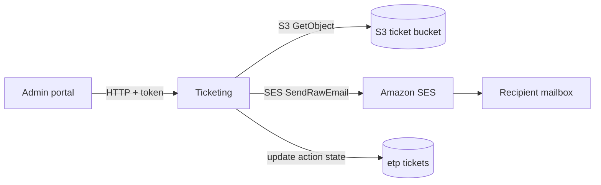

# X-21 · ইমেইল (SES)

> **Bangla name:** ইমেইল (SES)
>
> [← 60 · ক্রস-কাটিং](README.md) · [সূচিপত্র](../README.md) · [ওপেন কোয়ারি](../99-open-queries.md)

## 1. নাম ও উদ্দেশ্য

**Amazon SES দিয়ে ইমেইল।** প্ল্যাটফর্ম নিজের কোড থেকে ঠিক এক ধরনের ব্যবসায়িক ইমেইল পাঠায়: একজন অ্যাডমিন কোনো প্রাপককে **রিজার্ভ টিকিটের** একটি ZIP পাঠান। ব্যবহারকারীরা যে অন্যান্য ইমেইল দেখেন (ইমেইলে নিবন্ধন OTP, অ্যাকাউন্ট নোটিস) সেগুলো এই রিপোজিটরির বাইরে থেকে আসে ([X-06](X-06-user-registration.md), [X-22](X-22-sms-notification.md))।

## 2. ট্রিগার ও অ্যাক্টর

অ্যাডমিন পোর্টালের একজন ব্যবহারকারী (**admin** pool পলিসি) রিজার্ভ টিকিট বেছে নিয়ে *Send* চাপেন ([A-12](../10-admin-portal/A-12-reserved-tickets.md))।

## 3. ব্যবসায়িক প্রবাহ

অ্যাডমিন টিকিট নম্বরগুলো বেছে নেন, প্রাপক লেখেন, এবং চাইলে বিষয় ও বার্তা দেন। প্রাপক একটি ZIP ফাইলসহ ইমেইল পান; ভেতরের প্রতিটি PDF-এর নাম `{ticketNumber}.pdf`। প্রতিটি টিকিটের action state `emailed: {recipient}`-এ আপডেট হয়।

## 4. কারিগরি প্রবাহ

1. অ্যাডমিন পোর্টাল `event.service.ts` `sendReservedTickets(payload)` **[HTTP + user token]** → `POST /ticketing/api/v1/booking-order-ticket/send-reserved`।
2. `TicketManager.SendReservedTicketsAsync` মেমোরিতেই ZIP তৈরি করে (`GetZippedTicketStreamAsync`): প্রতিটি টিকিটের জন্য সে S3 থেকে সাইন করা PDF পড়ে, আর টিকিটে ব্যাক পেজ থাকলে ব্যাক-পেজ PDF যুক্ত করে ([X-20](X-20-file-storage.md))।
3. `EmailService.SendEmailWithZipAttachmentAsync` একটি raw MIME মেসেজ সাজায় (`CreateRawEmail`, boundary `NextPartBoundary`, HTML বডি ধাপে base64 ZIP অ্যাটাচমেন্ট) এবং SES-এর `SendRawEmail` কল করে।
4. `UpdateReservedTicketActionState` `emailed: {recipient}` লেখে; এখানে ব্যর্থতা শুধু একটি warning হিসেবে লগ হয়।

কলার বাদ দিলে ডিফল্ট মান: বিষয় `Get your tickets`, বডি `<p>Please find your reserved tickets attached as a ZIP file.`, ZIP-এর নাম `tickets.zip`। প্রেরক `AWS:Ticket:EmailSender`।

## 5. কম্পোনেন্ট

| ধরন | কম্পোনেন্ট |
|---|---|
| সার্ভিস | Ticketing (`IEmailService` Ticketing ও Admin-এ রেজিস্টার করা; শুধু Ticketing কল করে) |
| কোড | `Core/ETP.Core.Email/Services/EmailService.cs`, `Services/Ticketing/ETP.Ticketing.Domain/Managers/TicketManager.cs` |
| AWS | SES (`IAmazonSimpleEmailService`), S3 ticket bucket |
| কনফিগ | `AWS:Ticket:EmailSender`, `AWS:Region`, `AWS:AccessKey`, `AWS:SecretAccessKey` ([X-26](X-26-configuration.md)) |

## 6. API কন্ট্র্যাক্ট

| Method | Path | Auth | Request | Response | Errors |
|---|---|---|---|---|---|
| POST | `/ticketing/api/v1/booking-order-ticket/send-reserved` | `admin` পলিসি | `TicketRequest` | `200` খালি | SES বা S3 ব্যর্থ হলে 500 |

`TicketRequest` (ওয়্যারে camelCase): `ticketNumbers` (আবশ্যক, string অ্যারে), `fileName` (ঐচ্ছিক), `email` অবজেক্টের সঙ্গে `recipient`, `subject`, `body`।

```json
{
  "ticketNumbers": ["RSV-0001", "RSV-0002"],
  "fileName": "partner-batch-1",
  "email": { "recipient": "partner@example.com", "subject": "Your tickets", "body": "<p>Attached.</p>" }
}
```

(`ticketNumbers`-এর মানগুলো দৃষ্টান্তমূলক; প্রপার্টির নাম `TicketRequest.cs` থেকে।)

## 7. ডেটা ও পার্শ্বপ্রতিক্রিয়া

- প্রতি রিকোয়েস্টে একটি SES `SendRawEmail` কল; পুরো ZIP মেমোরিতে থাকে এবং একটি অ্যাটাচমেন্ট হিসেবে পাঠানো হয়, তাই খুব বড় নির্বাচন SES-এর মেসেজ-সাইজ সীমায় ঠেকাতে পারে `[UNCONFIRMED: Q-06]`।
- টিকিট রো: action state `emailed: {recipient}`।

## 8. কোড রেফারেন্স

| কী | কোথায় |
|---|---|
| এন্ডপয়েন্ট | `rvl-gobcb-backend/Services/Ticketing/ETP.Ticketing.Service/Api/BookingOrderTicketController.cs:330-339` |
| রিকোয়েস্ট মডেল | `rvl-gobcb-backend/Services/Ticketing/ETP.Ticketing.Service/Models/TicketRequest.cs` |
| পাঠানোর লজিক | `rvl-gobcb-backend/Services/Ticketing/ETP.Ticketing.Domain/Managers/TicketManager.cs:1608-1630` |
| SES র‍্যাপার | `rvl-gobcb-backend/Core/ETP.Core.Email/Services/EmailService.cs:367-402` |
| রেজিস্ট্রেশন | `rvl-gobcb-backend/Services/Ticketing/ETP.Ticketing.Service/Configurations/DependencyConfig.cs:124-125` |
| পোর্টালের কল | `rvl-gobcb-admin-portal/src/app/features/events/services/event.service.ts:175-178` |

## 9. হ্যান্ডওভার নোট

1. **গ্রাহকের টিকিটের জন্য কোনো ইমেইল নেই।** গ্রাহকরা অ্যাপ বা পোর্টালে টিকিট ডাউনলোড করেন ([P-09](../20-user-portal/P-09-ticket-details-downloads.md)); শুধু অ্যাডমিনরা রিজার্ভ টিকিট ইমেইল করেন।
2. `EmailService` মূলত AWS-এর স্যাম্পল র‍্যাপার (identity listing, verification, templates); ব্যবহার হয় শুধু `SendEmailWithZipAttachmentAsync`। `SendGridEmailSender` ক্লাস আছে কিন্তু কখনো রেজিস্টার করা হয় না ([অ্যাপেন্ডিক্স A](../90-appendix-a-legacy.md))।
3. প্রেরক ঠিকানাটি একটি **ভেরিফায় করা SES identity** হতে হবে, এবং যেকোনো প্রাপককে মেইল পাঠানোর জন্য SES অ্যাকাউন্টটি sandbox থেকে বের হয়ে আসতে হবে `[UNCONFIRMED: Q-06]` (কোড দিয়ে SES অ্যাকাউন্টের অবস্থা দেখা যায় না)।
4. ইমেইলের বিষয় ও বডি রিকোয়েস্ট থেকে অপরিবর্তিতে নেওয়া হয়: বডিটি escaping ছাড়াই HTML হিসেবে পাঠানো হয়, তাই এটি কেবল বিশ্বস্ত অ্যাডমিন থেকেই আসে।

## 10. কম্পোনেন্ট সম্পর্ক



**নির্ভর করে:** রিজার্ভ-টিকিট জেনারেশন ও সাইনিং ([A-12](../10-admin-portal/A-12-reserved-tickets.md), [S-08](../50-system-initiated/S-08-ticket-signing.md))। **প্রভাব ফেলে:** পরবর্তী কোনো কিছুতে নয়।

## 11. ডেভেলপার টেস্ট গাইড

**লোকালে পরীক্ষাযোগ্যতা: আংশিক।** Floci SES দেয় এবং `scripts/Seed-EtpFloci.ps1` `noreply@etp.local` ভেরিফাই করে, যা `scripts/user-secrets.example.json`-এর `AWS:Ticket:EmailSender`-এর সঙ্গে মেলে। কোনো আসল মেইল পৌঁছায় না।

| বিষয় | বিবরণ |
|---|---|
| টেস্ট ডেটা ও অ্যাকাউন্ট | অ্যাডমিন লগইন ([X-01](X-01-admin-login.md)); আগে রিজার্ভ টিকিট তৈরি ও সাইন করতে হবে ([A-12](../10-admin-portal/A-12-reserved-tickets.md)) |
| ব্রাউজার | অ্যাডমিন পোর্টাল `http://localhost:4200` → event → reserved tickets → send; Network-এ `POST .../booking-order-ticket/send-reserved` দেখা যাবে |
| এমুলেটর | — |
| Postman | `postman/services/etp-ticketing.postman_collection.json`, `POST /api/v1/booking-order-ticket/send-reserved`-এর রিকোয়েস্ট অ্যাডমিন টোকেনসহ (`{{access_token_admin}}`) |
| Visual Studio ডিবাগ | `TicketManager.SendReservedTicketsAsync` ও `EmailService.SendEmailWithZipAttachmentAsync`-এ ব্রেকপয়েন্ট |
| যাচাই | Ticketing-এর Aspire লগ; Ticketing ডেটাবেসে টিকিট রোর action state `emailed: ...`; Floci SES-এর sent-message তালিকা (`docs/local-dev.md` -এ তা কীভাবে পড়তে হয় তা বর্ণিত নেই `[UNCONFIRMED: Q-06]`) |
