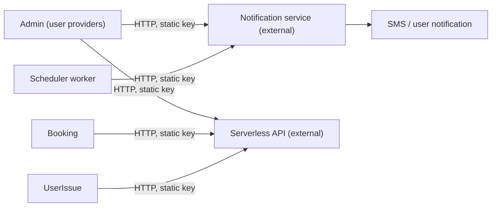

# X-22 · SMS ও বাহ্যিক নোটিফিকেশন সার্ভিস

> **Bangla name:** SMS ও বাহ্যিক নোটিফিকেশন সার্ভিস
>
> [← 60 · ক্রস-কাটিং](README.md) · [সূচিপত্র](../README.md) · [ওপেন কোয়ারি](../99-open-queries.md)

## 1. নাম ও উদ্দেশ্য

**SMS ও বাহ্যিক নোটিফিকেশন সার্ভিস।** ব্যাকএন্ড নিজে SMS পাঠায় না। এটি `INotificationClient` দিয়ে একটি **বাহ্যিক নোটিফিকেশন সার্ভিসে** (`Notification:Endpoint`, এই রিপোজিটরির অংশ নয় `[UNCONFIRMED: Q-05]`) JSON পোস্ট করে। সেই সার্ভিসই SMS এবং "টিকিট তৈরি" ও "সমস্যা সমাধান" ব্যবহারকারী-নোটিফিকেশন পাঠায়। আরেকটি বাহ্যিক API, **Serverless API**, ব্যবহার করা হয় আইডি দিয়ে ব্যবহারকারীর নাম ও ফোন খুঁজতে। একে পুশ নোটিফিকেশনের সঙ্গে গুলিয়ে ফেলবেন না ([X-23](X-23-push-firebase.md)), যা প্ল্যাটফর্ম নিজেই Firebase-এর মাধ্যমে পাঠায়।

## 2. ট্রিগার ও অ্যাক্টর

| মেসেজ | কী ট্রিগার করে | অ্যাক্টর |
|---|---|---|
| ব্যবহারকারীর নাম ও পাসওয়ার্ডসহ "account created" SMS | অ্যাডমিন একটি admin, agent বা checker ব্যবহারকারী তৈরি করেন ([X-05](X-05-admin-provisioning.md)) | অ্যাডমিন ব্যবহারকারী |
| নতুন পাসওয়ার্ডসহ "password changed" SMS | অ্যাডমিন কোনো ব্যবহারকারীর পাসওয়ার্ড রিসেট করেন ([X-02](X-02-admin-forgot-password.md), [X-05](X-05-admin-provisioning.md)) | অ্যাডমিন ব্যবহারকারী বা ব্যবহারকারী নিজে |
| `ticket_generated` নোটিফিকেশন | টিকিট তৈরি হওয়ার পর Scheduler-এর ওয়ার্কার ([S-12](../50-system-initiated/S-12-ticket-generated-notification.md)) | সিস্টেম |
| `issue_resolved` নোটিফিকেশন | অ্যাডমিন কোনো সমস্যাকে Resolved চিহ্নিত করেন, **শুধু user issues-এর লেগ্যাসি Admin কপিতে** | অ্যাডমিন ব্যবহারকারী |

## 3. ব্যবসায়িক প্রবাহ

অ্যাকাউন্ট তৈরি বা রিসেট হলে কর্মীরা SMS-এ তাদের ক্রেডেনশিয়াল পান। গ্রাহকদের জানানো হয় তাদের টিকিট প্রস্তুত। সাপোর্টের কোনো সমস্যা সমাধান হলে গ্রাহকদের জানানোর কথা ছিল, কিন্তু §9-এর নোটটি দেখুন।

## 4. কারিগরি প্রবাহ

`NotificationClient` (`Core/ETP.Core/ServiceClient/NotificationClient/NotificationClient.cs`) পাঠায় **[HTTP, static key]**:

| Method | `Notification:Endpoint`-এর Path | বডির ধরন | কী কাজে |
|---|---|---|---|
| `SendSMSAsync` | `POST /notification/send-message` | `SMSNotification` | ক্রেডেনশিয়াল SMS |
| `SendTicketGeneratedNotification` | `POST /notification/request` | `TicketGeneratedNotification` | টিকিট প্রস্তুত |
| `SendIssueResolvedNotification` | `POST /notification/request` | `IssueResolvedNotification` | সমস্যা সমাধান |

ক্লায়েন্ট প্রতিটি কলে `Authorization`-কে `Notification:Authorization`-এর মানে সেট করে এবং সাময়িক HTTP এরর ৩বার exponential back-off সহ রিট্রাই করে (Admin-এর রেজিস্ট্রেশন; Booking ও Scheduler একই ক্লায়েন্ট রেজিস্টার করে)। সফল না হওয়া স্ট্যাটাস `ArgumentException` ছুঁড়ে, ফলে কলকারী অপারেশনটি ব্যর্থ হয়।

Admin, Booking ও Scheduler-এ রেজিস্টার করা। কলাররা: `AdminUserProvider`, `AgentUserProvider`, `TicketCheckerUserProvider` (তিনটিই Admin), `UserIssueManager` (Admin), এবং `SendNotificationAfterGeneratedTicketServiceTaskManager` (Scheduler)। Booking-এ `UserBookingOrderManager` ও `InitiateUserTicketGenerationTaskManager`-এর মধ্যে `notificationClient.SendSMSAsync` কলগুলো **কমেন্ট করা**।

**Serverless API** (`IServerlessClient`, `Serverless:BaseUrl`, `Serverless:Authorization`): `GET user/get-bulk-users?user_ids=...` ব্যবহারকারী রেকর্ড (`CognitoUser`) ফেরত দেয়। ব্যবহার করে Admin (user issues, raffle draw), Booking (orders list ও detail, ticket-generation ও VAT ওয়ার্কার) এবং UserIssue (report issue)। একই API-তে অ্যাডমিন পোর্টালের OTP কলগুলো [X-01](X-01-admin-login.md)-এ আছে।

## 5. কম্পোনেন্ট

| ধরন | কম্পোনেন্ট |
|---|---|
| সার্ভিস | Admin, Booking, Scheduler, UserIssue (শুধু Serverless) |
| বাইরের | Notification service `[UNCONFIRMED: Q-05]`, Serverless API `[UNCONFIRMED: Q-03]` |
| কোড | `Core/ETP.Core/ServiceClient/NotificationClient/*`, `Core/ETP.Core/ServiceClient/ServerlessClient/*`, `Core/ETP.Core/Models/Notification.cs` |
| কনফিগ | `Notification:Endpoint`, `Notification:Authorization`, `Serverless:BaseUrl`, `Serverless:Authorization` ([X-26](X-26-configuration.md)) |

## 6. API কন্ট্র্যাক্ট

এগুলো এমন কল যা ব্যাকএন্ড **করে**; এদের জন্য ব্যাকএন্ড কোনো এন্ডপয়েন্ট প্রকাশ করে না।

| Method | Path | Auth | Request | Response |
|---|---|---|---|---|
| POST | `{Notification:Endpoint}/notification/send-message` | static `Authorization` | `SMSNotification` | শুধু স্ট্যাটাস |
| POST | `{Notification:Endpoint}/notification/request` | static `Authorization` | `TicketGeneratedNotification` বা `IssueResolvedNotification` | শুধু স্ট্যাটাস |
| GET | `{Serverless:BaseUrl}/user/get-bulk-users?user_ids=` | static `Authorization` | — | `CognitoUser`-এর তালিকা |

প্রপার্টির নাম `[JsonPropertyName]` দিয়ে নির্দিষ্ট (snake_case) — প্ল্যাটফর্মের নিজস্ব API-র camelCase নয়।

```json
{ "message_destination": "+8801700000000", "message_type": "sms", "the_message": "Your account has been created successfully. Your user name is ... and password is ..." }
```

```json
{
  "notification_type": "ticket_generated",
  "user_id": "<cognito sub>",
  "notification_data": {
    "order_id": "<order number>", "ticket_id": "T1,T2", "program_event": "<event name>",
    "event_venue": "<venue>", "seating_gallery": "<gallery>", "seating_block": "<block>",
    "seating_level": "<level>", "entry_gate": "<gate>", "mini_gate": "<mini gate>"
  }
}
```

মানগুলো placeholder; প্রপার্টির নাম `Notification.cs` ও `SMSNotification.cs` থেকে। `ticket_id` হলো কমা দিয়ে যুক্ত টিকিট নম্বর। `issue_resolved` বডিতে `notification_data`-তে `order_id` ও `issue_id` থাকে।

## 7. ডেটা ও পার্শ্বপ্রতিক্রিয়া

- নিজস্ব কোনো ডেটাবেস লেখা নেই।
- অ্যাকাউন্ট তৈরি ও রিসেটের সময় SMS-এর লেখায় **প্লেইন-টেক্সট পাসওয়ার্ড** থাকে (§9 দেখুন)।
- স্বাভাবিক রিকোয়েস্ট লগিং ছাড়া ব্যাকএন্ড মেসেজগুলো লগ বা সংরক্ষণ করে না, এবং অ্যাক্টিভিটি লগ সেগুলো কভার করে না ([X-24](X-24-activity-logging.md))।

## 8. কোড রেফারেন্স

| কী | কোথায় |
|---|---|
| ক্লায়েন্ট | `rvl-gobcb-backend/Core/ETP.Core/ServiceClient/NotificationClient/NotificationClient.cs` |
| মডেল | `rvl-gobcb-backend/Core/ETP.Core/Models/Notification.cs`, `.../NotificationClient/Models/SMSNotification.cs` |
| ক্রেডেনশিয়াল SMS | `rvl-gobcb-backend/Services/Admin/ETP.Admin.Integration/Services/AdminUserProvider.cs:79-86, 235-243, 570-579`; `AgentUserProvider.cs:74, 197`; `TicketCheckerUserProvider.cs:70, 193` |
| টিকিট-প্রস্তুত নোটিফিকেশন | `rvl-gobcb-backend/Services/Scheduler/ETP.Scheduler.Service/Workers/TaskManagers/SendNotificationAfterGeneratedTicketServiceTaskManager.cs:76-97` |
| সমস্যা সমাধান | `rvl-gobcb-backend/Services/Admin/ETP.Admin.Domain/Managers/UserIssueManager.cs:199-217` |
| রেজিস্ট্রেশন | `Services/Admin/ETP.Admin.Service/Configurations/DependencyConfig.cs:131-137`; `Services/Booking/ETP.Booking.Service/Configuration/DependencyConfig.cs:163`; `Services/Scheduler/ETP.Scheduler.Service/Configurations/DependencyConfig.cs:107` |

## 9. হ্যান্ডওভার নোট

1. **পাসওয়ার্ড SMS-এ প্লেটেক্সটে যায়** (`... password is {password}`), আর নোটিফিকেশন সার্ভিসটি বাইরের ও নিশ্চিত নয়। কর্মী অ্যাকাউন্টের ক্রেডেনশিয়াল পৌঁছানোর ডিজাইন এটিই; ঝুঁকি-সংক্রান্ত নোট দেখুন [X-05](X-05-admin-provisioning.md) ও [X-02](X-02-admin-forgot-password.md)-এ।
2. **"Issue resolved" শুধু লেগ্যাসি Admin কপি থেকে পাঠানো হয়।** চালু সাপোর্ট ফিচারটি হলো UserIssue সার্ভিস (`/userissue/...`, [A-24](../10-admin-portal/A-24-user-issues-admin.md)); তার ম্যানেজার `INotificationClient` কল করে না। তাই বর্তমান ক্লায়েন্টগুলোর সঙ্গে অ্যাডমিন পোর্টালে কোনো সমস্যা সমাধান করলে **কোনো** নোটিফিকেশন যায় না `[UNCONFIRMED: Q-05]`। দেখুন [অ্যাপেন্ডিক্স A](../90-appendix-a-legacy.md)।
3. গ্রাহকদের কাছে SMS (অর্ডার বা টিকিট SMS) লেখা হয়েছিল, কিন্তু Booking-এ কমেন্ট করা; গ্রাহকরা শুধু `ticket_generated` নোটিফিকেশন পান।
4. লোকাল রানে দুটি এন্ডপয়েন্টই `https://*.invalid/`-এ সেট করা, তাই প্রতিটি SMS বা নোটিফিকেশন কল কানেকশন এরর দিয়ে ব্যর্থ হয়। অ্যাডমিন ব্যবহারকারী তৈরির ক্ষেত্রে এর মানে **Cognito ব্যবহারকারী তৈরি হয়, কিন্তু এরপর রিকোয়েস্টটি ব্যর্থ হয়** (SMS পাঠানো হয় `AdminCreateUser`/`AdminSetUserPassword`-এর পরে), ফলে এমন একটি অ্যাকাউন্ট থেকে যায় যার পাসওয়ার্ড অ্যাডমিনের কাছে নেই।
5. Scheduler ওয়ার্কারটি প্রতিটি বুকিংয়ের জন্য ব্যর্থ send ধরে ও লগ করে, তাই একই রানের ভেতরে রিট্রাই হয় না; পরে রিট্রাই হবে কি না তা নির্ভর করে ওয়ার্কারের নিজস্ব বুকিং ফিল্টারের ওপর ([S-12](../50-system-initiated/S-12-ticket-generated-notification.md))।

## 10. কম্পোনেন্ট সম্পর্ক



**নির্ভর করে:** অ্যাকাউন্ট প্রোভিশনিং ([X-05](X-05-admin-provisioning.md)), টিকিট জেনারেশন ([S-07](../50-system-initiated/S-07-initiate-user-ticket-generation.md), [S-08](../50-system-initiated/S-08-ticket-signing.md))। **প্রভাব ফেলে:** কর্মী অনবোর্ডিং, গ্রাহকের টিকিট-প্রস্তুত বার্তা।

## 11. ডেভেলপার টেস্ট গাইড

**লোকালে পরীক্ষাযোগ্যতা: লোকালে নয়।** নোটিফিকেশন ও Serverless এন্ডপয়েন্ট হলো `https://notification.invalid/` ও `https://serverless.invalid/` (`scripts/user-secrets.example.json`); কোনো stub তাদের প্রতিস্থাপন করে না (`docs/local-dev.md`-এ এগুলো ডামি হিসেবে তালিকাভুক্ত)।

| বিষয় | বিবরণ |
|---|---|
| টেস্ট ডেটা ও অ্যাকাউন্ট | অ্যাডমিন লগইন ([X-01](X-01-admin-login.md)) |
| ব্রাউজার | অ্যাডমিন পোর্টাল → Users → ব্যবহারকারী যোগ করুন: Cognito ব্যবহারকারী তৈরি হওয়ার পর রিকোয়েস্টটি ব্যর্থ হয় (§9 নোট 4) |
| এমুলেটর | — |
| Postman | `postman/services/etp-admin.postman_collection.json`-এর create-user রিকোয়েস্ট; লোকালে SMS ধাপে 500 আশা করুন |
| Visual Studio ডিবাগ | `NotificationClient.SendSMSAsync`-এ ব্রেকপয়েন্ট; payload পরীক্ষা করতে user-secrets-এর মাধ্যমে সাময়িকভাবে `Notification:Endpoint`-কে একটি লোকাল লিসেনারের দিকে ইঙ্গুত করুন (সাবমডিউলের বাইরে) |
| যাচাই | Aspire লগ (Admin) ব্যর্থ POST দেখায়; payload-এর আকার নিশ্চিত করতে উপরের মতো একটি লোকাল HTTP লিসেনার ব্যবহার করুন |
