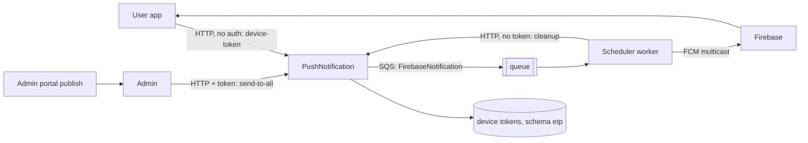

# X-23 · পুশ নোটিফিকেশন (PushNotification সার্ভিস, Firebase)

> **Bangla name:** পুশ নোটিফিকেশন (PushNotification সার্ভিস, Firebase)
>
> [← 60 · ক্রস-কাটিং](README.md) · [সূচিপত্র](../README.md) · [ওপেন কোয়ারি](../99-open-queries.md)

## 1. নাম ও উদ্দেশ্য

**মোবাইল অ্যাপে পুশ নোটিফিকেশন।** **PushNotification সার্ভিস** প্রতিটি ব্যবহারকারীর ডিভাইস টোকেন (FCM টোকেন) সংরক্ষণ করে এবং একটি "send" রিকোয়েস্টকে `FirebaseNotification` কিউ-তে সর্বোচ্চ ২০০ টোকেনের ব্যাচে রূপান্তর করে। **Scheduler** সার্ভিসের একটি ওয়ার্কার কিউটি পড়ে এবং ব্যাচগুলো Firebase Cloud Messaging-এর মাধ্যমে পাঠায়। বর্তমান কোডে পুশ পাঠানোর একমাত্র কলার হলো অ্যাডমিনের event publish। ধারণাগুলো: [কিউ-চালিত প্রসেসিং](../00-platform-primer.md#explainer-queue-driven), [ব্যাকগ্রাউন্ড ওয়ার্কার](../00-platform-primer.md#explainer-background-workers)।

## 2. ট্রিগার ও অ্যাক্টর

- **টোকেন রেজিস্টার/বদলানো/মুছে ফেলা:** ইউজার অ্যাপ, স্টার্ট-আপে ও টোকেন রিফ্রেশে ([U-09](../30-user-app/U-09-device-token.md))।
- **সবার কাছে পাঠানো:** কোনো অ্যাডমিন ইভেন্ট প্রকাশ করলে Admin সার্ভিস ([A-07](../10-admin-portal/A-07-events.md))।
- **পুরোনো টোকেন পরিষ্কার করা:** Scheduler ওয়ার্কার ([S-13](../50-system-initiated/S-13-device-token-cleanup.md))।
- **পৌঁছানো:** Scheduler `FirebaseNotificationService` ([S-11](../50-system-initiated/S-11-firebase-notification.md))।

## 3. ব্যবসায়িক প্রবাহ

কোনো ইভেন্ট প্রকাশিত হলে যে ব্যবহারকারীদের অ্যাপ ইনস্টল করা আছে, তারা সবাই ইভেন্টের নামসহ "New Event Available!" দেখেন। যারা ইনস্টল করার পর কখনো অ্যাপ খোলেননি, বা যারা নোটিফিকেশনের অনুমতি প্রত্যাহার করেছেন, তাদের কোনো টোকেন থাকে না এবং তারা কিছু পান না।

## 4. কারিগরি প্রবাহ

**টোকেন রেজিস্ট্রেশন** (ইউজার অ্যাপ → `TicketBanglaApiClient`): `{userId, fcmToken, osType}` দিয়ে `POST/PUT/DELETE pushnotification/api/v1/device-token` (PUT: `{userId, oldToken, newToken, osType}`)। `osType` অবশ্যই `android`, `ios` বা `web` হতে হবে (case-insensitive), নয়তো 400।

**ইভেন্ট publish → push**

1. Admin `EventManager` (publish path, `EventManager.cs:~722`) তৈরি করে `PushNotificationRequest { Title = "New Event Available!", Body = "'<name>' is now available for booking. Get your tickets now!", Data = { eventId, eventName, type = "event_published" } }`।
2. `IPushNotificationClient.SendNotificationToAllAsync` → `POST pushnotification/api/v1/push-notification/send-to-all` **[HTTP + user token]** (Admin অ্যাডমিন টোকেনটি ফরোয়ার্ড করে; PushNotification তা উপেক্ষা করে, §9 দেখুন)।
3. `NotificationManager.SendNotificationToAllUsersAsync` ২০০-এর পেজে করে সক্রিয় টোকেন পড়ে এবং প্রতি পেজে একটি `FirebaseNotificationRequest` publish করে **[SQS: FirebaseNotification]**, যেখানে `GroupId = requestId` ও `OrderId = "{requestId}-batch-{n}"`। HTTP উত্তর `202 Accepted` এবং সঙ্গে `requestId`।
4. Scheduler `FirebaseNotificationService` **[Worker]** স্টার্ট হওয়ার ১ মিনিট পরে অপেক্ষা করে, তারপর লুপ চালায়; `FirebaseNotificationTaskManager` কিউ দীর্ঘ-পোল করে (৫টি মেসেজ, ১০ সে অপেক্ষা, visibility ৬০ সে), `FirebasePushNotificationService.SendNotificationToMultipleAsync` (`SendEachForMulticastAsync`) কল করে এবং **সর্বদাই মেসেজটি মুছে ফেলে**, পাঠানো সফল হয়েছে কি না তা সত্ত্বেও।
5. `send-to-all` কল ব্যর্থ হলে `EventManager` এররটি লগ করে এবং publish তবু সফল হয়।

একই সার্ভিসে `send-to-users` (ব্যবহারকারীর আইডির তালিকা) ও `send-to-user/{userId}`-ও আছে; পাঁচটি রিপোজিটরিতে কোথাও সেগুলো কল করা হয় না (§9 নোট 5)।

## 5. কম্পোনেন্ট

| ধরন | কম্পোনেন্ট |
|---|---|
| সার্ভিস | PushNotification (API, DB), Admin (কলার), Scheduler (ওয়ার্কার) |
| কিউ | `FirebaseNotification` ([X-19](X-19-service-to-service.md)) |
| টেবিল | `UserDeviceTokens`, PushNotification-এর DbContext-এ `IUserDeviceTokenRepository`-এর মাধ্যমে (স্কিমা `etp`) |
| বাইরের | Firebase Cloud Messaging |
| কনফিগ | `FirebasePushNotificationConfig:*` (service-account JSON ফিল্ড), `AWS:Queue:FirebaseNotification`, `Services:PushNotification` ([X-26](X-26-configuration.md)) |
| কোড | `Services/PushNotification/*`, `Core/ETP.Core/PushNotification/FirebasePushNotificationService.cs`, `Core/ETP.Core/ServiceClient/PushNotificationClient/*` |

## 6. API কন্ট্র্যাক্ট

Base path `/pushnotification/api/v1/`। **এই এন্ডপয়েন্টগুলোর কোনোটিতেই অনুমোদন নেই** (§9)।

| Method | Path | Request | Response | Errors |
|---|---|---|---|---|
| POST | `device-token` | `DeviceTokenRequest {userId, fcmToken, osType}` | `200 {message, tokenId}` | 400 অবৈধ `osType` |
| PUT | `device-token` | `UpdateDeviceTokenRequest {userId, oldToken, newToken, osType}` | `200 {message}` | 400, 404 টোকেন পাওয়া যায়নি |
| DELETE | `device-token` | body `{userId, fcmToken}` | `200 {message}` | 404 |
| GET | `device-token/{userId}` | — | টোকেন রোয়ের তালিকা | — |
| DELETE | `device-token/cleanup?retentionDays=30` | — | `200 {message, deletedCount, cutoffDate, retentionDays}` | `retentionDays <= 0` হলে 400, 500 |
| POST | `push-notification/send-to-all` | `PushNotificationRequest {title, body, data}` | `202 {message, requestId}` | 500 |
| POST | `push-notification/send-to-users` | `userIds`-সহ `PushNotificationRequest` | `202 {message, requestId}` | 400 `userIds` নেই, 500 |
| POST | `push-notification/send-to-user/{userId}` | `PushNotificationRequest` | `202 {message, requestId}` | 500 |
| GET | `push-notification/bulk-status/{requestId}` | — | ধ্রুব `{requestId, status:"processing", message}` | — |

প্রধান নমুনা (Admin সার্ভিস publish-এর সময় যা পাঠায়; মান দৃষ্টান্তমূলক, প্রপার্টির নাম `PushNotificationRequest.cs` থেকে):

```json
{
  "title": "New Event Available!",
  "body": "'<event name>' is now available for booking. Get your tickets now!",
  "data": { "eventId": "<event id>", "eventName": "<event name>", "type": "event_published" }
}
```

কিউ মেসেজ (`FirebaseNotificationRequest`): `title`, `body`, `data`, `deviceTokens` (≤ 200), `createdAt`, `groupId`, `orderId`।

## 7. ডেটা ও পার্শ্বপ্রতিক্রিয়া

- ডিভাইস টোকেনের টেবিল (যোগ/আপডেট/মুছে ফেলা/পরিষ্কার); পাঠানো নোটিফিকেশনের কোনো রেকর্ড নেই, এবং `bulk-status` সবসময় "processing" জবাব দেয়।
- `FirebaseNotification`-এ SQS মেসেজ; FCM ডেলিভারি।

## 8. কোড রেফারেন্স

| কী | কোথায় |
|---|---|
| কন্ট্রোলার | `rvl-gobcb-backend/Services/PushNotification/ETP.PushNotification.Service/Api/DeviceTokenController.cs`, `.../NotificationController.cs` |
| ব্যাচিং ও publish | `rvl-gobcb-backend/Services/PushNotification/ETP.PushNotification.Domain/Managers/NotificationManager.cs` |
| Auth কমেন্ট করা | `rvl-gobcb-backend/Services/PushNotification/ETP.PushNotification.Service/Program.cs:75-76` |
| publish ট্রিগার | `rvl-gobcb-backend/Services/Admin/ETP.Admin.Domain/Managers/EventManager.cs:722-745` |
| ক্লায়েন্ট | `rvl-gobcb-backend/Core/ETP.Core/ServiceClient/PushNotificationClient/PushNotificationClient.cs:23, 42, 61` |
| ওয়ার্কার | `rvl-gobcb-backend/Services/Scheduler/ETP.Scheduler.Service/Workers/BackgroundServices/FirebaseNotificationService.cs`, `.../TaskManagers/FirebaseNotificationTaskManager.cs` |
| FCM sender | `rvl-gobcb-backend/Core/ETP.Core/PushNotification/FirebasePushNotificationService.cs` |
| অ্যাপের টোকেন কল | `rvl-gobcb-user-app/data/lib/remote/api_service/firebase_api_service/firebase_api_service_impl.dart:21, 38, 48` |

## 9. হ্যান্ডওভার নোট

1. **গোটা সার্ভিসেই কোনো প্রমাণীকরণ নেই।** `Program.cs`-এ `UseAuthentication()` ও `UseAuthorization()` কমেন্ট করা, আর কন্ট্রোলারগুলোতে কোনো `[Authorize]` নেই। `/pushnotification/...` পৌঁছাতে পারে এমন যে কেউ টোকেন যোগ বা মুছতে পারে, যেকোনো `userId`-এর টোকেন পড়তে পারে (`GET device-token/{userId}`), `send-to-all` ট্রিগার করতে পারে এবং `cleanup` চালাতে পারে। আর্কিটেকচার ডকুমেন্টেও একই তথ্য আছে (§9 আইটেম 3 ও 6); ingress এটি প্রকাশ করে কি না তা খোলা `[UNCONFIRMED: Q-04]`।
2. **টোকেন রেজিস্ট্রেশনে ব্যবহারকারীর আইডি body থেকে নেওয়া হয়**, টোকেন থেকে নয়, তাই একটি ক্লায়েন্ট অন্য ব্যবহারকারীর আইডির অধীনে টোকেন রেজিস্টার করতে পারে।
3. **ডেলিভারি fire-and-forget।** Firebase ব্যর্থ হলে বা আংশিক ব্যর্থতা ফেরত দিলেও ওয়ার্কার প্রতিটি মেসেজ মুছে ফেলে (`SendEachForMulticastAsync` অন্তত একটি টোকেন সফল হলেই সফল হিসেবে গোনা হয়)। অবৈধ টোকেন ব্যর্থতার পরে সরানো হয় না; সেগুলো শুধু বয়সভিত্তিক পরিষ্কার করায় সরে যায় ([S-13](../50-system-initiated/S-13-device-token-cleanup.md))।
4. **এখানে কোনো distributed lock দরকার নেই**: সমন্বয়ের বিন্দু হলো কিউটিই (লক-ভিত্তিক ওয়ার্কারের তুলনা দেখুন, [explainer](../00-platform-primer.md#explainer-distributed-locks))।
5. `send-to-users`, `send-to-user` এবং Admin ক্লায়েন্টের সমতুর্য মেথড আছে, কিন্তু এই পর্যালোচনায় পাঁচটি রিপোজিটরিতে তাদের কোনো কলার পাওয়া যায়নি; চালু একমাত্র sender হলো event publish `[UNCONFIRMED: Q-08]`। অর্ডার ও টিকিটের পুশ পাঠানো হয় না (গ্রাহকরা বাহ্যিক সার্ভিসের মাধ্যমে `ticket_generated` মেসেজ পান, [X-22](X-22-sms-notification.md))।
6. `FirebaseBulkNotificationRequest` ও `FirebaseOptions.ServerKey` অব্যবহৃত ([অ্যাপেন্ডিক্স A](../90-appendix-a-legacy.md))।
7. Scheduler-এর দৈনিক টোকেন ক্লিনআপ মনে হচ্ছে `device-token/cleanup`-এ পৌঁছায় না; এটি `pushnotification/` প্রিফিক্স ছাড়াই `Services:Admin`-কে কল করে ([S-13](../50-system-initiated/S-13-device-token-cleanup.md), `[UNCONFIRMED: Q-16]`)`। তা নিশ্চিত না হওয়া পর্যন্ত ধরে নিন যে পুরোনো টোকেন সরানো হয় না।
8. লোকালে Firebase ডামি: Scheduler Firebase সতর্কবার্তা লগ করে এবং অ্যাপ কোনো আসল টোকেন রেজিস্টার করে না (`docs/local-dev.md`, `docs/mobile-local.md` §8 "Known gaps")।

## 10. কম্পোনেন্ট সম্পর্ক



**নির্ভর করে:** event publish ([A-07](../10-admin-portal/A-07-events.md)), অ্যাপের টোকেন রেজিস্ট্রেশন ([U-09](../30-user-app/U-09-device-token.md))। **প্রভাব ফেলে:** অ্যাপে পুশ পৌঁছানো ([U-10](../30-user-app/U-10-push-receipt.md))।

## 11. ডেভেলপার টেস্ট গাইড

**লোকালে পরীক্ষাযোগ্যতা: আংশিক।** টোকেন রেজিস্ট্রেশন, `send-to-all` ও কিউ-পথ লোকালে কাজ করে (PushNotification পোর্ট 5105, Floci SQS)। ডেলিভারি কাজ করে না: Firebase ডামি, তাই কোনো পুশ পৌঁছায় না।

| বিষয় | বিবরণ |
|---|---|
| টেস্ট ডেটা ও অ্যাকাউন্ট | এই এন্ডপয়েন্টগুলোর জন্য লগইন লাগে না; বাস্তবসম্মত `userId`-এর জন্য seeded ব্যবহারকারীর ফোন …11 ([X-07](X-07-user-password-login.md)) |
| ব্রাউজার | `device-token` ও `send-to-all` কল করতে `http://localhost:5105/pushnotification/swagger` (`docs/local-dev.md` §4) |
| এমুলেটর | ইউজার অ্যাপ: লোকালে সাইন-ইন সম্ভব নয় (পরিচিত ঘাটতি), তাই টোকেন কলে পৌঁছানো যায় না `[see docs/mobile-local.md]` |
| Postman | `postman/services/etp-pushnotification.postman_collection.json`-এর রিকোয়েস্ট, যেমন `POST /api/v1/device-token` ও `POST /api/v1/push-notification/send-to-all` (`/pushnotification` প্রিফিক্সসহ `base_url` সেট করুন, অ্যাপেন্ডিক্স D দেখুন) |
| Visual Studio ডিবাগ | `NotificationManager.SendNotificationToAllUsersAsync` ও `FirebaseNotificationTaskManager.ExecuteAsync`-এ ব্রেকপয়েন্ট (ওয়ার্কার ১ মিনিটের বিলম্বের পরে শুরু হয়) |
| যাচাই | `aws --endpoint-url http://localhost:4566 sqs get-queue-attributes --queue-url <FirebaseNotification url> --attribute-names ApproximateNumberOfMessages`; SQL: PushNotification ডেটাবেসের device-token টেবিল থেকে select; Scheduler-এর Aspire লগে "Processing Firebase notification" দেখা যায় |
