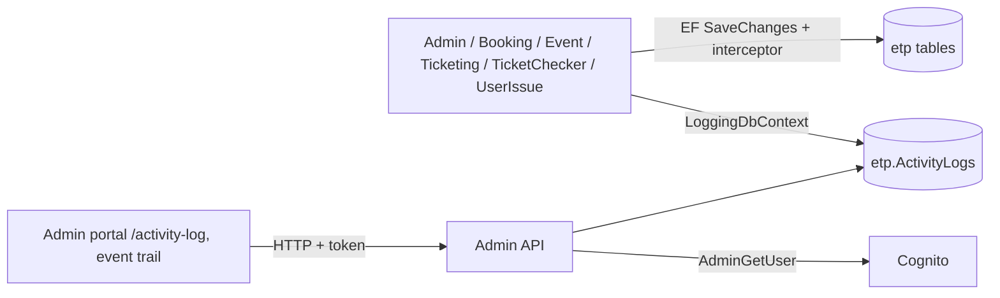

# X-24 · অ্যাক্টিভিটি লগিং (অডিট ট্রেইল)

> **Bangla name:** অ্যাক্টিভিটি লগিং (অডিট ট্রেইল)
>
> [← 60 · ক্রস-কাটিং](README.md) · [সূচিপত্র](../README.md) · [ওপেন কোয়ারি](../99-open-queries.md)

## 1. নাম ও উদ্দেশ্য

**অ্যাক্টিভিটি লগিং।** ছয়টি সার্ভিসের মাধ্যমে ডেটাবেস রো-এ করা প্রতিটি পরিবর্তন স্বয়ংক্রিয়ভাবে একটি টেবিলে, `etp."ActivityLogs"`, রেকর্ড হয়: কে কোন entity কোন মান থেকে কোন মানে বদলেছে এবং কোন IP ঠিকানা থেকে। অ্যাডমিনরা অ্যাডমিন পোর্টালে এই ট্রেইল পড়েন ([A-27](../10-admin-portal/A-27-activity-log.md))। মেকানিজমটি একটি EF Core **SaveChanges interceptor**, তাই ফিচারের কোড একে সরাসরি কল করে না।

## 2. ট্রিগার ও অ্যাক্টর

Admin, Booking, Event, Ticketing, TicketChecker বা UserIssue-এর যেকোনো `SaveChanges`। "অ্যাক্টর" হলো বর্তমান রিকোয়েস্টের `username` claim, আর রিকোয়েস্ট না থাকলে (ওয়ার্কার, কিউ কনজিউমার) লেখা `System`।

## 3. ব্যবসায়িক প্রবাহ

ভেন্যু, ইভেন্ট, মূল্য, প্রোমো কোড, ব্যবহারকারী, টিকিট ইত্যাদিতে পরিবর্তন একটি অডিট এন্ট্রি রেখে যায়। Admin বা EventManager রোলের ব্যবহারকারী লগটি সার্ভিস, entity নাম ও entity আইডি দিয়ে খুঁজতে পারেন, বা প্রতি ইভেন্টের ট্রেইল খুলতে পারেন।

## 4. কারিগরি প্রবাহ

1. ছয়টি `DbContext` ক্লাসের প্রত্যেকেই `OnConfiguring`-এ `ActivityLogInterceptor(userId, ipAddress, serviceName, loggingDbContext)` যোগ করে। `userId` হলো `username` claim (না থাকলে `System`); IP হলো `X-Forwarded-For`-এর প্রথম এন্ট্রি (না থাকলে কানেকশনের ঠিকানা, সেটাও না থাকলে `Unknown`)। সার্ভিসের নাম একটি লিটারাল (`Admin`, `Booking`, ...)।
2. **সেভের আগে** (`SavingChangesAsync`): স্ট্যাটাস **Modified** বা **Deleted** এন্ট্রিগুলো লগ হয়। Modified-এর ক্ষেত্রে কেবল যেসব প্রপার্টির মান বদলেছে সেগুলো JSON হিসেবে `OldValues` ও `NewValues`-এ জমা হয়; Deleted-এর ক্ষেত্রে সব original মান `OldValues`-এ যায়। `CreatedAt`, `UpdatedAt`, `CreatedBy`, `UpdatedBy` বাদ দেওয়া হয়। যেসব রো-এর পুরোনো ও নতুন দুটো JSON-ই `{}`, সেগুলো এড়িয়ে যাওয়া হয়।
3. **সেভের পরে** (`SavedChangesAsync`): **Added** এন্ট্রিগুলো সব current মানসহ `NewValues`-এ লগ হয় (key insert-এর পরেই জানা যায়)।
4. রোগুলো আলাদা `LoggingDbContext` (`etp."ActivityLogs"`) দিয়ে তার নিজস্ব `SaveChanges`-এ লেখা হয়।
5. `EntityContext` (JSON টেক্সট) তৈরি করে `EntityContextBuilder` পরিচিত entity নামের জন্য — যেমন একটি `BlockLevel`-এর জন্য ভেন্যু, গ্যালারি ও ব্লকের নাম, যাতে পাঠক সংখ্যা আইডির বদলে নাম দেখেন।
6. কয়েকটি Admin ম্যানেজার স্পষ্টভাবে `IActivityLogger.LogActivityAsync(entityName, entityId, action, old, new)`-ও কল করে; `AdminUserManager` অ্যাডমিন-ব্যবহারকারী তৈরি, আপডেট ও মুছে ফেলার জন্য এটি করে, কারণ সেই পরিবর্তনগুলো ডেটাবেসে নয়, Cognito-তে ঘটে।

**পড়া** (Admin সার্ভিস, রোল `Admin` ও `EventManager`):

- `GET /admin/api/v1/activity-log?serviceName=&entityNames=&entityNamesToExclude=&entityId=&pageOffset=&pageSize=` (ডিফল্ট `pageSize` 100)
- `POST /admin/api/v1/activity-log/batch` `{ "requests": [ {serviceName, entityName, entityId?, pageOffset, pageSize} ] }` সহ
- `GET /admin/api/v1/activity-log/event/{eventId}`

এরপর `ActivityLogManager` প্রতিটি স্বতন্ত্র `UserId`-এর জন্য `AdminUserManager.GetUserDetails` (একটি Cognito লুকআপ) দিয়ে `UserName` পূরণ করে; যেখানে লুকআপটি `ArgumentException` ছুঁড়ে (যেমন `System`-এর ক্ষেত্রে), সেখানে এক্সেপশনের বার্তাই নাম হয়ে যায়।

## 5. কম্পোনেন্ট

| ধরন | কম্পোনেন্ট |
|---|---|
| সার্ভিস | Admin, Booking, Event, Ticketing, TicketChecker, UserIssue (লেখে); Admin (পড়ে) |
| কভার করা নেই | Scheduler, Utility, PushNotification (কোনো interceptor নেই) |
| টেবিল | `etp."ActivityLogs"` |
| কোড | `Core/ETP.Core.EntityFramework/*` (`ActivityLogInterceptor`, `LoggingDbContext`, `ActivityLogConfiguration`, `EntityContextBuilder`), `Services/Admin/*` (`ActivityLogController`, `ActivityLogManager`, `ActivityLogRepository`, `ActivityLogger`) |
| AWS | Cognito (ব্যবহারকারীর নাম) |
| কনফিগ | প্রতিটি সার্ভিসের নিজস্ব DB কানেকশন স্ট্রিং; `LoggingDbContext` সেটাই পুনর্ব্যবহার করে ([X-26](X-26-configuration.md)) |

## 6. API কন্ট্র্যাক্ট

| Method | Path | Auth | Request | Response | Errors |
|---|---|---|---|---|---|
| GET | `/admin/api/v1/activity-log` | রোল `Admin`, `EventManager` | উপরের query | `ActivityLogsResponse`-এর পেজযুক্ত তালিকা | 404, 500 |
| POST | `/admin/api/v1/activity-log/batch` | একই | `ActivityLogsBatchRequest { requests: ActivityLogsRequest[] }` | পেজযুক্ত তালিকা | 404, 500 |
| GET | `/admin/api/v1/activity-log/event/{eventId}` | একই | query `pageOffset`, `pageSize` | পেজযুক্ত তালিকা | 404, 500 |

`ActivityLogsResponse`-এর প্রপার্টি (ওয়্যারে camelCase, Admin-এ কোনো string-enum converter নেই): `serviceName`, `entityName`, `entityId`, `action` (`Added`, `Modified`, `Deleted`, বা `Created`-এর মতো কাস্টম টেক্সট), `oldValues`, `newValues`, `entityContext` (তিনটিই JSON **স্ট্রিং**), `transactionId`, `timestamp`, `userId`, `userName`, `ipAddress`।

## 7. ডেটা ও পার্শ্বপ্রতিক্রিয়া

- `etp."ActivityLogs"` কলাম: `Id`, `ServiceName`, `EntityName`, `EntityId`, `Action`, `OldValues`, `NewValues`, `EntityContext`, `TransactionId`, `Timestamp`, `UserId`, `IpAddress`।
- প্রতিটি অডিট করা সেভ লগিং কনটেক্সটে একটি অতিরিক্ত `SaveChanges` ঘটায়, তাই প্রতিটি লেখায় একটি বাড়তি ডেটাবেস রাউন্ড ট্রিপ লাগে।

## 8. কোড রেফারেন্স

| কী | কোথায় |
|---|---|
| Interceptor | `rvl-gobcb-backend/Core/ETP.Core.EntityFramework/Interceptors/ActivityLogInterceptor.cs` |
| লগিং কনটেক্সট ও ম্যাপিং | `rvl-gobcb-backend/Core/ETP.Core.EntityFramework/LoggingDbContext.cs`, `.../Configuration/ActivityLogConfiguration.cs` |
| প্রতি সার্ভিসে ওয়্যারিং | `.../Services/Admin/ETP.Admin.Storage/DbContexts/AdminDbContext.cs:77-85`; একই প্যাটার্ন `BookingDbContext.cs:42-49`, `EventDbContext`, `TicketingDbContext`, `TicketCheckerDbContext`, `UserIssueDbContext`-এ |
| স্পষ্ট logger | `rvl-gobcb-backend/Services/Admin/ETP.Admin.Domain/Services/ActivityLogger.cs`, ব্যবহৃত `Managers/AdminUserManager.cs:45-170` |
| রিড API | `rvl-gobcb-backend/Services/Admin/ETP.Admin.Service/Api/ActivityLogController.cs`, `.../Managers/ActivityLogManager.cs`, `.../Repositories/ActivityLogRepository.cs` |
| পোর্টাল | `rvl-gobcb-admin-portal/src/app/features/global-activity-log/services/activity-log.service.ts:22`; `.../events/services/event.service.ts:256` |

## 9. হ্যান্ডওভার নোট

1. **আপডেট ও ডিলিটের ক্ষেত্রে লগ মূল সেভের আগে লেখা হয়।** এরপর মূল `SaveChanges` ব্যর্থ হলে, Modified/Deleted লগ রো আগেই তৈরি হয়ে থাকে (তারা আলাদা কনটেক্সট ব্যবহার করে এবং নিজেদের মতো করে commit হয়)। Added রো শুধু সফল সেভের পরে লেখা হয়। তাই লগকে পরিবর্তন ঘটেছে প্রমাণ হিসেবে গণ্য করবেন না।
2. **`TransactionId` কোনো ট্রানজাকশন গ্রুপ করে না।** `ActivityLogInterceptor.SetTransactionId` কোথাও কখনো কল হয় না, তাই প্রতিটি রো নতুন নতুন GUID পায়।
3. **ওয়ার্কাররা `System` হিসেবে দেখায়** আর IP থাকে `Unknown`, তাই কিউ কনজিউমার ও স্কেডিউলারের করা পরিবর্তন (ক্যাপাসিটি, টিকিট স্ট্যাটাস, বুকিং স্ট্যাটাস) কোনো ব্যবহারকারীর সঙ্গে মেলানো যায় না।
4. **পড়তে হলে লগ লেখার ডেটাবেসের সঙ্গে একই ডেটাবেসে থাকতে হবে।** প্রতিটি সার্ভিস নিজের কানেকশনে লেখে; Admin রিড API কেবল সেই ডেটাবেসের দিকেই দেখে, যেখানে তার `LoggingDbContext` ইঙ্গুত করে, তাই অন্য ডেটাবেসে থাকা সার্ভিস অদৃশ্য `[UNCONFIRMED: Q-02]`।
5. **সংবেদনশীল মান।** প্রপার্টির মানগুলো প্লেইন JSON হিসেবে সংরক্ষিত হয়। অ্যাডমিন-ব্যবহারকারী লগিং-এ কেবল নাম, ইমেইল, ফোন, রোল ও প্রোগ্রাম আইডি জমা হয় (পাসওয়ার্ড নয়); জেনারিক interceptor entity-এর প্রতিটি বদলানো কলাম সংরক্ষণ করে, তাই কোনো secret কলাম থাকলে সেটি লগে চলে যাবে।
6. এই রিপোজিটরিতে `ActivityLogs`-এর জন্য কোনো retention বা cleanup জব নেই; টেবিল শুধু বড় হতে থাকে।
7. Scheduler, Utility ও PushNotification সার্ভিস অডিট করে না; তাদের পরিবর্তনের (যেমন device-token cleanup) কোনো এন্ট্রি থাকে না।

## 10. কম্পোনেন্ট সম্পর্ক

**নির্ভর করে:** যেকোনো ফিচার যা ডেটা লেখে; `username` claim-এর জন্য অ্যাডমিন লগইন ([X-01](X-01-admin-login.md), [X-15](X-15-authz-roles.md))। **প্রভাব ফেলে:** [A-27](../10-admin-portal/A-27-activity-log.md)।

## 11. ডেভেলপার টেস্ট গাইড

**লোকালে পরীক্ষাযোগ্যতা: সম্পূর্ণ।** Interceptor ও রিড API লোকালে চলে।

| বিষয় | বিবরণ |
|---|---|
| টেস্ট ডেটা ও অ্যাকাউন্ট | seeded অ্যাডমিন লগইন, ফোন …01 (`Passw0rd!23`, [X-01](X-01-admin-login.md)); লগ পড়তে রোল `Admin` বা `EventManager` প্রয়োজন |
| ব্রাউজার | `http://localhost:4200` → Activity log; কিছু একটা বদলান (যেমন একটি team-এর নাম) এবং লগ রিলোড করুন; Network-এ `GET .../admin/api/v1/activity-log?serviceName=...` দেখা যাবে |
| এমুলেটর | — |
| Postman | `postman/services/etp-admin.postman_collection.json`: `{{access_token_admin}}` দিয়ে "GET /api/v1/activity-log", এরপর একটি লেখার রিকোয়েস্ট, যেমন team আপডেট |
| Visual Studio ডিবাগ | `ActivityLogInterceptor.SavingChangesAsync` / `SavedChangesAsync` এবং `ActivityLogManager.GetAllAsync`-এ ব্রেকপয়েন্ট |
| যাচাই | SQL: `select "ServiceName","EntityName","EntityId","Action","UserId","Timestamp" from etp."ActivityLogs" order by "Timestamp" desc limit 20;` |
