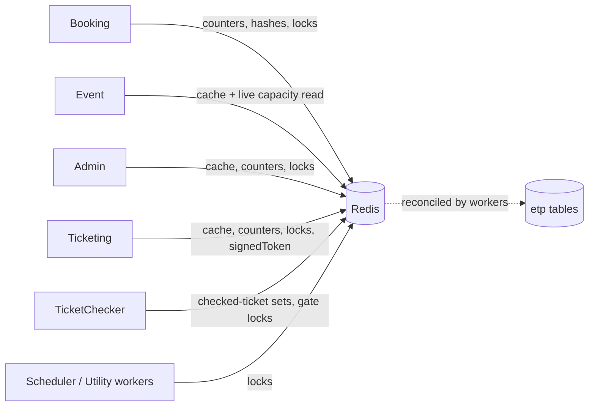

# X-25 · Redis: ক্যাশ, লাইভ ধারণক্ষমতা ও লক

> **Bangla name:** Redis: ক্যাশ, লাইভ ক্যাপাসিটি ও লক
>
> [← 60 · ক্রস-কাটিং](README.md) · [সূচিপত্র](../README.md) · [ওপেন কোয়ারি](../99-open-queries.md)

## 1. নাম ও উদ্দেশ্য

**Redis।** একটিমাত্র Redis ইনস্ট্যান্স চারটি ভিন্ন কাজ করে: (১) গরম ডেটার জন্য একটি **read cache**, (২) **লাইভ ক্যাপাসিটি ও আসন কাউন্টার** যা নির্ধারণ করে একটি বুকিং এগোবে কি না, (৩) **distributed lock** (RedLock), যাতে একসময়ে শুধু একটি ইনস্ট্যান্স কোনো ওয়ার্কার চালায় বা কোনো লেভেল স্পর্শ করে, এবং (৪) ছোট অপারেশনাল state (টিকিট কাউন্টার, যাচাই করা টিকিটের সেট, signed token, DgePay token)। ধারণাগুলো: [Redis লাইভ ক্যাপাসিটি](../00-platform-primer.md#explainer-redis-live-capacity), [distributed lock](../00-platform-primer.md#explainer-distributed-locks)।

## 2. ট্রিগার ও অ্যাক্টর

Admin, Booking, Event, Ticketing, TicketChecker, Scheduler, UserIssue ও Utility-র যেকোনো রিকোয়েস্ট বা ওয়ার্কার। ব্যবহারকারী-মুখী কোনো Redis ফিচার নেই; প্রভাব দেখা যায় দ্রুত রিড, ক্যাপাসিটির সংখ্যা এবং "একসময়ে শুধু একটি ওয়ার্কার" হিসেবে।

## 3. ব্যবসায়িক প্রবাহ

গ্রাহকরা আসন বুক করার সময় সভ্য থাকা সংখ্যাটি আগে Redis-এ পড়া ও কমানো হয় এবং পরে ওয়ার্কাররা সেটি ডেটাবেসের সঙ্গে reconcile করেন ([S-01](../50-system-initiated/S-01-level-capacity-update.md) থেকে [S-04](../50-system-initiated/S-04-scheduler-capacity-update.md))। Redis ফ্লাশ হলে লাইভ কাউন্টারগুলো ভুল থাকে, যতক্ষণ না reconcile ওয়ার্কারগুলো সেগুলো আবার তৈরি করে।

## 4. কারিগরি প্রবাহ

**তিনটি অ্যাক্সেস পথ, সবই একই সার্ভারের বিপরীতে** (`Cache:Redis:ConnectionString`):

| পথ | কে রেজিস্টার করে | কী কাজে | নোট |
|---|---|---|---|
| `ICacheManager` (`IDistributedCache`-এর ওপর `DistributedCacheManager`) | `AddCaching` | read-through cache, যেমন `User` ক্যাশে Cognito ব্যবহারকারীর অ্যাট্রিবিউট | `InstanceName` প্রিফিক্স (`Cache:Redis:InstanceName`); **ডিফল্ট absolute expiry ২ মিনিট** (`CacheConfig.DefaultExpireTime`) |
| `IRedisService` (StackExchange.Redis `IDatabase`, JSON মান) | `AddRedisCaching` | string, set, hash, কাউন্টার; কোনো প্রিফিক্স নেই, ডেটাবেস `Cache:Redis:DefaultDatabase` | ক্যাপাসিটি, আসন ও চেকারের সব key |
| `IDistributedLockFactory` (RedLock.net) | `AddDistributedLock` | lock | endpoint আসে `DistributedLock:Redis:EndPoint`, `:Port`, `:Database` থেকে; একটিমাত্র endpoint, তাই এটি সাধারণ Redis lock, multi-node RedLock নয় |

`AddCaching` ও `AddRedisCaching` দুটোই ASP.NET-এর **Data Protection key** Redis-এ সংরক্ষণ করে (`DataProtection-Keys`, `DataProtection-Keys-redis`)।

**প্রতি সার্ভিসে রেজিস্ট্রেশন:** Admin, Booking, Ticketing ও UserIssue তিনটি রেজিস্টার করে; Event ক্যাশ ও `IRedisService` রেজিস্টার করে; Scheduler, TicketChecker ও Utility `IRedisService` ও lock রেজিস্টার করে; PushNotification শুধু ক্যাশ রেজিস্টার করে; Platform ও UserAuth শুধু ক্যাশ।

**Key পরিবার** (`Core/ETP.Core/Constant/AppConstant.cs`-এর `CachePrefix`; key-এর আকার call site থেকে নেওয়া):

| প্রিফিক্স ও আকার | বিষয়বস্তু | কে ব্যবহার করে |
|---|---|---|
| `level_live:{event}_{gallery}_{block}_{level}` | প্রতি লেভেলে লাভাঙ্গল আসন (সেঙ্গে `capacity` hash, ফিল্ড `level_live:{groupId}`) | Booking, Event |
| `event_live:{eventId}` | প্রতি ইভেন্টে লাইভ ক্যাপাসিটি | Booking, Event |
| `level_locked:{event}_{gallery}_{block}_{level}` | লক করা ক্যাপাসিটি ধরে রাখা অর্ডারের hash (ফিল্ড = অর্ডার আইডি) | Booking |
| `level_live_seats:{event}_{gallery}_{block}_{level}` | লাইভ আসনের অবস্থা | Booking |
| `event_database:*`, `level_database:*`, `level_database_seats:*`, `level_database_purchased_seats:*` | reconcile-এর জন্য ব্যবহৃত ডেটাবেস-পাশের কাউন্টার | Booking |
| `event_total_online_ticket:{eventId}` | অনলাইন টিকিটের মোট | Booking, Event |
| `event_details:{id}`, `admin_event_details:{id}`, `event_venue_details:{id}`, `event_settings_details`, `program_settings_details`, `ticket_attributes_details`, `ticket_pricing_all`, `admin_level_info`, `landing_page_image_published`, `general_notice_published` | ক্যাস করা read model | Admin, Event, Ticketing, Booking |
| `booking_details:{publicId}` | অর্ডারের বিবরণ | Booking |
| `dgepay_auth_token` | DgePay token | Booking ([P-06](../20-user-portal/P-06-booking-payment.md)) |
| `ticket_checker_tickets:event_{e}_gate_{g}`, `ticket_checker_checked_tickets:{e}_{g}_{user}`, `TicketCheckerLevelGateMap` (hash, ফিল্ড `{event}_{gate or level}`) | অফলাইন টিকিটের তালিকা, যাচাই করা টিকিট, লেভেল-টু-গেট ম্যাপ | TicketChecker, Ticketing, Admin ([C-02](../40-checker-app/C-02-offline-ticket-download.md), [C-05](../40-checker-app/C-05-ticket-sync.md), [S-14](../50-system-initiated/S-14-checked-ticket-sync.md)) |
| `event_ticket_counter:{eventId}` | পরপর টিকিট নম্বরের কাউন্টার, ইভেন্ট publish-এ `0`-এ রিসেট হয় | Admin, Ticketing |
| `signedToken` | একটিমাত্র গ্লোবাল অ্যাডমিন ডাউনলোড টোকেন, ৬০ সে | Ticketing ([X-20](X-20-file-storage.md)) |
| `sharedTicket:{ticketNumber}_{signature}` | presigned শেয়ার URL | Ticketing ([X-20](X-20-file-storage.md)) |

`mergeTicket`, `zipTicket` ও `program_details` `CachePrefix`-এ ঘোষণা আছে কিন্তু কোনো কোড সেগুলো পড়ে বা লেখে না (merge-এর অবস্থা S3-এর ফাইলের নামে রাখা হয়)।

**Lock রিসোর্স** (`CreateLockAsync(resource, expiry[, wait, retry])`; `await using` দিয়ে অর্জন):

| রিসোর্সের নাম | কোথায় | উদ্দেশ্য |
|---|---|---|
| `user_booking:{userId}` (৬০ সে) | Booking `UserBookingOrderManager` | একসময়ে প্রতি ব্যবহারকারীর একটি বুকিং চেষ্টা |
| `level_booking_{event}_{gallery}_{block}_{level}` | Booking `UserBookingOrderManager`, `SeatReservationManager`, `EventCapacityAdjustmentManager` | একটি লেভেলের ক্যাপাসিটি পরিবর্তন সিরিয়াল করা |
| `database_update_{event}_{gallery}_{block}_{level}` এবং `{event}_{gallery}_{block}_{level}_database_update` | Booking `CapacityManager` | ক্যাপাসিটি reconcile |
| `level_capacity_updater_{n}`, `event_capacity_updater_{n}`, `locked_order_refresher_{n}`, `vat_challan_processor_{n}` | Booking ওয়ার্কার (`n` = র‍্যান্ডম স্লট) | কিউ কনজিউমার: একাধিক ইনস্ট্যান্স সমান্তরালে চলতে পারে |
| `booking_status_updater`, `reservation_status_updater`, `refresh_level_locks_{key}`, `user_ticket_generator_{eventId}` | Booking task manager | singleton পর্যায়কালীন কাজ |
| `event_live_capacity_refresher`, `pending_cancel_booking_status_updater`, `notification_for_ticket_generated`, `device_token_cleanup` | Scheduler | singleton পর্যায়কালীন কাজ |
| `checked_ticket`, `ticket_checker_status_reset`, `promo_code_status_updater`, `system_discount_status_updater` | Admin ওয়ার্কার | singleton পর্যায়কালীন কাজ |
| `ticket_checker_gate_{gateId}` | TicketChecker `TicketsManager` | প্রতি গেটে একটি sync |
| `create_user_ticket_{publicId}` / `{orderId}` এবং `signed_ticket_generator_{0..9}` | Ticketing | টিকিট তৈরি ও সাইনিং স্লট |
| `ticket_processing_service_{reservationId}` (১ ঘণ্টা) | Utility | একটি রিজার্ভেশনের merge/zip |

## 5. কম্পোনেন্ট

| ধরন | কম্পোনেন্ট |
|---|---|
| কোড | `Core/ETP.Core/Caching/RedisService.cs`, `Core/ETP.Core/Configuration/CacheConfig.cs`, `RedisConfig.cs`, `DistributedLockConfig.cs`, `Core/ETP.Core/Constant/AppConstant.cs` (`CachePrefix`) |
| AWS | ElastiCache Redis (আর্কিটেকচার ডকুমেন্ট, ডেটা অংশ) |
| কনফিগ | `Cache:Redis:ConnectionString`, `Cache:Redis:InstanceName`, `Cache:Redis:DefaultDatabase`, `DistributedLock:Redis:EndPoint`, `:Port`, `:Database` ([X-26](X-26-configuration.md)); লোকালে `localhost:6379`, instance `etp-local:`, database 0 |

## 6. API কন্ট্র্যাক্ট

কিছু নেই। Redis-এর নিজস্ব কোনো এন্ডপয়েন্ট নেই; উপরের ফিচারগুলো অভ্যন্তরে এটি ব্যবহার করে।

## 7. ডেটা ও পার্শ্বপ্রতিক্রিয়া

কিছু state কেবল Redis-এ থাকে এবং ডেটাবেসে থাকে **ন**: লাইভ ক্যাপাসিটি (recile হওয়া পর্যন্ত), `event_ticket_counter`, চেকারের সেট, `signedToken`, lock। ক্যাস করা read modelগুলো ডেটাবেস রো-এর কপি, আর মালিক সেগুলো বদলালে স্পষ্টভাবে সরিয়ে ফেলা হয় (যেমন ইভেন্ট publish `event_details`, `admin_event_details`, `event_venue_details` সরায়, তারপর `event_ticket_counter` রিসেট করে)।

## 8. কোড রেফারেন্স

| কী | কোথায় |
|---|---|
| raw Redis র‍্যাপার | `rvl-gobcb-backend/Core/ETP.Core/Caching/RedisService.cs` |
| ক্যাশ ম্যানেজার ও expiry | `rvl-gobcb-backend/Core/ETP.Core/Configuration/CacheConfig.cs:13-45` |
| Redis multiplexer | `rvl-gobcb-backend/Core/ETP.Core/Configuration/RedisConfig.cs` |
| Lock factory | `rvl-gobcb-backend/Core/ETP.Core/Configuration/DistributedLockConfig.cs` |
| Key প্রিফিক্স | `rvl-gobcb-backend/Core/ETP.Core/Constant/AppConstant.cs:63-101` |
| Lock-এর ব্যবহার | উপরের টেবিল দেখুন; যেমন `Services/Booking/ETP.Booking.Domain/Managers/UserBookingOrderManager.cs:68, 117-123` |
| ক্যাশ অবলম্পনের উদাহরণ | `rvl-gobcb-backend/Services/Admin/ETP.Admin.Domain/Managers/EventManager.cs:715-722` |

## 9. হ্যান্ডওভার নোট

1. **Redis একটি hard dependency এবং ক্যাপাসিটির একটি source of truth।** ফ্লাশ বা failover হলে লাইভ কাউন্টার, লক-করা-অর্ডারের hash ও চেকারের তালিকা হারায় যায়। পুনরুদ্ধার নির্ভর করে reconcile ওয়ার্কারগুলোর ওপর; তারা তাৎক্ষণিক নয় ([S-03](../50-system-initiated/S-03-locked-capacity-refresh.md), [S-04](../50-system-initiated/S-04-scheduler-capacity-update.md))। আর্কিটেকচার ডকুমেন্টে ElastiCache-এর সেটআপ ও persistence সেটিংস বর্ণিত, যা এই পর্যালোচনায় কোডে দেখা যায় না `[UNCONFIRMED: Q-02]`।
2. **Lock-এর endpoint একটি নোড**, তাই অপারেশনের মাঝপথে সেই নোড fail করলে lock কোনো সুরক্ষা দেয় না।
3. **Lock ও বুকিং:** `UserBookingOrderManager.CreateAsync` সর্বোচ্চ ৬০ সেকেন্ডের জন্য `user_booking:{userId}` ধরে (কোনো অপেক্ষা নয়), তারপর প্রতি লেভেলের lock `level_booking_...`-এর জন্য সর্বোচ্চ ১৫ সেকেন্ড অপেক্ষা করে (প্রতি ১ সেকেন্ডে রিট্রাই করে), যার মেয়াদ ৬০ সেকেন্ড পর শেষ। সংঘর্ষ লেভেলভিত্তিক, তাই জনপ্রিয় লেভেল তার বুকিং সিরিয়াল করে।
4. **দুটি ভিন্ন expiry ডিফল্ট**: `ICacheManager` ২ মিনিট (`CacheConfig`), অন্যদিকে `RedisConfig.DefaultExpireTime` (২ ঘণ্টা) ঘোষণা করা কিন্তু `RedisService` প্রয়োগ করে না — এটি expiry কেবল তখনই সেট করে যখন কলকারী একটি দেয়।
5. **Key-এর নাম কোড কনস্ট্যান্ট ও string template**, ছড়িয়ে আছে বিভিন্ন ম্যানেজারে; `CachePrefix`-এর বাইরে কোনো কেন্দ্রীয় key রেজিস্ট্রি নেই। সব ব্যবহারকারী খুঁজতে প্রিফিক্সটি খুঁজুন।
6. `DataProtection` key-গুলো একই Redis-এ; তাই Redis ফ্লাশ করলে data-protection key ring-ও রিসেট হয়।
7. কিউ কনজিউমার ওয়ার্কাররা একটি নামের বদলে র‍্যান্ডম স্লট নাম (`..._{n}`) লক করে, তাই ডিজাইন করেই একাধিক কনজিউমার একসঙ্গে চলতে পারে। কোডে স্লটের সীমা: `level_capacity_updater` 0-49, `event_capacity_updater` 0-19, `vat_challan_processor` 0-9, `signed_ticket_generator` 0-9, `locked_order_refresher` 0-4।

## 10. কম্পোনেন্ট সম্পর্ক

**নির্ভর করে:** কনফিগারেশন ([X-26](X-26-configuration.md))। **প্রভাব ফেলে:** বুকিং ও আসন নির্বাচন ([P-04](../20-user-portal/P-04-seat-selection.md), [P-06](../20-user-portal/P-06-booking-payment.md)), ক্যাপাসিটি ([A-10](../10-admin-portal/A-10-capacity-adjustment.md)), চেকার অ্যাপ, সেকশন ৫০-এর প্রতিটি ওয়ার্কার।

## 11. ডেভেলপার টেস্ট গাইড

**লোকালে পরীক্ষাযোগ্যতা: সম্পূর্ণ।** Redis `localhost:6379`-এ একটি Docker কনটেইনার হিসেবে চলে (`docs/local-dev.md`); সেটি বন্ধ থাকলে সার্ভিসগুলো স্টার্ট-আপেই ক্র্যাশ করে।

| বিষয় | বিবরণ |
|---|---|
| টেস্ট ডেটা ও অ্যাকাউন্ট | `pwsh ./scripts/Seed-EtpData.ps1`; অ্যাডমিন লগইন ([X-01](X-01-admin-login.md)) |
| ব্রাউজার | ইউজার পোর্টালে (`http://localhost:4201`) একটি ইভেন্ট খুলুন — প্রথম ক্যাপাসিটি রিডের পর `level_live:*`-এর মতো Redis key দেখা যাবে |
| এমুলেটর | — |
| Postman | `postman/services/etp-booking.postman_collection.json`: ক্যাপাসিটি ও আসন রিকোয়েস্ট; একটি Admin ক্যাপাসিটি অ্যাডজাস্টমেন্ট `event_total_online_ticket:{id}` বদলে দেয় |
| Visual Studio ডিবাগ | `RedisService.HashGetAsync` / `StringSetAsync`-এ এবং একটি lock site-এ ব্রেকপয়েন্ট, যেমন `UserBookingOrderManager` লাইন 68 |
| যাচাই | `redis-cli -h localhost -p 6379 --scan --pattern 'level_*'`; `redis-cli HGETALL capacity`; `ICacheManager` এন্ট্রির জন্য `redis-cli --scan --pattern 'etp-local:*'` (প্রিফিক্স = `InstanceName`) |
