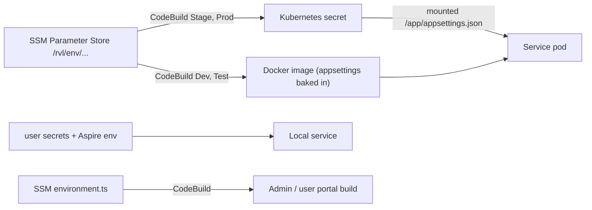

# X-26 · কনফিগারেশন ও সিক্রেট

> **Bangla name:** কনফিগারেশন ও সিক্রেট
>
> [← 60 · ক্রস-কাটিং](README.md) · [সূচিপত্র](../README.md) · [ওপেন কোয়ারি](../99-open-queries.md)

## 1. নাম ও উদ্দেশ্য

**কনফিগারেশন ও সিক্রেট।** প্রতিটি সার্ভিস নিজের সেটিংস পড়ে অবাগত .NET কনফিগারেশন সিস্টেম থেকে (`appsettings.json`, environment variables, user secrets)। রিপোজিটরিতে শুধু **placeholder** থাকে (`[see User Secrets]`); আসল মান প্রতিটি environment-এ আলাদাভাবে দেওয়া হয়। প্রায় প্রতিটি অন্য ফিচার একটি `Section:Key` নামের দিকে ইঙ্গুত করে, তাই এই ফাইলটি ব্যাখ্যা করে কোন environment-এর মান কোথা থেকে আসে এবং কোন key-গুলো গুরুত্বপূর্ণ।

## 2. ট্রিগার ও অ্যাক্টর

লোকালে কোনো সার্ভিস চালু করা একজন ডেভেলপার, কিংবা কোনো environment বিল্ড ও ডিপ্লয় করা CodeBuild। কোনো end user এতে জড়িত নয়।

## 3. ব্যবসায়িক প্রবাহ

কিছু নেই। এটি সিদ্ধান্ত নেয় যে প্ল্যাটফর্মের ডিপ্লয় করা একটি কপি কোন ডেটাবেস, Redis, AWS অ্যাকাউন্ট, পেমেন্ট gateway ও পাশের সার্ভিসের URL-এর সঙ্গে কথা বলবে।

## 4. কারিগরি প্রবাহ

**প্রতিটি environment অনুযায়ী মান কোথা থেকে আসে**

| Environment | উৎস | সার্ভিসে কীভাবে পৌঁছায় | প্রমাণ |
|---|---|---|---|
| লোকাল (ওয়ার্কস্পেস) | `scripts/user-secrets.example.json` → `scripts/Set-EtpSecrets.ps1` → প্রতি সার্ভিসে `dotnet user-secrets`; Aspire environment variable যোগ করে (`ConnectionStrings__*`, `Services__*`, `Cache__Redis__*`, `DistributedLock__Redis__*`, `ASPNETCORE_URLS`) | ASP.NET Core কনফিগারেশনের ক্রম: `appsettings.json`, user secrets, environment variables | `docs/local-dev.md` Step 4; `aspire/Etp.AppHost/AppHost.cs:76-98` |
| Dev ও Test | SSM Parameter Store `/rvl/<env>/<service>-service-appsettings` | `buildspec-dev.yml` ও `buildspec-test.yaml` **সোর্স ট্রি-তে সার্ভিসের `appsettings.json` বদলে দেয় এবং Docker ইমেজে বেক করে** (`mv appsettings_N.json Services/...`) | `rvl-gobcb-backend/buildspec-dev.yml` pre_build ও build স্টেজ; `deployment/k8s/development/*.yaml`-এ `envFrom` ও secret volume কমেন্ট করা |
| Stage ও Prod | একই SSM প্যারামিটার | `buildspec-prod.yaml`, `buildspec-stage.yaml` প্রতি সার্ভিসের জন্য একটি Kubernetes secret তৈরি করে (`kubectl create secret generic <svc>-appsettings --from-file=appsettings.json=...`); ডিপ্লয়মেন্ট সেটিকে read-only হিসেবে `/app/appsettings.json`-এ মাউন্ট করে | `buildspec-prod.yaml:122-135`; `deployment/k8s/production/admin_service.yaml:80-90` |

আর্কিটেকচার ডকুমেন্ট (§2.3, §6) SSM → Kubernetes secret-এর পথটি বর্ণনা করে; কোড দেখায় যে Stage ও Prod-এর ক্ষেত্রে এটি সত্য, আর Dev ও Test-এ ব্যবহৃত হয় ইমেজে বেক করা ফাইল।

**ফ্রন্ট এন্ড**

| ক্লায়েন্ট | কনফিগ ফাইল | CI-তে উৎস |
|---|---|---|
| অ্যাডমিন পোর্টাল | `src/environments/environment.ts` ও `environment.prod.ts`, **git-এ খালি** | `/rvl/<env>/admin-portal/environment.prod.ts` (SSM), buildspec দিয়ে লেখা হয় (`rvl-gobcb-admin-portal/buildspec-dev.yml:7, 28-31`; `buildspec-prod.yaml:14, 27-28`) |
| ইউজার পোর্টাল | git-এ `src/environments/` ফোল্ডার নেই | `/rvl/<env>/user-portal/environment.ts` (SSM) (`docs/user-portal-local.md`) |
| ইউজার অ্যাপ, চেকার অ্যাপ | `env/.env.<flavor>` (`dev`, `test`, `staging`, `prod`), git-এ নেই; `env/README.md`-তে `API_BASE_URL`, `API_TOKEN` তালিকাভুক্ত | বিল্ড তৈরি করে; কোনো আবশ্যক key অনুপস্থিত থাকলে অ্যাপ চালু হতে চায় না (`docs/mobile-local.md` §5) |

**সার্ভিস পরিচয় ও রাউটিং।** `Application:ServiceName` (`admin`, `booking`, `event`, `platform`, `PushNotification`, `scheduler`, `ticketChecker`, `ticketing`, `userAuth`, `utility`) `GlobalRoutePrefixConvention`-এর মাধ্যমে URL প্রিফিক্স হয় ([explainer](../00-platform-primer.md#explainer-path-prefix-routing))। UserIssue-এর git-এ `appsettings.json` নেই, তাই লোকালে Aspire `Application__ServiceName=userissue` সেট করে (`AppHost.cs:85`); ক্লাউডে এটি SSM ফাইল থেকে আসে।

**Key মানচিত্র** (এই ডকুমেন্টে ব্যবহৃত সেকশন; সম্পূর্ণ লোকাল তালিকা `scripts/user-secrets.example.json`):

| সেকশন | কী রাখে | কোথায় বর্ণিত |
|---|---|---|
| `ConnectionStrings:<Service>` | প্রতিটি কনটেক্সটের জন্য একটি PostgreSQL কানেকশন স্ট্রিং | [X-24](X-24-activity-logging.md), `[UNCONFIRMED: Q-02]` |
| `Services:<Name>` | পাশের সার্ভিসের base URL (লক্ষ্য করুন `Services:AppBase`) | [X-19](X-19-service-to-service.md) |
| `AWS:Region`, `AccessKey`, `SecretAccessKey` | S3, SQS, SES, Cognito-এর জন্য static AWS ক্রেডেনশিয়াল | [X-20](X-20-file-storage.md), [X-19](X-19-service-to-service.md) |
| `AWS:Bucket:*`, `AWS:Ticket:*` | মিডিয়া ও টিকিট বাকেট, টিকিট পাথের base | [X-20](X-20-file-storage.md) |
| `AWS:CognitoPool:{Admin,User,TicketChecker,Agent}:{PoolId,Authority,ClientId,Metadata}` | Cognito pool | [X-14](X-14-authz-pool-policies.md) |
| `AWS:Queue:*` | SQS কিউয়ের নাম | [X-19](X-19-service-to-service.md) |
| `Cache:Redis:*`, `DistributedLock:Redis:*` | Redis | [X-25](X-25-redis.md) |
| `PaymentSettings:*` | DgePay ও SSLCommerz ক্রেডেনশিয়াল, redirect URL | [P-06](../20-user-portal/P-06-booking-payment.md) |
| `Notification:*`, `Serverless:*` | বাহ্যিক নোটিফিকেশন ও ব্যবহারকারী API | [X-22](X-22-sms-notification.md) |
| `TSP:*`, `OneIdSettings:*` | signing provider, OneID | [S-08](../50-system-initiated/S-08-ticket-signing.md), [P-10](../20-user-portal/P-10-oneid-ticket-sync.md) |
| `CloudfrontTicketValidator:*` | CloudFront সাইনিং key ধরানো S3 অবজেক্ট | [X-20](X-20-file-storage.md) |
| `FirebasePushNotificationConfig:*` | Firebase service-account ফিল্ড (Scheduler) | [X-23](X-23-push-firebase.md) |
| `CORS:AllowedOrigins` | অনুমোদিত ব্রাউজার origin (commit করা মান: localhost 4200/4201) | সব সার্ভিস |
| `GallerySettings` | অ্যাডমিন ভেন্যু গ্যালারি সেটিংস | [A-05](../10-admin-portal/A-05-venues.md) |

## 5. কম্পোনেন্ট

| ধরন | কম্পোনেন্ট |
|---|---|
| কোড | প্রতিটি সার্ভিসের `Program.cs` ও `appsettings.json`; `Core/ETP.Core/Options/*` (typed option, যেমন `AwsOptions`) |
| পাইপলাইন | `rvl-gobcb-backend/buildspec-{dev,test,stage,prod}.y*ml`, `deployment/k8s/<env>/*.yaml`; ফ্রন্ট এন্ডের `buildspec-*.y*ml` |
| AWS | SSM Parameter Store, CodeBuild, ECR, EKS secret |
| ওয়ার্কস্পেস | `scripts/user-secrets.example.json`, `scripts/Set-EtpSecrets.ps1`, `scripts/Clear-EtpSecrets.ps1`, `aspire/Etp.AppHost` |

## 6. API কন্ট্র্যাক্ট

কিছু নেই।

## 7. ডেটা ও পার্শ্বপ্রতিক্রিয়া

রানটাইমে কিছু নেই। বিল্ড সময়ে: Dev ও Test-এর Docker ইমেজে আসল `appsettings.json` থাকে।

## 8. কোড রেফারেন্স

| কী | কোথায় |
|---|---|
| Placeholder সেটিংস | `rvl-gobcb-backend/Services/Admin/ETP.Admin.Service/appsettings.json` (এবং প্রতিটি সার্ভিস) |
| SSM ও ইমেজ বেক (Dev) | `rvl-gobcb-backend/buildspec-dev.yml` |
| SSM ও secret (Prod) | `rvl-gobcb-backend/buildspec-prod.yaml:122-135`, `rvl-gobcb-backend/deployment/k8s/production/admin_service.yaml:80-90` |
| লোকাল মান | `scripts/user-secrets.example.json`, `scripts/Set-EtpSecrets.ps1` |
| Aspire override | `aspire/Etp.AppHost/AppHost.cs:76-98` |
| SSM থেকে ফ্রন্ট এন্ডের env | `rvl-gobcb-admin-portal/buildspec-dev.yml:7-31`, `rvl-gobcb-admin-portal/buildspec-prod.yaml:14-28` |

## 9. হ্যান্ডওভার নোট

1. **commit করা `appsettings.json` ফাইলগুলো অসম্পূর্ণ টেমপ্লেট।** উদাহরণ হিসেবে Admin-এর ফাইলে `Notification`, `Serverless`, `CloudfrontTicketValidator` বা `AWS:Ticket` সেকশন নেই, যদিও কোডের ওগুলো দরকার। সম্পূর্ণ key set জানতে `scripts/user-secrets.example.json` ব্যবহার করুন (কোড থেকে লোকাল সেটআপের জন্য লেখা) এবং SSM প্যারামিটারগুলো, যেগুলো এই পর্যালোচনায় দেখা যায় না `[UNCONFIRMED: Q-06]`।
2. **Dev ও Test ইমেজে secret বেক করে।** তৈরি ইমেজে আসল `appsettings.json` থাকে (ডেটাবেস, AWS key, gateway secret), আর buildspec-গুলো Admin ফাইলটি বিল্ড লগে `cat` করে। ইমেজ pull করতে পারা বা CodeBuild লগ পড়তে পারা যেকোনো ব্যক্তি সেগুলো দেখতে পায়। অ্যাডমিন পোর্টালের Dev buildspec-ও environment ফাইলটি তার লগে ছাপে (`cat src/environments/environment.prod.ts`)।
3. **AWS অ্যাক্সেস একটি static key pair**, কনফিগারেশনে (`AWS:AccessKey`, `AWS:SecretAccessKey`), S3, SQS, SES, Cognito ও MassTransit bus-এর জন্য ব্যবহৃত; কোডে role-based অ্যাক্সেস নেই (আর্কিটেকচার §2.3)। এটি রোটেট করতে হলে সব ১১টি SSM প্যারামিটার আপডেট করে আবার ডিপ্লয় করতে হবে।
4. **মনে রাখার মতো টাইপো ও ড্রিফট**: `ticekt` পাথ ([X-20](X-20-file-storage.md)); Postman environment region `ap-southeast-1` সেট করে যখন কিছু ডকুমেন্ট `us-east-1` বলে ([অ্যাপেন্ডিক্স D](../93-appendix-d-local-test-reference.md))।
5. **Key অনুপস্থিত থাকলে ব্যর্থতা স্টার্ট-আপে বা প্রথম ব্যবহারে ঘটে।** অনেক key `configuration["..."]!` দিয়ে পড়া হয়, তাই অনুপস্থিত key প্রথম ব্যবহারের জায়গায় null reference বা `ArgumentNullException` হিসেবে দেখা দেয়, স্পষ্ট বার্তা হিসেবে নয়। Redis keyগুলো স্টার্টেই যাচাই হয় (`DistributedLockConfig` একটি `ConfigurationErrorsException` ছুঁড়ে)।
6. git-এর লোকাল `CORS:AllowedOrigins`-এ শুধু `localhost` পোর্ট আছে; আসল origin SSM ফাইলে।

## 10. কম্পোনেন্ট সম্পর্ক

**নির্ভর করে:** কিছু নেই। **প্রভাব ফেলে:** প্রতিটি ফিচার।

## 11. ডেভেলপার টেস্ট গাইড

**লোকালে পরীক্ষাযোগ্যতা: সম্পূর্ণ।**

| বিষয় | বিবরণ |
|---|---|
| টেস্ট ডেটা ও অ্যাকাউন্ট | `pwsh ./scripts/Set-EtpSecrets.ps1` (Floci seeding-এর পর) secret লেখে; `-DryRun` JSON ছাপে (`docs/local-dev.md` Step 4) |
| ব্রাউজার | `http://localhost:4200/` তৈরি করা `environment.ts`-এর প্রভাব দেখায় (API base URL) |
| এমুলেটর | git-ignored `mobile-local/` কপিতে `env/.env.dev` (`pwsh ./scripts/Setup-MobileApps.ps1`) |
| Postman | `postman/`-এর environment ফাইলগুলোতে `base_url` ও টোকেন থাকে ([অ্যাপেন্ডিক্স D](../93-appendix-d-local-test-reference.md) দেখুন) |
| Visual Studio ডিবাগ | IDE থেকে একটি সার্ভিস চালু করুন; সেও একই user secret পড়ে (`docs/local-dev.md` §6.1) |
| যাচাই | `dotnet user-secrets list --project rvl-gobcb-backend/Services/Admin/ETP.Admin.Service` |
