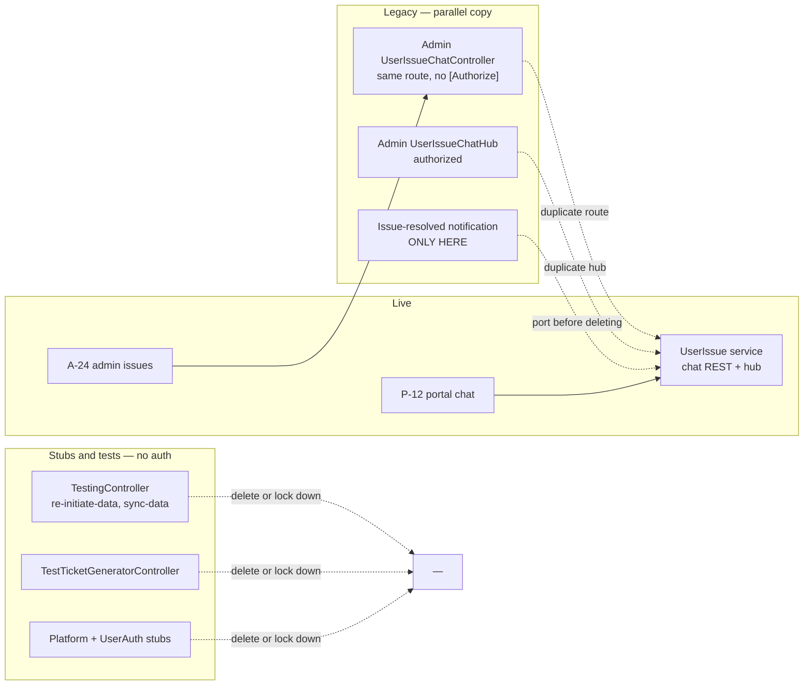

# 90 · অ্যাপেন্ডিক্স A — লেগ্যাসি, অব্যবহৃত ও নিষ্ক্রিয় কোড

> **Bangla name:** লেগ্যাসি, অব্যবহৃত ও নিষ্ক্রিয় কোড
>
> [← সূচিপত্র](README.md) · [ওপেন কোয়ারি](99-open-queries.md)

BS23 শুধু যে পণ্যটি শিপ করেছে তার চেয়ে অনেক বেশি বানিয়েছিল। এই পাতায় সেই কোডগুলো তালিকাভুক্ত, যেগুলো **এখনো রিপোজিটরিতে আছে কিন্তু লাইভ পণ্যের অংশ নয়** — ডুপ্লিকেট সার্ভিস, টেস্ট কন্ট্রোলার, মৃত এন্ডপয়েন্ট, অব্যবহৃত সেটিংস রেকর্ড ও টেমপ্লেটের অবশিষ্টাংশ। এটি এমন একটি পাতা যাতে RVL সিদ্ধান্ত নিতে পারে কী মুছবে, এবং পরে কেউ কোনো নিষ্ক্রিয় এন্ডপয়েন্টকে লাইভ ভাবে ভুল না করে।

**এই পাতাটি কীভাবে তৈরি হয়েছে।** নিচের প্রতিটি আইটেম পাঁচটি রিপোজিটরিতে খুঁজে বের করা হয়েছে — এমন কন্ট্রোলার, ম্যানেজার, রেকর্ড ও রুট যেগুলোর কোনো ক্লায়েন্টে কোনো caller নেই এবং লাইভ কোনো স্ক্রিন থেকে পৌঁছানোর কোনো পথ নেই। এখানে কিছুই আর্কিটেকচার ডকুমেন্ট থেকে অনুমান করা হয়নি।

## 1. Status কলামটি কীভাবে পড়বেন

| Status | অর্থ | করণীয় |
|---|---|---|
| **Dead** | পাঁচটি রিপোজিটরির কোথানোই কোনো caller নেই | কোনো বাহ্যিক ভোক্তা নেই তা নিশ্চিত করে মুছে ফেলুন |
| **Legacy** | এমন একটি ফিচারের লাইভ, সমান্তরাল কপি যা অন্যত্র আবার বাস্তবায়িত হয়েছে | নতুনটি প্রমাণিত হলে পুরোনো কপিটি মুছে ফেলুন |
| **Dormant** | পৌঁছানো যায় কিন্তু কোনো caller নেই; আসন্ন রিলিজের জন্য এটি ইচ্ছাকৃত হতে পারে | BS23-কে জিজ্ঞাসা করুন |
| **Stub** | কোনো বাস্তবায়ন ছাড়া একটি টেমপ্লেট প্রজেক্ট | মুছে ফেলুন বা বদলে দিন |
| **Inert** | ডেটা আছে কিন্তু কেউ তা পড়ে বা লেখে না | BS23-কে জিজ্ঞাসা করুন |

## 2. ডুপ্লিকেট সার্ভিস

### 2.1 issue-chat REST API দুইবার আছে — দুটোই অপ্রমাণীকৃত

**Status: Legacy (মুছে ফেলার আগে অবশ্যই ঠিক করতে হবে)।**

`Admin` ও `UserIssue` — দুজনেই সম্পূর্ণ সাপোর্ট-চ্যাট REST সারফেস বাস্তবায়ন করে, **একই রুট প্রিফিক্সে** `api/v1/user-issue-chat`, একই আটটি এন্ডপয়েন্ট সহ:

| এন্ডপয়েন্ট | Admin (legacy) | UserIssue (live) |
|---|---|---|
| `POST send` | `:24` | `:52` |
| `GET {id}/messages` | `:43` | `:32` |
| `GET {id}/unread` | `:64` | `:87` |
| `GET {id}/unread/count` | `:83` | `:70` (`unread-count`) |
| `POST {id}/mark-read` | `:102` | `:104` |
| `GET {id}/last` | `:120` | `:120` |
| `GET {id}/recent` | `:141` | `:141` |
| `GET message/{id}/attachment/download` | `:159` | `:157` |

ফাইল:
- `rvl-gobcb-backend/Services/Admin/ETP.Admin.Service/Api/UserIssueChatController.cs`
- `rvl-gobcb-backend/Services/UserIssue/ETP.UserIssue.Service/Api/ReportIssueChatController.cs`

**দুটির কোনোটিতেই `[Authorize]` নেই** — দুটি ফাইলেই শূন্য। যেহেতু `senderId`, `senderName` ও `senderType` ক্লায়েন্ট-সরবরাহকৃত ফর্ম ফিল্ড, একজন অজানা caller যেকোনো `ADMIN`-লেবেল করা ইস্যু থ্রেডে পোস্ট করতে পারে। **এটি এই হ্যান্ডওভারের সবচেয়ে গুরুতর নিরাপত্তা-সংক্রান্ত শিল্পকর্ম** ([Q-46](99-open-queries.md))।

এছাড়া **একই ক্লাস নামে দুটি SignalR hub** রয়েছে, এবং দুটোই `[Authorize(AuthenticationSchemes = AuthScheme.User + "," + AuthScheme.Admin)]` দিয়ে প্রমাণীকৃত:
- `Services/Admin/ETP.Admin.Service/Hubs/UserIssueChatHub.cs:12-13`
- `Services/UserIssue/ETP.UserIssue.Service/Hubs/UserIssueChatHub.cs:13-14`

লক্ষ্য করুন প্রায় একই কিন্তু **অভিন্ন নয়** এমন রুট বানান (`unread/count` বনাম `unread-count`) — একটি কপির বিপরীতে লেখা ক্লায়েন্ট অন্যটির বিপরীতে কাজ করবে না।

**legacy Admin কপিটিই একমাত্র জায়গা যেখানে "issue resolved" নোটিফিকেশন বাস্তবায়িত।** এর ম্যানেজার `INotificationClient` কল করে; live `UserIssue` ম্যানেজার করে না। তাই অ্যাডমিন পোর্টালে কোনো ইস্যু সলভ করলে বর্তমানে গ্রাহককে **কোনো** নোটিফিকেশন যায় না ([X-22](60-cross-cutting/X-22-sms-notification.md) নোট ২, [P-12](20-user-portal/P-12-issues-chat.md) নোট ১১)। **legacy কপিটি মুছে ফেলার আগে সেই নোটিফিকেশনটি অন্যত্র নিয়ে যান।**

দেখুন [A-24](10-admin-portal/A-24-user-issues-admin.md) এবং [P-12](20-user-portal/P-12-issues-chat.md)।

### 2.2 দুটি সার্ভিসই একই hub রুট রেজিস্টার করে

প্রতিটি সার্ভিসের `Program.cs` তার hub-কে একটি পথে ম্যাপ করে। কোনটি বাদ দেওয়ার আগে নিশ্চিত করুন ডিপ্লয় করা গেটওয়ে কোনটিতে রুট দেয় — এখানে কোনো মিসম্যাচ হলে চ্যাট নীরবে না ভেঙে যাবে।

## 3. সার্ভিসগুলোতে রয়ে যাওয়া টেস্ট ও টেমপ্লেট কন্ট্রোলার

| কন্ট্রোলার | সার্ভিস | রুট | Auth | Status |
|---|---|---|---|---|
| `TestingController` | TicketChecker | `GET api/v1/testing/re-initiate-data`, `POST api/v1/testing/sync-data` | **কোনোটিই নেই** | **Dead, এবং বিপজ্জনক** |
| `WeatherForecastController` | TicketChecker | `api/[controller]` | none | **Stub** |
| `TestTicketGeneratorController` | Ticketing | `api/TestTicketGenerator` | **কোনোটিই নেই** | **Dead** |
| `TestController` | UserAuth | শুধু `/health` | none | **Stub** |
| `Platform` সার্ভিস | Platform | টেমপ্লেট `WeatherForecastController` | none | **Stub** |

`TestingController`-ই প্রথমে সামলাতে হবে: `re-initiate-data` ও `sync-data` **টিকিট ডেটা পুনরায় ইনিশিয়ালাইজ ও পুনরায় সিঙ্ক করে**, আর দুটোই প্রমাণীকৃত নয়। সার্ভিসে যে কেউ পৌঁছাতে পারে সে পূর্ণ ডেটা রি-সিঙ্ক চালু করতে পারে। ইনগ্রেস `/ticketChecker/api/v1/testing/*` এক্সপোজ করে কি না তা একটি ডিপ্লয়মেন্ট-সংক্রান্ত প্রশ্ন ([Q-04](99-open-queries.md))।

`TestTicketGeneratorController` সরাসরি টিকিট-জেনারেশন কিউতে পাবলিশ করে — এটি অর্ডার ছাড়াই টিকিট তৈরি করতে পারে।

## 4. লাইভ সার্ভিসগুলোতে মৃত এন্ডপয়েন্ট

এমন এন্ডপয়েন্ট যেগুলোর কোনো ক্লায়েন্টে কোনো caller নেই। এগুলো তালিকাভুক্ত, যাতে কেউ এগুলোর উপর ভিত্তি করে কিছু তৈরি না করে ভেবে কাজ করছে।

| এন্ডপয়েন্ট | সার্ভিস | Status | নোট |
|---|---|---|---|
| `GET api/v1/user-issue-chat/*` (পুরো সারফেস) | Admin | Legacy | দেখুন §2.1 |
| `POST push-notification/send-to-users`, `send-to-user` | PushNotification | Dormant | কোনো caller পাওয়া যায়নি; একমাত্র live sender হলো event publish ([Q-08](99-open-queries.md)) |
| `POST api/v1/offline-sold-ticket` | Ticketing | Dormant | পুরো এজেন্ট ফিচারের কোনো ক্লায়েন্ট নেই ([Q-07](99-open-queries.md), [X-13](60-cross-cutting/X-13-agent-pool.md)) |
| `POST booking/api/v1/user-booking-order/payment-status-bypass` | Booking | Dormant | গেটওয়ে কল ছাড়াই অর্ডারকে পরিশোধিত হিসেবে চিহ্নিত করে; কোনো ক্লায়েন্ট কল করে না। **bypass-এর কারণেই একটি bypass VAT রেকর্ড এড়াতে পারে** ([Q-15](99-open-queries.md)) |
| `POST api/v1/seat-reservation` bulk (`CreateBulk`, default 65 %) | Booking | Dormant | কোনো পোর্টাল caller নেই; ব্যাখ্যাহীন কনস্ট্যান্ট ([Q-22](99-open-queries.md), [A-11](10-admin-portal/A-11-seat-reservation.md)) |
| `GET api/v1/currency` | Admin | Dormant | একটি রুট; কোনো caller পাওয়া যায়নি |
| `GET api/v1/portal-users` | Admin | Dormant | একটি রুট; কোনো caller পাওয়া যায়নি |
| `GET api/v1/system-settings` | Admin | Dormant | একটি রুট; কোনো caller পাওয়া যায়নি |
| `GET api/v1/social-media-settings` | Admin | Legacy | রেকর্ডটি লেখা হয় কিন্তু পোর্টাল বদলে `HeaderFooters` পড়ে ([Q-34](99-open-queries.md), [A-30](10-admin-portal/A-30-header-footer-social.md)) |
| SSLCommerz callback handler | Booking | Dormant | enum ও ফর্মে সমর্থিত; handler কিছুই করে না ([Q-19](99-open-queries.md)) |

## 5. নিষ্ক্রিয় ডেটা

সেই ডেটা যা স্কিমায় আছে কিন্তু পাঁচটি রিপোজিটরির কিছুই তা অর্থবহভাবে পড়ে বা লেখে না।

| আইটেম | কোথায় | Status | নোট |
|---|---|---|---|
| `SocialMediaSettings` | Admin — মডেল, migration `20250226115506`, ম্যানেজার, কন্ট্রোলার | Legacy | `HeaderFooters` দিয়ে অতিক্রান্ত; পোর্টাল কেবল পরেরটিই পড়ে ([Q-34](99-open-queries.md)) |
| `OfflineSoldTickets` | Ticketing | Inert | এজেন্ট এন্ডপয়েন্ট লেখে, **কেউ পড়ে না** — কোনো রিপোর্ট নেই, কোনো অ্যাডমিন স্ক্রিন নেই ([X-13](60-cross-cutting/X-13-agent-pool.md) নোট ৩) |
| `GeneralNotices` | Admin লেখে; **ইউজার পোর্টালে কিছুই পড়ে না** | Inert | `EventApiService.getAllGeneralNotices` আছে কিন্তু কোনো caller নেই; হোম-পেজের স্ট্রিপ অন্য কিছু দেখায় ([Q-35](99-open-queries.md), [P-01](20-user-portal/P-01-home-content.md)) |
| `Ticket-pricing` কনটেন্ট পাতা | Admin (`POST /admin/api/v1/ticket-pricing`) | Inert | গ্রাহকের মূল্য পাতা `program-pricing` (লাইভ দাম) কল করে, এই কনটেন্ট নয় ([Q-33](99-open-queries.md), [P-03](20-user-portal/P-03-info-pages.md), [A-14](10-admin-portal/A-14-ticket-pricing-content.md)) |
| শূন্য/শূন্য-নয়-এর বাইরে `checkNumber` | চেকার অ্যাপ | Inert | একটি `IntColumn`, কিন্তু প্ল্যাটফর্মের শুধু "কখনো স্ক্যান হয়নি" বনাম "স্ক্যান হয়েছে" দরকার ([C-02](40-checker-app/C-02-offline-ticket-download.md) নোট ৫) |
| `send-to-users`, `send-to-user` | PushNotification | Dormant | দেখুন §4 |
| ইস্যু স্ট্যাটাস `'Pending'` | UserIssue enum | Inert | enum-এ শুধু `{Open, Resolved}`; পোর্টালে জেরে থাকা ব্রাঞ্চ কখনো ট্রিগার হতে পারে না ([P-12](20-user-portal/P-12-issues-chat.md) নোট ৯) |

## 6. ক্লায়েন্টগুলোতে টেমপ্লেটের অবশিষ্টাংশ

| অবশিষ্টাংশ | কোথায় | নোট |
|---|---|---|
| রুট enum নাম `movieList`, `movieDetails`, `movieSearch`, `movieBookmark` | `rvl-gobcb-checker-app/…/navigation/route_path.dart` | একটি মুভি-টিকিট টেমপ্লেট থেকে। `movieList`/`movieDetails`/`movieBookmark`-এর কোনো স্ক্রিন নেই; `movieSearch`-ও dead ([Q-67](99-open-queries.md), [C-01](40-checker-app/C-01-assigned-event-gate.md) নোট ৬) |
| `status.ps1` | ওয়ার্কস্পেসের রুট | আগের টিমের রেখে যাওয়া একটি হেল্পার; কোনো build-এর সাথে সম্পর্কিত নয় |
| `gobcb_architecture_diagram.png` | ওয়ার্কস্পেসের রুট | প্রসঙ্গ হিসেবে কাজে; লেখা সংস্করণ `architecture/gobcb-aws-architecture.md` |

## 7. মন্তব্য ও এমন কোড যা একটা কথা বলে আরেকটা করে

Dead কোড নয়, তবে এমন জায়গা যেখানে একটি মন্তব্য আপনাকে ভুল পথে নিয়ে যাবে।

| কী | কোথায় | মন্তব্য কী বলে | কোড কী করে |
|---|---|---|---|
| `onGetOfflineData` callback | `qr_page_view_model.dart:145-148` | যে ক্যাশ করা অ্যাসাইনমেন্ট অফলাইনে ব্যবহার করা যায় | বডিটি **সম্পূর্ণ কমেন্ট করা**, তাই কখনো কোনো ক্যাশ করা মান ফেরত আসে না ([C-05](40-checker-app/C-05-ticket-sync.md) নোট ৫) |
| ম্যানুয়াল-এন্ট্রি দৈর্ঘ্য যাচাই | `manual_entry_view_model.dart:27-30` | (একটি কমেন্ট করা ব্লক) | `if (ticketId.length < 13)` কমেন্ট করা, তাই ফিল্ডটি যেকোনো দৈর্ঘ্য গ্রহণ করে ([C-04](40-checker-app/C-04-manual-entry.md) নোট ৩) |
| "যদি আমরা জানি এই টিকিট আগে যাচাই করা হয়েছে…" | `qr_page_view_model.dart:210-220` | যে আগে যাচাই করা টিকিট পাঠানো হয় না | বাস্তবে ঠিক তাই হয় — **কোনো রো লেখা হয় না**, ইচ্ছাকৃতভাবে ([C-04](40-checker-app/C-04-manual-entry.md) নোট ২) |

## 8. এসবের সাথে কী করবেন

প্রস্তাবিত ক্রম:

1. **আগে নিরাপত্তা, পরে মুছে ফেলা।** `TestingController`, `TestTicketGeneratorController` ও দুটি চ্যাট কন্ট্রোলারের কোনো প্রমাণীকরণ নেই। অন্য সবকিছু ছোঁয়ার আগে ডিপ্লয় করা কনফিগারেশন থেকে এগুলো **লক করে দিন বা সরিয়ে দিন** ([Q-04](99-open-queries.md), [Q-46](99-open-queries.md))।
2. **issue-resolved নোটিফিকেশনটি** legacy Admin চ্যাট কপি থেকে বের করে আনুন (§2.1) — নইলে তা মুছে ফেলার ফলে নিঃশব্দে একটি গ্রাহক নোটিফিকেশন হারিয়ে যাবে, যা এখন একমাত্র।
3. **এজেন্ট ফিচার সম্পর্কে BS23-কে জিজ্ঞাসা করুন** ([Q-07](99-open-queries.md))। হয় হ্যান্ডওভার থেকে কোনো এজেন্ট ক্লায়েন্ট বাদ পড়েছে, নয়তো ফিচারটি অমৃত বোঝা।
4. **তারপর stub মুছুন** (Platform, UserAuth, দুটি `WeatherForecastController`, `TestController`) — এগুলো কোনো ক্ষতি করে না, শুধু শব্দ বাড়ায়।
5. **নিষ্ক্রিয় ডেটার পরিণতি ব্যবসার সাথে ঠিক করুন** (§5)। `SocialMediaSettings` ও `GeneralNotices` — এই দুটিই সবচেয়ে বেশি সম্ভাবনা আছে যে সেগুলো এমন কনটেন্ট প্রতিনির্মিত করে যা কেউ live মনে করে।

## 9. কম্পোনেন্ট সম্পর্ক

**নির্ভর করে:** [A-24](10-admin-portal/A-24-user-issues-admin.md), [P-12](20-user-portal/P-12-issues-chat.md), [X-13](60-cross-cutting/X-13-agent-pool.md)। **প্রভাব ফেলে:** আপনি যা মুছতে চান তার যেকোনো কিছুর উপর — আগে §2.1-এর নোটিফিকেশন নির্ভরতা দেখে নিন।