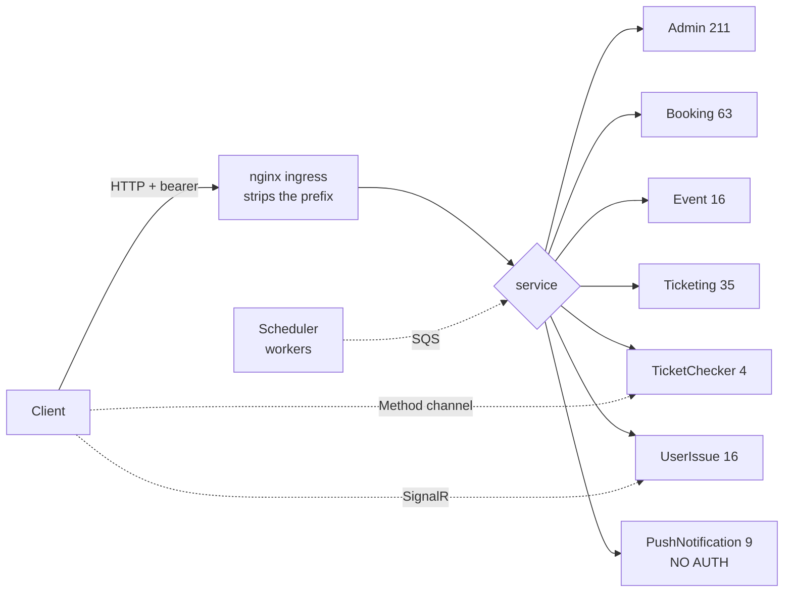

# 91 · Appendix B — এন্ডপয়েন্ট ইনডেক্স

> **Bangla name:** এন্ডপয়েন্ট ইনডেক্স
>
> [← সূচিপত্র](README.md) · [ওপেন কোয়ারি](99-open-queries.md)

Backend-এর প্রতিটি HTTP endpoint-এর controller-level index, সঙ্গে সেগুলো ব্যবহার করে এমন ফিচার ফাইলগুলো। আপনার হাতে একটি request path আছে এবং জানতে চাইছেন **কোন screen থেকে এটি এসেছে** বা **কোন screen-এ এটি দেখা উচিত** — এই পাতাটি ব্যবহার করুন।

## 1. একটি path কীভাবে পড়বেন

একটি বাহ্যিক URL তিনটি অংশ দিয়ে তৈরি:

```
/{Application:ServiceName}/{[Route] on the controller}/{[Http*] route}
```

অর্থাৎ TicketChecker-এ (যার `ServiceName` হলো `ticketChecker`) `[Route("api/v1/tickets")]` এবং `[HttpPost("sync-tickets")]`-ওয়ালা `TicketsController` বাইরে থেকে হয়:

```
POST /ticketChecker/api/v1/tickets/sync-tickets
```

Prefix যোগ করে প্রতিটি `Program.cs`-এর `GlobalRoutePrefixConvention`, আর nginx ingress সেটি শেষ করে — দেখুন [00 · প্ল্যাটফর্ম প্রাইমার](00-platform-primer.md) §2।

## 2. Service অনুযায়ী ইনডেক্স

সংখ্যা দেওয়া হলো service-এর controller-গুলোতে পাওয়া route attribute-এর সংখ্যা।

### 2.1 Admin — `/admin`, পোর্ট 5101, ৩৩টি controller, ২১১টি route

| Controller | Route prefix | Route | ফিচার |
|---|---|---|---|
| `ProgramController` | `api/v1/program` | 5 | [A-01](10-admin-portal/A-01-program-selection.md), [A-02](10-admin-portal/A-02-programs.md) |
| `ProgramSettingsController` | `api/v1/program-settings` | 3 | [A-03](10-admin-portal/A-03-program-settings.md) |
| `TeamsController` | `api/v1/teams` | 8 | [A-04](10-admin-portal/A-04-teams.md) |
| `VenuesController` | `api/v1/venues` | 20 | [A-05](10-admin-portal/A-05-venues.md) |
| `ProgramVenueController` | `api/v1/programVenue` | 2 | [A-06](10-admin-portal/A-06-program-venue-mapping.md) |
| `ProgramVenueDetailsController` | `api/v1/programVenueDetails` | 7 | [A-06](10-admin-portal/A-06-program-venue-mapping.md), [A-09](10-admin-portal/A-09-event-level-pricing.md) |
| `EventsController` | `api/v1/events` | 17 | [A-07](10-admin-portal/A-07-events.md) |
| `EventSettingsController` | `api/v1/event-settings` | 2 | [A-08](10-admin-portal/A-08-event-settings.md) |
| `EventsVenueDetailsController` | `api/v1/eventsVenueDetails` | 5 | [A-09](10-admin-portal/A-09-event-level-pricing.md) |
| `BlockLevelEntryGateController` | `api/v1/block-level-entry-gate` | 1 | [A-09](10-admin-portal/A-09-event-level-pricing.md) |
| `EventCapacityAdjustmentController` (Booking) | `api/v1/event-capacity-adjustment` | 4 | [A-10](10-admin-portal/A-10-capacity-adjustment.md) |
| `SeatReservationController` (Booking) | `api/v1/seat-reservation` | 15 | [A-11](10-admin-portal/A-11-seat-reservation.md), [A-12](10-admin-portal/A-12-reserved-tickets.md) |
| `TicketLayoutConfigsController` | `api/v1/ticket-layout` | 19 | [A-13](10-admin-portal/A-13-ticket-layouts.md) |
| `TicketAttributesController` | `api/v1/ticket-attributes` | 4 | [A-13](10-admin-portal/A-13-ticket-layouts.md) |
| `TicketPricingController` | `api/v1/ticket-pricing` | 9 | [A-14](10-admin-portal/A-14-ticket-pricing-content.md) — **গ্রাহকের pricing page এটি পড়ে না** |
| `PromoCodeController` | `api/v1/promo-codes` | 8 | [A-15](10-admin-portal/A-15-promo-codes.md), [P-05](20-user-portal/P-05-apply-promo-code.md) |
| `DiscountController` | `api/v1/discount` | 8 | [A-16](10-admin-portal/A-16-discounts.md), [U-04](30-user-app/U-04-seat-selection-promo.md) |
| `TicketCheckerController` | `api/v1/ticket-checker` | 11 | [A-17](10-admin-portal/A-17-ticket-checker-users.md) |
| `TicketCheckerGateController` | `api/v1/ticket-checker-gate` | 14 | [A-18](10-admin-portal/A-18-gate-assignment.md), [C-01](40-checker-app/C-01-assigned-event-gate.md) |
| `RaffleDrawController` | `api/v1/raffle-draw` | 4 | [A-20](10-admin-portal/A-20-raffle-draw.md) |
| `DashboardController` | `api/v1/dashboard` | 2 | [A-21](10-admin-portal/A-21-dashboard.md) |
| `ReportController` (Booking) | `api/v1/report` | 8 | [A-22](10-admin-portal/A-22-reports.md) |
| `BookingReportController` (Booking) | `api/v1/dashboard` | 4 | [A-21](10-admin-portal/A-21-dashboard.md), [A-22](10-admin-portal/A-22-reports.md) |
| `UserIssueController` | `api/v1/user-issue` | 7 | [A-24](10-admin-portal/A-24-user-issues-admin.md) |
| `UserIssueChatController` | `api/v1/user-issue-chat` | 8 | **Legacy কপি**, auth নেই — [Appendix A §2.1](90-appendix-a-legacy.md), [Q-46](99-open-queries.md) |
| `AdminUsersController` | `api/v1/admin-users` | 10 | [A-25](10-admin-portal/A-25-admin-users.md), [X-05](60-cross-cutting/X-05-admin-provisioning.md) |
| `AgentUserController` | `api/v1/agent-users` | 8 | [A-26](10-admin-portal/A-26-agent-users.md), [X-13](60-cross-cutting/X-13-agent-pool.md) |
| `ActivityLogController` | `api/v1/activity-log` | 3 | [A-27](10-admin-portal/A-27-activity-log.md), [X-24](60-cross-cutting/X-24-activity-logging.md) |
| `LandingPageImageController` | `api/v1/landing-page-image` | 11 | [A-28](10-admin-portal/A-28-media-configuration.md) |
| `GalleryController` | `api/v1/gallery` | 1 | [A-28](10-admin-portal/A-28-media-configuration.md) |
| `HeaderFooterController` | `api/v1/header-footer` | 2 | [A-30](10-admin-portal/A-30-header-footer-social.md) |
| `SocialMediaSettingsController` | `api/v1/social-media-settings` | 2 | **Legacy** record — [A-30](10-admin-portal/A-30-header-footer-social.md), [Q-34](99-open-queries.md) |
| `GeneralNoticeController` | `api/v1/general-notice` | 6 | [A-31](10-admin-portal/A-31-general-notices.md) — **portal এটি পড়ে না** |
| `SystemSettingsController` | `api/v1/system-settings` | 1 | [X-26](60-cross-cutting/X-26-configuration.md) |
| `CurrencyController` | `api/v1/currency` | 1 | Dormant |
| `PortalUsersController` | `api/v1/portal-users` | 1 | Dormant |
| `TokenIssuerController` | `api/v1/token` | 1 | [X-04](60-cross-cutting/X-04-admin-session.md) |

### 2.2 Booking — `/booking`, পোর্ট 5102, ৬টি controller, ৬৩টি route

| Controller | Route prefix | Route | ফিচার |
|---|---|---|---|
| `UserBookingOrderController` | `api/v1/user-booking-order` | 23 | [P-06](20-user-portal/P-06-booking-payment.md), [P-07](20-user-portal/P-07-my-bookings.md), [P-08](20-user-portal/P-08-ticket-generation-request.md), [A-23](10-admin-portal/A-23-reconciliation.md), [U-05](30-user-app/U-05-booking-webview-payment.md), [U-06](30-user-app/U-06-my-bookings-tickets.md) |
| `CapacityController` | `api/v1/capacity` | 9 | [P-04](20-user-portal/P-04-seat-selection.md), [U-04](30-user-app/U-04-seat-selection-promo.md), [S-01](50-system-initiated/S-01-level-capacity-update.md) |
| `SeatReservationController` | `api/v1/seat-reservation` | 15 | [A-11](10-admin-portal/A-11-seat-reservation.md), [A-12](10-admin-portal/A-12-reserved-tickets.md) |
| `EventCapacityAdjustmentController` | `api/v1/event-capacity-adjustment` | 4 | [A-10](10-admin-portal/A-10-capacity-adjustment.md) |
| `ReportController` | `api/v1/report` | 8 | [A-22](10-admin-portal/A-22-reports.md) |
| `BookingReportController` | `api/v1/dashboard` | 4 | [A-21](10-admin-portal/A-21-dashboard.md) |

### 2.3 Event — `/event`, পোর্ট 5103, ৬টি controller, ১৬টি route

সবগুলোই public, token লাগে না। Content দেখাতে portal ও app এই endpointগুলো পড়ে।

| Controller | Route prefix | Route | ফিচার |
|---|---|---|---|
| `EventsController` | `api/v1/events` | 9 | [P-02](20-user-portal/P-02-browse-events.md), [U-02](30-user-app/U-02-home-browse-events.md) |
| `ProgramController` | `api/v1/events/programs` | 2 | [P-01](20-user-portal/P-01-home-content.md), [U-02](30-user-app/U-02-home-browse-events.md) |
| `LandingPageImageController` | `api/v1/landing-page-image` | 1 | [P-01](20-user-portal/P-01-home-content.md), [U-02](30-user-app/U-02-home-browse-events.md), [U-03](30-user-app/U-03-info-pages.md) — **gallery-র সঙ্গে shared** ([Q-53](99-open-queries.md)) |
| `TicketPricingController` | `api/v1/ticket-pricing` | 2 | [P-03](20-user-portal/P-03-info-pages.md), [U-03](30-user-app/U-03-info-pages.md) (`program-pricing`) |
| `HeaderFooterController` | `api/v1/header-footer` | 1 | [P-01](20-user-portal/P-01-home-content.md) |
| `HomeController` | (root) | 1 | Home aggregate |

### 2.4 Ticketing — `/ticketing`, পোর্ট 5108, ৩টি controller, ৩৫টি route

| Controller | Route prefix | Route | ফিচার |
|---|---|---|---|
| `BookingOrderTicketController` | `api/v1/booking-order-ticket` | 33 | [P-08](20-user-portal/P-08-ticket-generation-request.md), [P-09](20-user-portal/P-09-ticket-details-downloads.md), [P-10](20-user-portal/P-10-oneid-ticket-sync.md), [U-06](30-user-app/U-06-my-bookings-tickets.md), [S-06](50-system-initiated/S-06-booking-status-generated.md), [S-07](50-system-initiated/S-07-initiate-user-ticket-generation.md), [S-08](50-system-initiated/S-08-ticket-signing.md), [S-09](50-system-initiated/S-09-ticket-merge-zip.md) |
| `OfflineTicketSoldController` | `api/v1/offline-sold-ticket` | 1 | শুধু agent, কোনো client নেই — [X-13](60-cross-cutting/X-13-agent-pool.md), [Q-07](99-open-queries.md) |
| `TestTicketGeneratorController` | `api/TestTicketGenerator` | 1 | **Dead, auth নেই** — [Appendix A §3](90-appendix-a-legacy.md) |

### 2.5 TicketChecker — `/ticketChecker`, পোর্ট 5107, ৩টি controller, ৪টি route

| Controller | Route prefix | Route | ফিচার |
|---|---|---|---|
| `TicketController` | `api/v1/tickets` | 1 | [C-02](40-checker-app/C-02-offline-ticket-download.md), [C-05](40-checker-app/C-05-ticket-sync.md) (`POST sync-tickets`) |
| `TestingController` | `api/v1/testing` | 2 | **Dead, auth নেই** — [Appendix A §3](90-appendix-a-legacy.md) |
| `WeatherForecastController` | `api/[controller]` | 1 | Stub |

### 2.6 UserIssue — `/userissue`, পোর্ট 5110, ২টি controller, ১৬টি route

লক্ষ্য করুন: `appsettings.json`-এ **`Application:ServiceName` নেই**, তাই prefix অন্য service-গুলোর চেয়ে ভিন্নভাবে যোগ হয় — deployed route যাচাই করে নিন।

| Controller | Route prefix | Route | ফিচার |
|---|---|---|---|
| `ReportIssueController` | `api/v1/user-issue` | 8 | [P-12](20-user-portal/P-12-issues-chat.md), [U-08](30-user-app/U-08-issues-chat.md) |
| `ReportIssueChatController` | `api/v1/user-issue-chat` | 8 | [P-12](20-user-portal/P-12-issues-chat.md), [U-08](30-user-app/U-08-issues-chat.md) — **auth নেই** ([Q-46](99-open-queries.md)) |

### 2.7 PushNotification — `/pushnotification`, পোর্ট 5105, ২টি controller, ৯টি route

Authentication middleware **পুরো service জুড়ে নিষ্ক্রিয়** — নিচের প্রতিটি route খোলা ([Q-62](99-open-queries.md), [X-18](60-cross-cutting/X-18-endpoints-without-auth.md))।

| Controller | Route prefix | Route | ফিচার |
|---|---|---|---|
| `DeviceTokenController` | `api/v1/device-token` | 5 | [U-09](30-user-app/U-09-device-token.md), [S-13](50-system-initiated/S-13-device-token-cleanup.md) |
| `NotificationController` | `api/v1/push-notification` | 4 | [X-23](60-cross-cutting/X-23-push-firebase.md), [S-11](50-system-initiated/S-11-firebase-notification.md) |

### 2.8 যেসব service-এর কোনো controller নেই

| Service | Prefix | পোর্ট | কী আছে |
|---|---|---|---|
| **Scheduler** | `/scheduler` | 5106 | শুধু worker — [S-11](50-system-initiated/S-11-firebase-notification.md) … [S-15](50-system-initiated/S-15-gate-download-status-cleanup.md) |
| **Utility** | `/utility` | 5111 | শুধু worker — [S-09](50-system-initiated/S-09-ticket-merge-zip.md) |
| **Platform** | `/platform` | 5104 | Stub |
| **UserAuth** | `/userAuth` | 5109 | Stub (শুধু `/health`) |

## 3. HTTP ছাড়া অন্য interface

Endpoint নয়, তবে ক্লায়েন্ট যেভাবে প্ল্যাটফর্মে পৌঁছায়।

| ধরন | কোথায় | কে ব্যবহার করে | ফিচার |
|---|---|---|---|
| **SignalR hub** | `/userissue/chathub`, `/admin/chathub` | Portal ও app-এর chat | [P-12](20-user-portal/P-12-issues-chat.md), [U-08](30-user-app/U-08-issues-chat.md) |
| **Method channel** | `certificate/methods` (`verifyCertificate`) | Checker app | [C-03](40-checker-app/C-03-qr-scan-validation.md) — **শুধু Android**, iOS-এ কোনো handler নেই ([Q-72](99-open-queries.md)) |
| **SQS queue** | ৬টি queue | Service ও worker | [50 · সিস্টেম-ইনিসিয়েটেড](50-system-initiated/README.md) |
| **বাহ্যিক identity API** | `user/*`, `otp/*` | Portal, app | [X-06](60-cross-cutting/X-06-user-registration.md), [P-11](20-user-portal/P-11-profile.md) — workspace-এ নেই ([Q-01](99-open-queries.md)) |

## 4. যে endpointগুলো নিয়ে আপনি সবার আগে কাজ করবেন

আপনি স্থানীয় environment সাজাচ্ছেন বা একটি smoke test লিখছেন — এই নয়টি endpoint প্রোডাক্টের বেশিরভাগ ঢেকে দেয়।

| # | Endpoint | কেন |
|---|---|---|
| 1 | `POST /admin/api/v1/program` | সবকিছু যার উপর দাঁড়িয়ে আছে সেই program তৈরি ([A-02](10-admin-portal/A-02-programs.md)) |
| 2 | `POST /admin/api/v1/venues` | একটি venue তৈরি ([A-05](10-admin-portal/A-05-venues.md)) |
| 3 | `POST /admin/api/v1/ticket-layout` | একটি layout upload ও **publish** করা — event-এর আগে প্রয়োজন ([A-13](10-admin-portal/A-13-ticket-layouts.md)) |
| 4 | `POST /admin/api/v1/events` | একটি event তৈরি ও publish করা ([A-07](10-admin-portal/A-07-events.md)) |
| 5 | `GET /event/api/v1/events/list` | Event-টি public হয়েছে কি না নিশ্চিত করা ([P-02](20-user-portal/P-02-browse-events.md)) |
| 6 | `GET /booking/api/v1/capacity/level-user-portal-seats` | গ্রাহক যে আসনগুলো দেখেন ([P-04](20-user-portal/P-04-seat-selection.md)) |
| 7 | `POST /booking/api/v1/user-booking-order` | একটি order তৈরি ([P-06](20-user-portal/P-06-booking-payment.md)) |
| 8 | `POST /ticketChecker/api/v1/tickets/sync-tickets` | চেকারের download ও upload — একই endpoint ([C-02](40-checker-app/C-02-offline-ticket-download.md), [C-05](40-checker-app/C-05-ticket-sync.md)) |
| 9 | `GET /admin/api/v1/ticket-checker-gate/event-info` | চেকারের assignment ([C-01](40-checker-app/C-01-assigned-event-gate.md)) |

## 5. Postman collection

ওয়ার্কস্পেসে `postman/`-এর নিচে collection রয়েছে, সবগুলোই local service-এর বিপরীতে:

| Collection | কী ঢাকে |
|---|---|
| `services/etp-admin.postman_collection.json` | Admin service |
| `services/etp-booking.postman_collection.json` | Booking service |
| `services/etp-event.postman_collection.json` | Event service |
| `services/etp-ticketing.postman_collection.json` | Ticketing service |
| `services/etp-ticketchecker.postman_collection.json` | TicketChecker service |
| `services/etp-pushnotification.postman_collection.json` | PushNotification service |
| `services/etp-userissue.postman_collection.json` | UserIssue service |
| `services/etp-cognito-auth.postman_collection.json` | Cognito pool sign-in |
| `etp-login-all-pools.postman_collection.json` | চারটি pool-এই sign in |

Environment: `etp-local-services.postman_environment.json`, `etp-local-floci.postman_environment.json`।

**যেসবের জন্য কোনো collection নেই:** বাহ্যিক identity API ([Q-01](99-open-queries.md)), OneID wallet ([Q-06](99-open-queries.md)), অথবা token ছাড়া PushNotification-এর send endpoint। যেকোনো ফিচারের test guide-এ "not in any collection" বলা থাকলে তা এগুলোকেই বোঝায়।

## 6. কম্পোনেন্ট সম্পর্ক



**নির্ভর করে:** [00 · প্ল্যাটফর্ম প্রাইমার](00-platform-primer.md) (service তালিকা), [Appendix A](90-appendix-a-legacy.md) (কোন endpointগুলো dead)। **প্রভাব ফেলে:** [02 · ট্রেসেবিলিটি ম্যাট্রিক্স](02-traceability-matrix.md) — এই পাতা তার endpoint অংশ।