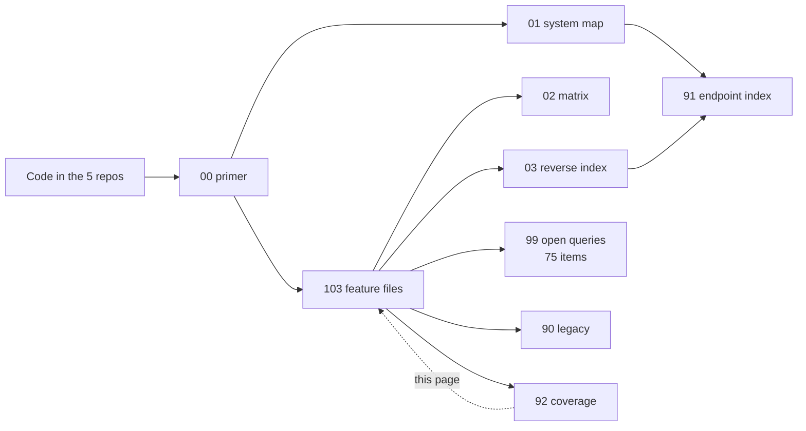

# 92 · অ্যাপেন্ডিক্স C — কভারেজ

> **Bangla name:** কভারেজ
>
> [← সূচিপত্র](README.md) · [লোকাল টেস্ট রেফারেন্স](93-appendix-d-local-test-reference.md) · [ওপেন কোয়ারি](99-open-queries.md)

এই ডকুমেন্টেশনে কী কভার করা হয়েছে, কী সচেতনভাবে করা হয়নি, এবং কোথায় কভারেজ পাতলা — সব তা এখানে। আপনার কোনো প্রশ্নের উত্তর এখানে পাবেন কি না, তা বিচার করতে এটি ব্যবহার করুন।

## 1. কী নথিভুক্ত হয়েছে

| সেকশন | ফিচার | ফাইল |
|---|---|---|
| [00 · প্ল্যাটফর্ম প্রাইমার](00-platform-primer.md) | — (পটভূমি) | 1 |
| [01 · সিস্টেম ম্যাপ](01-system-map.md) | — (সূচক) | 1 |
| [02 · ট্রেসেবিলিটি ম্যাট্রিক্স](02-traceability-matrix.md) | — (সূচক) | 1 |
| [03 · কম্পোনেন্ট রিভার্স ইনডেক্স](03-component-reverse-index.md) | — (সূচক) | 1 |
| [10 · অ্যাডমিন পোর্টাল](10-admin-portal/README.md) | A-01 … A-31 | 31 + README |
| [20 · ইউজার পোর্টাল](20-user-portal/README.md) | P-01 … P-13 | 13 + README |
| [30 · ইউজার অ্যাপ](30-user-app/README.md) | U-01 … U-10 | 10 + README |
| [40 · চেকার অ্যাপ](40-checker-app/README.md) | C-01 … C-06 | 6 + README |
| [50 · সিস্টেম-ইনিসিয়েটেড](50-system-initiated/README.md) | S-01 … S-17 | 17 + README |
| [60 · ক্রস-কাটিং](60-cross-cutting/README.md) | X-01 … X-26 | 26 + README |
| [90–93 · অ্যাপেন্ডিক্স](90-appendix-a-legacy.md) | — (রেফারেন্স) | 4 |
| [99 · ওপেন কোয়ারি](99-open-queries.md) | — (কোয়ারি) | 1 |

**মোট: 103টি ফিচার ফাইল**, প্রতিটিই একই এগারোটি পয়েন্টের টেমপ্লেট অনুসরণ করে।

## 2. প্রতিটি ফিচার ফাইলে কী থাকে

প্রতিটি ফাইল এই ক্রমে উত্তর দেয়:

| § | সেকশন | সবসময় আছে? |
|---|---|---|
| 1 | নাম ও উদ্দেশ্য | হ্যাঁ |
| 2 | ট্রিগার ও অ্যাক্টর | হ্যাঁ |
| 3 | ব্যবসায়িক প্রবাহ | হ্যাঁ |
| 4 | **প্রযুক্তিগত প্রবাহ** — হপ-বাই-হপ পথ, `[HTTP + token]` / `[SQS: key]` / `[Worker: interval, lock]` ট্যাগ সহ | হ্যাঁ |
| 5 | কম্পোনেন্ট | হ্যাঁ |
| 6 | API কন্ট্রাক্ট | হ্যাঁ, উত্তর "None" হলেও |
| 7 | ডেটা ও পার্শ্বপ্রতিক্রিয়া | হ্যাঁ |
| 8 | কোড রেফারেন্স | হ্যাঁ |
| 9 | **হ্যান্ডওভার নোট** — ফান্ডিংস, ঝুঁকি ও `[UNCONFIRMED: Q-nn]` মার্কার | হ্যাঁ |
| 10 | কম্পোনেন্ট সম্পর্ক (mermaid) | হ্যাঁ |
| 11 | **ডেভেলপার টেস্ট গাইড** — টেস্ট ডেটা, ব্রেকপয়েন্ট ও যাচাইয়ের উপায় | হ্যাঁ |

হ্যান্ডওভারের জন্য সবচেয়ে মূল্যবান তিনটি সেকশন হলো **4**, **9** ও **11**।

## 3. প্ল্যাটফর্ম ক্ষেত্র অনুযায়ী কভারেজ

| ক্ষেত্র | নথিভুক্ত | কতটা ভালো | ফাঁক |
|---|---|---|---|
| **অ্যাডমিন মাস্টার ডেটা** (প্রোগ্রাম, ভেন্যু, ইভেন্ট, মূল্য, লেআউট) | 14টি ফিচার | বিস্তারিত | — |
| **বুকিং ও পেমেন্ট** | 8টি ফিচার | বিস্তারিত | আসল gateway স্থানীয়ভাবে পরীক্ষা করা যায় না |
| **টিকিট জেনারেশন ও সাইনিং** | 6টি ফিচার | কোড পথে বিস্তারিত | আসল TSP সাইনিং পরীক্ষা করা যায় না ([Q-06](99-open-queries.md), [Q-13](99-open-queries.md)) |
| **চেকার অ্যাপ** | 6টি ফিচার | বিস্তারিত | **iOS একেবারে পরীক্ষা করা যায় না** ([Q-72](99-open-queries.md)) |
| **সাপোর্ট ও ইস্যু** | 3টি ফিচার | বিস্তারিত | নোটিফিকেশন দিকটি বাহ্যিক ([Q-05](99-open-queries.md)) |
| **পুশ নোটিফিকেশন** | 4টি ফিচার | ভালো | Firebase ডেলিভারি পরীক্ষা করা যায় না ([X-23](60-cross-cutting/X-23-push-firebase.md)) |
| **পরিচয় ও auth** | 13টি ফিচার | **স্বাভাবিকভাবেই আংশিক** | identity API-এর কোনো সোর্স নেই ([Q-01](99-open-queries.md)) |
| **এজেন্ট / অফলাইন বিক্রি** | 2টি ফিচার | পাতলা | কোনো ক্লায়েন্ট নেই ([Q-07](99-open-queries.md)) |
| **অবকাঠামো** (Redis, S3, SES, SMS, কনফিগ, লগিং) | 8টি ফিচার | ভালো | ডিপ্লয়মেন্টের মান অজানা ([Q-02](99-open-queries.md), [Q-04](99-open-queries.md)) |
| **ওয়ার্কার ও কিউ** | 17টি ফিচার | বিস্তারিত | কোনো dead-letter হ্যান্ডলিং নেই ([Q-09](99-open-queries.md)) |
| **অ্যাডমিন রিপোর্টিং** | 5টি ফিচার | ভালো | রিপোর্টের সংজ্ঞা ও time zone স্পষ্ট নয় ([Q-28](99-open-queries.md), [Q-30](99-open-queries.md)) |

## 4. যা সচেতনভাবে নথিভুক্ত করা হয়নি

| যা কভার হয়নি | কেন | যেখানে আছে |
|---|---|---|
| **identity API-এর ইমপ্লিমেন্টেশন** | ওয়ার্কস্পেসে নেই | [Q-01](99-open-queries.md) — BS23-কে জিজ্ঞাসা করুন |
| **OneID-এর ইমপ্লিমেন্টেশন** | বাহ্যিক, স্থানীয়ভাবে dummy | `docs/user-portal-local.md` §5 |
| **বাহ্যিক নোটিফিকেশন সার্ভিসের টেমপ্লেট** | বাহ্যিক | [Q-05](99-open-queries.md) |
| **NBR VAT-এর API** | বাহ্যিক | [Q-06](99-open-queries.md) |
| **ডিপ্লয়মেন্ট ম্যানিফেস্ট, Terraform, ingress নিয়ম** | ওয়ার্কস্পেসে নেই | `architecture/gobcb-aws-architecture.md` (BS23-এর ডকুমেন্ট, এখানে যাচাই করা হয়নি) |
| **ডেটাবেস স্কিমার DDL** | migration দিয়ে তৈরি হয় | `Services/*/ETP.*.Storage/Migrations/` |
| **Unit ও integration টেস্ট স্যুট** | পাঁচটি রিপোজিটরিতে প্রায় কিছুই নেই | — দেখুন §6 |
| **জেনারেট হওয়া drift `.g.dart` ফাইল** | জেনারেট করা | `data/lib/local/drift_database/*.g.dart` |
| **AWS অ্যাকাউন্টের নির্দিষ্ট তথ্য** | BS23-এর | `docs/rvl-handover-AWS-access-summary.md` |

## 5. কোডের কভারেজ

| কম্পোনেন্ট | আকার | নথিভুক্ত |
|---|---|---|
| 11টি ব্যাকএন্ড সার্ভিস | 58টি কন্ট্রোলার, 354টি রুট | প্রতিটি কন্ট্রোলার [91](91-appendix-b-endpoint-index.md)-এ সূচকবদ্ধ |
| 17টি ব্যাকগ্রাউন্ড ওয়ার্কার | — | প্রতিটি ওয়ার্কার [03 §6](03-component-reverse-index.md)-এ |
| 6টি SQS কিউ | — | প্রতিটি কিউ [03 §5](03-component-reverse-index.md)-এ |
| ~30টি Redis key family | — | প্রতিটি key family [03 §4](03-component-reverse-index.md)-এ |
| ~70টি ডেটাবেস টেবিল | — | প্রতিটি টেবিল [03 §3](03-component-reverse-index.md)-এ |
| অ্যাডমিন পোর্টাল | 31টি স্ক্রিন | সব 31টি ফিচার |
| ইউজার পোর্টাল | 13টি ফিচার | সব 13টি |
| ইউজার অ্যাপ | 10টি ফিচার | সব 10টি |
| চেকার অ্যাপ | 6টি ফিচার | সব 6টি |

**ডকুমেন্টেশনের কোড কভারেজ ফিচার-লেভেলে সম্পূর্ণ।** যেটা বদলায় তা হলো গভীরতা: সহজ প্রবাহগুলো সংক্ষেপে নথিভুক্ত, আর যেগুলোতে অপ্রত্যাশিত কিছু লুকানো আছে সেগুলো বিস্তারিতভাবে।

## 6. পণ্যের ফাঁক, ডকুমেন্টেশনের নয়

**পাঁচটি রিপোজিটরির কোনোটিতেই অর্থবহ অটোমেটেড টেস্ট স্যুট নেই।** যা আছে তা ম্যানুয়াল টেস্ট নির্দেশিকা — প্রতিটি ফিচার ফাইলের §11 ডেভেলপার টেস্ট গাইড।

অর্থাৎ:

- হ্যান্ডওভার নোটে তালিকাভুক্ত প্রতিটি রিগ্রেশন ঝুঁকি CI দ্বারা অরক্ষিত।
- কোনো আচরণ চুপচাপ বদলে যেতে পারে, কারণ কিছুই তা দাবি করে না।
- টেস্ট লেখা পর্যন্ত §11 গাইডগুলোই একমাত্র রিগ্রেশন সুরক্ষা।

হ্যান্ডওভারের পর RVL যদি একটি বিনিয়োগকে অগ্রাধিকার দেয়, তা হওয়া উচিত সবচেয়ে বেশি ফান্ডিং থাকা প্রবাহগুলোর চারপাশে characterisation test লেখা: চেকার ভ্যালিডেশন পথ ([C-03](40-checker-app/C-03-qr-scan-validation.md)), পেমেন্ট callback ([P-06](20-user-portal/P-06-booking-payment.md)) এবং চ্যাট অনুমোদন ([P-12](20-user-portal/P-12-issues-chat.md))।

## 7. আস্থা

| বক্তব্যের ধরন | আস্থা | নোট |
|---|---|---|
| "এই ফাইলটি এই পাথে আছে" | **যাচাই করা** | এই পর্যালোচনায় প্রতিটি কোড রেফারেন্স পড়া হয়েছে |
| "এই এন্ডপয়েন্টটি এই ফাইল থেকে কল হয়" | **যাচাই করা** | কল সাইট পড়া হয়েছে, অনুমান করা হয়নি |
| "কোড এটা করে" | **উচ্চ** | কোড পড়া হয়েছে |
| "এটা যা করার *করা উচিত* ছিল" | **`[UNCONFIRMED]` চিহ্নিত** | [99](99-open-queries.md)-এ 75টি ওপেন কোয়ারি |
| "ডিপ্লয় করা সিস্টেম যা করে" | **অজানা** | ডিপ্লয়মেন্টের মান ওয়ার্কস্পেসে নেই ([Q-02](99-open-queries.md), [Q-04](99-open-queries.md), [Q-06](99-open-queries.md)) |

যেখানে এই ডকুমেন্টেশন ও BS23-এর `gobcb-aws-architecture.md` মতভেদ করে, **কোডই জেতে** — আর্কিটেকচার ডকুমেন্টটি ডিপ্লয়মেন্টের অভিসন্ধি বর্ণনা করে, আর এই ডকুমেন্টেশন বর্ণনা করে ওয়ার্কস্পেসের কোড আসলে যা করে।

## 8. পরিচিত পাতলা জায়গা

| জায়গা | কেন পাতলা |
|---|---|
| [X-13](60-cross-cutting/X-13-agent-pool.md) / [A-26](10-admin-portal/A-26-agent-users.md) | শুধু ব্যাকএন্ডের অর্ধেক আছে; ট্রেস করার মতো কোনো ক্লায়েন্ট নেই ([Q-07](99-open-queries.md)) |
| [A-20](10-admin-portal/A-20-raffle-draw.md) raffle draw | ছোট ফিচার; Serverless lookup স্থানীয়ভাবে dummy |
| [A-28](10-admin-portal/A-28-media-configuration.md) media | গ্যালারি ও ব্যানার একই এন্ডপয়েন্ট ব্যবহার করে ([Q-53](99-open-queries.md)) |
| [A-27](10-admin-portal/A-27-activity-log.md) activity log | পাতলা, কারণ বিস্তারিত [X-24](60-cross-cutting/X-24-activity-logging.md) বহন করে |
| [P-13](20-user-portal/P-13-language-switch.md) language switch | সম্পূর্ণ ক্লায়েন্ট-সাইড; সার্ভারে ট্রেস করার কিছু নেই |
| [U-10](30-user-app/U-10-push-receipt.md) push receipt | ট্রেস করার মতো কোনো সার্ভার-সাইড কম্পোনেন্ট নেই — এটাই ফান্ডিং ([Q-65](99-open-queries.md)) |
| [S-15](50-system-initiated/S-15-gate-download-status-cleanup.md), [S-16](50-system-initiated/S-16-promo-code-status.md), [S-17](50-system-initiated/S-17-discount-status.md) | সহজ স্ট্যাটাস-আপডেট ওয়ার্কার, উল্লেখ করা ছাড়া আর কোনো অপ্রত্যাশিত কিছু নেই |

## 9. এই ডকুমেন্টেশন কীভাবে সম্প্রসারিত করবেন

এগারোটি পয়েন্টের টেমপ্লেটটিই চুক্তি। নতুন ফিচার যোগ করতে:

1. একই সেকশনের একটি বিদ্যমান ফাইল কপি করুন।
2. এগারোটি সেকশন ক্রম অপরিবর্তিত রাখুন। §6 ও §7-এর জন্য "None" একটি বৈধ উত্তর — সেকশনটি মুছে ফেলার বদলে সেটি লিখুন।
3. প্রযুক্তিগত-প্রবাহের প্রতিটি হপে এগুলোর একটি ট্যাগ দিন: `[HTTP + user token]`, `[HTTP + admin token]`, `[HTTP, no token]`, `[SQS: <queue>]`, `[Worker: <interval>, <lock>]`, `[External: <system>]`, `[Local: <store>]`।
4. যা কিছু আপনি নিশ্চিত করতে পারছেন না তার জন্য একটি `[UNCONFIRMED: Q-nn]` মার্কার যোগ করুন, এবং একই পরিবর্তনে [99](99-open-queries.md)-এ তার সংজ্ঞা দিন।
5. সেকশনের README, [ট্রেসেবিলিটি ম্যাট্রিক্স](02-traceability-matrix.md) এবং [এন্ডপয়েন্ট ইনডেক্স](91-appendix-b-endpoint-index.md) হালনাগাদ করুন।
6. স্থানীয়ভাবে পরীক্ষা করা যায় — এই দাবিটি সত্যিই চালিয়ে যাচাই করুন।

## 10. কম্পোনেন্ট সম্পর্ক

**নির্ভর করে:** অন্য সব পাতার ওপর। **প্রভাব ফেলে:** §9 — এই ডকুমেন্টেশন নির্ভুল রাখার পদ্ধতি।