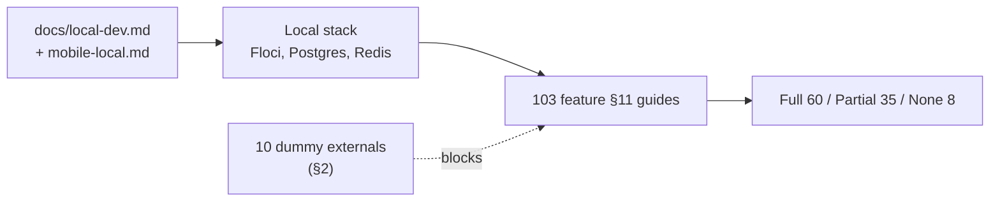

# 93 · অ্যাপেন্ডিক্স D — লোকাল টেস্ট রেফারেন্স

> **Bangla name:** লোকাল টেস্ট রেফারেন্স
>
> [← সূচিপত্র](README.md) · [কভারেজ](92-appendix-c-coverage.md)

প্রতিটি ফিচারের জন্য একটি করে সারি: **এটি স্থানীয়ভাবে পরীক্ষা করা যায় কি না, আর যদি না হয় তাহলে কেন।** প্রতিটি ফিচার ফাইলের নিজস্ব §11 ডেভেলপার টেস্ট গাইডে সুনির্দিষ্ট ধাপ আছে; এই পাতাটি সেই সূচক, যা বলে দেয় এগুলোর মধ্যে কোনগুলো আসলে আপনাকে কিছু দেখাবে।

## 1. সেটআপ ডকুমেন্ট

এখান থেকে শুরু করবেন না। এখান থেকে শুরু করুন, তারপর ফিরে আসুন:

| ডকুমেন্ট | যা কভার করে |
|---|---|
| [`docs/local-dev.md`](../../../local-dev.md) | পুরো ব্যাকএন্ড স্ট্যাক: PostgreSQL, Redis, DynamoDB Local, Floci (Cognito, S3, SQS, SES, DynamoDB), Aspire-এর নিচে নয়টি সার্ভিস, seeding, teardown |
| [`docs/mobile-local.md`](../../../mobile-local.md) | দুটি Flutter অ্যাপ: টুল, ডিভাইস, কীভাবে সেগুলো ব্যাকএন্ডে পৌঁছায়, এবং **§8 পরিচিত ফাঁক** |
| [`docs/admin-portal-local.md`](../../../admin-portal-local.md) | অ্যাডমিন পোর্টাল (এটি submodule নয়, লোকাল কপি থেকে চলে) |
| [`docs/user-portal-local.md`](../../../user-portal-local.md) | ইউজার পোর্টাল, `/p/identity` ও `/p/oneid` স্টাবসহ |
| [`docs/config-reference.md`](../../../config-reference.md) | প্রতিটি কনফিগারেশন key |
| [`docs/local-dev-setup.bn.md`](../../../local-dev-setup.bn.md) | বাংলায় সেটআপ ম্যানুয়াল |
| [`postman/`](../../../../postman/) | সার্ভিস কলেকশন ও লোকাল এনভায়রনমেন্ট |
| [`scripts/`](../../../../scripts/) | `user-secrets.example.json`, seed SQL, `Set-EtpSecrets.ps1` |

## 2. লোকাল স্ট্যাকে যা dummy

নিচের সবকিছুই stub করা। এই একটি টেবিলই §3-এর বেশিরভাগ "Partial" রেটিং ব্যাখ্যা করে।

| বাহ্যিক | লোকাল মান | পরিণতি |
|---|---|---|
| **DgePay** | dummy | অর্ডার তৈরি কাজ করে; পেমেন্ট পেজ ও callback কাজ করে না |
| **TSP (VDS)** | `https://tsp.invalid/…`, কোনো সার্টিফিকেট নেই | টিকিট `Requested`-এ পৌঁছায় কিন্তু কখনো সই হয় না — এতে আটকে যায় [S-08](50-system-initiated/S-08-ticket-signing.md), [S-09](50-system-initiated/S-09-ticket-merge-zip.md), [P-08](20-user-portal/P-08-ticket-generation-request.md), [C-03](40-checker-app/C-03-qr-scan-validation.md) |
| **OneID** | `/p/oneid`-এ fake | লগইন কাজ করে; টিকিট সিঙ্ক কাজ করে না ([P-10](20-user-portal/P-10-oneid-ticket-sync.md)) |
| **NBR VAT** | `https://*.invalid` | VAT মেসেজ চিরকাল রিট্রাই করে ([S-10](50-system-initiated/S-10-vat-challan.md)) |
| **Identity API** | 503 স্টাব, বা `/p/identity` | রেজিস্ট্রেশন, OTP, প্রোফাইল ও ডিলিট ঠিকভাবে পরীক্ষা করা যায় না ([Q-01](99-open-queries.md)) |
| **Serverless API** | `https://serverless.invalid/` | গ্রাহকের নাম/ফোন লুকআপ ফাঁকা ফেরত দেয় ([Q-03](99-open-queries.md)) |
| **Notification service** | `https://notification.invalid/` | প্রতিটি SMS ব্যর্থ হয় ([Q-05](99-open-queries.md)) |
| **Firebase** | dummy | কোনো পুশ কখনো ডেলিভার হয় না |
| **CloudFront signed cookie** | `local-dummy` | অ্যাডমিন-পোর্টালের ফাইল সুরক্ষা স্থানীয়ভাবে ব্যর্থ হয় ([X-20](60-cross-cutting/X-20-file-storage.md)) |
| **SES** | Floci SES, `noreply@etp.local` | পাঠানো গ্রহণ করা হয়; আসল মেল নেই ([X-21](60-cross-cutting/X-21-email-ses.md)) |

**Floci যা দেয় এবং যা আসল:** Cognito (সব চারটি পুল), S3 (বাকেট `etp-local`), SQS (আসল কিউ সেমান্টিক), SES, DynamoDB Local, PostgreSQL ও Redis।

## 3. ফিচারভিত্তিক পরীক্ষাযোগ্যতা

**Full** — স্থানীয়ভাবে কাজ করে। **Partial** — মূল পথ কাজ করে, নিচের দিকে কিছু dummy। **Not locally** — আসল বাহ্যিক সিস্টেম ছাড়া কোনো উপায়ে পরীক্ষা করার সুযোগ নেই।

### 3.1 অ্যাডমিন পোর্টাল

| Id | রেটিং | সীমাবদ্ধতা |
|---|---|---|
| [A-01](10-admin-portal/A-01-program-selection.md) | Full | — |
| [A-02](10-admin-portal/A-02-programs.md) | Full | S3 হলো Floci |
| [A-03](10-admin-portal/A-03-program-settings.md) | Full | — |
| [A-04](10-admin-portal/A-04-teams.md) | Full | — |
| [A-05](10-admin-portal/A-05-venues.md) | Full | seeded venue আছে |
| [A-06](10-admin-portal/A-06-program-venue-mapping.md) | Full | — |
| [A-07](10-admin-portal/A-07-events.md) | পুশ ছাড়া Full | dummy Firebase |
| [A-08](10-admin-portal/A-08-event-settings.md) | Full | — |
| [A-09](10-admin-portal/A-09-event-level-pricing.md) | Full | — |
| [A-10](10-admin-portal/A-10-capacity-adjustment.md) | Full | — |
| [A-11](10-admin-portal/A-11-seat-reservation.md) | Full | — |
| [A-12](10-admin-portal/A-12-reserved-tickets.md) | **Partial** | সাইনিংয়ের জন্য TSP দরকার; CloudFront cookie ব্যর্থ হয় |
| [A-13](10-admin-portal/A-13-ticket-layouts.md) | Full | — |
| [A-14](10-admin-portal/A-14-ticket-pricing-content.md) | Full | — |
| [A-15](10-admin-portal/A-15-promo-codes.md) | Full | — |
| [A-16](10-admin-portal/A-16-discounts.md) | Full | — |
| [A-17](10-admin-portal/A-17-ticket-checker-users.md) | **Partial** | Cognito কাজ করে; **ব্যবহারকারী তৈরি হওয়ার পরেই SMS ব্যর্থ হয়**, তাই তৈরিতে এরর দেয় |
| [A-18](10-admin-portal/A-18-gate-assignment.md) | Full (অ্যাডমিন দিক) | — |
| [A-19](10-admin-portal/A-19-gate-reports.md) | **Partial** | চেকার অ্যাপ স্থানীয়ভাবে সাইন ইন করতে পারে না; Postman বা seed ডেটা ব্যবহার করুন |
| [A-20](10-admin-portal/A-20-raffle-draw.md) | **Partial** | Serverless dummy; পার্টনার ও কম্প্লিমেন্টারি টিকিট কাজ করে |
| [A-21](10-admin-portal/A-21-dashboard.md) | Full | ডেটার জন্য `pwsh ./scripts/Seed-EtpData.ps1` |
| [A-22](10-admin-portal/A-22-reports.md) | Full | `scripts/seed/03-orders-tickets.sql` |
| [A-23](10-admin-portal/A-23-reconciliation.md) | **Partial** | Serverless dummy, তাই গ্রাহকের তথ্য ফাঁকা |
| [A-24](10-admin-portal/A-24-user-issues-admin.md) | **Partial** | সার্ভিস, হাব ও REST চলে; গ্রাহকের ডেটা চলে না |
| [A-25](10-admin-portal/A-25-admin-users.md) | **Partial** | একই তৈরির পরে SMS ব্যর্থতা |
| [A-26](10-admin-portal/A-26-agent-users.md) | **Partial** | একই |
| [A-27](10-admin-portal/A-27-activity-log.md) | Full | — |
| [A-28](10-admin-portal/A-28-media-configuration.md) | Full | — |
| [A-29](10-admin-portal/A-29-content-editor.md) | Full | — |
| [A-30](10-admin-portal/A-30-header-footer-social.md) | Full | — |
| [A-31](10-admin-portal/A-31-general-notices.md) | Full | — |

### 3.2 ইউজার পোর্টাল

| Id | রেটিং | সীমাবদ্ধতা |
|---|---|---|
| [P-01](20-user-portal/P-01-home-content.md) | Full | seeded hero, sponsor, notice ও FAQ সারি |
| [P-02](20-user-portal/P-02-browse-events.md) | Full | সাতটি seeded ম্যাচ |
| [P-03](20-user-portal/P-03-info-pages.md) | Full | — |
| [P-04](20-user-portal/P-04-seat-selection.md) | preview পর্যন্ত Full | স্থানীয়ভাবে পেমেন্ট সম্ভব নয় |
| [P-05](20-user-portal/P-05-apply-promo-code.md) | Full | — |
| [P-06](20-user-portal/P-06-booking-payment.md) | **Partial** | DgePay dummy |
| [P-07](20-user-portal/P-07-my-bookings.md) | Full | নয়টি seeded অর্ডার |
| [P-08](20-user-portal/P-08-ticket-generation-request.md) | **Partial** | টিকিট `Requested`-এ পৌঁছায়, কখনো সই হয় না |
| [P-09](20-user-portal/P-09-ticket-details-downloads.md) | **Partial** | হোল্ডার এডিট, বিবরণ ও ইনভয়েস কাজ করে; সই করা PDF seed-এর ওপর নির্ভর করে |
| [P-10](20-user-portal/P-10-oneid-ticket-sync.md) | **Not locally** | OneID dummy |
| [P-11](20-user-portal/P-11-profile.md) | **Partial** | `/p/identity`-এর বিরুদ্ধে চলে; OTP স্টাব `123456` |
| [P-12](20-user-portal/P-12-issues-chat.md) | REST Full / **হাব Partial** | হাবের WebSocket রুট দরকার; `skipNegotiation` ফলব্যাকটি সরিয়ে দেয় |
| [P-13](20-user-portal/P-13-language-switch.md) | Full | সম্পূর্ণ ক্লায়েন্ট-সাইড |

### 3.3 ইউজার অ্যাপ

| Id | রেটিং | সীমাবদ্ধতা |
|---|---|---|
| [U-01](30-user-app/U-01-splash-onboarding.md) | ভার্সন চেক ছাড়া Full | `allowed-app-version` স্টাব নেই; `/p/identity`-এ পয়েন্ট করুন |
| [U-02](30-user-app/U-02-home-browse-events.md) | Full | — |
| [U-03](30-user-app/U-03-info-pages.md) | Full | — |
| [U-04](30-user-app/U-04-seat-selection-promo.md) | রিড Full / **পেমেন্ট Partial** | একটি gateway sandbox দরকার |
| [U-05](30-user-app/U-05-booking-webview-payment.md) | **Partial** | অর্ডারের POST কাজ করে; gateway পেজ কাজ করে না |
| [U-06](30-user-app/U-06-my-bookings-tickets.md) | লিস্ট Full / **PDF Partial** | সাইনিং ও OneID স্থানীয়ভাবে নেই |
| [U-07](30-user-app/U-07-profile-settings.md) | **Partial** | `/p/identity`-এর বিরুদ্ধে চলে; Cognito কলের জন্য আসল পুল দরকার |
| [U-08](30-user-app/U-08-issues-chat.md) | REST Full / **হাব Partial** | — |
| [U-09](30-user-app/U-09-device-token.md) | **Partial** | কোড চলে; আসল টোকেন নেই |
| [U-10](30-user-app/U-10-push-receipt.md) | **Not locally** (ডেলিভারি) | ম্যানুয়াল নোটিফিকেশন দিয়ে ফোরগ্রাউন্ড রেন্ডারিং চালানো যায় |

### 3.4 চেকার অ্যাপ

| Id | রেটিং | সীমাবদ্ধতা |
|---|---|---|
| [C-01](40-checker-app/C-01-assigned-event-gate.md) | Full (API কল) | Cognito পুল পৌঁছানো বা seeded হতে হবে |
| [C-02](40-checker-app/C-02-offline-ticket-download.md) | Full | — |
| [C-03](40-checker-app/C-03-qr-scan-validation.md) | **Android-এ Full / iOS-এ নয়** | iOS-এ কোনো ক্রিপ্টো ইমপ্লিমেন্টেশন নেই ([Q-72](99-open-queries.md)) |
| [C-04](40-checker-app/C-04-manual-entry.md) | Full | কোনো নেটওয়ার্ক জড়িত নয় |
| [C-05](40-checker-app/C-05-ticket-sync.md) | Full | — |
| [C-06](40-checker-app/C-06-manual-ticket-validation.md) | **Android-এ Full / iOS-এ সবসময় ব্যর্থ** | — |

**চেকার অ্যাপ স্থানীয়ভাবে একেবারেই সাইন ইন করতে পারে না** — Amplify Flutter-কে Floci-র দিকে পয়েন্ট করানো যায় না ([X-12](60-cross-cutting/X-12-checker-login.md))। এ কারণেই [A-19](10-admin-portal/A-19-gate-reports.md) কেবল আংশিক: স্ক্যান Postman দিয়ে ইনজেক্ট করতে হয়।

### 3.5 সিস্টেম-ইনিসিয়েটেড

| Id | রেটিং | সীমাবদ্ধতা |
|---|---|---|
| [S-01](50-system-initiated/S-01-level-capacity-update.md) | Full | — |
| [S-02](50-system-initiated/S-02-event-live-capacity.md) | Full | — |
| [S-03](50-system-initiated/S-03-locked-capacity-refresh.md) | Full | — |
| [S-04](50-system-initiated/S-04-scheduler-capacity-update.md) | Full | — |
| [S-05](50-system-initiated/S-05-pending-failed-revalidation.md) | **Partial** | DgePay dummy → `GetPaymentStatus` ছুঁড়ে ফেলে → অর্ডার `Pending` থেকে যায় |
| [S-06](50-system-initiated/S-06-booking-status-generated.md) | **Partial** | সাইনিং ছাড়া অর্ডার কখনো `Generated`-এ পৌঁছায় না |
| [S-07](50-system-initiated/S-07-initiate-user-ticket-generation.md) | **Partial** | টিকিট ও ফাঁকা PDF কাজ করে |
| [S-08](50-system-initiated/S-08-ticket-signing.md) | **Partial** | সাইনিংয়ের আগের সবকিছু কাজ করে |
| [S-09](50-system-initiated/S-09-ticket-merge-zip.md) | **Partial** | আগে সই করা PDF দরকার |
| [S-10](50-system-initiated/S-10-vat-challan.md) | **Partial** | মেসেজ চিরকাল রিট্রাই করে |
| [S-11](50-system-initiated/S-11-firebase-notification.md) | **Partial** | কিউ ও ওয়ার্কার চলে; ডেলিভারি নেই |
| [S-12](50-system-initiated/S-12-ticket-generated-notification.md) | **Partial** | পাঠানো ব্যর্থ হয়, কিছুই মার্ক হয় না |
| [S-13](50-system-initiated/S-13-device-token-cleanup.md) | **Partial** | কোডে থাকা পথ Admin-এ পৌঁছায়, PushNotification-এ নয় — [Q-16](99-open-queries.md) |
| [S-14](50-system-initiated/S-14-checked-ticket-sync.md) | Full (ওয়ার্কার) | — |
| [S-15](50-system-initiated/S-15-gate-download-status-cleanup.md) | Full | — |
| [S-16](50-system-initiated/S-16-promo-code-status.md) | Full | — |
| [S-17](50-system-initiated/S-17-discount-status.md) | Full | — |

### 3.6 ক্রস-কাটিং

| Id | রেটিং | সীমাবদ্ধতা |
|---|---|---|
| [X-01](60-cross-cutting/X-01-admin-login.md) | **Partial** | OTP স্টাব: যেকোনো ফোন, কোড `123456` |
| [X-02](60-cross-cutting/X-02-admin-forgot-password.md) | **Partial** | OTP স্টাব `user_id` ফেরত দেয় না, তাই প্রবাহ থেমে যায় |
| [X-03](60-cross-cutting/X-03-admin-change-password-logout.md) | লগআউট Full / **পাসওয়ার্ড পরিবর্তন Partial** | Floci-র `ChangePassword` এমুলেশন অসম্পূর্ণ |
| [X-04](60-cross-cutting/X-04-admin-session.md) | Full | — |
| [X-05](60-cross-cutting/X-05-admin-provisioning.md) | **Partial** | Cognito কাজ করে; SMS ব্যর্থ হয় |
| [X-06](60-cross-cutting/X-06-user-registration.md) | **Not locally** | identity proxy 503 দেয় |
| [X-07](60-cross-cutting/X-07-user-password-login.md) | Full (পোর্টাল) / **Not locally** (অ্যাপ) | Amplify Flutter Floci-র দিকে পয়েন্ট করতে পারে না |
| [X-08](60-cross-cutting/X-08-oneid-sso.md) | **Partial** | `/p/oneid`-এর fake স্বয়ংক্রিয়ভাবে অনুমোদন দেয় |
| [X-09](60-cross-cutting/X-09-user-forgot-password.md) | **Not locally** | 503 স্টাব |
| [X-10](60-cross-cutting/X-10-user-session.md) | Full (পোর্টাল) / **Not locally** (অ্যাপ) | — |
| [X-11](60-cross-cutting/X-11-delete-account-force-update.md) | **Not locally** | 503 স্টাব |
| [X-12](60-cross-cutting/X-12-checker-login.md) | **Not locally** (সাইন ইন) | Amplify Flutter-এর সীমাবদ্ধতা |
| [X-13](60-cross-cutting/X-13-agent-pool.md) | **Partial** | এন্ডপয়েন্ট ও পুল লগইন কাজ করে; এজেন্ট ডেটা নেই |
| [X-14](60-cross-cutting/X-14-authz-pool-policies.md) | Full | Floci-তে সব চারটি পুল |
| [X-15](60-cross-cutting/X-15-authz-roles.md) | Full | — |
| [X-16](60-cross-cutting/X-16-authz-program-scope.md) | Full | — |
| [X-17](60-cross-cutting/X-17-authz-client-side.md) | Full | — |
| [X-18](60-cross-cutting/X-18-endpoints-without-auth.md) | Full | — |
| [X-19](60-cross-cutting/X-19-service-to-service.md) | Full (HTTP, SQS) | বাহ্যিক সিস্টেমগুলো dummy |
| [X-20](60-cross-cutting/X-20-file-storage.md) | **Partial** | আপলোড কাজ করে; signed cookie কাজ করে না |
| [X-21](60-cross-cutting/X-21-email-ses.md) | **Partial** | Floci SES পাঠানো গ্রহণ করে |
| [X-22](60-cross-cutting/X-22-sms-notification.md) | **Not locally** | কোনো স্টাব নেই |
| [X-23](60-cross-cutting/X-23-push-firebase.md) | **Partial** | টোকেন ও কিউ কাজ করে; ডেলিভারি নেই |
| [X-24](60-cross-cutting/X-24-activity-logging.md) | Full | — |
| [X-25](60-cross-cutting/X-25-redis.md) | Full | `localhost:6379`; **Redis বন্ধ থাকলে সার্ভিস ক্র্যাশ করে** |
| [X-26](60-cross-cutting/X-26-configuration.md) | Full | — |

## 4. সারসংক্ষেপ

| রেটিং | সংখ্যা | 103-এর মধ্যে |
|---|---|---|
| **Full** | 60 | 58% |
| **Partial** | 35 | 34% |
| **Not locally** | 8 | 8% |

প্রায় প্রতিটি "Partial"-এর কারণ §2-এর দশটি dummy-র একটি, আর প্রায় প্রতিটি "Not locally"-র কারণ identity API, OneID, DgePay, বা অনুপস্থিত Amplify-Floci সেতু। **এর কোনোটিই কোডের ত্রুটি নয়** — এগুলো লোকাল পরিবেশের সীমাবদ্ধতা, আর লোকাল পরিবেশের কাজই এটি।

## 5. প্রথমে পরীক্ষা করার মতো পাঁচটি বিষয়

আপনার একটি বিকেল থাকলে এবং মিনিটপ্রতি সর্বাধিক আচরণ দেখতে চাইলে:

| # | যা করবেন | যা দেখাবে |
|---|---|---|
| 1 | ডেটা seed করুন, ইউজার পোর্টাল খুলুন, কোনো ইভেন্টে ঘুরে দেখুন ও সিট ম্যাপ খুলুন | পুরো read path: Event, Booking, Redis ক্যাপাসিটি |
| 2 | একটি বুকিং অর্ডার তৈরি করুন, Redis lock আসতে দেখুন, তারপর [S-03](50-system-initiated/S-03-locked-capacity-refresh.md) সেটি পরিষ্কার করতে দেখুন | ক্যাপাসিটি লকিং, RedLock ওয়ার্কার, এবং [Q-10](99-open-queries.md) key বাগ |
| 3 | চেকার অ্যাপের **ম্যানুয়াল এন্ট্রি** পথ চালান ([C-04](40-checker-app/C-04-manual-entry.md)) | পণ্যের সবচেয়ে দুর্বল ভ্যালিডেশন, এবং [Q-75](99-open-queries.md) |
| 4 | **টোকেন ছাড়া** চ্যাট REST এন্ডপয়েন্টে POST করুন | [Q-46](99-open-queries.md) — সবচেয়ে গুরুতর ফান্ডিং, একটি রিকোয়েস্টেই পুনরাবৃত্তিযোগ্য |
| 5 | Redis বন্ধ করুন, তারপর একটি সার্ভিস রিস্টার্ট করুন | [X-25](60-cross-cutting/X-25-redis.md) কেন Redis-কে hard dependency বলে |

## 6. কম্পোনেন্ট সম্পর্ক

**নির্ভর করে:** `docs/local-dev.md`, `docs/mobile-local.md`, `docs/admin-portal-local.md`, `docs/user-portal-local.md`। **প্রভাব ফেলে:** প্রতিটি ফিচারের §11 গাইড।