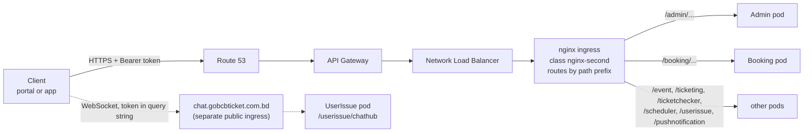

# 00 · Platform primer

[Back to contents](README.md)

This page gives the background every feature file assumes: what the services are, how a request reaches them, how errors
look, and the microservice ideas the code relies on. The ideas are explained in **explainer boxes** (📦) below; feature files
link here instead of repeating them.

## 1. The platform in one paragraph

GoBCB sells and checks tickets for Bangladesh Cricket Board events. Staff set up **programs** (a series or a tournament), the
**venues** (stadium → gallery → block → level), the **events** (matches) with prices and capacity, promotions and ticket
layouts in the **admin portal**. Customers browse and buy on the **user web portal** or the **user app**, pay through
**DgePay**, and receive digitally signed PDF tickets with a QR code. Gate staff scan the QR codes offline with the
**checker app**. The backend is a set of ASP.NET Core 8 web APIs ("services") in one repository, running on Amazon EKS
behind API Gateway (see [`gobcb-aws-architecture.md`](../../../architecture/gobcb-aws-architecture.md) §0–§4).

## 2. Backend services

All services live in `rvl-gobcb-backend/Services/<Name>/`, each split into `ETP.<Name>.Service` (controllers, `Program.cs`,
workers), `.Domain` (managers = business logic), `.Storage` (EF Core `DbContext`, repositories) and, for some, `.Client`
(typed HTTP client other services use) and `.Integration`. Shared code is in `rvl-gobcb-backend/Core/` (`ETP.Core`,
`ETP.Core.Web`, …).

| Service | Path prefix | Local port | What it does (from controllers and workers) | DB connection key | Background workers |
|---|---|---|---|---|---|
| Admin | `/admin` | 5101 | Master data and back office: programs, venues, events, settings, promo codes, discounts, ticket layouts, staff users (Cognito), gate assignment, raffle, notices, site content, activity log. Hosts `/admin/chathub` (legacy, see Appendix A) | `ConnectionStrings:Admin` | `CheckedTicketService`, `PromoCodeStatusUpdateService`, `SystemDiscountStatusUpdateService`, `GateCheckerDownloadStatusCleanupService` |
| Booking | `/booking` | 5102 | Capacity and seats, booking orders, payment (DgePay), promo-code application, seat reservations, capacity adjustments, sales reports, VAT challan | `ConnectionStrings:Booking` | `BookingStatusUpdateService`, `InitiateUserTicketGenerationService`, `LevelCapacityUpdateService`, `RefreshLockedCapacityService`, `EventLiveCapacityUpdateService`, `VatChallanProcessingService` |
| Event | `/event` | 5103 | Public, read-only view of programs, events, venue details, landing images, header/footer and ticket pricing for the portals and app | `ConnectionStrings:Event` | none |
| Ticketing | `/ticketing` | 5108 | Tickets: generation, signing (TSP), PDFs, downloads, sharing, invoices, reserved tickets, OneID sync, offline-sold tickets | `ConnectionStrings:Booking` (sic) | `TicketGenerationService` |
| TicketChecker | `/ticketChecker` | 5107 | Sync endpoint for the checker app (scans in, scans out) | `ConnectionStrings:TicketChecker` | none |
| UserIssue | `/userissue` | 5110 | Customer issues and support chat; hosts the SignalR hub `/userissue/chathub` | `ConnectionStrings:UserIssue` | none |
| PushNotification | `/PushNotification` | 5105 | Device tokens and push send APIs (writes to a queue) | `ConnectionStrings:PushNotification` | none |
| Scheduler | `/scheduler` | 5106 | Workers only: push delivery to Firebase, payment revalidation, ticket-generated notices, capacity reconcile, device-token cleanup | none | `FirebaseNotificationService`, `PendingOrFailedBookingStatusUpdateService`, `SendNotificationAfterGeneratedTicketService`, `CapacityUpdateService`, `DeviceTokenCleanupService` |
| Utility | `/utility` | 5111 | Worker only: merges/zips reserved tickets | none | `TicketProcessingService` |
| Platform | `/platform` | 5104 | Stub (only a template `WeatherForecastController`) | none | none |
| UserAuth | `/userAuth` | 5109 | Stub (no controllers; only `/health`) | none | none |

Sources: `Services/*/ETP.*.Service/Program.cs` and `Configuration(s)/DependencyConfig.cs` (hosted services and connection
strings), `Services/*/ETP.*.Service/appsettings.json` (`Application:ServiceName`, which is the path prefix; UserIssue has no
`appsettings.json` and its prefix `userissue` comes from the hub mapping and the clients). Local ports come from
`aspire/README.md`.

## 3. Clients

| Client | Repository | Tech | Signs in with | Calls |
|---|---|---|---|---|
| Admin portal | `rvl-gobcb-admin-portal` | Angular | Admin pool (after an SMS OTP from the Serverless API) | Admin, Booking, Ticketing, UserIssue; Serverless API for OTP |
| User web portal | `rvl-gobcb-user-portal/ETP-Web` | Angular 19 | User pool, or OneID through Cognito | Event, Booking, Ticketing, Admin (public endpoints), UserIssue; identity API |
| User app | `rvl-gobcb-user-app` | Flutter | User pool, or OneID through Cognito | Event, Booking, Ticketing, UserIssue, PushNotification, Admin; identity API |
| Checker app | `rvl-gobcb-checker-app` | Flutter | TicketChecker pool | Admin (`ticket-checker-gate/event-info`), TicketChecker (`tickets/sync-tickets`); identity API for the app version |

The **identity API** (`services.identity` in the user portal, `AUTH_API_BASE_URL` in the apps) handles customer registration,
OTPs, profile and app versions. Its source is in none of the five repositories `[UNCONFIRMED: Q-01]`.

## 4. How a request reaches a service



The hosting part of this picture (API Gateway, NLB, ingress) comes from the architecture document §1 and §4.1. Whether API
Gateway also validates tokens is reported but unverified there (architecture Q1/Q1b). The services always validate the token
themselves.

<a id="explainer-path-prefix-routing"></a>
> 📦 **Explainer: path-prefix routing**
>
> In a monolith every controller lives under one host. Here each service is a separate process, but clients still use **one
> API host**. The first path segment decides which service gets the request: `/booking/api/v1/user-booking-order` goes to
> Booking, `/event/api/v1/events/list` to Event.
>
> Two pieces make this work:
> 1. **In the code**, `Core/ETP.Core/Conventions/GlobalRoutePrefixConvention.cs` prepends `Application:ServiceName` to every
>    controller route (registered in each `Program.cs`, for example `Services/Booking/ETP.Booking.Service/Program.cs:51`).
>    So the Booking controller's `[Route("api/v1/user-booking-order")]` is really served at
>    `/booking/api/v1/user-booking-order`, even when you call the service directly on its own port.
> 2. **In the cluster**, an nginx ingress per service forwards `/<prefix>/...` to that service unchanged
>    (architecture §4.1).
>
> Consequence for you: when you call a service locally (`http://localhost:5102`), you must still include the prefix:
> `http://localhost:5102/booking/api/v1/...`. Swagger is at `/<prefix>/swagger`.

## 5. Request and response conventions

| Topic | What the code does | Source |
|---|---|---|
| JSON property names | camelCase in every service. Booking, Event, Ticketing, TicketChecker, Scheduler, Utility, PushNotification, Platform and UserAuth set `PropertyNamingPolicy = CamelCase` explicitly; Admin and UserIssue use the ASP.NET Core default, which is also camelCase | `Services/*/ETP.*.Service/Program.cs` (`AddJsonOptions`) |
| Enums | Strings (`JsonStringEnumConverter`) in the services that call `AddJsonOptions`; **numbers** in Admin and UserIssue, which do not register the converter | same |
| Nulls | Omitted from responses (`WhenWritingNull`) in the services that call `AddJsonOptions`; Admin and UserIssue include them | same |
| Errors | `ErrorResponseExceptionFilter` turns exceptions into `ProblemDetails` (see below) | `Core/ETP.Core.Web/Filters/ErrorResponseExceptionFilter.cs` |
| Ids | Most tables use a `long Id`. Many also carry a public string/Guid id (for example `Event.EventId`, order `PublicId`), and endpoints accept one or the other, which is why pairs such as `events/{eventId}` and `events/EventLongId/{id}` exist | `Services/Admin/ETP.Admin.Storage/Models/Event.cs` |
| Time | Server-side comparisons use `DateTime.UtcNow` | e.g. `UserBookingOrderManager.cs:1135-1193` |

**Error responses.** Controllers throw; the filter maps the exception type to a status code and a `ProblemDetails` body:

| Exception | Status | Body |
|---|---|---|
| `ArgumentException` (and subclasses) | 400 | `{ "status": 400, "title": "<exception message>" }` |
| `ApiException` | 400 | the exception's own `Details` (`ProblemDetails`) |
| `UnauthorizedAccessException` | 403 | `{ "status": 403, "title": "Unauthorized access", "detail": "<message>" }` |
| anything else | 500 | `{ "status": 500, "title": "An unexpected error occurred." }` (the real message in Development) |

In the Development environment a `stackTrace` field is added. Authentication failures (no or invalid token) never reach the
filter: the JWT handler answers **401** with an empty body; a valid token from the wrong pool or without the role answers
**403**.

```json
{
  "status": 400,
  "title": "Invalid promo code. Please enter a valid code."
}
```

## 6. Explainer boxes

<a id="explainer-token-forwarding"></a>
> 📦 **Explainer: token forwarding (how one service calls another for a user)**
>
> When a customer's request reaches Booking and Booking needs data from Event, Booking calls Event over HTTP. In this
> code base that call **carries the customer's own Cognito access token**, not a service identity.
>
> - Each service registers typed `HttpClient`s (for example `services.AddHttpClient<IEventClient, EventClient>` in
>   `Services/Admin/ETP.Admin.Service/Configurations/DependencyConfig.cs:123`) with a base URL from `Services:<Name>`.
> - The client pipeline includes `DelegatedBearerAuthenticationHandler`
>   (`Core/ETP.Core.Web/Security/DelegatedBearerAuthenticationHandler.cs`). It reads the access token that the JWT handler
>   stored as a claim on the current user (`OnTokenValidated` in `Core/ETP.Core/Configuration/DefaultAuthenticationConfig.cs`)
>   and copies it to `Authorization: Bearer` on the outgoing request.
> - The downstream service validates that token again with its **own** policy. If Booking calls an Admin endpoint that
>   requires the Admin pool while the caller is a customer, the downstream call fails with 401/403.
> - Retries: most clients retry 3 times with exponential backoff (Polly).
> - **No user, no token.** A background worker has no HTTP request, so the handler finds no token and sends none. That is
>   why the endpoints workers call have no `[Authorize]` (see [X-18](60-cross-cutting/X-18-endpoints-without-auth.md)).
>
> Hop tags: **[HTTP + user token]** and **[HTTP, no token]**. Full details: [X-19](60-cross-cutting/X-19-service-to-service.md).

<a id="explainer-queue-driven"></a>
> 📦 **Explainer: queue-driven processing (SQS)**
>
> Some work is too slow or too important to do inside the user's request: signing a ticket with the TSP, merging hundreds of
> PDFs, recording VAT with NBR, sending push messages, recalculating capacity. The request **publishes a message** to an
> Amazon SQS queue and returns; a **worker** in some service reads the queue later and does the work.
>
> - Publishing: `Core/ETP.Core/Queue/Services/SqsPublisher.cs` resolves the queue URL from its **name** (configured as
>   `AWS:Queue:<Key>`), serializes the message as JSON and sends it. If the queue name ends in `fifo`, it also sets
>   `MessageGroupId` and `MessageDeduplicationId` from the message.
> - Consuming: a `BackgroundService` loops, calls `ReceiveMessageAsync`, processes, and deletes the message only on success.
>   A failed message becomes visible again and is retried.
> - Messages hold business ids only. There is no user token in a message and no sender check: anyone with IAM permission
>   to send to the queue can enqueue work (architecture §2.3 C).
> - Queue keys used: `OrderSuccess`, `EventCapacity`, `VatChallanProcessing` (Booking), `TicketSigning` (Ticketing),
>   `TicketProcessing` (Utility), `FirebaseNotification` (Scheduler).
> - MassTransit is registered in some services but no consumer or publisher uses it (see
>   [Appendix A](90-appendix-a-legacy.md)).
>
> Hop tag: **[SQS: Key]**. Feature files in [50-system-initiated](50-system-initiated/README.md) describe each consumer.

<a id="explainer-background-workers"></a>
> 📦 **Explainer: background workers (timers inside services)**
>
> Besides answering HTTP requests, several services run **hosted services** (`BackgroundService`) on a timer, registered
> with `services.AddHostedService<...>()`. The pattern is the same everywhere
> (`Services/Admin/ETP.Admin.Service/Workers/BackgroundServices/CheckedTicketService.cs`):
>
> 1. wait about a minute after start-up;
> 2. loop forever: try to take a Redis lock, and if it is taken, create a DI scope and run a **TaskManager**
>    (`Workers/TaskManagers/*`) that holds the real logic;
> 3. sleep for a **hard-coded** interval (30 seconds to 1 day), longer after an error.
>
> The intervals are constants in the code, not configuration. Every replica (pod) of a service runs the same workers, which
> is why the lock matters (next box). Hop tag: **[Worker: interval, lock]**.

<a id="explainer-distributed-locks"></a>
> 📦 **Explainer: distributed locks (RedLock)**
>
> In production each service can run as several pods. Without coordination, every pod's worker would process the same
> orders at the same time. The code uses **RedLock** (`RedLockNet`) on Redis: before a job runs, the worker asks for a named
> lock (for example `checked_ticket`, expiry 20 minutes). Only the pod that gets it does the work; the others skip the cycle
> and log `Could NOT acquire lock ... Skipping this cycle` (a normal message, also seen locally).
>
> The same mechanism protects business operations that must not overlap, for example one booking at a time per customer
> (`user_booking:{userId}` in `UserBookingOrderManager.cs:68`) and capacity changes per level.
>
> Set-up: `Core/ETP.Core/Configuration/DistributedLockConfig.cs` (keys `DistributedLock:Redis:*`). Lock names and expiries are
> listed in [X-25](60-cross-cutting/X-25-redis.md).

<a id="explainer-shared-database"></a>
> 📦 **Explainer: one database, shared tables and read models**
>
> A textbook microservice owns a private database. This code base does not work that way:
>
> - Every `DbContext` uses the **same schema `etp`** (`DefaultSchema = "etp"` in each `*DbContext.cs`), and each service has its
>   own connection-string key (`ConnectionStrings:Admin`, `:Booking`, …). Ticketing uses `ConnectionStrings:Booking`.
>   Locally all keys point at one database, `etp_local` (`scripts/user-secrets.example.json`).
> - A table is **owned** by the service whose migrations create it. Other services map the same table again in their own
>   `DbContext` with `ExcludeFromMigrations`, and read it (sometimes write it) directly. Example: Booking maps `PromoCodes`,
>   `Discounts`, `EventVenueDetails`, `Events` from Admin as excluded tables
>   (`Services/Booking/ETP.Booking.Storage/DbContexts/BookingDbContext.cs:86-140`).
> - The **Event** service owns almost nothing: it is a public, read-only view over Admin's and Booking's tables
>   (`Services/Event/ETP.Event.Storage/DbContexts/EventDbContext.cs`).
>
> What this means for you: a column change in Admin can break Booking, Ticketing or Event at run time even though they
> compile separately. Search all `*DbContext.cs` files for a table name before you change it. The brief we received says
> "one schema per service"; the code says one schema for all. The production layout is open: `[UNCONFIRMED: Q-02]`.
>
> Hop tag: **[Shared table]**.

<a id="explainer-redis-live-capacity"></a>
> 📦 **Explainer: Redis as the live seat counter**
>
> Seat availability changes every second during a sale, so Booking keeps **live counters in Redis** (key families such as
> `level_live`, `level_locked`, `event_live`, `level_live_seats`; constants in `Core/ETP.Core/Constant/AppConstant.cs:64-104`)
> and treats the database as the slower, durable copy. Orders lock capacity in Redis first; queue workers
> ([S-01](50-system-initiated/S-01-level-capacity-update.md), [S-02](50-system-initiated/S-02-event-live-capacity.md)) and
> timers ([S-03](50-system-initiated/S-03-locked-capacity-refresh.md)) bring the database and Redis back in line.
> The gate-scan counters of the checker app work the same way ([C-05](40-checker-app/C-05-ticket-sync.md),
> [S-14](50-system-initiated/S-14-checked-ticket-sync.md)).
>
> Consequence: if Redis is flushed during a sale, live numbers are rebuilt from the database by the next worker cycle;
> locally `scripts/Seed-EtpData.ps1` clears the cache for this reason. Details: [X-25](60-cross-cutting/X-25-redis.md).

## 7. Explainer index

| Concept | Box | First features that rely on it |
|---|---|---|
| Path-prefix routing | [link](#explainer-path-prefix-routing) | every feature |
| Token forwarding | [link](#explainer-token-forwarding) | [P-06](20-user-portal/P-06-booking-payment.md), [A-07](10-admin-portal/A-07-events.md), [X-19](60-cross-cutting/X-19-service-to-service.md) |
| Queue-driven processing | [link](#explainer-queue-driven) | [P-06](20-user-portal/P-06-booking-payment.md), [A-12](10-admin-portal/A-12-reserved-tickets.md), all `S-xx` |
| Background workers | [link](#explainer-background-workers) | all `S-xx` |
| Distributed locks | [link](#explainer-distributed-locks) | [P-06](20-user-portal/P-06-booking-payment.md), [A-10](10-admin-portal/A-10-capacity-adjustment.md), all `S-xx` |
| One database, shared tables | [link](#explainer-shared-database) | [P-05](20-user-portal/P-05-apply-promo-code.md), [P-02](20-user-portal/P-02-browse-events.md), [A-15](10-admin-portal/A-15-promo-codes.md) |
| Redis live seat counter | [link](#explainer-redis-live-capacity) | [P-04](20-user-portal/P-04-seat-selection.md), [P-06](20-user-portal/P-06-booking-payment.md), [C-05](40-checker-app/C-05-ticket-sync.md) |
