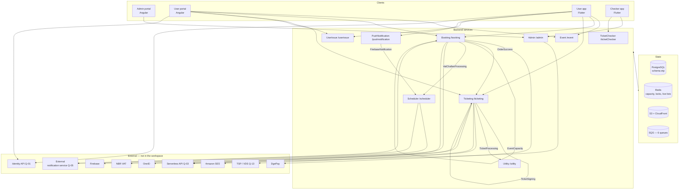

# 01 · System map

> **Bangla name:** সিস্টেম ম্যাপ
>
> [← Contents](README.md)

The one page that shows how a customer, a member of staff or a background worker moves through GoBCB. Every feature file in this documentation drills into one box on this map. Read this first if you are new to the platform; if you already know it, use it as the index for finding the right feature file.

## 1. The three clients

| Client | Technology | Who uses it | Lives in | Feature files |
|---|---|---|---|---|
| **Admin portal** | Angular (standalone components, signals) | GoBCB staff — event managers, admins | `rvl-gobcb-admin-portal/` | [10 · Admin portal](10-admin-portal/README.md) (A-01…A-31) |
| **User portal** | Angular, SSR-capable | Customers buying on the web | `rvl-gobcb-user-portal/` | [20 · User portal](20-user-portal/README.md) (P-01…P-13) |
| **User app** | Flutter, 3 packages | Customers on Android / iOS | `rvl-gobcb-user-app/` | [30 · User app](30-user-app/README.md) (U-01…U-10) |
| **Checker app** | Flutter, monorepo + vendored scanner | Gate staff | `rvl-gobcb-checker-app/` | [40 · Checker app](40-checker-app/README.md) (C-01…C-06) |

The **backend** is a fifth repository, `rvl-gobcb-backend/`, holding nine ASP.NET Core 8 services plus two stubs. It is not a "client" but it is where every feature's real behaviour lives.

> The five repositories in the workspace are `rvl-gobcb-backend`, `rvl-gobcb-admin-portal`, `rvl-gobcb-user-portal`, `rvl-gobcb-user-app` and `rvl-gobcb-checker-app`. They are git submodules and are treated as read-only by this documentation.

## 2. The backend services

| Service | Prefix | Port | Owns | Feature files |
|---|---|---|---|---|
| **Admin** | `/admin` | 5101 | All master data — programs, venues, events, pricing, layouts, promo codes, discounts, staff users, gate assignment, content, activity log | [A-01](10-admin-portal/A-01-program-selection.md) … [A-31](10-admin-portal/A-31-general-notices.md) |
| **Booking** | `/booking` | 5102 | Capacity, seats, booking orders, DgePay payment, promo application, reservations, VAT challan | [P-04](20-user-portal/P-04-seat-selection.md), [P-06](20-user-portal/P-06-booking-payment.md), [S-05](50-system-initiated/S-05-pending-failed-revalidation.md) |
| **Event** | `/event` | 5103 | The public read-only view the portals and app read | [P-01](20-user-portal/P-01-home-content.md), [U-02](30-user-app/U-02-home-browse-events.md) |
| **Ticketing** | `/ticketing` | 5108 | Ticket generation, TSP signing, PDFs, downloads, OneID sync, offline-sold tickets | [P-09](20-user-portal/P-09-ticket-details-downloads.md), [S-08](50-system-initiated/S-08-ticket-signing.md) |
| **TicketChecker** | `/ticketChecker` | 5107 | The checker's scan sync | [C-02](40-checker-app/C-02-offline-ticket-download.md), [C-05](40-checker-app/C-05-ticket-sync.md) |
| **UserIssue** | `/userissue` | 5110 | Customer issues and the support chat hub | [P-12](20-user-portal/P-12-issues-chat.md), [U-08](30-user-app/U-08-issues-chat.md) |
| **PushNotification** | `/pushnotification` | 5105 | Device tokens and push send | [U-09](30-user-app/U-09-device-token.md), [X-23](60-cross-cutting/X-23-push-firebase.md) |
| **Scheduler** | `/scheduler` | 5106 | Workers only — no controllers | [S-11](50-system-initiated/S-11-firebase-notification.md) … [S-15](50-system-initiated/S-15-gate-download-status-cleanup.md) |
| **Utility** | `/utility` | 5111 | Worker only — merges and zips reserved tickets | [S-09](50-system-initiated/S-09-ticket-merge-zip.md) |
| Platform | `/platform` | 5104 | **Stub** — only a template `WeatherForecastController` | — |
| UserAuth | `/userAuth` | 5109 | **Stub** — only `/health` | — |

Every service is reached through its **path prefix**, added by `GlobalRoutePrefixConvention` (`Application:ServiceName` in `appsettings.json`) and terminated at the nginx ingress. So a controller route `tickets/sync-tickets` in TicketChecker is externally `/ticketchecker/api/v1/tickets/sync-tickets`.

Each service has its **own `DbContext` and connection string**, but all of them use the PostgreSQL schema `etp`. Tables that one service only reads are mapped with `ExcludeFromMigrations` so it does not try to own their schema — see [X-19](60-cross-cutting/X-19-service-to-service.md) and [Q-02](99-open-queries.md).

## 3. The three actors

| Actor | Cognito pool | Reaches | Token | Feature files |
|---|---|---|---|---|
| **Staff** | Admin pool (`admin`) | `/admin`, and `/ticketchecker` for gate work | admin JWT, policy- and role-scoped | [X-01](60-cross-cutting/X-01-admin-login.md), [X-14](60-cross-cutting/X-14-authz-pool-policies.md), [X-15](60-cross-cutting/X-15-authz-roles.md), [X-16](60-cross-cutting/X-16-authz-program-scope.md) |
| **Customer** | User pool (`user`) | `/event`, `/booking`, `/ticketing`, `/userissue`, `/pushnotification`, plus the external identity API and OneID | user JWT | [X-06](60-cross-cutting/X-06-user-registration.md), [X-07](60-cross-cutting/X-07-user-password-login.md), [X-10](60-cross-cutting/X-10-user-session.md) |
| **Checker** | Ticket-checker pool (`ticket-checker`) | `/admin/ticket-checker-gate/event-info`, `/ticketchecker` | checker JWT | [X-12](60-cross-cutting/X-12-checker-login.md), [C-01](40-checker-app/C-01-assigned-event-gate.md) |
| **Agent** | Agent pool (`agent`) | `POST /ticketing/api/v1/offline-sold-ticket` | agent JWT | [X-13](60-cross-cutting/X-13-agent-pool.md) — **no client exists in the workspace** ([Q-07](99-open-queries.md)) |

Clients send the token in `Authorization: Bearer`; the Angular interceptor adds a static API-key header on an allow-list of routes, and the Flutter clients add their own per service ([X-19](60-cross-cutting/X-19-service-to-service.md)).

## 4. The external systems

None of these is in the workspace. Treat each as a dependency with an unknown owner — see [99 · Open queries](99-open-queries.md).

| System | Used for | Where the code calls it | Query |
|---|---|---|---|
| **Identity API** | Registration, OTP, `my-profile`, `register-sso`, `allowed-app-version`, `delete-my-profile` | Angular `IdentityApiService`; Flutter `auth_api_client.dart` | [Q-01](99-open-queries.md) |
| **Serverless / Lambda identity API** | Admin login lookups (name, phone by id) | `environment.serverless.baseUrl` | [Q-03](99-open-queries.md) |
| **DgePay** | Payment | `Booking`, callback + `payment-status-bypass` | [P-06](20-user-portal/P-06-booking-payment.md) |
| **SSLCommerz** | Payment — supported by the form, **callbacks inactive** | `Booking` | [Q-19](99-open-queries.md) |
| **TSP (VDS)** | Digital signature on the ticket QR | `Ticketing`, `Cert/tspgw_client.pfx` | [S-08](50-system-initiated/S-08-ticket-signing.md), [Q-13](99-open-queries.md) |
| **OneID** | National ID login, ticket sync to the wallet | `Ticketing`, `environment.aws.oneId*` | [P-10](20-user-portal/P-10-oneid-ticket-sync.md) |
| **NBR VAT** | Smart challan | `Booking` → SQS → Scheduler | [S-10](50-system-initiated/S-10-vat-challan.md) |
| **Firebase (FCM/APNs)** | Push notifications | Scheduler → Firebase, tokens in `PushNotification` | [X-23](60-cross-cutting/X-23-push-firebase.md) |
| **External notification service** | Every SMS | `INotificationClient` → `Notification:Endpoint` | [X-22](60-cross-cutting/X-22-sms-notification.md), [Q-05](99-open-queries.md) |
| **Amazon SES** | Email, ticket ZIP | `Ticketing` | [X-21](60-cross-cutting/X-21-email-ses.md) |
| **S3 + CloudFront** | PDFs, images, admin-portal download protection | `X-20` | [X-20](60-cross-cutting/X-20-file-storage.md) |

## 5. The messaging backbone

Six SQS queues carry the asynchronous work. Each has a producer and a consumer, and the pairing is where most of the "why did this not happen yet" answers live.

| Queue | Produced by | Consumed by | Feature |
|---|---|---|---|
| `OrderSuccess` | Booking, on a confirmed payment | Ticketing `TicketGenerationService` | [S-07](50-system-initiated/S-07-initiate-user-ticket-generation.md) |
| `EventCapacity` | Booking, on a seat lock change | Booking `LevelCapacityUpdateService`, `EventLiveCapacityUpdateService` | [S-01](50-system-initiated/S-01-level-capacity-update.md), [S-02](50-system-initiated/S-02-event-live-capacity.md) |
| `VatChallanProcessing` | Booking, on a `Paid` callback | Scheduler `VatChallanProcessingService` | [S-10](50-system-initiated/S-10-vat-challan.md) |
| `TicketSigning` | Ticketing, when a PDF needs signing | Ticketing | [S-08](50-system-initiated/S-08-ticket-signing.md) |
| `TicketProcessing` | Ticketing, for reserved-ticket merges | Utility `TicketProcessingService` | [S-09](50-system-initiated/S-09-ticket-merge-zip.md) |
| `FirebaseNotification` | PushNotification | Scheduler `FirebaseNotificationService` | [S-11](50-system-initiated/S-11-firebase-notification.md) |

All six are documented in [50 · System-initiated](50-system-initiated/README.md) (S-01…S-17). Two behaviours are common to all of them and worth knowing before you debug one: **there is no dead-letter handling in code**, and **the retry counter is incremented on a deserialised copy and never re-published**, so a permanently failing message retries for ever ([Q-09](99-open-queries.md)).

## 6. The request journeys

The four journeys below are the ones a new engineer should be able to narrate. Each is expanded in the linked file.

### 6.1 A customer buys a ticket — the longest path

```
User portal / App
  → Event service      browse programs, events, prices        P-01, P-02
  → Booking service    lock seats in Redis, create order     P-04, P-06
  → DgePay             redirect, pay, callback               P-06
  → (OrderSuccess queue)
  → Ticketing          generate PDFs, sign with TSP, ZIP     S-07, S-08, S-09
  → (FirebaseNotification queue) → Scheduler → FCM          S-11, S-12
  → Customer           download or view the signed PDF       P-09, U-06
```

Capacity is **Redis-first** (`level_live`, `level_locked`, 12-minute lock) with the database as the durable copy reconciled by workers — [X-25](60-cross-cutting/X-25-redis.md), [S-03](50-system-initiated/S-03-locked-capacity-refresh.md).

### 6.2 A checker validates a ticket at the gate — the offline path

```
Checker app
  → Admin service     GET ticket-checker-gate/event-info     C-01
  → TicketChecker     POST sync-tickets  (download)         C-02
  → (local SQLite)    every scan is decided offline         C-03
  → TicketChecker     POST sync-tickets  (every 90 s)       C-05
```

This is the only journey that **needs no network to be correct** — that is the design intent, and it is why [C-06](40-checker-app/C-06-manual-ticket-validation.md) and [C-04](40-checker-app/C-04-manual-entry.md) matter so much: they are the paths where a decision is made with weaker evidence.

### 6.3 Staff set up an event

```
Admin portal
  → Admin service      programs, venues, layouts, pricing    A-01…A-14
  → Admin service      events, capacity, publishing          A-07…A-10
  → Event service      the published result becomes public   P-01, U-02
```

There is an ordering constraint that is enforced only in the UI: **layouts must be published before an event can be published** ([Q-23](99-open-queries.md), [A-13](10-admin-portal/A-13-ticket-layouts.md)).

### 6.4 A customer reports an issue

```
User portal / App
  → UserIssue service  POST /user-issue (the issue)         P-12, U-08
  → SignalR hub        /userissue/chathub  (authorised)     P-12, U-08
  → UserIssue service  REST fallback (NOT authorised)       Q-46
  → Admin portal       A-24 reads and resolves the issue     A-24
```

## 7. The cross-cutting concerns

Twenty-six concerns apply to more than one feature. They are in [60 · Cross-cutting](60-cross-cutting/README.md).

| Area | Files | Read it when |
|---|---|---|
| **Authentication** | [X-01](60-cross-cutting/X-01-admin-login.md) … [X-04](60-cross-cutting/X-04-admin-session.md), [X-06](60-cross-cutting/X-06-user-registration.md) … [X-10](60-cross-cutting/X-10-user-session.md), [X-12](60-cross-cutting/X-12-checker-login.md) | You need to know who the caller is, or how a login works |
| **Authorization** | [X-14](60-cross-cutting/X-14-authz-pool-policies.md) … [X-17](60-cross-cutting/X-17-authz-client-side.md), [X-18](60-cross-cutting/X-18-endpoints-without-auth.md) | You are deciding whether a screen **should** be reachable. **Read X-18 before assuming an endpoint is protected.** |
| **Infrastructure** | [X-19](60-cross-cutting/X-19-service-to-service.md), [X-20](60-cross-cutting/X-20-file-storage.md), [X-25](60-cross-cutting/X-25-redis.md), [X-26](60-cross-cutting/X-26-configuration.md) | You are changing a connection string, a file path, a Redis key or a config key |
| **Messaging and notifications** | [X-22](60-cross-cutting/X-22-sms-notification.md), [X-23](60-cross-cutting/X-23-push-firebase.md), [X-24](60-cross-cutting/X-24-activity-logging.md) | You are adding a notification or an audit trail |
| **Feature-specific auth** | [X-05](60-cross-cutting/X-05-admin-provisioning.md), [X-08](60-cross-cutting/X-08-oneid-sso.md), [X-09](60-cross-cutting/X-09-user-forgot-password.md), [X-11](60-cross-cutting/X-11-delete-account-force-update.md), [X-13](60-cross-cutting/X-13-agent-pool.md) | The specific flow, not the general rule |

<a id="8-where-the-risk-is"></a>
## 8. Where the risk is

If you read only one section of this handover, read this one. These are the places where the code is doing something that a reasonable person would not expect, ranked by consequence.

| Risk | Where | Query |
|---|---|---|
| **An unauthenticated endpoint lets anyone post support messages as an admin** | `UserIssue` chat REST controller | [Q-46](99-open-queries.md) |
| **PushNotification has no authentication at all** | service-wide | [Q-04](99-open-queries.md), [Q-62](99-open-queries.md) |
| **Admin-authored HTML is stored and rendered unsanitised** | content editor, notices, and two app widgets | [Q-33](99-open-queries.md), [Q-55](99-open-queries.md) |
| **Manual ticket entry skips signature verification** and writes a row even for unknown ids | checker app | [Q-75](99-open-queries.md) |
| **Duplicate tickets can be admitted at the same gate** — detection is local only | checker app | [Q-74](99-open-queries.md) |
| **A paid-but-late order can be cancelled** with money taken | Booking re-check worker | [Q-11](99-open-queries.md) |
| **A late payment callback records VAT for an order that stays unpaid** | Booking callback | [Q-15](99-open-queries.md) |
| **The `-1` manual-entry convention is undocumented** on the server | checker sync | [Q-68](99-open-queries.md) |
| **iOS cannot verify any QR** — the checker app is Android-only for real validation | `AppDelegate.swift` | [Q-72](99-open-queries.md) |
| **Database content is never translated** — only the portal chrome switches language | user portal | [Q-44](99-open-queries.md) |
| **A failed sync still shows a "last sync time"** | checker app | [Q-76](99-open-queries.md) |
| **The identity API — a large part of customer-facing behaviour — has no source in the workspace** | external | [Q-01](99-open-queries.md) |

## 9. How to use the rest of this documentation

| You want to… | Go to |
|---|---|
| Understand one customer-facing screen | [20 · User portal](20-user-portal/README.md) or [30 · User app](30-user-app/README.md) |
| Understand one staff screen | [10 · Admin portal](10-admin-portal/README.md) |
| Understand something that happens with nobody watching | [50 · System-initiated](50-system-initiated/README.md) |
| Understand auth, storage, Redis, config, notifications | [60 · Cross-cutting](60-cross-cutting/README.md) |
| Know which feature owns which endpoint | [91 · Endpoint index](91-appendix-b-endpoint-index.md) |
| Know which feature uses which table, queue, Redis key | [03 · Component reverse index](03-component-reverse-index.md) |
| Know what is still unknown | [99 · Open queries](99-open-queries.md) |
| Know what BS23 built that we are not using | [90 · Legacy and unused](90-appendix-a-legacy.md) |

Each feature file answers the same eleven questions in the same order — purpose, trigger, business flow, technical flow, components, API contracts, data and side effects, code references, handover notes, component relationships, and how to test it locally — so you can jump to the section you need without reading the whole file.

## 10. Component relationships



**Depends on:** the five repositories and [`gobcb-aws-architecture.md`](../../../architecture/gobcb-aws-architecture.md). **Affects:** every other page — this is the index.