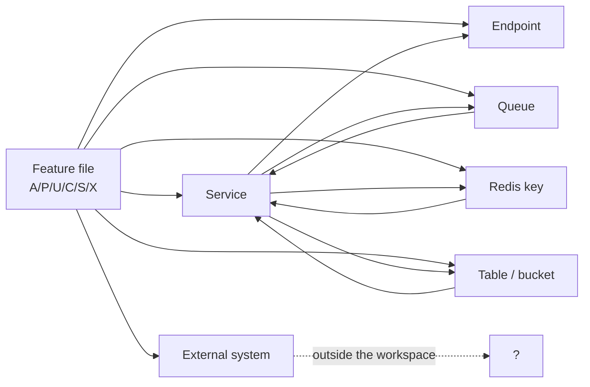

# 02 · Traceability matrix

> **Bangla name:** ট্রেসেবিলিটি ম্যাট্রিক্স
>
> [← Contents](README.md) · [Endpoint index](91-appendix-b-endpoint-index.md) · [Reverse index](03-component-reverse-index.md)

Every business feature, and the technical things it touches. Three tables:

1. **§2 Feature → service** — which backend service implements each feature
2. **§3 Feature → endpoint** — which HTTP endpoint each screen calls
3. **§4 Feature → state** — which queue, Redis key, table and external system each feature touches

Use §2 and §3 when you have a screen and want to know where its behaviour lives. Use §4 and the [reverse index](03-component-reverse-index.md) when you have a table, queue or Redis key and want to know who writes it.

## 1. Conventions

| Column | Meaning |
|---|---|
| **Service** | The backend service that owns the behaviour |
| **Endpoint** | The primary external path; `—` means the feature makes no HTTP call |
| **Queue** | The SQS queue it produces to or consumes from; `—` means none |
| **Redis** | The keys it reads or writes; `—` means none |
| **Store** | The table, bucket or external store it writes |
| **Ext** | An external system it depends on |

A feature may span several rows when it genuinely does. Where a cell says *same as above*, the two features share the same component.

## 2. Feature → service

### 2.1 Admin portal (31 features)

| Id | Feature | Service | Also touches |
|---|---|---|---|
| [A-01](10-admin-portal/A-01-program-selection.md) | Program selection | Admin | Cognito (session), localStorage |
| [A-02](10-admin-portal/A-02-programs.md) | Programs | Admin | Cognito |
| [A-03](10-admin-portal/A-03-program-settings.md) | Program settings | Admin | — |
| [A-04](10-admin-portal/A-04-teams.md) | Teams | Admin | — |
| [A-05](10-admin-portal/A-05-venues.md) | Venues | Admin | S3 (venue media) |
| [A-06](10-admin-portal/A-06-program-venue-mapping.md) | Program–venue mapping | Admin | — |
| [A-07](10-admin-portal/A-07-events.md) | Events | Admin | — |
| [A-08](10-admin-portal/A-08-event-settings.md) | Event settings override | Admin | — |
| [A-09](10-admin-portal/A-09-event-level-pricing.md) | Event venue details and pricing | Admin | — |
| [A-10](10-admin-portal/A-10-capacity-adjustment.md) | Capacity adjustment | **Booking** | Redis |
| [A-11](10-admin-portal/A-11-seat-reservation.md) | Seat reservation | **Booking** | — |
| [A-12](10-admin-portal/A-12-reserved-tickets.md) | Reserved ticket generation | **Booking**, Ticketing | `TicketProcessing` queue |
| [A-13](10-admin-portal/A-13-ticket-layouts.md) | Ticket layouts | Admin | S3 (layout files) |
| [A-14](10-admin-portal/A-14-ticket-pricing-content.md) | Ticket-pricing content | Admin | **Not read by the customer pricing page** |
| [A-15](10-admin-portal/A-15-promo-codes.md) | Promo codes | Admin | Scheduler ([S-16](50-system-initiated/S-16-promo-code-status.md)) |
| [A-16](10-admin-portal/A-16-discounts.md) | System discounts | Admin | Scheduler ([S-17](50-system-initiated/S-17-discount-status.md)) |
| [A-17](10-admin-portal/A-17-ticket-checker-users.md) | Checker accounts | Admin | Cognito (checker pool) |
| [A-18](10-admin-portal/A-18-gate-assignment.md) | Gate assignment | Admin | Redis (`TicketCheckerLevelGateMap`) |
| [A-19](10-admin-portal/A-19-gate-reports.md) | Gate reports | Admin, Booking | Scheduler ([S-14](50-system-initiated/S-14-checked-ticket-sync.md)) |
| [A-20](10-admin-portal/A-20-raffle-draw.md) | Raffle draw | Admin | — |
| [A-21](10-admin-portal/A-21-dashboard.md) | Dashboard | Admin, Booking | Redis (live capacity) |
| [A-22](10-admin-portal/A-22-reports.md) | Reports | Booking | — |
| [A-23](10-admin-portal/A-23-reconciliation.md) | Reconciliation | Booking, Ticketing | — |
| [A-24](10-admin-portal/A-24-user-issues-admin.md) | User issues (admin) | Admin, UserIssue | SignalR, external notification ([Q-05](99-open-queries.md)) |
| [A-25](10-admin-portal/A-25-admin-users.md) | Admin users | Admin | Cognito (admin pool) |
| [A-26](10-admin-portal/A-26-agent-users.md) | Agent users | Admin | Cognito (agent pool) |
| [A-27](10-admin-portal/A-27-activity-log.md) | Activity log | Admin | — |
| [A-28](10-admin-portal/A-28-media-configuration.md) | Media configuration | Admin | S3 |
| [A-29](10-admin-portal/A-29-content-editor.md) | Content editor | Admin | **HTML stored unsanitised** ([Q-33](99-open-queries.md)) |
| [A-30](10-admin-portal/A-30-header-footer-social.md) | Header/footer and social | Admin | — |
| [A-31](10-admin-portal/A-31-general-notices.md) | General notices | Admin | **Not read by the portal** ([Q-35](99-open-queries.md)) |

### 2.2 User portal (13 features)

| Id | Feature | Service | Also touches |
|---|---|---|---|
| [P-01](20-user-portal/P-01-home-content.md) | Home content | Event, Admin | Redis (published list) |
| [P-02](20-user-portal/P-02-browse-events.md) | Browse events | Event | — |
| [P-03](20-user-portal/P-03-info-pages.md) | Information pages | Event | — |
| [P-04](20-user-portal/P-04-seat-selection.md) | Seat selection | Booking | Redis (live seats) |
| [P-05](20-user-portal/P-05-apply-promo-code.md) | Promo code | Booking | Redis (seat lock) |
| [P-06](20-user-portal/P-06-booking-payment.md) | Booking and payment | Booking | **DgePay**, Redis |
| [P-07](20-user-portal/P-07-my-bookings.md) | My bookings | Booking | — |
| [P-08](20-user-portal/P-08-ticket-generation-request.md) | Ticket generation request | Ticketing | — |
| [P-09](20-user-portal/P-09-ticket-details-downloads.md) | Ticket details and downloads | Ticketing | S3, SES |
| [P-10](20-user-portal/P-10-oneid-ticket-sync.md) | OneID ticket sync | Ticketing | **OneID** |
| [P-11](20-user-portal/P-11-profile.md) | Profile | **Identity API** (external) | — ([Q-01](99-open-queries.md)) |
| [P-12](20-user-portal/P-12-issues-chat.md) | Issues and chat | UserIssue | SignalR; **REST fallback has no auth** ([Q-46](99-open-queries.md)) |
| [P-13](20-user-portal/P-13-language-switch.md) | Language switch | — (client only) | localStorage; **DB content never translated** ([Q-44](99-open-queries.md)) |

### 2.3 User app (10 features)

| Id | Feature | Service | Also touches |
|---|---|---|---|
| [U-01](30-user-app/U-01-splash-onboarding.md) | Splash and version gate | **Identity API** (external) | — ([Q-51](99-open-queries.md), [Q-52](99-open-queries.md)) |
| [U-02](30-user-app/U-02-home-browse-events.md) | Home and browse | Event | — |
| [U-03](30-user-app/U-03-info-pages.md) | Information pages | Event | — |
| [U-04](30-user-app/U-04-seat-selection-promo.md) | Seat selection and promo | Booking, **Admin** (discounts) | Redis; **no polling** ([Q-56](99-open-queries.md)) |
| [U-05](30-user-app/U-05-booking-webview-payment.md) | Booking and WebView payment | Booking | **DgePay** via WebView; **success inferred from the URL** ([Q-58](99-open-queries.md)) |
| [U-06](30-user-app/U-06-my-bookings-tickets.md) | My bookings and tickets | Booking, Ticketing | S3, **no polling** ([Q-54](99-open-queries.md)) |
| [U-07](30-user-app/U-07-profile-settings.md) | Profile and settings | **Identity API** (external) | `delete-my-profile` **unreachable** ([Q-61](99-open-queries.md)) |
| [U-08](30-user-app/U-08-issues-chat.md) | Issues and chat | UserIssue | SignalR first, REST fallback |
| [U-09](30-user-app/U-09-device-token.md) | Device token | PushNotification | **Service has no auth** ([Q-62](99-open-queries.md)) |
| [U-10](30-user-app/U-10-push-receipt.md) | Receiving push | — (Firebase SDK) | **No tap navigation, no receipt** ([Q-64](99-open-queries.md), [Q-65](99-open-queries.md)) |

### 2.4 Checker app (6 features)

| Id | Feature | Service | Also touches |
|---|---|---|---|
| [C-01](40-checker-app/C-01-assigned-event-gate.md) | Assigned event and gate | **Admin** | SharedPreferences cache |
| [C-02](40-checker-app/C-02-offline-ticket-download.md) | Ticket download | TicketChecker | Local SQLite (drift) |
| [C-03](40-checker-app/C-03-qr-scan-validation.md) | QR scan validation | **none** (local crypto) | Method channel; **Android only** ([Q-72](99-open-queries.md)) |
| [C-04](40-checker-app/C-04-manual-entry.md) | Manual entry | **none** | Local SQLite; **no signature check** ([Q-75](99-open-queries.md)) |
| [C-05](40-checker-app/C-05-ticket-sync.md) | Scan sync | TicketChecker | Redis `ticketCheckerDbSync` ([Q-17](99-open-queries.md)) |
| [C-06](40-checker-app/C-06-manual-ticket-validation.md) | Signature-only validation | **none** | Method channel; diagnostic only ([Q-77](99-open-queries.md)) |

### 2.5 System-initiated (17 features)

| Id | Feature | Service | Trigger |
|---|---|---|---|
| [S-01](50-system-initiated/S-01-level-capacity-update.md) | Level capacity update | Booking | `OrderSuccess` queue |
| [S-02](50-system-initiated/S-02-event-live-capacity.md) | Event live capacity | Booking | `EventCapacity` queue |
| [S-03](50-system-initiated/S-03-locked-capacity-refresh.md) | Locked-capacity refresh | Booking | Timer + RedLock |
| [S-04](50-system-initiated/S-04-scheduler-capacity-update.md) | Scheduler capacity reconcile | Scheduler | Timer |
| [S-05](50-system-initiated/S-05-pending-failed-revalidation.md) | Payment revalidation | Scheduler | Timer (7–10 min) |
| [S-06](50-system-initiated/S-06-booking-status-generated.md) | Booking → Generated | Ticketing | Timer |
| [S-07](50-system-initiated/S-07-initiate-user-ticket-generation.md) | Initiate ticket generation | Booking | Timer (15 min loop) |
| [S-08](50-system-initiated/S-08-ticket-signing.md) | Ticket signing (TSP) | Ticketing | `TicketSigning` queue |
| [S-09](50-system-initiated/S-09-ticket-merge-zip.md) | Reserved ticket merge/zip | Utility | `TicketProcessing` queue |
| [S-10](50-system-initiated/S-10-vat-challan.md) | VAT challan (NBR) | Scheduler | `VatChallanProcessing` queue |
| [S-11](50-system-initiated/S-11-firebase-notification.md) | Push delivery to FCM | Scheduler | `FirebaseNotification` queue |
| [S-12](50-system-initiated/S-12-ticket-generated-notification.md) | Ticket-generated notification | Scheduler | Timer |
| [S-13](50-system-initiated/S-13-device-token-cleanup.md) | Device-token cleanup | Scheduler | Daily timer — **may miss its target** ([Q-16](99-open-queries.md)) |
| [S-14](50-system-initiated/S-14-checked-ticket-sync.md) | Checked-ticket sync | Admin | Timer + Redis flag ([Q-17](99-open-queries.md)) |
| [S-15](50-system-initiated/S-15-gate-download-status-cleanup.md) | Gate download cleanup | Admin | Timer |
| [S-16](50-system-initiated/S-16-promo-code-status.md) | Promo-code status | Admin | Timer |
| [S-17](50-system-initiated/S-17-discount-status.md) | Discount status | Admin | Timer, reads Booking via HTTP |

### 2.6 Cross-cutting (26 features)

| Id | Feature | Service | Note |
|---|---|---|---|
| [X-01](60-cross-cutting/X-01-admin-login.md) | Admin login | Cognito + Serverless API | [Q-03](99-open-queries.md) |
| [X-02](60-cross-cutting/X-02-admin-forgot-password.md) | Admin forgot password | Cognito + notification | [Q-05](99-open-queries.md) |
| [X-03](60-cross-cutting/X-03-admin-change-password-logout.md) | Admin change password | Admin | — |
| [X-04](60-cross-cutting/X-04-admin-session.md) | Admin session | Admin, Cognito | — |
| [X-05](60-cross-cutting/X-05-admin-provisioning.md) | Staff provisioning | Admin, Cognito | [X-13](60-cross-cutting/X-13-agent-pool.md) |
| [X-06](60-cross-cutting/X-06-user-registration.md) | Customer registration | **Identity API** | [Q-01](99-open-queries.md) |
| [X-07](60-cross-cutting/X-07-user-password-login.md) | Customer login | **Identity API**, Cognito | — |
| [X-08](60-cross-cutting/X-08-oneid-sso.md) | OneID SSO | **Identity API**, OneID | — |
| [X-09](60-cross-cutting/X-09-user-forgot-password.md) | Customer password reset | **Identity API** | — |
| [X-10](60-cross-cutting/X-10-user-session.md) | Customer session | Cognito, identity API | — |
| [X-11](60-cross-cutting/X-11-delete-account-force-update.md) | Delete account, force update | **Identity API** | **The app has no UI for delete** ([Q-61](99-open-queries.md)) |
| [X-12](60-cross-cutting/X-12-checker-login.md) | Checker login | Cognito | — |
| [X-13](60-cross-cutting/X-13-agent-pool.md) | Agent pool | Ticketing, Cognito | **No client** ([Q-07](99-open-queries.md)) |
| [X-14](60-cross-cutting/X-14-authz-pool-policies.md) | Pool schemes and policies | all services | — |
| [X-15](60-cross-cutting/X-15-authz-roles.md) | Staff roles | all services | ~2 min cache ([Q-32](99-open-queries.md)) |
| [X-16](60-cross-cutting/X-16-authz-program-scope.md) | Program scope | all services | — |
| [X-17](60-cross-cutting/X-17-authz-client-side.md) | Client-side authorization | portals | — |
| [X-18](60-cross-cutting/X-18-endpoints-without-auth.md) | **Endpoints without auth** | several | Read before assuming protection ([Q-04](99-open-queries.md)) |
| [X-19](60-cross-cutting/X-19-service-to-service.md) | Service-to-service | all | [Q-02](99-open-queries.md) |
| [X-20](60-cross-cutting/X-20-file-storage.md) | S3, CloudFront | all | [Q-06](99-open-queries.md), [Q-50](99-open-queries.md) |
| [X-21](60-cross-cutting/X-21-email-ses.md) | Email (SES) | Ticketing | — |
| [X-22](60-cross-cutting/X-22-sms-notification.md) | SMS | external service | [Q-05](99-open-queries.md) |
| [X-23](60-cross-cutting/X-23-push-firebase.md) | Push (Firebase) | PushNotification, Scheduler | **No auth** ([Q-62](99-open-queries.md)) |
| [X-24](60-cross-cutting/X-24-activity-logging.md) | Activity logging | all | [Q-02](99-open-queries.md) |
| [X-25](60-cross-cutting/X-25-redis.md) | Redis | all | [Q-03](99-open-queries.md) |
| [X-26](60-cross-cutting/X-26-configuration.md) | Configuration and secrets | all | [Q-07](99-open-queries.md) |

## 3. Feature → endpoint

The primary endpoint each screen calls. Full list in the [endpoint index](91-appendix-b-endpoint-index.md).

| Id | Endpoint | Auth |
|---|---|---|
| [A-01](10-admin-portal/A-01-program-selection.md) | `GET /admin/api/v1/program` | admin |
| [A-02](10-admin-portal/A-02-programs.md) | `POST /admin/api/v1/program` | admin |
| [A-03](10-admin-portal/A-03-program-settings.md) | `/admin/api/v1/program-settings` | admin |
| [A-04](10-admin-portal/A-04-teams.md) | `/admin/api/v1/teams` | admin |
| [A-05](10-admin-portal/A-05-venues.md) | `/admin/api/v1/venues` | admin |
| [A-06](10-admin-portal/A-06-program-venue-mapping.md) | `/admin/api/v1/programVenueDetails` | admin |
| [A-07](10-admin-portal/A-07-events.md) | `/admin/api/v1/events` | admin |
| [A-08](10-admin-portal/A-08-event-settings.md) | `/admin/api/v1/event-settings` | admin |
| [A-09](10-admin-portal/A-09-event-level-pricing.md) | `/admin/api/v1/eventsVenueDetails` | admin |
| [A-10](10-admin-portal/A-10-capacity-adjustment.md) | `/booking/api/v1/event-capacity-adjustment` | admin |
| [A-11](10-admin-portal/A-11-seat-reservation.md) | `/booking/api/v1/seat-reservation` | admin |
| [A-12](10-admin-portal/A-12-reserved-tickets.md) | `/booking/api/v1/seat-reservation` | admin |
| [A-13](10-admin-portal/A-13-ticket-layouts.md) | `/admin/api/v1/ticket-layout` | admin |
| [A-14](10-admin-portal/A-14-ticket-pricing-content.md) | `POST /admin/api/v1/ticket-pricing` | admin |
| [A-15](10-admin-portal/A-15-promo-codes.md) | `/admin/api/v1/promo-codes` | admin |
| [A-16](10-admin-portal/A-16-discounts.md) | `/admin/api/v1/discount` | admin |
| [A-17](10-admin-portal/A-17-ticket-checker-users.md) | `/admin/api/v1/ticket-checker` | admin |
| [A-18](10-admin-portal/A-18-gate-assignment.md) | `/admin/api/v1/ticket-checker-gate` | admin |
| [A-19](10-admin-portal/A-19-gate-reports.md) | `/booking/api/v1/report` | admin |
| [A-20](10-admin-portal/A-20-raffle-draw.md) | `/admin/api/v1/raffle-draw` | admin |
| [A-21](10-admin-portal/A-21-dashboard.md) | `/admin/api/v1/dashboard`, `/booking/api/v1/dashboard` | admin |
| [A-22](10-admin-portal/A-22-reports.md) | `/booking/api/v1/report` | admin |
| [A-23](10-admin-portal/A-23-reconciliation.md) | `GET /booking/api/v1/user-booking-order/admin/reconciliation/…` | admin |
| [A-24](10-admin-portal/A-24-user-issues-admin.md) | `/userissue/api/v1/user-issue`, `/admin/api/v1/user-issue` | admin |
| [A-25](10-admin-portal/A-25-admin-users.md) | `/admin/api/v1/admin-users` | admin |
| [A-26](10-admin-portal/A-26-agent-users.md) | `/admin/api/v1/agent-users` | admin |
| [A-27](10-admin-portal/A-27-activity-log.md) | `/admin/api/v1/activity-log` | admin |
| [A-28](10-admin-portal/A-28-media-configuration.md) | `/admin/api/v1/landing-page-image` | admin |
| [A-29](10-admin-portal/A-29-content-editor.md) | Redis-published content (no endpoint) | admin |
| [A-30](10-admin-portal/A-30-header-footer-social.md) | `/admin/api/v1/header-footer` | admin |
| [A-31](10-admin-portal/A-31-general-notices.md) | `/admin/api/v1/general-notice` | admin |
| [P-01](20-user-portal/P-01-home-content.md) | `GET /event/api/v1/landing-page-image/public` | **none** |
| [P-02](20-user-portal/P-02-browse-events.md) | `GET /event/api/v1/events/list` | **none** |
| [P-03](20-user-portal/P-03-info-pages.md) | `GET /event/api/v1/ticket-pricing/program-pricing` | **none** |
| [P-04](20-user-portal/P-04-seat-selection.md) | `GET /booking/api/v1/capacity/level-user-portal-seats` | user |
| [P-05](20-user-portal/P-05-apply-promo-code.md) | `/booking/api/v1/user-booking-order` (apply step) | user |
| [P-06](20-user-portal/P-06-booking-payment.md) | `POST /booking/api/v1/user-booking-order` | user |
| [P-07](20-user-portal/P-07-my-bookings.md) | `/booking/api/v1/user-booking-order` (list) | user |
| [P-08](20-user-portal/P-08-ticket-generation-request.md) | `PATCH /ticketing/api/v1/booking-order-ticket/generate-request/{id}` | user |
| [P-09](20-user-portal/P-09-ticket-details-downloads.md) | `/ticketing/api/v1/booking-order-ticket` | user |
| [P-10](20-user-portal/P-10-oneid-ticket-sync.md) | `…/sync-order-to-oneid` | user; **no owner check** ([Q-41](99-open-queries.md)) |
| [P-11](20-user-portal/P-11-profile.md) | `GET`/`PUT user/my-profile` | identity API ([Q-01](99-open-queries.md)) |
| [P-12](20-user-portal/P-12-issues-chat.md) | `POST /userissue/api/v1/user-issue`, SignalR hub | user |
| [P-13](20-user-portal/P-13-language-switch.md) | — | — |
| [U-01](30-user-app/U-01-splash-onboarding.md) | `GET user/allowed-app-version` | identity API |
| [U-02](30-user-app/U-02-home-browse-events.md) | `/event/api/v1/…` | **none** |
| [U-03](30-user-app/U-03-info-pages.md) | `/event/api/v1/…` | **none** |
| [U-04](30-user-app/U-04-seat-selection-promo.md) | `/booking/api/v1/capacity/…`, `/admin/api/v1/discount/program/…` | user |
| [U-05](30-user-app/U-05-booking-webview-payment.md) | `POST /booking/api/v1/user-booking-order`, DgePay WebView | user |
| [U-06](30-user-app/U-06-my-bookings-tickets.md) | `/booking/api/v1/user-booking-order/…`, `/ticketing/api/v1/booking-order-ticket` | user |
| [U-07](30-user-app/U-07-profile-settings.md) | `GET user/my-profile?user_id=…` | identity API ([Q-59](99-open-queries.md)) |
| [U-08](30-user-app/U-08-issues-chat.md) | `/userissue/api/v1/user-issue`, SignalR + REST fallback | user |
| [U-09](30-user-app/U-09-device-token.md) | `/pushnotification/api/v1/device-token` | **none** ([Q-62](99-open-queries.md)) |
| [U-10](30-user-app/U-10-push-receipt.md) | — (Firebase SDK only) | — |
| [C-01](40-checker-app/C-01-assigned-event-gate.md) | `GET /admin/api/v1/ticket-checker-gate/event-info` | checker |
| [C-02](40-checker-app/C-02-offline-ticket-download.md) | `POST /ticketChecker/api/v1/tickets/sync-tickets` | checker |
| [C-03](40-checker-app/C-03-qr-scan-validation.md) | — (Method channel `certificate/methods`) | local |
| [C-04](40-checker-app/C-04-manual-entry.md) | — | local |
| [C-05](40-checker-app/C-05-ticket-sync.md) | `POST /ticketChecker/api/v1/tickets/sync-tickets` | checker |
| [C-06](40-checker-app/C-06-manual-ticket-validation.md) | — (Method channel) | local |

## 4. Feature → state

### 4.1 Queue ownership

Every message, its producer and its consumer. **There is no dead-letter handling in code for any of them**, and the retry counter never advances ([Q-09](99-open-queries.md)).

| Queue | Produced by | Consumed by | Features |
|---|---|---|---|
| `OrderSuccess` | Booking (paid order) | Ticketing `TicketGenerationService` | [P-06](20-user-portal/P-06-booking-payment.md), [S-07](50-system-initiated/S-07-initiate-user-ticket-generation.md) |
| `EventCapacity` | Booking (seat change) | Booking `LevelCapacityUpdateService`, `EventLiveCapacityUpdateService` | [S-01](50-system-initiated/S-01-level-capacity-update.md), [S-02](50-system-initiated/S-02-event-live-capacity.md) |
| `VatChallanProcessing` | Booking (`Paid` callback) | Scheduler `VatChallanProcessingService` | [S-10](50-system-initiated/S-10-vat-challan.md), [P-06](20-user-portal/P-06-booking-payment.md) |
| `TicketSigning` | Ticketing (PDF ready) | Ticketing | [S-08](50-system-initiated/S-08-ticket-signing.md) |
| `TicketProcessing` | Ticketing (reserved) | Utility `TicketProcessingService` | [S-09](50-system-initiated/S-09-ticket-merge-zip.md), [A-12](10-admin-portal/A-12-reserved-tickets.md) |
| `FirebaseNotification` | PushNotification | Scheduler `FirebaseNotificationService` | [S-11](50-system-initiated/S-11-firebase-notification.md), [X-23](60-cross-cutting/X-23-push-firebase.md) |

### 4.2 Redis key ownership

| Key | Written by | Read by | Features |
|---|---|---|---|
| `level_live:{e}_{g}_{b}_{l}` | Booking (seat lock) | Booking, Event (public view) | [P-04](20-user-portal/P-04-seat-selection.md), [S-02](50-system-initiated/S-02-event-live-capacity.md) |
| `level_live_seats:{e}_{g}_{b}_{l}` | Booking | Booking | [P-04](20-user-portal/P-04-seat-selection.md), [U-04](30-user-app/U-04-seat-selection-promo.md) |
| `level_locked:{e}_{g}_{b}_{l}` | Booking (12-min lock) | Booking, refresh worker | [P-05](20-user-portal/P-05-apply-promo-code.md), [S-03](50-system-initiated/S-03-locked-capacity-refresh.md), [S-05](50-system-initiated/S-05-pending-failed-revalidation.md) |
| `capacity` (hash) | Booking | Booking, Event | [A-21](10-admin-portal/A-21-dashboard.md), [X-25](60-cross-cutting/X-25-redis.md) |
| `refresh` (set) | Booking | Refresh worker — **key mismatch** ([Q-10](99-open-queries.md)) | [S-03](50-system-initiated/S-03-locked-capacity-refresh.md) |
| `capacity/*`, `capacityAction` | Admin (adjustment) | Booking, Event | [A-10](10-admin-portal/A-10-capacity-adjustment.md) |
| `TicketCheckerLevelGateMap` | Admin (gate assignment) | TicketChecker (sync) | [A-18](10-admin-portal/A-18-gate-assignment.md), [C-05](40-checker-app/C-05-ticket-sync.md) |
| `ticketCheckerDbSync` | Admin ([S-14](50-system-initiated/S-14-checked-ticket-sync.md)) | TicketChecker | **No expiry** ([Q-17](99-open-queries.md)) |
| Published-content keys | Admin (content publish) | Event (public read) | [P-01](20-user-portal/P-01-home-content.md), [A-29](10-admin-portal/A-29-content-editor.md) |
| `signedToken` (CloudFront) | Admin (`generate-signed-token`) | **nothing in the backend** | [X-20](60-cross-cutting/X-20-file-storage.md), [Q-50](99-open-queries.md) |

### 4.3 Local (client) state

| Store | Client | Written by | Features |
|---|---|---|---|
| drift `qrTable` (SQLite) | Checker app | [C-02](40-checker-app/C-02-offline-ticket-download.md) download; [C-03](40-checker-app/C-03-qr-scan-validation.md)/[C-04](40-checker-app/C-04-manual-entry.md) scans | No migration story ([Q-70](99-open-queries.md)) |
| SharedPreferences `event-list` | Checker app | [C-01](40-checker-app/C-01-assigned-event-gate.md) | — |
| SharedPreferences `selectedLanguage` | User portal | [P-13](20-user-portal/P-13-language-switch.md) | Read directly by the payment redirect |
| localStorage `globalProgramId` | Admin portal | [A-01](10-admin-portal/A-01-program-selection.md) | Program scope ([X-16](60-cross-cutting/X-16-authz-program-scope.md)) |
| `.env` `VDS_CERTIFICATE` | Checker app | — (build-time) | [C-03](40-checker-app/C-03-qr-scan-validation.md), [C-06](40-checker-app/C-06-manual-ticket-validation.md) — rotation is an app release ([Q-73](99-open-queries.md)) |
| `.env` `PAYMENT_SUCCESS_URL` | User app | — (build-time) | [U-05](30-user-app/U-05-booking-webview-payment.md) — **falls back to production** ([Q-58](99-open-queries.md)) |

### 4.4 External systems by feature

| External | Used by | Query |
|---|---|---|
| **Identity API** | [X-06](60-cross-cutting/X-06-user-registration.md), [X-07](60-cross-cutting/X-07-user-password-login.md), [X-08](60-cross-cutting/X-08-oneid-sso.md), [X-09](60-cross-cutting/X-09-user-forgot-password.md), [X-11](60-cross-cutting/X-11-delete-account-force-update.md), [P-11](20-user-portal/P-11-profile.md), [U-01](30-user-app/U-01-splash-onboarding.md), [U-07](30-user-app/U-07-profile-settings.md) | [Q-01](99-open-queries.md) |
| **DgePay** | [P-06](20-user-portal/P-06-booking-payment.md), [U-05](30-user-app/U-05-booking-webview-payment.md), [S-05](50-system-initiated/S-05-pending-failed-revalidation.md), [S-10](50-system-initiated/S-10-vat-challan.md) | — |
| **TSP (VDS)** | [S-08](50-system-initiated/S-08-ticket-signing.md), [C-03](40-checker-app/C-03-qr-scan-validation.md), [C-06](40-checker-app/C-06-manual-ticket-validation.md) | [Q-06](99-open-queries.md), [Q-13](99-open-queries.md) |
| **OneID** | [X-08](60-cross-cutting/X-08-oneid-sso.md), [P-10](20-user-portal/P-10-oneid-ticket-sync.md) | [Q-06](99-open-queries.md) |
| **NBR VAT** | [S-10](50-system-initiated/S-10-vat-challan.md) | [Q-06](99-open-queries.md) |
| **Firebase** | [U-09](30-user-app/U-09-device-token.md), [U-10](30-user-app/U-10-push-receipt.md), [S-11](50-system-initiated/S-11-firebase-notification.md) | — |
| **External notification service** | [X-02](60-cross-cutting/X-02-admin-forgot-password.md), [X-05](60-cross-cutting/X-05-admin-provisioning.md), [X-22](60-cross-cutting/X-22-sms-notification.md), [S-12](50-system-initiated/S-12-ticket-generated-notification.md), [A-24](10-admin-portal/A-24-user-issues-admin.md) | [Q-05](99-open-queries.md) |
| **SES** | [X-21](60-cross-cutting/X-21-email-ses.md), [S-09](50-system-initiated/S-09-ticket-merge-zip.md) | — |
| **S3 / CloudFront** | [X-20](60-cross-cutting/X-20-file-storage.md), [A-05](10-admin-portal/A-05-venues.md), [A-13](10-admin-portal/A-13-ticket-layouts.md), [A-28](10-admin-portal/A-28-media-configuration.md), [P-09](20-user-portal/P-09-ticket-details-downloads.md), [U-06](30-user-app/U-06-my-bookings-tickets.md) | [Q-50](99-open-queries.md) |

## 5. Gaps in the matrix

| Gap | What is missing | Query |
|---|---|---|
| **Identity API endpoints** | Not in the repository, so they appear in no service's route table | [Q-01](99-open-queries.md) |
| **OneID endpoints** | Configured under `[see User Secrets]`; locally a dummy | [Q-06](99-open-queries.md) |
| **Agent client** | The endpoint exists, the client does not | [Q-07](99-open-queries.md) |
| **Notification templates** | The external service holds the text and channel choice | [Q-05](99-open-queries.md) |
| **CloudFront token consumer** | Nothing in the backend reads `signedToken` | [Q-50](99-open-queries.md) |
| **Table ownership** | Several tables are mapped `ExcludeFromMigrations` by more than one service, so "which service owns this table" is not always answerable | [Q-02](99-open-queries.md) |

## 6. Component relationships

**Depends on:** [01 · System map](01-system-map.md), [91 · Endpoint index](91-appendix-b-endpoint-index.md). **Affects:** [03 · Component reverse index](03-component-reverse-index.md), [92 · Coverage](92-appendix-c-coverage.md).