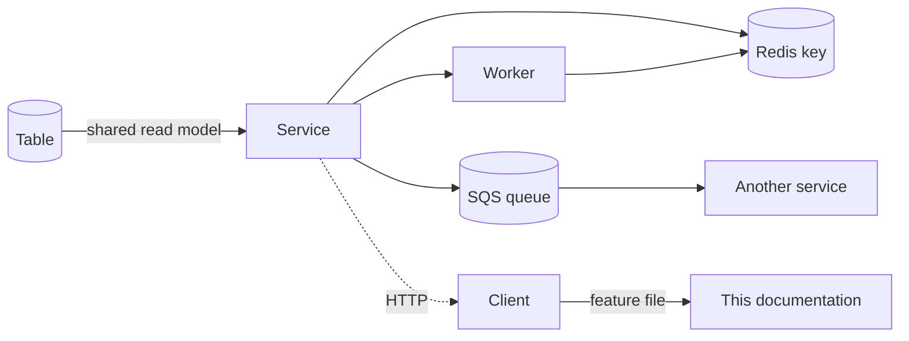

# 03 · Component reverse index

> **Bangla name:** কম্পোনেন্ট রিভার্স ইনডেক্স
>
> [← Contents](README.md) · [Traceability matrix](02-traceability-matrix.md)

The matrix ([02](02-traceability-matrix.md)) goes **feature → component**. This page goes the other way: **component → feature**. Use it when you have a table, a queue, a Redis key, a worker or an endpoint and need to know what depends on it — before you rename it, drop it, or change its shape.

## 1. How to use this page

| You are about to… | Look at |
|---|---|
| Change a table's columns | §3 — who else maps it |
| Rename a Redis key | §4 — who reads it |
| Change a queue's message shape | §5 — who produces and consumes it |
| Delete a controller | [91 · Endpoint index](91-appendix-b-endpoint-index.md), then §2 |
| Delete a worker | §6 |

Anything marked **shared** has more than one service mapping it. Those are the changes that break something quietly.

## 2. Service → what it owns

| Service | Owns (migrated by it) | Reads (read models) | Feature files |
|---|---|---|---|
| **Admin** | 33 `DbSet`s — the master data | — (it is the master) | [A-01](10-admin-portal/A-01-program-selection.md) … [A-31](10-admin-portal/A-31-general-notices.md) |
| **Booking** | `Capacity`, `SeatReservation`, `EventCapacityAdjustment`, `UserBookingOrder`, `BookedUserRecord` | **14 tables** (§3.2) | [P-04](20-user-portal/P-04-seat-selection.md) … [P-08](20-user-portal/P-08-ticket-generation-request.md) |
| **Ticketing** | `Ticket`, `OfflineSoldTicket` | **16 tables** (§3.3) | [P-09](20-user-portal/P-09-ticket-details-downloads.md), [P-10](20-user-portal/P-10-oneid-ticket-sync.md), [S-06](50-system-initiated/S-06-booking-status-generated.md) … [S-09](50-system-initiated/S-09-ticket-merge-zip.md) |
| **TicketChecker** | *(none — it writes only Redis)* | `Events`, `TicketCheckerGates`, `TicketCheckerGateUsers`, `BlockLevelEntryGates` | [C-02](40-checker-app/C-02-offline-ticket-download.md), [C-05](40-checker-app/C-05-ticket-sync.md) |
| **UserIssue** | `ReportedIssue`, `ReportedIssueChatMessage` | `Ticket`, `UserBookingOrder` | [P-12](20-user-portal/P-12-issues-chat.md), [U-08](30-user-app/U-08-issues-chat.md) |
| **PushNotification** | `UserDeviceToken` | — | [U-09](30-user-app/U-09-device-token.md), [S-13](50-system-initiated/S-13-device-token-cleanup.md) |
| **Scheduler**, **Utility**, **Platform**, **UserAuth** | none | none | [S-11](50-system-initiated/S-11-firebase-notification.md) … [S-17](50-system-initiated/S-17-discount-status.md) |

## 3. Table reverse index

### 3.1 Tables owned by Admin

Nothing else migrates them, but several are **read** by other services — those are marked.

| Table | Also read by | Used by (features) |
|---|---|---|
| `Program` | Booking, Ticketing | [A-02](10-admin-portal/A-02-programs.md), [A-07](10-admin-portal/A-07-events.md) |
| `ProgramVenue`, `ProgramVenueDetails` | — | [A-06](10-admin-portal/A-06-program-venue-mapping.md) |
| `ProgramTeam` | Ticketing | [A-04](10-admin-portal/A-04-teams.md) |
| `ProgramSettings` | — | [A-03](10-admin-portal/A-03-program-settings.md) |
| `Venue`, `VenueGallery`, `GalleryBlock`, `BlockLevel` | **Booking, Ticketing** | [A-05](10-admin-portal/A-05-venues.md), [P-04](20-user-portal/P-04-seat-selection.md) |
| `BlockLevelEntryGates` | **TicketChecker** | [A-09](10-admin-portal/A-09-event-level-pricing.md), [C-03](40-checker-app/C-03-qr-scan-validation.md) |
| `BlockLevelMiniGates` | — | [A-09](10-admin-portal/A-09-event-level-pricing.md), [S-12](50-system-initiated/S-12-ticket-generated-notification.md) |
| `Event` | **Booking, Ticketing, TicketChecker** | [A-07](10-admin-portal/A-07-events.md) |
| `EventSettings` | Ticketing | [A-08](10-admin-portal/A-08-event-settings.md) |
| `EventVenueDetails` | **Booking, Ticketing** | [A-09](10-admin-portal/A-09-event-level-pricing.md), [P-03](20-user-portal/P-03-info-pages.md) |
| `EventSegment` | Ticketing | [A-07](10-admin-portal/A-07-events.md), [P-02](20-user-portal/P-02-browse-events.md) |
| `TicketLayoutConfig`, `TicketAttributes` | **Ticketing** | [A-13](10-admin-portal/A-13-ticket-layouts.md), [S-08](50-system-initiated/S-08-ticket-signing.md) |
| `TicketPricing`, `TicketPricingAttribute` | — | [A-14](10-admin-portal/A-14-ticket-pricing-content.md) — **the customer pricing page uses `program-pricing`, not this** |
| `PromoCode`, `PromoCodeAssign` | **Booking** | [A-15](10-admin-portal/A-15-promo-codes.md), [P-05](20-user-portal/P-05-apply-promo-code.md), [S-16](50-system-initiated/S-16-promo-code-status.md) |
| `Discount`, `DiscountAssign` | **Booking, Ticketing** | [A-16](10-admin-portal/A-16-discounts.md), [U-04](30-user-app/U-04-seat-selection-promo.md), [S-17](50-system-initiated/S-17-discount-status.md) |
| `TicketCheckerGate`, `TicketCheckerGateUser` | **TicketChecker** | [A-18](10-admin-portal/A-18-gate-assignment.md), [C-01](40-checker-app/C-01-assigned-event-gate.md), [S-14](50-system-initiated/S-14-checked-ticket-sync.md) |
| `CheckedTicket` | — | [S-14](50-system-initiated/S-14-checked-ticket-sync.md), [A-19](10-admin-portal/A-19-gate-reports.md) |
| `UserIssue`, `UserIssueChatMessage` | *(the Admin copies — legacy, see [Appendix A §2.1](90-appendix-a-legacy.md))* | [A-24](10-admin-portal/A-24-user-issues-admin.md) |
| `RaffleDraw` | — | [A-20](10-admin-portal/A-20-raffle-draw.md) |
| `Currency` | **Booking, Ticketing** | [A-09](10-admin-portal/A-09-event-level-pricing.md) |
| `SystemSettings` | — | [X-26](60-cross-cutting/X-26-configuration.md) |
| `LandingPageImage` | Event (public read) | [A-28](10-admin-portal/A-28-media-configuration.md), [P-01](20-user-portal/P-01-home-content.md), [U-02](30-user-app/U-02-home-browse-events.md) |
| `HeaderFooter` | Event (public read) | [A-30](10-admin-portal/A-30-header-footer-social.md), [P-01](20-user-portal/P-01-home-content.md) |
| `GeneralNotice` | *(nothing reads it)* | [A-31](10-admin-portal/A-31-general-notices.md), [Q-35](99-open-queries.md) |
| `SocialMediaSettings` | *(nothing reads it — legacy)* | [A-30](10-admin-portal/A-30-header-footer-social.md), [Q-34](99-open-queries.md) |
| `Gallery` | — | [A-28](10-admin-portal/A-28-media-configuration.md) |

### 3.2 Tables Booking owns

| Table | Used by (features) |
|---|---|
| `Capacity` | [P-04](20-user-portal/P-04-seat-selection.md), [U-04](30-user-app/U-04-seat-selection-promo.md), [S-01](50-system-initiated/S-01-level-capacity-update.md) |
| `SeatReservation` | [A-11](10-admin-portal/A-11-seat-reservation.md), [A-12](10-admin-portal/A-12-reserved-tickets.md), [S-09](50-system-initiated/S-09-ticket-merge-zip.md) |
| `EventCapacityAdjustment` | [A-10](10-admin-portal/A-10-capacity-adjustment.md) |
| `UserBookingOrder` | [P-06](20-user-portal/P-06-booking-payment.md), [P-07](20-user-portal/P-07-my-bookings.md), [P-08](20-user-portal/P-08-ticket-generation-request.md), [S-05](50-system-initiated/S-05-pending-failed-revalidation.md), [A-22](10-admin-portal/A-22-reports.md), [A-23](10-admin-portal/A-23-reconciliation.md) |
| `BookedUserRecord` | Ticketing reads it; [X-13](60-cross-cutting/X-13-agent-pool.md) |

### 3.3 Tables Ticketing owns

| Table | Used by (features) |
|---|---|
| `Ticket` | [P-09](20-user-portal/P-09-ticket-details-downloads.md), [U-06](30-user-app/U-06-my-bookings-tickets.md), [C-03](40-checker-app/C-03-qr-scan-validation.md), [S-06](50-system-initiated/S-06-booking-status-generated.md), [S-08](50-system-initiated/S-08-ticket-signing.md), **UserIssue reads it** |
| `OfflineSoldTicket` | [X-13](60-cross-cutting/X-13-agent-pool.md) — **written, never read** ([Q-07](99-open-queries.md)) |

### 3.4 Tables the other services own

| Table | Owner | Read by | Used by |
|---|---|---|---|
| `ReportedIssue`, `ReportedIssueChatMessage` | UserIssue | *(UserIssue only)* | [P-12](20-user-portal/P-12-issues-chat.md), [U-08](30-user-app/U-08-issues-chat.md), [A-24](10-admin-portal/A-24-user-issues-admin.md) |
| `UserDeviceToken` | PushNotification | Scheduler, Admin | [U-09](30-user-app/U-09-device-token.md), [S-13](50-system-initiated/S-13-device-token-cleanup.md) |

### 3.5 The shared-table problem

These tables are mapped by more than one service with `ExcludeFromMigrations`, so **no single service owns their schema**:

```
Discounts · DiscountAssigns · DiscountAssignEvent · DiscountAssignVenueGallery
VenueGalleries · GalleryBlocks · BlockLevels · EventVenueDetails
PromoCodes · PromoCodeAssigns · EventPromoCodeAssign · PromoCodeAssignVenueGallery
Currencies · Events · PromoCodeVenueEventGallery
TicketLayoutConfigs · BookedUserRecords · ProgramTeams · Venues · EventSegments · EventSettings
TicketCheckerGates · TicketCheckerGateUsers · BlockLevelEntryGates
UserBookingOrders
```

**Consequence.** A column rename in Admin will not fail the build in Booking or Ticketing — the mappings are read-only views, so the break appears at runtime as a missing column. This is the single largest schema-change hazard in the platform, and it depends on the unresolved database-layout question ([Q-02](99-open-queries.md)).

See [X-19](60-cross-cutting/X-19-service-to-service.md), [S-17](50-system-initiated/S-17-discount-status.md) and [X-24](60-cross-cutting/X-24-activity-logging.md).

## 4. Redis key reverse index

| Key | Type | Written by | Read by | Features |
|---|---|---|---|---|
| `level_live:{e}_{g}_{b}_{l}` | hash/string | Booking | Booking, Event | [P-04](20-user-portal/P-04-seat-selection.md), [S-02](50-system-initiated/S-02-event-live-capacity.md), [X-25](60-cross-cutting/X-25-redis.md) |
| `level_live_seats:{e}_{g}_{b}_{l}` | hash/set | Booking | Booking | [P-04](20-user-portal/P-04-seat-selection.md), [U-04](30-user-app/U-04-seat-selection-promo.md) |
| `level_locked:{e}_{g}_{b}_{l}` | hash | Booking | Booking, refresh worker | [P-05](20-user-portal/P-05-apply-promo-code.md), [S-03](50-system-initiated/S-03-locked-capacity-refresh.md), [S-05](50-system-initiated/S-05-pending-failed-revalidation.md) |
| `capacity` | hash | Booking | Booking, Event, Admin | [A-21](10-admin-portal/A-21-dashboard.md), [X-25](60-cross-cutting/X-25-redis.md) |
| `refresh` | set | Booking | Refresh worker — **key mismatch**, see [Q-10](99-open-queries.md) | [S-03](50-system-initiated/S-03-locked-capacity-refresh.md) |
| `capacity/*`, `capacityAction` | hash | Admin | Booking, Event | [A-10](10-admin-portal/A-10-capacity-adjustment.md) |
| `TicketCheckerLevelGateMap` | hash | Admin | TicketChecker | [A-18](10-admin-portal/A-18-gate-assignment.md), [C-05](40-checker-app/C-05-ticket-sync.md) |
| `ticketCheckerDbSync` | flag | Admin ([S-14](50-system-initiated/S-14-checked-ticket-sync.md)) | TicketChecker | **No expiry** ([Q-17](99-open-queries.md)) |
| Published-content keys | hash | Admin | Event | [P-01](20-user-portal/P-01-home-content.md), [A-29](10-admin-portal/A-29-content-editor.md) |
| `signedToken` | string, 60 s | Admin `generate-signed-token` | **nothing in the backend** | [X-20](60-cross-cutting/X-20-file-storage.md), [Q-50](99-open-queries.md) |

**RedLock** is used for the refresh worker's distributed lock — [S-03](50-system-initiated/S-03-locked-capacity-refresh.md), [X-25](60-cross-cutting/X-25-redis.md).

## 5. Queue reverse index

| Queue | Message shape | Producer | Consumer | Feature |
|---|---|---|---|---|
| `OrderSuccess` | booking order id | Booking | Ticketing `TicketGenerationService` | [S-07](50-system-initiated/S-07-initiate-user-ticket-generation.md) |
| `EventCapacity` | capacity event | Booking | Booking `LevelCapacityUpdateService`, `EventLiveCapacityUpdateService` | [S-01](50-system-initiated/S-01-level-capacity-update.md), [S-02](50-system-initiated/S-02-event-live-capacity.md) |
| `VatChallanProcessing` | order id | Booking | Scheduler `VatChallanProcessingService` | [S-10](50-system-initiated/S-10-vat-challan.md) |
| `TicketSigning` | `TicketSigningPayload` | Ticketing | Ticketing | [S-08](50-system-initiated/S-08-ticket-signing.md) |
| `TicketProcessing` | `TicketProcessingRequest { ReservationId, ProcessingType = Merge\|Zip, GroupId, OrderId }` | Ticketing | Utility `TicketProcessingService` | [S-09](50-system-initiated/S-09-ticket-merge-zip.md) |
| `FirebaseNotification` | `FirebaseNotificationRequest { Title, Body, Data, DeviceTokens, CreatedAt, GroupId, OrderId }` | PushNotification | Scheduler `FirebaseNotificationService` | [S-11](50-system-initiated/S-11-firebase-notification.md) |

**Before changing any message shape**, read [Q-09](99-open-queries.md): there is no dead-letter queue and the retry counter never advances, so a shape mismatch retries for ever rather than failing visibly.

## 6. Worker reverse index

Every background worker, its service, and its interval. A full description of each is in [50 · System-initiated](50-system-initiated/README.md).

| Worker | Service | Interval | Feature |
|---|---|---|---|
| `LevelCapacityUpdateService` | Booking | on `EventCapacity` message | [S-01](50-system-initiated/S-01-level-capacity-update.md) |
| `EventLiveCapacityUpdateService` | Booking | on `EventCapacity` message | [S-02](50-system-initiated/S-02-event-live-capacity.md) |
| `RefreshLockedCapacityService` | Booking | timer + RedLock | [S-03](50-system-initiated/S-03-locked-capacity-refresh.md) |
| `CapacityUpdateService` | Scheduler | timer | [S-04](50-system-initiated/S-04-scheduler-capacity-update.md) |
| `PendingOrFailedBookingStatusUpdateService` | Scheduler | timer (7–10 min) | [S-05](50-system-initiated/S-05-pending-failed-revalidation.md) |
| `BookingStatusUpdateService` | Booking | timer | [S-06](50-system-initiated/S-06-booking-status-generated.md) |
| `InitiateUserTicketGenerationService` | Booking | 15-minute loop — **busy loop if nothing qualifies** ([Q-12](99-open-queries.md)) | [S-07](50-system-initiated/S-07-initiate-user-ticket-generation.md) |
| `TicketGenerationService` | Ticketing | on `OrderSuccess` message | [S-07](50-system-initiated/S-07-initiate-user-ticket-generation.md), [S-08](50-system-initiated/S-08-ticket-signing.md) |
| `TicketProcessingService` | Utility | on `TicketProcessing` message | [S-09](50-system-initiated/S-09-ticket-merge-zip.md) |
| `VatChallanProcessingService` | Scheduler | on `VatChallanProcessing` message | [S-10](50-system-initiated/S-10-vat-challan.md) |
| `FirebaseNotificationService` | Scheduler | on `FirebaseNotification` message | [S-11](50-system-initiated/S-11-firebase-notification.md) |
| `SendNotificationAfterGeneratedTicketService` | Scheduler | timer | [S-12](50-system-initiated/S-12-ticket-generated-notification.md) |
| `DeviceTokenCleanupService` | Scheduler | daily — **may 404** ([Q-16](99-open-queries.md)) | [S-13](50-system-initiated/S-13-device-token-cleanup.md) |
| `CheckedTicketService` | Admin | timer | [S-14](50-system-initiated/S-14-checked-ticket-sync.md) |
| `GateCheckerDownloadStatusCleanupService` | Admin | timer | [S-15](50-system-initiated/S-15-gate-download-status-cleanup.md) |
| `PromoCodeStatusUpdateService` | Admin | timer | [S-16](50-system-initiated/S-16-promo-code-status.md) |
| `SystemDiscountStatusUpdateService` | Admin | timer | [S-17](50-system-initiated/S-17-discount-status.md) |

## 7. Code-file reverse index

The files a newcomer is most likely to need, by role.

### 7.1 Backend entry points

| What | Where |
|---|---|
| Service bootstrap, prefix, auth, DI | `Services/<Name>/ETP.<Name>.Service/Program.cs` |
| Hosted services and connection strings | `Services/<Name>/ETP.<Name>.Service/Configurations/DependencyConfig.cs` |
| Service name (the URL prefix) | `Services/<Name>/ETP.<Name>.Service/appsettings.json` → `Application:ServiceName` |
| Shared DI registrations | `Configuration(s)/DependencyConfig.cs` |
| Path-prefix convention | `Core/ETP.Core.Web` — `GlobalRoutePrefixConvention` |
| Auth schemes | `Core/ETP.Core.Web` — `AuthScheme.User` / `.Admin` / `.Agent` |

### 7.2 Per-service structure

Each service follows the same split:

| Layer | What lives there |
|---|---|
| `ETP.<Name>.Service/Api/` | Controllers — thin, delegate to managers |
| `ETP.<Name>.Domain/Managers/` | **The business logic.** This is where to read |
| `ETP.<Name>.Storage/DbContexts/` | `DbContext`, `DbSet`s, `ExcludeFromMigrations` |
| `ETP.<Name>.Storage/Migrations/` | Migrations — only for tables the service owns |
| `ETP.<Name>.Client/` | Typed HTTP client other services use |
| `ETP.<Name>.Integration/` | External system clients (TSP, DgePay, OneID, SES) |

### 7.3 Client-side entry points

| What | Where |
|---|---|
| Admin portal routes | `rvl-gobcb-admin-portal/src/app/app-routing.module.ts` |
| Admin portal HTTP + interceptor | `…/src/app/core/` (guards, interceptors, services) |
| Admin portal program scope | `…/core/services/program.service.ts` (`localStorage: globalProgramId`) |
| User portal routes and `LanguageGuard` | `rvl-gobcb-user-portal/ETP-Web/src/app/app-routing.module.ts` |
| User portal identity calls | `…/core/services/api/identity-api.service.ts` |
| User portal chat | `…/modules/*/…/signalr-chat.service.ts` |
| User app API services | `rvl-gobcb-user-app/data/lib/remote/api_service/` |
| User app `.env` keys | `rvl-gobcb-user-app/.env` (`AUTH_API_BASE_URL`, `VDS_*`, `PAYMENT_SUCCESS_URL`, `FIREBASE_*`) |
| Checker app routes | `rvl-gobcb-checker-app/lib/presentation/navigation/route_path.dart` |
| Checker app VDS decode | `rvl-gobcb-checker-app/data/lib/service/vds_qr_decoder.dart` |
| Checker app Android crypto | `rvl-gobcb-checker-app/android/…/MainActivity.kt` |
| Checker app iOS gap | `rvl-gobcb-checker-app/ios/Runner/AppDelegate.swift` (13 lines, no channel handler) |
| Checker app database | `rvl-gobcb-checker-app/data/lib/local/drift_database/` |

## 8. Component relationships



**Depends on:** [02 · Traceability matrix](02-traceability-matrix.md). **Affects:** every change to a shared table, Redis key or queue message.