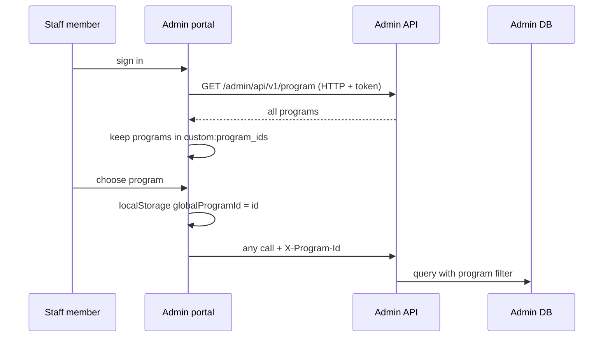

# A-01 · Program selection and program-scoped menu

> **Bangla name:** প্রোগ্রাম নির্বাচন ও প্রোগ্রাম-ভিত্তিক মেনু
>
> [← 10 · Admin portal](README.md) · [Contents](../README.md) · [Open queries](../99-open-queries.md)

## 1. Name and purpose

**Program selection.** A *program* is a series or tournament that groups events (see [A-02](A-02-programs.md)). After signing in, a staff member picks one program in the top bar. From then on every request carries the header `X-Program-Id`, the portal shows the **program menu** (dashboard, events, promo codes, reports, issues, ticket layouts), and the backend limits program-owned data to that program. With no program selected (`0`) the portal shows the **global menu** (programs, venues, users, settings, agents, ticket checkers). Concepts: [path-prefix routing](../00-platform-primer.md#explainer-path-prefix-routing); the authorization side is in [X-16](../60-cross-cutting/X-16-authz-program-scope.md) and [X-17](../60-cross-cutting/X-17-authz-client-side.md).

## 2. Trigger and actor

Any signed-in staff member (**admin pool**; roles `admin`, `event_manager`, `ticket_manager`, `ticket_operator`, `customer_support`, `ticket_operator` (`BCBPersonnel`), [X-15](../60-cross-cutting/X-15-authz-roles.md)). Trigger: after login, or the top-bar dropdown, or "Back to global menu".

## 3. Business flow

1. After login the portal loads the program list. A user who is not `admin` sees only the programs listed in their `custom:program_ids` attribute; `admin` sees all.
2. If no program is chosen yet (`globalProgramId` is `0`), a modal asks the user to choose one.
3. Choosing a program stores it in the browser and moves the user to the landing page of their role (for example `/` dashboard for admin, `/issues` for customer support, `/events` for event manager, `/events/event-ticket` for ticket manager).
4. "Back to global menu" (with a confirmation) resets the program to `0` and returns to the global page of the role (`/program-management` or `/home`).
5. Log-out and role change also reset the program to `0` ([X-03](../60-cross-cutting/X-03-admin-change-password-logout.md), [X-17](../60-cross-cutting/X-17-authz-client-side.md)).

## 4. Technical flow

1. **[HTTP + user token]** `app.topbar.component.ts` `getPrograms()` → `GET /admin/api/v1/program` (all programs). **The filtering by `custom:program_ids` is done in the browser**, using the Cognito attributes of the signed-in user.
2. `ProgramService` (`core/services/program.service.ts`) keeps the current id in a `BehaviorSubject` and in `localStorage` key `globalProgramId`; the default is `0`.
3. `ProgramIdInterceptor` adds `X-Program-Id: <id>` to **every** request except the 2FA OTP calls (`/admin/login-2fa`). Interceptor order: Auth, Loader, ProgramId ([X-04](../60-cross-cutting/X-04-admin-session.md)).
4. Route guards: `ProgramMenuGuard` allows a route only when the program id is greater than 0, else it redirects to `/program-management`; `LimitedMenuGuard` allows a route only when the id is `0`, else it redirects to `/` ([X-17](../60-cross-cutting/X-17-authz-client-side.md)).
5. **Backend:** `ProgramIdMiddleware` reads `X-Program-Id` (a positive integer, otherwise 0) into `HttpContext.Items["ProgramId"]`; `ProgramIdAccessor` exposes it, and the `AdminDbContext` global query filter restricts entities that carry a program id to `ProgramId <= 0 OR match` ([explainer](../00-platform-primer.md#explainer-shared-database), [X-16](../60-cross-cutting/X-16-authz-program-scope.md)). The `[AuthorizeProgram]` attribute that compares the header with the user's `custom:program_ids` is applied only to the dashboard controller.

## 5. Components

| Kind | Component |
|---|---|
| Client | Admin portal: `layout/app.topbar.component.ts`, `layout/app.menu.component.ts`, `core/services/program.service.ts`, `interceptors/program-id.interceptor.ts`, `core/guard/program-menu.guard.ts`, `core/guard/limited-menu.guard.ts` |
| Services | Admin (`ProgramIdMiddleware`, `ProgramIdAccessor`, `AdminDbContext`); no other service reads the header (only `Core/.../AdminClient.cs` mentions it) |
| AWS | Cognito attributes `custom:role`, `custom:program_ids` |
| Browser storage | `localStorage["globalProgramId"]` |

## 6. API contracts

| Method | Path | Auth | Request | Response |
|---|---|---|---|---|
| GET | `/admin/api/v1/program` | roles `Admin`, `EventManager`, and the others listed on `ProgramController` | none (header `X-Program-Id`) | list of programs ([A-02](A-02-programs.md)) |

Request header on every call: `X-Program-Id: 12` (example value). The header is **not** validated against the user's program list except in `DashboardController` ([A-21](A-21-dashboard.md)).

## 7. Data and side effects

None on the server. Browser: `localStorage` entry. The selected id influences all list queries of program-owned entities.

## 8. Code references

| What | Where |
|---|---|
| Program dropdown and modal | `rvl-gobcb-admin-portal/src/app/layout/app.topbar.component.ts:166-215` |
| Reset on "back to global" | `rvl-gobcb-admin-portal/src/app/layout/app.menu.component.ts:286-300` |
| Program state | `rvl-gobcb-admin-portal/src/app/core/services/program.service.ts` |
| Header interceptor | `rvl-gobcb-admin-portal/src/app/interceptors/program-id.interceptor.ts` |
| Guards | `rvl-gobcb-admin-portal/src/app/core/guard/program-menu.guard.ts`, `limited-menu.guard.ts` |
| Middleware | `rvl-gobcb-backend/Services/Admin/ETP.Admin.Service/Middleware/ProgramIdMiddleware.cs` |
| Program list endpoint | `rvl-gobcb-backend/Services/Admin/ETP.Admin.Service/Api/ProgramController.cs:27` |

## 9. Handover notes

1. **The user's program list is enforced only in the browser** (and in the dashboard). `GET /program` returns every program to any allowed role, and the backend trusts the `X-Program-Id` header, so a staff member can send another program's id with an ordinary HTTP client and see that program's data ([X-16](../60-cross-cutting/X-16-authz-program-scope.md)).
2. **Two menus, one flag.** Which menu appears depends only on `globalProgramId` being `0` or not, held in `localStorage`; it survives a browser restart. A user who edits it by hand reaches pages the guard would otherwise redirect, but the server still applies the role checks.
3. The header is added to calls to **all** services (Admin, Booking, Ticketing), but only Admin has the program query filter and reads it; Booking report endpoints take an explicit `programId` query parameter (see [A-22](A-22-reports.md)).
4. Customer support and ticket operator roles have no program menu: they land on `/home` or `/issues`.
5. The interceptor excludes only `/admin/login-2fa`; calls to AWS Cognito are not Angular `HttpClient` calls and do not carry the header.

## 10. Component relationships

**Depends on:** admin login ([X-01](../60-cross-cutting/X-01-admin-login.md)), program setup ([A-02](A-02-programs.md)), roles ([X-15](../60-cross-cutting/X-15-authz-roles.md)). **Affects:** nearly every admin feature ([A-07](A-07-events.md), [A-15](A-15-promo-codes.md), [A-21](A-21-dashboard.md), [A-22](A-22-reports.md)).

## 11. Developer test guide

**Local testability: Full.**

| Item | Detail |
|---|---|
| Test data and accounts | `pwsh ./scripts/Seed-EtpData.ps1` creates programs; admin phone `…01` (OTP stub `123456`, password `Passw0rd!23`, [X-01](../60-cross-cutting/X-01-admin-login.md)); other seeded admins `…02` to `…05` have other roles |
| Browser | `http://localhost:4200` → log in → the program dropdown in the top bar; DevTools → Application → Local Storage `globalProgramId`; Network → any request → header `X-Program-Id` |
| Emulator | — |
| Postman | `postman/services/etp-admin.postman_collection.json` "GET /api/v1/program" with `{{access_token_admin}}` (`base_url` has no `/admin` prefix, see Appendix D); add header `X-Program-Id` to test filtering |
| Visual Studio debug | `ProgramIdMiddleware.InvokeAsync` (Admin), then a query on a program-scoped entity |
| Verify | Compare a list endpoint (for example `GET /events`) with `X-Program-Id: 0` and with a real id; SQL: `select "Id","Name" from etp."Programs"` |
