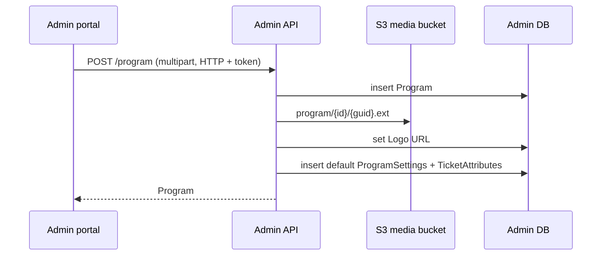

# A-02 · Programs

> **Bangla name:** প্রোগ্রাম
>
> [← 10 · Admin portal](README.md) · [Contents](../README.md) · [Open queries](../99-open-queries.md)

## 1. Name and purpose

**Programs.** A program is the top-level container of the business: a series, tournament or season, with a name, a short name, a logo and a validity period. Venues ([A-06](A-06-program-venue-mapping.md)), teams ([A-04](A-04-teams.md)), commercial rules ([A-03](A-03-program-settings.md)), ticket layouts ([A-13](A-13-ticket-layouts.md)), events ([A-07](A-07-events.md)), promo codes, discounts and users' access all hang off a program. Admins create and edit programs here.

## 2. Trigger and actor

Staff signed in to the admin portal with the roles allowed on `ProgramController` (`admin`, `event_manager`, `ticket_manager`, `customer_support`, `ticket_operator` (`BCBPersonnel`) can read; see §9 for who can write). Entry points in the portal: menu **Prog. Managem.** (`/program-management`, global menu only), then **Create program** (`/program-management/program-create`) or a program's home page (`/program-management/program-home/:id`) tab **Program Update**.

## 3. Business flow

1. List programs (name, dates, logo).
2. Create a program: name (max 100 characters), short name, start and end date-time (start must be earlier than end), optional logo.
3. The platform also creates **default program settings** and **default ticket attributes** for the new program, so the program can be used at once ([A-03](A-03-program-settings.md), [A-13](A-13-ticket-layouts.md)).
4. Edit name, dates or logo. Delete a program only when no event belongs to it.

## 4. Technical flow

1. **[HTTP + user token]** `program-list` calls `GET /admin/api/v1/program` (through `ProgramsService` of the settings module); the home page calls `GET /admin/api/v1/program/{id}` (with venues and settings).
2. Create: `create-program.component.ts` builds a `FormData` with `name`, `shortName`, `startDateTime` (ISO), `endDateTime`, `logo` and sends `POST /admin/api/v1/program` (`multipart/form-data`). `ProgramManager.CreateAsync`:
   - `CheckValidation`: name required, ≤ 100 characters, start earlier than end;
   - insert the program; if a logo is sent, upload it to S3 `program/{programId}/{guid}{ext}` and save the URL `{AWS:Bucket:BaseUrl}/{key}` as `Logo` ([X-20](../60-cross-cutting/X-20-file-storage.md));
   - create `ProgramSettings` with fixed defaults (§7) and a default `TicketAttributes` row.
3. Update: `PUT /admin/api/v1/program/{id}` (also multipart); the repository copies `Name`, `ShortName`, `StartDateTime`, `EndDateTime`; a new logo replaces the URL.
4. Delete: `DELETE /admin/api/v1/program/{id}`. If `EventManager.GetEventsByProgramIdIgnoreEndDateAsync` finds any event, it fails with "Cannot delete program. There are N event(s) associated with this program."; otherwise the program is **soft-deleted** (`IsDeleted = true`).
5. The portal calls `programService.notifyProgramsUpdated()` after creating a program and after a delete in the list so the top-bar list can reload ([A-01](A-01-program-selection.md)).

## 5. Components

| Kind | Component |
|---|---|
| Client | `features/program-management/pages/{program-list,create-program,edit-program,program-home}`, `services/program-management.service.ts`; a second, unlinked screen `features/program-settings/pages/program` (route `/settings/programs`, see §9) |
| Service | Admin: `ProgramController`, `ProgramManager`, `ProgramRepository` |
| Tables | `Programs`, `ProgramSettings`, `TicketAttributes` |
| Storage | S3 media bucket, folder `program/{id}` |
| Calls out | none |

## 6. API contracts

| Method | Path | Auth | Request | Response | Main errors |
|---|---|---|---|---|---|
| GET | `/admin/api/v1/program` | roles Admin, EventManager, TicketManager, CustomerSupportAdmin, BCBPersonnel | none | `Program[]` | 500 |
| GET | `/admin/api/v1/program/{id}` | same | path `id` | `Program` with venues and settings | null body if missing |
| POST | `/admin/api/v1/program` | same | `CreateOrUpdateProgram` (multipart) | `Program` | 400 `Name is missing.`, `Name should not be more than 100`, `Start Date Time must be earlier than End Date Time.` |
| PUT | `/admin/api/v1/program/{id}` | same | `CreateOrUpdateProgram` (multipart) | `Program` | 400 as above, `'{id}' doesn't exist.` |
| DELETE | `/admin/api/v1/program/{id}` | same | path | `Program` | 400 `Cannot delete program. There are N event(s) ...` |

Primary sample, `POST /admin/api/v1/program` as `multipart/form-data` (field names from `CreateOrUpdateProgram`; values are examples):

```
name=Premier League 2026
shortName=BPL26
startDateTime=2026-12-01T00:00:00.000Z
endDateTime=2027-02-28T00:00:00.000Z
logo=<file>
```

Response `Program` (camelCase, numbers for enums, nulls included): `id`, `name`, `shortName`, `logo`, `startDateTime`, `endDateTime`, `programVenues[]`, `programSettings[]`.

## 7. Data and side effects

- `Programs` row; the `Logo` column holds a full URL.
- Default `ProgramSettings` created with: `LimitedAvailabilityThreshold` 60, `AllowableMaximumOrderPerUser` 4, `AllowableMaximumSeatPerOrder` 4, `TicketSellingStartFromHour` 72, `TicketSellingStopFromHour` 1, `TicketAvailableFromHour` 48, `TicketNumberPrefix` `T20`, `Vat` 15 (percentage), `ServiceCharge` 0 (percentage), VAT inclusive, payment gateway `DgePay`.
- Activity log entries ([X-24](../60-cross-cutting/X-24-activity-logging.md)).

## 8. Code references

| What | Where |
|---|---|
| Controller | `rvl-gobcb-backend/Services/Admin/ETP.Admin.Service/Api/ProgramController.cs:14-100` |
| Manager | `rvl-gobcb-backend/Services/Admin/ETP.Admin.Domain/Managers/ProgramManager.cs:36-198` |
| Repository | `rvl-gobcb-backend/Services/Admin/ETP.Admin.Storage/Repositories/ProgramRepository.cs:25-74` |
| Request model | `rvl-gobcb-backend/Services/Admin/ETP.Admin.Domain/Models/Settings/CreateOrUpdateProgram.cs` |
| Portal form | `rvl-gobcb-admin-portal/src/app/features/program-management/pages/create-program/create-program.component.ts:127-155` |
| Portal tabs | `rvl-gobcb-admin-portal/src/app/features/program-management/pages/program-home/program-home.component.html:48-62` |

## 9. Handover notes

1. **Write access is wider than the menu.** `ProgramController` allows the five roles above for every action, including POST, PUT and DELETE; the portal shows the "Prog. Managem." menu mainly to admin and event/ticket roles ([X-15](../60-cross-cutting/X-15-authz-roles.md), [X-17](../60-cross-cutting/X-17-authz-client-side.md)). A `customer_support` token can create or delete a program through the API.
2. **The repository's update copies only name, short name and the two dates and does not set `UpdatedAt`.**
3. **Two screens for the same data.** The unlinked `/settings` module has its own program, program-teams and program-venues pages and uses the same endpoints; only the `/program-management` screens are reachable from the menu ([A-30](A-30-header-footer-social.md) lists what else lives in `/settings`).
4. **Delete is soft and blocked only by events.** Venues mapped to the program, teams, settings, promo codes and discounts remain in the database, and `GetAllAsync` hides the program. Whether a soft-deleted program disappears from every other list is not checked here.
5. The program `Id` is a `long` in the controller but `int` in the `Program` response model.
6. The default `TicketNumberPrefix` is `T20`; tickets of events whose settings are not overridden get numbers starting with it ([A-08](A-08-event-settings.md), [S-07](../50-system-initiated/S-07-initiate-user-ticket-generation.md)).

## 10. Component relationships



**Depends on:** admin login and roles ([X-01](../60-cross-cutting/X-01-admin-login.md), [X-15](../60-cross-cutting/X-15-authz-roles.md)). **Affects:** everything program-scoped: [A-03](A-03-program-settings.md), [A-04](A-04-teams.md), [A-06](A-06-program-venue-mapping.md), [A-07](A-07-events.md), [A-13](A-13-ticket-layouts.md), [A-15](A-15-promo-codes.md), [A-16](A-16-discounts.md), [A-25](A-25-admin-users.md) (users are assigned programs).

## 11. Developer test guide

**Local testability: Full** (S3 is Floci).

| Item | Detail |
|---|---|
| Test data and accounts | `pwsh ./scripts/Seed-EtpData.ps1` (programs exist); admin `…01` ([X-01](../60-cross-cutting/X-01-admin-login.md)) |
| Browser | `http://localhost:4200` → global menu **Prog. Managem.** → create; Network: `POST .../admin/api/v1/program` multipart; header `X-Program-Id: 0` |
| Emulator | — |
| Postman | `postman/services/etp-admin.postman_collection.json`: "GET /api/v1/program", "POST /api/v1/program" (form-data), "PUT /api/v1/program/{id}", "DELETE /api/v1/program/{id}" with `{{access_token_admin}}` |
| Visual Studio debug | `ProgramManager.CreateAsync`, `ProgramManager.CheckValidation`, `ProgramRepository.DeleteByIdAsync` |
| Verify | SQL: `select "Id","Name","Logo","IsDeleted" from etp."Programs"`; `aws --endpoint-url http://localhost:4566 s3 ls s3://etp-local/program/ --recursive` |
