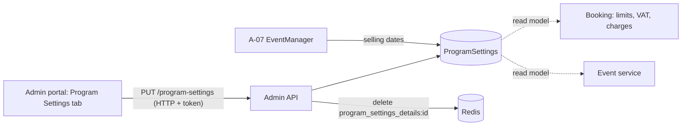

# A-03 · Program settings

> **Bangla name:** প্রোগ্রাম সেটিংস
>
> [← 10 · Admin portal](README.md) · [Contents](../README.md) · [Open queries](../99-open-queries.md)

## 1. Name and purpose

**Program settings.** The commercial rules of a program: how many orders and seats a customer may buy, when selling opens and closes relative to an event, when ticket generation opens, the ticket-number prefix, VAT, service charge and the payment gateway. They are the defaults of every event of the program; an event can override them ([A-08](A-08-event-settings.md)).

## 2. Trigger and actor

Staff with role `admin` or `event_manager` (the controller allows only these two). Entry: **Prog. Managem.** → a program → tab **Program Settings** (`/program-management/program-home/:id`).

## 3. Business flow

The admin selects a program, changes the values and presses **Update**. Rules of the form: maximum orders per customer per event; maximum seats per order; "ticket selling start from" (hours before the event starts); "ticket selling stop from" (hours before the event **ends**); "ticket available from" (hours before the event starts, when tickets can be generated, [S-07](../50-system-initiated/S-07-initiate-user-ticket-generation.md)); limited-availability threshold; ticket-number prefix; payment gateway (DgePay or SSLCommerz); VAT and service charge (amount or percentage); VAT inclusive.

## 4. Technical flow

1. **[HTTP + user token]** The tab loads `GET /admin/api/v1/program-settings/{programId}` and fills the form; the program dropdown comes from `GET /admin/api/v1/program`.
2. **[HTTP + user token]** **Update** sends `PUT /admin/api/v1/program-settings` with the whole `ProgramSettings` object (JSON body).
3. `ProgramSettingsManager.UpdateAsync` loads the row by `ProgramId` ("No program settings found" if missing), copies the hours, limits, prefix, threshold, VAT-inclusive flag and gateway; then, if **any event of the program is published**, it refuses a change of VAT value/percentage flag or service-charge value/percentage flag with "Cannot update VAT and Service Charge while events are published."; otherwise it copies VAT and service charge too. It saves and deletes the Redis key `program_settings_details:{programId}` so the next read rebuilds it ([X-25](../60-cross-cutting/X-25-redis.md)).
4. Where the values are used: **at event creation the program settings are copied into the event's own settings** ([A-07](A-07-events.md)). When an event is read, `EventManager` computes `TicketSellingStartDateTime = event start − TicketSellingStartFromHour`, `TicketSellingStopDateTime = event **end** − TicketSellingStopFromHour` and `TicketAvailabilityStartDateTime = event start − TicketAvailableFromHour`, from the event's own settings if it has them, else from the program settings ([A-08](A-08-event-settings.md)). Booking reads the limits and the charges at order time ([P-06](../20-user-portal/P-06-booking-payment.md)).

## 5. Components

| Kind | Component |
|---|---|
| Client | `features/program-management/components/program-settings/*`, `services/program-settings.service.ts` (a second copy sits in the unlinked `features/program-settings` module) |
| Service | Admin: `ProgramSettingsController`, `ProgramSettingsManager`; Booking and Event read the same table as read models |
| Tables | `ProgramSettings` |
| Redis | `program_settings_details:{programId}` (cache, deleted on update) |

## 6. API contracts

| Method | Path | Auth | Request | Response | Main errors |
|---|---|---|---|---|---|
| GET | `/admin/api/v1/program-settings` | `Admin`, `EventManager` | none | `ProgramSettings[]` | |
| GET | `/admin/api/v1/program-settings/{programId}` | same | path | `ProgramSettings` | |
| PUT | `/admin/api/v1/program-settings` | same | `ProgramSettings` | `ProgramSettings` | 400 `No program settings found`, `Cannot update VAT and Service Charge while events are published.` |

Primary sample, `PUT` body (property names from `ProgramSettings`; the values shown are the creation defaults of [A-02](A-02-programs.md)):

```json
{
  "id": 7,
  "programId": 12,
  "limitedAvailabilityThreshold": 60,
  "allowableMaximumOrderPerUser": 4,
  "allowableMaximumSeatPerOrder": 4,
  "ticketSellingStartFromHour": 72,
  "ticketSellingStopFromHour": 1,
  "ticketAvailableFromHour": 48,
  "ticketNumberPrefix": "T20",
  "vat": 15,
  "isVatPercentage": true,
  "serviceCharge": 0,
  "isServiceChargePercentage": true,
  "isVatInclusive": true,
  "paymentGateway": 1
}
```

`paymentGateway`: `1` = DgePay, `2` = SSLCommerz (the Admin service sends numbers, not names).

## 7. Data and side effects

`ProgramSettings` row updated; cache key deleted; activity log entry. Existing events are **not** changed (they hold their own copy of the settings).

## 8. Code references

| What | Where |
|---|---|
| Controller | `rvl-gobcb-backend/Services/Admin/ETP.Admin.Service/Api/ProgramSettingsController.cs:14-62` |
| Manager | `rvl-gobcb-backend/Services/Admin/ETP.Admin.Domain/Managers/ProgramSettingsManager.cs:58-125` |
| Model | `rvl-gobcb-backend/Services/Admin/ETP.Admin.Domain/Models/Settings/ProgramSettings.cs` |
| Date computation | `rvl-gobcb-backend/Services/Admin/ETP.Admin.Domain/Managers/EventManager.cs:96-136, 185-186` |
| Portal form | `rvl-gobcb-admin-portal/src/app/features/program-management/components/program-settings/program-settings.component.html` |

## 9. Handover notes

1. **The settings are copied, not referenced.** Every event created through the portal gets its own `EventSettings` row at creation, so changing the program settings affects only events created afterwards; use [A-08](A-08-event-settings.md) to change an existing event.
2. **VAT lock only looks at *published* events** of the program; a draft event keeps the old values until it is saved again, and the rule does not protect orders that were already placed.
3. **The ticket-selling stop is measured from the event end** (`EndDateTime`), unlike the start, which is measured from the event start; an event without an end date would fail in `EventManager` (`entity.EndDateTime.Value`).
4. **`TicketNumberPrefix` can be edited any time**; new tickets use the prefix of the event's settings ([S-07](../50-system-initiated/S-07-initiate-user-ticket-generation.md)), so one event may have tickets with two prefixes if it changes in between.
5. The payment gateway is an enum number in JSON; `SSLCommerz` is supported by the form but its callbacks are inactive ([Appendix A](../90-appendix-a-legacy.md)); choose `DgePay` unless BS23 confirms otherwise `[UNCONFIRMED: Q-19]`.

## 10. Component relationships



**Depends on:** [A-02](A-02-programs.md). **Affects:** [A-07](A-07-events.md), [A-08](A-08-event-settings.md), [P-04](../20-user-portal/P-04-seat-selection.md), [P-06](../20-user-portal/P-06-booking-payment.md), [S-07](../50-system-initiated/S-07-initiate-user-ticket-generation.md), [S-10](../50-system-initiated/S-10-vat-challan.md).

## 11. Developer test guide

**Local testability: Full.**

| Item | Detail |
|---|---|
| Test data and accounts | `pwsh ./scripts/Seed-EtpData.ps1`; admin `…01` or an `event_manager` login (`…02` to `…05`, [X-01](../60-cross-cutting/X-01-admin-login.md)) |
| Browser | `http://localhost:4200` → **Prog. Managem.** → program → **Program Settings**; Network: `PUT .../admin/api/v1/program-settings` |
| Emulator | — |
| Postman | `postman/services/etp-admin.postman_collection.json`: "GET /api/v1/program-settings/{programId}", "PUT /api/v1/program-settings" |
| Visual Studio debug | `ProgramSettingsManager.UpdateAsync` (check the "published events" branch) |
| Verify | SQL: `select * from etp."ProgramSettings" where "ProgramId" = <id>`; `redis-cli GET program_settings_details:<id>` returns nil after an update |
