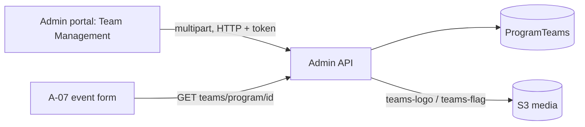

# A-04 · Teams

> **Bangla name:** টিম
>
> [← 10 · Admin portal](README.md) · [Contents](../README.md) · [Open queries](../99-open-queries.md)

## 1. Name and purpose

**Teams.** The teams (cricket sides) that play in a program's events, each with a name, short name, logo and optional flag. Events pick their teams from this list ([A-07](A-07-events.md)), and the customer-facing pages show the logos and flags ([P-02](../20-user-portal/P-02-browse-events.md)).

## 2. Trigger and actor

Staff with role `admin` or `event_manager` (`TeamsController`). Entry: **Prog. Managem.** → a program → tab **Team Management** (`/program-management/program-home/:id`), then create or edit (`/program-management/create/:programId`, `/program-management/edit/:id`).

## 3. Business flow

List the teams of a program, add a team with name, short name, logo and flag images, edit it, switch it active or inactive, or delete it. A team cannot be edited when its program has any published or already ended event.

## 4. Technical flow

1. **[HTTP + user token]** List: `GET /admin/api/v1/teams/program/{programId}` (tab) or `GET /admin/api/v1/teams?{search, sort, paging}` (paged); one team: `GET /admin/api/v1/teams/{id}`.
2. Create: `POST /admin/api/v1/teams` as `multipart/form-data` with `programId`, `name`, `shortName`, `logo`, `flag`, `isFlag`, `isActive`. `ProgramTeamManager.CreateAsync` validates the name (required, at most 100 characters), inserts, uploads the logo to `teams-logo/{id}/{guid}{ext}` and the flag to `teams-flag/{id}/{guid}{ext}`, and saves the URLs `{AWS:Bucket:BaseUrl}/{key}` in `Logo` and `Flag` ([X-20](../60-cross-cutting/X-20-file-storage.md)).
3. Update: `PUT /admin/api/v1/teams/{id}` (multipart). `CheckValidationForUpdate` additionally loads all events of the program (`GetEventsByProgramIdIgnoreEndDateAsync`) and throws "Program team cannot be edited because one or more events are published or expired." if any is published or has ended.
4. Toggle: `PUT /admin/api/v1/teams/toggle-status/{id}` flips `IsActive`.
5. Delete: `DELETE /admin/api/v1/teams/{id}`: a **soft delete** (`IsDeleted = true`).
6. The portal checks `GET /admin/api/v1/events/programs/{programId}/events/no-end-date-check` before enabling the edit form (`teams-management.service.ts`).

## 5. Components

| Kind | Component |
|---|---|
| Client | `features/program-management/components/{teams-list,create-teams}`, `services/teams-management.service.ts`; copy in the unlinked `features/program-settings/pages/program-teams` |
| Service | Admin: `TeamsController`, `ProgramTeamManager`, `TeamRepository` |
| Tables | `ProgramTeams` (Admin entity `ProgramTeam`) |
| Storage | S3 media: `teams-logo/{id}`, `teams-flag/{id}` |

## 6. API contracts

| Method | Path | Auth | Request | Response | Main errors |
|---|---|---|---|---|---|
| GET | `/admin/api/v1/teams/program/{programId}` | `Admin`, `EventManager` | path | `ProgramTeam[]` | |
| GET | `/admin/api/v1/teams` | same | query (search, sort, paging) | paged `ProgramTeam` | |
| GET | `/admin/api/v1/teams/{id}` | same | path | `ProgramTeam` | |
| POST | `/admin/api/v1/teams` | same | `CreateOrUpdateProgramTeam` (multipart) | `ProgramTeam` | 400 `Name is missing.`, `Name should not be more than 100` |
| PUT | `/admin/api/v1/teams/{id}` | same | `CreateOrUpdateProgramTeam` (multipart) | `ProgramTeam` | 400 as above; 500 `Program team cannot be edited because one or more events are published or expired.` |
| PUT | `/admin/api/v1/teams/toggle-status/{id}` | same | path | `ProgramTeam` | 400 `Invalid event ID.`, `Team with ID {id} not found.` |
| DELETE | `/admin/api/v1/teams/{id}` | same | path | `ProgramTeam` | 400 `'{id}' doesn't exist.` |

Primary sample, `POST /admin/api/v1/teams` multipart (field names from `CreateOrUpdateProgramTeam`; values illustrative):

```
programId=12
name=Dhaka Dynamites
shortName=DD
isActive=true
isFlag=false
logo=<file>
flag=<file>
```

## 7. Data and side effects

`ProgramTeams` row with `Logo` and `Flag` URLs; two S3 folders; activity log entries ([X-24](../60-cross-cutting/X-24-activity-logging.md)).

## 8. Code references

| What | Where |
|---|---|
| Controller | `rvl-gobcb-backend/Services/Admin/ETP.Admin.Service/Api/TeamsController.cs:28-140` |
| Manager | `rvl-gobcb-backend/Services/Admin/ETP.Admin.Domain/Managers/ProgramTeamManager.cs:41-260` |
| Repository | `rvl-gobcb-backend/Services/Admin/ETP.Admin.Storage/Repositories/TeamRepository.cs:111-121` |
| Portal service | `rvl-gobcb-admin-portal/src/app/features/program-management/services/teams-management.service.ts:24-47` |

## 9. Handover notes

1. **The edit lock is too coarse.** A team of a program with any published or ended event cannot be edited at all (not even a typo in a short name); the same applies to the logo and flag upload on update. Create is not restricted.
2. **Delete has no usage check.** A team that is already used by an event can be soft-deleted; whether event pages still show it depends on the query used `[UNCONFIRMED: Q-20]`.
3. **The error text for toggle says "Invalid event ID."** (copy-paste); it refers to the team id.
4. **`isFlag`** is stored on the team (the repository copies it), but the manager decides to upload a flag only by the presence of the `flag` file; nothing in the Admin service reads `IsFlag` otherwise.
5. **Update validation uses the `ProgramId` of the request body**, not that of the stored team, so a request that names another program's id is checked against that program's events.

## 10. Component relationships



**Depends on:** [A-02](A-02-programs.md). **Affects:** [A-07](A-07-events.md), the event pages of the user portal and app ([P-02](../20-user-portal/P-02-browse-events.md), [U-02](../30-user-app/U-02-home-browse-events.md)).

## 11. Developer test guide

**Local testability: Full.**

| Item | Detail |
|---|---|
| Test data and accounts | `pwsh ./scripts/Seed-EtpData.ps1`; admin `…01` |
| Browser | `http://localhost:4200` → **Prog. Managem.** → program → **Team Management** → add; Network: multipart `POST .../admin/api/v1/teams` |
| Emulator | — |
| Postman | `postman/services/etp-admin.postman_collection.json`: "GET /api/v1/teams/program/{programId}", "POST /api/v1/teams" (form-data) |
| Visual Studio debug | `ProgramTeamManager.CreateAsync`, `CheckValidationForUpdate` |
| Verify | SQL: `select "Id","Name","Logo","Flag","IsActive","IsDeleted" from etp."ProgramTeams"`; `aws --endpoint-url http://localhost:4566 s3 ls s3://etp-local/teams-logo/ --recursive` |
