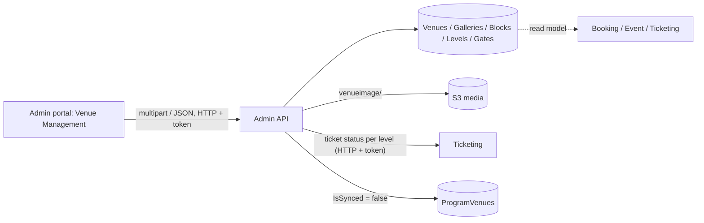

# A-05 · Venues and stadium layout

> **Bangla name:** ভেন্যু ও স্টেডিয়াম লেআউট
>
> [← 10 · Admin portal](README.md) · [Contents](../README.md) · [Open queries](../99-open-queries.md)

## 1. Name and purpose

**Venues.** A venue is a stadium or an exhibition hall. Its seating is modelled as a tree: **venue → gallery → block → level**, each node tied to an id (`SvgKey`) of an SVG map image, so the seat-selection screen can colour the right part of the picture. Levels carry the seating capacity and optional seat labels; **entry gates** and **mini gates** are attached to levels and appear on tickets and in the checker app. Concepts: [shared database](../00-platform-primer.md#explainer-shared-database) (Booking, Ticketing and Event read these tables as read models).

## 2. Trigger and actor

Staff with role `admin` or `event_manager` (`VenuesController`). Entry: global menu **Venue Management** (`/venue-management`, global menu only): list, **Create venue** (`/venue-management/create-venue`), **Update venue** (`/update-venue/:venueId`), **Stadium layout** (`/stadium-layout/:venueId`), **Exhibition layout** (`/exhibition-layout/:venueId`), **Gallery details** (`/gallery-details/:venueId`).

## 3. Business flow

1. Create the venue: type (`Stadium` or `ExhibitionHall`), name, short name, location, the SVG map image, and the list of SVG ids.
2. Build or edit the layout: galleries, blocks inside galleries, levels inside blocks, each with name, SVG key, seating capacity, sellable/active flags and (for seated levels) the seat list.
3. Attach entry gates and mini gates to the levels.
4. After a layout change, program-venue details must be regenerated ([A-06](A-06-program-venue-mapping.md)), and changes are refused while a running event has tickets on the node.

## 4. Technical flow

1. **[HTTP + user token]** List `GET /admin/api/v1/venues?pageOffset&pageSize`; one venue with its whole tree `GET /admin/api/v1/venues/venue?venueId=`; galleries, blocks and levels `GET .../venues/gallery`, `galleryBlocks`, `blockLevel`.
2. Create `POST /admin/api/v1/venues` (`multipart/form-data`): `VenueManager.CreateAsync` inserts the venue, then **`UploadSvgKeys`** splits each SVG id on `_` to create the tree automatically: `A_1_2` makes gallery `A`, block `A_1` and level `A_1_2`; `A_1` makes gallery `A` with block and level both keyed `A_1`; `A` makes gallery, block and level all keyed `A` (all flags `IsActive`, `IsSeatMapped`, `IsSellable` true, capacity 0). The SVG map file is uploaded to `venueimage/{venueId}/venue-svgimage-{id}-{guid}{ext}` and the URL saved in `SvgMapImage`; an old image is deleted first ([X-20](../60-cross-cutting/X-20-file-storage.md)).
3. Update `PUT /admin/api/v1/venues/venue/{venueId}` (multipart): if type, name, short name or location changed, every level of the venue is checked with `IsValidForUpdateAsync`, which refuses ("This venue is currently being used. You cannot update that information.") when the venue has a **running event** and any ticket on that level is `Requested` or `Generated`. New SVG keys are merged (`UpdateSvgKeys`) and **all program-venue details of the venue are marked unsynced** (`IsSynced = false`).
4. Layout `POST /admin/api/v1/venues/venueLayout` (JSON `CreateOrUpdateVenueLayout`: `venueId`, `venueGalleries[]` with `galleryBlocks[]` with `blockLevels[]`): create or update in one call. Changing the SVG key or name of an existing gallery, block or level is refused with "This gallery/block/level is currently being used. You cannot update that information." under the same running-event rule; at the end all program-venue details are marked unsynced.
5. Gates `GET/POST /admin/api/v1/venues/entry-gate` and `mini-gate` (`blockLevelId`): `CreateOrUpdateEntryGateAsync` takes a list, rejects an empty list and duplicate names, updates `IsActive` of existing gates and adds new ones for the level.
6. "Running event" (`CheckVenueHasRunningEventsAsync`, also `GET /venues/has-running-events/{venueId}`): the venue has an event that is published, whose ticket-selling start (event start minus the event settings' `TicketSellingStartFromHour`) has passed and whose end is in the future.
7. The portal also asks `GET /programVenueDetails/sync-status/{programId}/{venueId}` to show whether the program's copy of this venue is up to date ([A-06](A-06-program-venue-mapping.md)).

## 5. Components

| Kind | Component |
|---|---|
| Client | `features/venue-management/{pages,services/venue-management.service.ts}` (pages: `venue-list`, `create-venue`, `stadium-layout-create`, `exhibition-layout-create`, `gallery-details`) |
| Service | Admin: `VenuesController`, `BlockLevelEntryGateController`, `VenueManager`, `BlockLevelEntryGateManager`, `BlockLevelMiniGateManager` |
| Other services | Ticketing (ticket status lookup through `ITicketingClient`), read of the same tables by Booking, Event, Ticketing |
| Tables | `Venues`, `VenueGalleries`, `GalleryBlocks`, `BlockLevels`, `BlockLevelEntryGates`, `BlockLevelMiniGates`, `ProgramVenues` (`IsSynced`) |
| Storage | S3 media `venueimage/{venueId}` |

## 6. API contracts

| Method | Path | Auth | Request | Response |
|---|---|---|---|---|
| GET | `/admin/api/v1/venues` | `Admin`, `EventManager` | `pageOffset`, `pageSize`, search | paged `Venue` |
| GET | `/admin/api/v1/venues/{programId}` | same | path | venues of a program |
| GET | `/admin/api/v1/venues/venue?venueId=` | same | query | `Venue` with the whole tree |
| GET | `/admin/api/v1/venues/gallery?venueId=`, `/galleryBlocks`, `/blockLevel` | same | query | nodes |
| POST | `/admin/api/v1/venues` | same | `CreateOrUpdateVenue` (multipart) | `Venue` |
| PUT | `/admin/api/v1/venues/venue/{venueId}` | same | `CreateOrUpdateVenue` (multipart) | `Venue` |
| POST/PUT | `/admin/api/v1/venues/venueGallery`, `venueGallery/{id}`, `galleryBlocks`, `galleryBlocks/{id}`, `blockLevel`, `blockLevel/{id}` | same | node DTOs | node |
| POST | `/admin/api/v1/venues/venueLayout` | same | `CreateOrUpdateVenueLayout` (JSON) | `Venue` |
| GET/POST | `/admin/api/v1/venues/entry-gate`, `/mini-gate` | same | `blockLevelId` / list of gates | gates |
| GET | `/admin/api/v1/venues/has-running-events/{venueId}` | same | path | `bool` |

Primary sample, `POST /admin/api/v1/venues` (multipart; names from `CreateOrUpdateVenue`; `type` is `1` Stadium or `2` ExhibitionHall):

```
type=1
name=Sher-e-Bangla National Cricket Stadium
shortName=SBNCS
location=Mirpur, Dhaka
svgKeys=A
svgKeys=A_1
svgKeys=A_1_1
svgMapImageFile=<file.svg>
```

## 7. Data and side effects

New tree rows, S3 image, `ProgramVenues.IsSynced = false` for every mapped program after a change; activity log ([X-24](../60-cross-cutting/X-24-activity-logging.md)).

## 8. Code references

| What | Where |
|---|---|
| Controller | `rvl-gobcb-backend/Services/Admin/ETP.Admin.Service/Api/VenuesController.cs:34-345` |
| Manager | `rvl-gobcb-backend/Services/Admin/ETP.Admin.Domain/Managers/VenueManager.cs:103-704` (create 103, SVG split 197, update 262, layout 470, validity 636, running events 649, unsync 691) |
| Gates | `rvl-gobcb-backend/Services/Admin/ETP.Admin.Domain/Managers/BlockLevelEntryGateManager.cs:26-` |
| Portal service | `rvl-gobcb-admin-portal/src/app/features/venue-management/services/venue-management.service.ts:26-80` |
| Layout screens | `rvl-gobcb-admin-portal/src/app/features/venue-management/pages/stadium-layout-create/stadium-layout-create.component.ts:224`, `.../gallery-details/gallery-details.component.ts:1207` |

## 9. Handover notes

1. **The SVG key convention drives everything.** Gallery, block and level are recognised by splitting the key on `_` (`A`, `A_1`, `A_1_2`); only one to three parts are understood, and a key with four or more parts is read like a one-part key (gallery, block and level all keyed with the first part). The SVG file's element ids must follow the same convention, or the seat map will not highlight.
2. **The "in use" test is narrow.** It blocks changes only if the venue has a currently running, published event **and** a ticket on that node is `Requested` or `Generated`. Changes made while a published event is on sale but has no generated tickets yet are allowed, although capacity rows (A-09/A-10) may already exist.
3. **`updateVenueLayout` in the portal service calls `PUT /venues/venueLayout/{id}`, which does not exist** in the backend (only `POST venueLayout`). The screens use `createVenueLayout`, so the method is dead code.
4. **Entry gates are replaced by name per level.** `CreateOrUpdateEntryGateAsync` updates `IsActive` of known ids and adds the rest; names must be unique inside one request, not across the venue.
5. **A layout change makes every program-venue copy stale**, requiring a manual **Sync** in each program ([A-06](A-06-program-venue-mapping.md)). Until then, prices and capacities of events in those programs stay as generated.
6. **Two other admin controllers** read the same tree: `GalleryController` (`GET /gallery`) and `BlockLevelEntryGateController` (`GET /block-level-entry-gate/ids`, role `Admin` only), the endpoint that `Core/.../AdminClient.cs` can call; the TicketChecker service now reads the gate table directly ([C-02](../40-checker-app/C-02-offline-ticket-download.md)).
7. Soft-delete of venues is not offered by the controller; venues cannot be removed from the portal.

## 10. Component relationships



**Depends on:** [X-15](../60-cross-cutting/X-15-authz-roles.md). **Affects:** [A-06](A-06-program-venue-mapping.md), [A-07](A-07-events.md), [A-09](A-09-event-level-pricing.md), [A-10](A-10-capacity-adjustment.md), [A-11](A-11-seat-reservation.md), [A-18](A-18-gate-assignment.md), [P-04](../20-user-portal/P-04-seat-selection.md), tickets ([S-07](../50-system-initiated/S-07-initiate-user-ticket-generation.md)).

## 11. Developer test guide

**Local testability: Full** (S3 is Floci; seeded venues exist).

| Item | Detail |
|---|---|
| Test data and accounts | `pwsh ./scripts/Seed-EtpData.ps1` (a venue with a gallery tree, `scripts/seed/01-catalog.sql`); admin `…01` |
| Browser | `http://localhost:4200` → **Venue Management**; Network: `GET .../admin/api/v1/venues/venue?venueId=`, `POST .../venues/venueLayout` |
| Emulator | — |
| Postman | `postman/services/etp-admin.postman_collection.json`: "GET /api/v1/venues", "POST /api/v1/venues" (form-data), "POST /api/v1/venues/venueLayout", "GET /api/v1/venues/has-running-events/{venueId}" |
| Visual Studio debug | `VenueManager.SplitSvgKeys`, `CreateOrUpdateVenueLayoutAsync`, `IsValidForUpdateAsync` |
| Verify | SQL: `select "Id","SvgKey","SeatingCapacity" from etp."BlockLevels"` for the venue; `select "IsSynced" from etp."ProgramVenues"` after an update |
