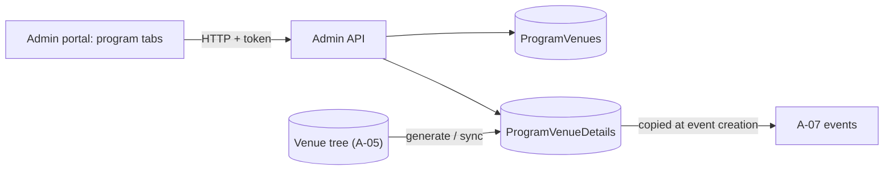

# A-06 · Program–venue mapping and venue details

> **Bangla name:** প্রোগ্রাম–ভেন্যু ম্যাপিং ও ভেন্যু ডিটেইলস
>
> [← 10 · Admin portal](README.md) · [Contents](../README.md) · [Open queries](../99-open-queries.md)

## 1. Name and purpose

**Program–venue mapping.** A program uses some of the venues defined in [A-05](A-05-venues.md). When a venue is attached to a program, the platform keeps a per-program **snapshot** of its tree (`ProgramVenueDetails`: one row per gallery, block and level) holding the program's own choices: price per seat, seating capacity, active and sellable flags, seats. New events of the program are created from these rows ([A-07](A-07-events.md)); the snapshot isolates a program's prices from other programs using the same venue.

## 2. Trigger and actor

Staff with role `admin` or `event_manager` (`ProgramVenueController`, `ProgramVenueDetailsController`). Entry: **Prog. Managem.** → a program → tab **List Of Venues** (`app-program-venue-list`) and the **Program venue details** page (`/program-management/programVenueDetails`).

## 3. Business flow

1. Attach a venue to the program (pick from the venue list).
2. **Generate** the program-venue details for the program (first time).
3. Set prices, capacities and flags per level in the details page.
4. If the venue's layout changes later ([A-05](A-05-venues.md)), the mapping is flagged "not synced"; press **Sync** to bring the program's copy up to date.

## 4. Technical flow

1. **[HTTP + user token]** Attach: `POST /admin/api/v1/programVenue` with `{ "programId": 12, "venueId": 3 }` → `ProgramVenueManager.CreateOrUpdateAsync` checks both exist ("Venue not found with the specific id.", "program not found with the specific id.") and inserts or updates the `ProgramVenue` row, copying the venue's current `SvgMapImage`. List: `GET /admin/api/v1/programVenue/{programId}`.
2. Generate: `POST /admin/api/v1/programVenueDetails/{programId}` → `GenerateProgramVenueDetails`: refuses if rows already exist for the program ("Data already in table."); otherwise for every mapped venue builds one row per level (`ProgramId`, `VenueId`, gallery/block/level ids and their `IsActive`, `IsSellable`, `IsSeatMapped` flags, `SeatingCapacity`, `HasSeats`, `Seats`) with `PricePerSeat = 0` and the default currency (`CurrencyRepository.GetDefaultAsync`).
3. Edit a row: `PUT /admin/api/v1/programVenueDetails/update/{id}` with the changed fields (each optional): `UpdateAsync` applies them; when `IsGalleryActive` changes, it applies it to **all rows of that gallery**.
4. Sync: `POST /admin/api/v1/programVenueDetails/{programId}/{venueId}` → `SyncProgramVenueDetailsV2`: deletes snapshot rows whose level no longer exists, creates rows for new levels (price 0), updates the existing ones, and sets `ProgramVenue.IsSynced = true`.
5. Read: `GET /programVenueDetails/{programId}/{venueId}`, `/venue-details/{programId}`, `/venue-galleries/{programId}/{venueId}`, and `GET /programVenueDetails/sync-status/{programId}/{venueId}` (`HasUnsyncedVenueAsync`) for the "needs sync" badge.

## 5. Components

| Kind | Component |
|---|---|
| Client | `features/program-management/components/{program-venue-list,program-venue-details}`, `services/program-venues-details.service.ts`, `program-management.service.ts` (`programVenue`) |
| Service | Admin: `ProgramVenueController`, `ProgramVenueDetailsController`, `ProgramVenueManager`, `ProgramVenueDetailsManager` |
| Tables | `ProgramVenues` (`IsSynced`, `SVGMapImage`), `ProgramVenueDetails`, `Currencies` |

## 6. API contracts

| Method | Path | Auth | Request | Response | Main errors |
|---|---|---|---|---|---|
| POST | `/admin/api/v1/programVenue` | `Admin`, `EventManager` | `CreateOrUpdateProgramVenue { id, programId, venueId }` | `ProgramVenue` | 400 not found messages above |
| GET | `/admin/api/v1/programVenue/{programId}` | same | path | `ProgramVenue[]` | |
| POST | `/admin/api/v1/programVenueDetails/{programId}` | same | path | `200` | 400 `Data already in table.` |
| POST | `/admin/api/v1/programVenueDetails/{programId}/{venueId}` | same | path | `200` | |
| GET | `/admin/api/v1/programVenueDetails/{programId}/{venueId}` | same | path | `ProgramVenueDetails[]` | |
| PUT | `/admin/api/v1/programVenueDetails/update/{id}` | same | `CreateOrUpdateProgramVenueDetails` (all fields optional) | `ProgramVenueDetails` | 400 `No ProgramVenueDetails found with id {id}.` |
| GET | `/admin/api/v1/programVenueDetails/venue-galleries/{programId}/{venueId}` | same | path | active galleries | |
| GET | `/admin/api/v1/programVenueDetails/venue-details/{programId}` | same | path | all rows of the program | |
| GET | `/admin/api/v1/programVenueDetails/sync-status/{programId}/{venueId}` | same | path | sync flag | |

Primary sample, `PUT /admin/api/v1/programVenueDetails/update/{id}` body (property names from `CreateOrUpdateProgramVenueDetails`; values illustrative):

```json
{ "pricePerSeat": 1500, "seatingCapacity": 800, "isLevelActive": true, "isLevelSellable": true }
```

## 7. Data and side effects

`ProgramVenues` and `ProgramVenueDetails` rows; no queue, no cache. The rows are copied into an event's own venue details when the event is created ([A-07](A-07-events.md), [A-09](A-09-event-level-pricing.md)).

## 8. Code references

| What | Where |
|---|---|
| Controllers | `rvl-gobcb-backend/Services/Admin/ETP.Admin.Service/Api/ProgramVenueController.cs:14-60`, `.../ProgramVenueDetailsController.cs:24-140` |
| Mapping | `rvl-gobcb-backend/Services/Admin/ETP.Admin.Domain/Managers/ProgramVenueManager.cs:28-60` |
| Generate and sync | `rvl-gobcb-backend/Services/Admin/ETP.Admin.Domain/Managers/ProgramVenueDetailsManager.cs:44-140` (generate), `:227-332` (sync V2) |
| Update | `rvl-gobcb-backend/Services/Admin/ETP.Admin.Domain/Managers/ProgramVenueDetailsManager.cs:508-552` |
| Portal service | `rvl-gobcb-admin-portal/src/app/features/program-management/services/program-venues-details.service.ts:22-32` |

## 9. Handover notes

1. **Three sync implementations exist** (`SyncProgramVenueDetails`, `SyncProgramVenueDetailsV2`, `SyncProgramVenueDetailsV2_Old`); the controller calls only `V2`. The first deletes the existing rows for the program and venue and rebuilds them with price 0, which would lose edited prices, so make sure nobody switches the controller back ([Appendix A](../90-appendix-a-legacy.md)).
2. **Edit permission is wide**: any `admin` or `event_manager` can change prices of the program snapshot at any time. Events already created keep their own copy, so a price change here does not change running events ([A-09](A-09-event-level-pricing.md) changes the event's own price).
3. **`Data already in table.`** makes **Generate** a one-time operation per program; a second venue attached later must be brought in with **Sync**, not Generate.
4. **Gallery switch applies to all rows of the gallery**, but block and level switches affect only the edited row.
5. **Program deletion** does not remove these rows ([A-02](A-02-programs.md)).
6. The unsync flag is set by the venue editor for **every** program that uses the venue, even when the change does not affect that program's prices.

## 10. Component relationships



**Depends on:** [A-02](A-02-programs.md), [A-05](A-05-venues.md). **Affects:** [A-07](A-07-events.md), [A-09](A-09-event-level-pricing.md), [A-13](A-13-ticket-layouts.md) (layouts are per program, venue and gallery).

## 11. Developer test guide

**Local testability: Full.**

| Item | Detail |
|---|---|
| Test data and accounts | `pwsh ./scripts/Seed-EtpData.ps1` (a program with a mapped venue and details); admin `…01` |
| Browser | `http://localhost:4200` → **Prog. Managem.** → program → **List Of Venues**; Network: `POST .../programVenueDetails/{programId}/{venueId}` for Sync |
| Emulator | — |
| Postman | `postman/services/etp-admin.postman_collection.json`: "POST /api/v1/programVenue", "POST /api/v1/programVenueDetails/{programId}", "PUT /api/v1/programVenueDetails/update/{id}" |
| Visual Studio debug | `ProgramVenueDetailsManager.GenerateProgramVenueDetails`, `SyncProgramVenueDetailsV2` |
| Verify | SQL: `select "BlockLevelId","PricePerSeat","SeatingCapacity" from etp."ProgramVenueDetails" where "ProgramId" = <id>`; `select "IsSynced" from etp."ProgramVenues"` |
