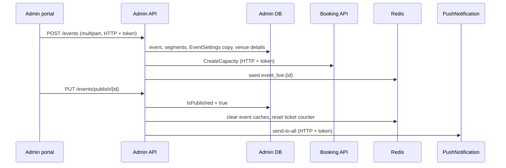

# A-07 · Events (matches)

> **Bangla name:** ইভেন্ট (ম্যাচ)
>
> [← 10 · Admin portal](README.md) · [Contents](../README.md) · [Open queries](../99-open-queries.md)

## 1. Name and purpose

**Events.** An event is one match or show of a program at a venue, made of one or more **segments** (a sport segment with two teams, or a concert segment). Creating an event builds its own copy of the commercial settings and of the venue's levels with prices and capacities, so ticket sales run per event. Publishing makes it visible and sellable; the platform then also tells app users by push notification. Concepts: [shared database](../00-platform-primer.md#explainer-shared-database), [Redis live capacity](../00-platform-primer.md#explainer-redis-live-capacity).

## 2. Trigger and actor

Staff with roles `admin`, `event_manager`, `ticket_manager`, `ticket_operator` (`BCBPersonnel`) (class attribute of `EventsController`; `[AuthorizeProgram]` is commented out). Entry: program menu **Events** (`/events`): list, **Create** (`/events/create`), **Edit** (`/events/edit/:id`), **Details** (`/events/event-details/:id`).

## 3. Business flow

1. List events of the selected program; filter, search.
2. **Create:** program, venue, name (≤ 60 characters), start and end, cover image, one or more segments (name, type `Sport` or `Concert`, start, end, team 1 and team 2 for sport, banner image).
3. Review and adjust prices, capacity, settings ([A-08](A-08-event-settings.md), [A-09](A-09-event-level-pricing.md), [A-10](A-10-capacity-adjustment.md)).
4. **Publish** (needs published ticket layouts for all active galleries, [A-13](A-13-ticket-layouts.md)); customers can then see and, once selling opens, buy.
5. **Toggle** active/inactive a published event; **Unpublish** only before selling starts; **Duplicate**; **Delete**.

## 4. Technical flow

1. **Create** **[HTTP + user token]** `POST /admin/api/v1/events` (`multipart/form-data`, `CreateEvent`). `EventManager.CreateAsync`:
   - `CheckValidityOfCreateEvent`: program and venue ids exist; name required and ≤ 60; start not in the past; end after start; cover image required; per segment: name, dates, banner required; sport needs two different teams, concert gets no teams.
   - A new `EventId` GUID is assigned to the event and to each segment.
   - **The program settings are copied into a new `EventSettings` row** (limits, selling hours, prefix, VAT, service charge, gateway) ([A-03](A-03-program-settings.md)); `IsVatInclusive` is also set on the event.
   - Insert; upload the cover to `eventcover/{id}/...` and each banner to `eventsegmentcover/...` ([X-20](../60-cross-cutting/X-20-file-storage.md)).
   - `GenerateEventVenueDetails(programId, eventId)` copies the program's venue-detail rows into the event ([A-09](A-09-event-level-pricing.md)).
   - **[HTTP + user token]** `IBookingClient.CreateCapacity(list)` creates a `Capacities` row per level in Booking (`TicketingCapacity` = the level's seating capacity, seats if any), then `GetEventLiveCapacity` seeds `event_live:{id}` in Redis ([S-02](../50-system-initiated/S-02-event-live-capacity.md)).
2. **Update** `PUT /admin/api/v1/events/{id}` (multipart):
   - **Not published:** `CheckValidityOfUpdateEvent` (venue exists, name, dates, segment rules incl. "Concert segments cannot have team IDs."), then the event and its segments are updated.
   - **Published:** the validity check is **skipped** and only these fields change: event end time, VAT-inclusive flag, cover image, each segment's end time, banner and teams.
   - The caches `event_details:*`, `admin_event_details:*`, `event_settings_details:{id}`, `event_venue_details:*` are deleted.
3. **Publish** `PUT /admin/api/v1/events/publish/{id}`: fails if already published, if the program has no ticket layout for the venue ("No ticket layout configuration found for VenueId: n."), or if an **active gallery has no published layout** ("Ticket layout is not configured for all active galleries."); sets `IsPublished`, clears the same caches, resets `event_ticket_counter:{eventId}` to 0, and sends a push notification to all app users (title "New Event Available!", data `eventId`, `eventName`, `type = event_published`) through PushNotification; a failed push is logged and ignored ([X-23](../60-cross-cutting/X-23-push-firebase.md)).
4. **Unpublish** `PUT .../unpublish/{id}`: fails if not published, or if `event start − TicketSellingStartFromHour` is already in the past ("Event can't unpublished after start ticket selling."); clears caches.
5. **Toggle** `PUT .../toggle-status/{id}`: only for published events, flips `IsActive`; clears caches.
6. **Duplicate** `POST .../duplicate/{id}`: creates "`{name} - Copy`" unpublished, copies segments, settings, venue details and capacities (again through `CreateCapacity` and `GetEventLiveCapacity`), and the gate and checker assignments of the original ([A-18](A-18-gate-assignment.md)).
7. **Delete** `DELETE .../{id}`: soft delete (`IsDeleted`), clears the list cache.
8. Date-times such as `TicketSellingStartDateTime`, `TicketSellingStopDateTime` and `TicketAvailabilityStartDateTime` are **computed when events are read** (event start/end minus the settings' hours; event settings if present, else program settings), not stored.

## 5. Components

| Kind | Component |
|---|---|
| Client | `features/events/pages/{event-list,event-create,event-details}`, `services/event.service.ts` |
| Services | Admin (`EventsController`, `EventManager`, `EventVenueDetailsManager`); Booking (`CreateCapacity`); PushNotification (publish push); Event service reads the same tables |
| Tables | `Events`, `EventSegments`, `EventSettings`, `EventVenueDetails`, Booking `Capacities` |
| Redis | `event_details:*`, `admin_event_details:*`, `event_settings_details:*`, `event_venue_details:*`, `event_ticket_counter:*`, `event_live:*` ([X-25](../60-cross-cutting/X-25-redis.md)) |
| Storage | S3 `eventcover/`, `eventsegmentcover/` |
| Queue | `FirebaseNotification` indirectly on publish |

## 6. API contracts

| Method | Path | Auth | Request | Response | Main errors |
|---|---|---|---|---|---|
| GET | `/admin/api/v1/events` | roles Admin, EventManager, TicketManager, BCBPersonnel | paging, search, sort | paged `Event` | |
| GET | `/admin/api/v1/events/{id}` | same | path | `Event` | |
| POST | `/admin/api/v1/events` | same | `CreateEvent` (multipart) | `Event` | 400 messages in §4 |
| PUT | `/admin/api/v1/events/{id}` | same | `UpdateEvent` (multipart) | `Event` | 400 |
| PUT | `/admin/api/v1/events/publish/{id}`, `unpublish/{id}`, `toggle-status/{id}` | same | path | `Event` | 400 messages in §4 |
| POST | `/admin/api/v1/events/duplicate/{id}` | same | path | `Event` | 400 `Event with ID n not found` |
| DELETE | `/admin/api/v1/events/{id}` | same | path | `Event` | 500 `Event with ID n not found.` |
| GET | `/admin/api/v1/events/search`, `/list`, `/published/list`, `/filtered-list/{status}/{count}`, `/by-public-id/{eventId}`, `/program/{programId}/events`, `/programs/{programId}/events/no-end-date-check`, `/{start}/{end}/{eventId}` | same (`/published/list`: see [X-18](../60-cross-cutting/X-18-endpoints-without-auth.md)) | | lists | |

Primary sample, `POST /admin/api/v1/events` (multipart; names from `CreateEvent`/`CreateEventSegment`; ASP.NET model binding indexes the segments; values illustrative):

```
programId=12
venueId=3
name=Dhaka vs Chattogram
startDateTime=2026-12-10T10:00:00.000Z
endDateTime=2026-12-10T18:00:00.000Z
eventCoverImageFile=<file>
segments[0].name=Match 1
segments[0].segmentType=0
segments[0].startDateTime=2026-12-10T10:00:00.000Z
segments[0].endDateTime=2026-12-10T18:00:00.000Z
segments[0].team1Id=4
segments[0].team2Id=5
segments[0].bannerImageFile=<file>
```

(`segmentType`: `0` Sport, `1` Concert.)

## 7. Data and side effects

New event, segments, settings copy, venue-detail copy, Booking capacities, Redis counters, S3 images, and on publish a push to all devices. Activity log entries ([X-24](../60-cross-cutting/X-24-activity-logging.md)).

## 8. Code references

| What | Where |
|---|---|
| Controller | `rvl-gobcb-backend/Services/Admin/ETP.Admin.Service/Api/EventsController.cs:29-300` |
| Create and validation | `rvl-gobcb-backend/Services/Admin/ETP.Admin.Domain/Managers/EventManager.cs:211-363` |
| Update | `.../EventManager.cs:364-537` |
| Publish, unpublish, toggle | `.../EventManager.cs:657-891` (push at `:722-745`) |
| Duplicate | `.../EventManager.cs:908-1034` |
| Date computation | `.../EventManager.cs:96-136, 185-186` |
| Portal | `rvl-gobcb-admin-portal/src/app/features/events/services/event.service.ts:28-60` |

## 9. Handover notes

1. **Creation is not atomic across services.** The event is saved first; the Booking `CreateCapacity` call happens afterwards over HTTP. If it fails, the event exists without capacity rows, and the API returns an error, so a retry creates a second event. Check Booking `Capacity` rows when an event "has no seats" ([S-01](../50-system-initiated/S-01-level-capacity-update.md)).
2. **A published event skips validation on update**, so its end time can be set before its start time, and the segment end can be changed without checks (only end times and teams are accepted for published events).
3. **Settings are a copy** taken at creation. Later changes to the program settings do not reach existing events; use [A-08](A-08-event-settings.md).
4. **Null end date.** `EndDateTime` is nullable in the DTO, the create check does not reject a null end, but the date computation dereferences `EndDateTime.Value`; always send an end time.
5. **Start in the past is rejected on every update**, even of a draft: editing a draft event after its start time fails with "StartDateTime must be greater than or equal to the current date and time."
6. **Unpublish is only possible before selling opens**; after that, use Toggle (inactive) to stop sales.
7. **Duplicate copies gate and checker assignments** of the original event, so check them before publishing the copy.
8. **Publish sends a push to everyone** and there is no preview or test mode, so a test publish in production notifies real users.

## 10. Component relationships



**Depends on:** [A-02](A-02-programs.md), [A-03](A-03-program-settings.md), [A-04](A-04-teams.md), [A-05](A-05-venues.md), [A-06](A-06-program-venue-mapping.md), [A-13](A-13-ticket-layouts.md). **Affects:** everything customer-facing ([P-02](../20-user-portal/P-02-browse-events.md), [P-04](../20-user-portal/P-04-seat-selection.md), [P-06](../20-user-portal/P-06-booking-payment.md)), [A-08](A-08-event-settings.md) to [A-12](A-12-reserved-tickets.md), reports, [S-07](../50-system-initiated/S-07-initiate-user-ticket-generation.md).

## 11. Developer test guide

**Local testability: Full** except the push (dummy Firebase).

| Item | Detail |
|---|---|
| Test data and accounts | `pwsh ./scripts/Seed-EtpData.ps1` (events, layouts); admin `…01`; select a program in the top bar ([A-01](A-01-program-selection.md)) |
| Browser | `http://localhost:4200/events` → create, publish; Network: multipart `POST .../admin/api/v1/events`, `PUT .../events/publish/{id}` |
| Emulator | — |
| Postman | `postman/services/etp-admin.postman_collection.json`: "GET /api/v1/events", "POST /api/v1/events" (form-data), "PUT /api/v1/events/publish/{id}", "POST /api/v1/events/duplicate/{id}" |
| Visual Studio debug | `EventManager.CreateAsync`, `PublishEventAsync`; Booking `CapacityController.CreateCapacityAsync` |
| Verify | SQL: `select "Id","Name","IsPublished","IsActive" from etp."Events"`; Booking `Capacities` rows for the event id; `redis-cli GET event_live:<id>` |
