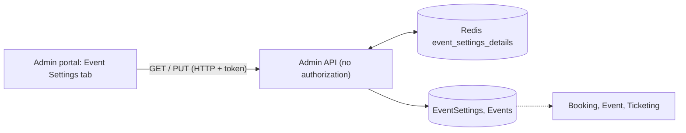

# A-08 · Event settings override

> **Bangla name:** ইভেন্ট সেটিংস ওভাররাইড
>
> [← 10 · Admin portal](README.md) · [Contents](../README.md) · [Open queries](../99-open-queries.md)

## 1. Name and purpose

**Event settings.** Each event carries its own copy of the commercial settings (purchase limits, selling hours, ticket prefix, VAT, service charge, payment gateway). They start as a copy of the program settings ([A-03](A-03-program-settings.md)) and can be changed per event here, for example a special VAT for one match or an earlier sales start.

## 2. Trigger and actor

Staff who can open the event details page (`/events/event-details/:id`), tab **Event Settings**. The **server** does not check the role: `EventSettingsController` has no `[Authorize]` ([X-18](../60-cross-cutting/X-18-endpoints-without-auth.md)).

## 3. Business flow

Open an event, go to **Event Settings**, change the values, **Update**. If the event is already published, VAT and service charge cannot change; the other values can.

## 4. Technical flow

1. **[HTTP + user token]** Load `GET /admin/api/v1/event-settings/{eventId}` (the Redis key `event_settings_details:{id}` serves it when present, otherwise the row is read and cached for **30 days**).
2. **[HTTP + user token]** Save `PUT /admin/api/v1/event-settings/{eventId}` with `EventSettings`. `EventSettingsManager.UpdateAsync`:
   - loads the settings ("No event settings found" if none);
   - copies hours, limits, prefix, threshold, VAT-inclusive flag and gateway (a missing gateway is replaced by `DgePay`);
   - if the event is **published**, refuses a change of VAT value, VAT-percentage flag, service-charge value or service-charge-percentage flag ("Cannot update VAT and Service Charge while events are published."); otherwise copies those too;
   - sets `IsVatInclusive` on the event itself, saves both, deletes `event_details:list`, `event_details:{eventId}`, `admin_event_details:{eventId}` and `admin_event_details:{id}`, and writes the new settings to `event_settings_details:{id}` for 30 days.
3. Where the values are used: the event's selling and availability times ([A-03](A-03-program-settings.md) step 4), Booking's limits and charges at order time ([P-06](../20-user-portal/P-06-booking-payment.md)), the ticket prefix at ticket creation ([S-07](../50-system-initiated/S-07-initiate-user-ticket-generation.md)), and the VAT line of the VAT record ([S-10](../50-system-initiated/S-10-vat-challan.md)).

## 5. Components

| Kind | Component |
|---|---|
| Client | `features/events/components/event-settings/*`, `services/event-settings.service.ts` |
| Service | Admin: `EventSettingsController`, `EventSettingsManager`; Booking, Event and Ticketing read the same table |
| Tables | `EventSettings`, `Events.IsVatInclusive` |
| Redis | `event_settings_details:{id}` (30 days), `event_details:*`, `admin_event_details:*` |

## 6. API contracts

| Method | Path | Auth | Request | Response | Main errors |
|---|---|---|---|---|---|
| GET | `/admin/api/v1/event-settings/{eventId}` | **none** | path | `EventSettings` | |
| PUT | `/admin/api/v1/event-settings/{eventId}` | **none** | `EventSettings` | `EventSettings` | 400 `No event settings found`, `Cannot update VAT and Service Charge while events are published.` |

Primary sample, `PUT` body (fields as in `ProgramSettings`, see [A-03](A-03-program-settings.md); values illustrative):

```json
{
  "allowableMaximumOrderPerUser": 2,
  "allowableMaximumSeatPerOrder": 4,
  "ticketSellingStartFromHour": 72,
  "ticketSellingStopFromHour": 1,
  "ticketAvailableFromHour": 48,
  "ticketNumberPrefix": "T20",
  "limitedAvailabilityThreshold": 60,
  "vat": 15,
  "isVatPercentage": true,
  "serviceCharge": 0,
  "isServiceChargePercentage": true,
  "isVatInclusive": true,
  "paymentGateway": 1
}
```

## 7. Data and side effects

`EventSettings` row, `Events.IsVatInclusive`, cache keys; activity log ([X-24](../60-cross-cutting/X-24-activity-logging.md)).

## 8. Code references

| What | Where |
|---|---|
| Controller | `rvl-gobcb-backend/Services/Admin/ETP.Admin.Service/Api/EventSettingsController.cs:14-48` |
| Manager | `rvl-gobcb-backend/Services/Admin/ETP.Admin.Domain/Managers/EventSettingsManager.cs:20-100` |
| Portal | `rvl-gobcb-admin-portal/src/app/features/events/services/event-settings.service.ts:20-24` |
| Event details tabs | `rvl-gobcb-admin-portal/src/app/features/events/pages/event-details/event-details.component.html:7-24` |

## 9. Handover notes

1. **No authentication or role check.** Anyone who can reach `/admin/api/v1/event-settings/{eventId}` can read and change the VAT, charges, prefix, gateway and limits of any event (draft events: VAT too). Note that EventSettings is also missing from the Postman collection (Appendix D).
2. **The published-event lock covers only VAT and service charge.** Selling hours, limits, prefix and gateway can change while selling is open; a prefix change gives later tickets a different prefix.
3. **The cache invalidation misses `event_details:{id}`** (it deletes the list key and the keys by `EventId`), so a reader that caches by numeric id may show old settings until its entry expires.
4. **`isVatInclusive` lives in two places** (`EventSettings` and `Events`); this manager writes both, while `EventManager.UpdateAsync` also writes the event column ([A-07](A-07-events.md)).

## 10. Component relationships



**Depends on:** [A-07](A-07-events.md), [A-03](A-03-program-settings.md). **Affects:** [P-06](../20-user-portal/P-06-booking-payment.md), [S-07](../50-system-initiated/S-07-initiate-user-ticket-generation.md), [S-10](../50-system-initiated/S-10-vat-challan.md).

## 11. Developer test guide

**Local testability: Full.**

| Item | Detail |
|---|---|
| Test data and accounts | `pwsh ./scripts/Seed-EtpData.ps1`; admin `…01` |
| Browser | `http://localhost:4200/events` → an event → **Event Settings**; Network: `GET/PUT .../admin/api/v1/event-settings/{id}` |
| Emulator | — |
| Postman | **Not in the collection** (`postman/services/etp-admin.postman_collection.json` has no EventSettings request); create "GET {{base_url}}/event-settings/{id}" by hand (the collection's `base_url` has no `/admin/api/v1` prefix, see Appendix D) |
| Visual Studio debug | `EventSettingsManager.UpdateAsync` |
| Verify | SQL: `select * from etp."EventSettings" where "EventId" = <id>`; `redis-cli GET event_settings_details:<id>` |
