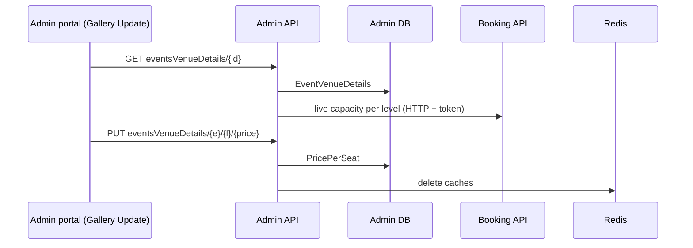

# A-09 · Event venue details and per-level pricing

> **Bangla name:** ইভেন্টের ভেন্যু ডিটেইলস ও লেভেল-ভিত্তিক মূল্য
>
> [← 10 · Admin portal](README.md) · [Contents](../README.md) · [Open queries](../99-open-queries.md)

## 1. Name and purpose

**Event venue details and per-level pricing.** Every event has its own copy of the venue tree (gallery → block → level) with, per level, a **price per seat**, capacity, seats and flags (`EventVenueDetails`). The admin sees this tree on the event's **Gallery Update** tab and sets the unit price of each level. This copy, not the program's, is what customers pay.

## 2. Trigger and actor

Staff with roles `admin`, `event_manager`, `ticket_manager`, `ticket_operator` (`BCBPersonnel`) (`EventsVenueDetailsController`). Entry: `/events/event-details/:id` → tab **Gallery Update** (the same tab also holds capacity adjustment [A-10](A-10-capacity-adjustment.md) and reservation [A-11](A-11-seat-reservation.md)).

## 3. Business flow

1. At event creation the program's rows are copied into the event ([A-07](A-07-events.md)); prices start at whatever the program snapshot had (0 after a fresh generate, [A-06](A-06-program-venue-mapping.md)).
2. In **Gallery Update** the admin sees every level with allocated, reserved and released counts and its unit price, edits the unit price inline and saves.
3. The new price applies to new orders; existing orders keep the price they were created with.

## 4. Technical flow

1. **[HTTP + user token]** `GET /admin/api/v1/eventsVenueDetails/{eventId}?isForTicket=false` returns the tree (`Node { data, children }`; `data` has `galleryId`, `blockId`, `levelId`, names and numbers). While building it, `EventVenueDetailsManager.GetDetailsTreeByEventId` asks Booking for each level's live capacity (**[HTTP + user token]** `IBookingClient.GetLevelLiveCapacity`).
2. **[HTTP + user token]** Save price: `PUT /admin/api/v1/eventsVenueDetails/{eventId}/{levelId}/{price}` (price in the URL, decimal). `UpdateSeatPriceAsync` finds the row for the event and level ("Event venue details with id '{levelId}' doesn't exist." otherwise), sets `PricePerSeat`, saves, and deletes the caches `admin_level_info:{eventId}_{levelId}`, `event_details:list`, `event_details:{eventId}`, `event_venue_details:{eventId}` and the same two details keys under the event's public id.
3. Other reads: `GET .../eventsVenueDetails/get-level/{eventId}/{levelId}` (one level with its gates), `GET .../venue-details/{eventId}` (flat rows), `POST .../galleries/by-event-ids` (galleries of several events, used by promo and discount forms, [A-15](A-15-promo-codes.md)).
4. Customer side: Booking and Event read `EventVenueDetails` as a read model to show prices and compute the order amount ([P-04](../20-user-portal/P-04-seat-selection.md), [P-06](../20-user-portal/P-06-booking-payment.md)).

## 5. Components

| Kind | Component |
|---|---|
| Client | `features/events/components/gallery-update/*` (`updatePriceByLevel`), `services/event.service.ts:82, 126` |
| Services | Admin (`EventsVenueDetailsController`, `EventVenueDetailsManager`, `EventVenueDetailsRepository`); Booking (live capacity) |
| Tables | `EventVenueDetails` |
| Redis | `admin_level_info`, `event_details`, `event_venue_details` caches |

## 6. API contracts

| Method | Path | Auth | Request | Response | Main errors |
|---|---|---|---|---|---|
| GET | `/admin/api/v1/eventsVenueDetails/{eventId}` | roles Admin, EventManager, TicketManager, BCBPersonnel | `isForTicket` (bool) | `Node[]` | |
| GET | `/admin/api/v1/eventsVenueDetails/get-level/{eventId}/{levelId}` | same | path | level with gates | |
| GET | `/admin/api/v1/eventsVenueDetails/venue-details/{eventId}` | same | path | `EventVenueDetails[]` | |
| PUT | `/admin/api/v1/eventsVenueDetails/{eventId}/{levelId}/{price}` | same | path only | `true` | 400 `Event venue details with id '{levelId}' doesn't exist.` |
| POST | `/admin/api/v1/eventsVenueDetails/galleries/by-event-ids` | same | list of event ids | galleries | |

Primary sample: `PUT /admin/api/v1/eventsVenueDetails/101/3305/1500` (event 101, level 3305, price 1500; ids illustrative) with an empty body; response body `true`.

## 7. Data and side effects

`EventVenueDetails.PricePerSeat`; cache deletes; activity log ([X-24](../60-cross-cutting/X-24-activity-logging.md)).

## 8. Code references

| What | Where |
|---|---|
| Controller | `rvl-gobcb-backend/Services/Admin/ETP.Admin.Service/Api/EventsVenueDetailsController.cs:14-100` |
| Manager | `rvl-gobcb-backend/Services/Admin/ETP.Admin.Domain/Managers/EventVenueDetailsManager.cs:103-166` (generate, price), `:167-268` (tree) |
| Repository | `rvl-gobcb-backend/Services/Admin/ETP.Admin.Storage/Repositories/EventVenueDetailsRepository.cs:60-67` |
| Portal | `rvl-gobcb-admin-portal/src/app/features/events/components/gallery-update/gallery-update.component.ts:592-600` |

## 9. Handover notes

1. **A price can be changed at any time**, including while the event is published and selling: `UpdateSeatPriceAsync` checks nothing (no published, no sales, no role beyond the class list). Customers who already hold a pending order keep the old price; those who open the seat page afterwards see the new price, subject to cache expiry.
2. **The price is a URL path segment** and the request has no body, so the value appears in access logs and proxy logs.
3. **Cache scope.** The method clears several keys by numeric and public event id; a customer page already rendered keeps the old price until it reloads.
4. **The tree call fans out to Booking** once per level (live capacity), so the Gallery Update tab is slow for large venues.
5. **Program prices are not linked.** Changing the price in the program snapshot later does not change the event ([A-06](A-06-program-venue-mapping.md)).

## 10. Component relationships

**Depends on:** [A-07](A-07-events.md), [A-06](A-06-program-venue-mapping.md). **Affects:** [P-04](../20-user-portal/P-04-seat-selection.md), [P-06](../20-user-portal/P-06-booking-payment.md), [A-22](A-22-reports.md) (revenue), [S-10](../50-system-initiated/S-10-vat-challan.md) (invoice amounts).

## 11. Developer test guide

**Local testability: Full.**

| Item | Detail |
|---|---|
| Test data and accounts | `pwsh ./scripts/Seed-EtpData.ps1`; admin `…01` or `ticket_manager` |
| Browser | `http://localhost:4200/events` → event → **Gallery Update**; Network: `GET .../eventsVenueDetails/{id}`, `PUT .../eventsVenueDetails/{e}/{l}/{price}` |
| Emulator | — |
| Postman | `postman/services/etp-admin.postman_collection.json`: "GET /api/v1/eventsVenueDetails/{eventId}", "PUT /api/v1/eventsVenueDetails/{eventId}/{levelId}/{price}" |
| Visual Studio debug | `EventVenueDetailsManager.UpdateSeatPriceAsync`, `GetDetailsTreeByEventId` |
| Verify | SQL: `select "BlockLevelId","PricePerSeat" from etp."EventVenueDetails" where "EventId" = <id>`; `redis-cli --scan --pattern 'event_venue_details*'` |
