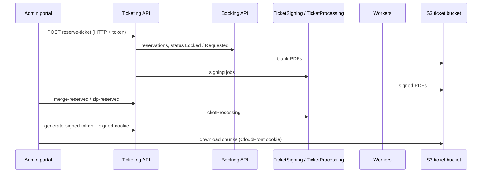

# A-12 · Reserved ticket generation and distribution

> **Bangla name:** রিজার্ভড টিকিট তৈরি ও বিতরণ
>
> [← 10 · Admin portal](README.md) · [Contents](../README.md) · [Open queries](../99-open-queries.md)

## 1. Name and purpose

**Reserved tickets.** After seats are reserved ([A-11](A-11-seat-reservation.md)), the admin turns the reservation into real tickets: creates the tickets, has them signed, then downloads them (merged PDFs, a zip, or the individual files) or emails them. These are complimentary and partner tickets; they have no buyer account. This is the **Generate Tickets** menu. Concepts: [queue-driven processing](../00-platform-primer.md#explainer-queue-driven), [token forwarding](../00-platform-primer.md#explainer-token-forwarding).

## 2. Trigger and actor

Staff with the **admin policy** (Ticketing `[Authorize(Policy = Admin)]` on every endpoint here). Entry: program menu **Generate Tickets** (`/events/event-ticket`), then `/events/generate-ticket/:id` (component `generate-ticket` with `app-gallery-reservation`).

## 3. Business flow

1. Pick an event, a level and a reservation (remaining reserved seats are shown).
2. **Generate** tickets for an amount (or named seats), with a ticket type (default `Partner Sale`). A **test** request creates only a preview of the blank ticket.
3. **Sign** the generated tickets ([S-08](../50-system-initiated/S-08-ticket-signing.md)); wait until all are signed.
4. **Merge** into PDFs or **Zip** ([S-09](../50-system-initiated/S-09-ticket-merge-zip.md)); download the chunks.
5. Alternatively download the individual tickets as a zip, or email them to a recipient ([X-21](../60-cross-cutting/X-21-email-ses.md)). The ticket's action state records what happened (`downloaded`, `emailed: {recipient}`, or a custom text).

## 4. Technical flow

1. **Create** **[HTTP + user token]** `POST /ticketing/api/v1/booking-order-ticket/reserve-ticket?eventId&levelId` with a list of `ReservedTicketRequest {id (reservation id), amount, hasSeats, seats, ticketType, isTest}`. `TicketManager.CreateReservationTicketsAsync`: reads the reservations from Booking (**[HTTP + user token]** `GetReservationsCountAsync`); for each request: the reservation must exist, must not be `Locked` ("Ticket generation is in process already ..."), and `existing + amount` must not exceed its ticket count ("Request exceeds reserved capacity ..."); renders one blank PDF (`GenerateBlankReservedTicket`); for a **test** request it stores the preview URL on the reservation (`UpdateReservationTicketPreviewUrlAsync`) and stops; otherwise inserts `amount` (or one per seat) tickets with number `{prefix}{unique code}`, a **consecutive number** from the Redis counter `event_ticket_counter:{eventId}`, status `Requested`, `CreatedBy = "System"`, then sets the reservation status `Locked`, publishes one signing job per ticket **[SQS: TicketSigning]** with the field `Complimentary` (the ticket type) and `Platform` and sets the reservation `Requested`.
2. **Sign** (again) `POST .../sign-reserve-ticket?eventId&levelId` → `PublishBulkTicketToSign`: publishes signing jobs for the event's tickets still in status `Requested` (a repair path for tickets whose job was lost).
3. **Read** `GET .../reserve-ticket?eventId&levelId` lists reserved tickets per reservation; `PUT .../reserve-ticket` with `ticketNumbers[]` and `action` sets the action state text.
4. **Merge and zip** `GET .../merge-reserved?reservationId`, `zip-reserved?reservationId` publish to `TicketProcessing`, progress via `merged-ticket-number`, `zipped-ticket-number` and Booking's status endpoints ([S-09](../50-system-initiated/S-09-ticket-merge-zip.md)).
5. **Download** the admin must first call `POST .../generate-signed-token` (a 60 s token in the global Redis key) and `GET .../signed-cookie` (CloudFront cookie) ([X-20](../60-cross-cutting/X-20-file-storage.md)). Then `POST .../download-reserved?signedToken=<token>` with `TicketRequest {ticketNumbers[], fileName}` streams a **zip** of the tickets (front plus back page) and sets their state `downloaded`; `GET .../download-merged?reservationId&signedToken` streams all merged chunks of the reservation as `{reservationId}.zip`; `POST .../download-test-blank-reserved?signedToken` streams the preview. An invalid or expired token gives "Invalid or expired token.".
6. **Email** `POST .../send-reserved` ([X-21](../60-cross-cutting/X-21-email-ses.md)).
7. `GET .../reserved-urls?reservationId` lists the signed ticket URLs of a reservation; it has no `[Authorize]` and no caller in the portal, and its action calls `GetSignedReservedTicketUrlsAsync` twice (the first result is discarded).

## 5. Components

| Kind | Component |
|---|---|
| Client | `features/events/pages/event-ticket`, `components/generate-ticket`, `components/gallery-reservation`, `services/event.service.ts:135-250` |
| Services | Ticketing (`BookingOrderTicketController`, `TicketManager`, `TicketGenerationService`); Booking (reservations); Utility (merge/zip); Event, Admin clients |
| Queues | `TicketSigning`, `TicketProcessing` |
| Tables | Ticketing `Tickets`; Booking `SeatReservations` (`Status`, `MergeStatus`, `ZipStatus`, `BlankTicketPreviewUrl`) |
| Redis | `event_ticket_counter:{eventId}`, `signedToken`, locks |
| Storage | S3 ticket bucket: blank, signed, merged ([X-20](../60-cross-cutting/X-20-file-storage.md)) |
| AWS | SES, CloudFront |

## 6. API contracts

All under `/ticketing/api/v1/booking-order-ticket/`, policy `Admin`:

| Method | Path | Request | Response |
|---|---|---|---|
| POST | `reserve-ticket?eventId&levelId` | `ReservedTicketRequest[]` | `200` |
| GET | `reserve-ticket?eventId&levelId` | query | tickets grouped by reservation |
| PUT | `reserve-ticket` | `ticketNumbers[]`, `action` | `200` |
| POST | `sign-reserve-ticket?eventId&levelId` | query | `200` |
| POST | `download-reserved?signedToken=` | `TicketRequest {ticketNumbers[], fileName, email}` | zip stream |
| POST | `download-test-blank-reserved?signedToken=` | `BlankTicketRequest` | zip stream |
| GET | `download-merged?reservationId&signedToken` | query | zip stream |
| GET | `merge-reserved`, `zip-reserved`, `merged-ticket-number`, `zipped-ticket-number` | `reservationId` | `202` / number |
| POST | `send-reserved` | `TicketRequest` | `200` |
| POST / GET | `generate-signed-token`, `signed-cookie` | none | token / cookie text |

Primary sample, `POST .../reserve-ticket?eventId=101&levelId=3305` (property names from `ReservedTicketRequest`; values illustrative):

```json
[ { "id": 55, "amount": 100, "hasSeats": false, "seats": null, "ticketType": "Partner Sale", "isTest": false } ]
```

## 7. Data and side effects

Tickets, S3 PDFs, reservation status changes (`Locked` → `Requested`), signing messages, Redis counters; emails; activity log ([X-24](../60-cross-cutting/X-24-activity-logging.md)) for database rows.

## 8. Code references

| What | Where |
|---|---|
| Endpoints | `rvl-gobcb-backend/Services/Ticketing/ETP.Ticketing.Service/Api/BookingOrderTicketController.cs:147-340, 488-535` |
| Create | `rvl-gobcb-backend/Services/Ticketing/ETP.Ticketing.Domain/Managers/TicketManager.cs:1208-1427` |
| Bulk signing | `.../TicketManager.cs:1440-1523` |
| Downloads | `.../TicketManager.cs:1633-1706, 1750-1795` |
| Signed token | `.../TicketManager.cs:1989-2006` |
| Portal | `rvl-gobcb-admin-portal/src/app/features/events/services/event.service.ts:135-250` |

## 9. Handover notes

1. **The consecutive number comes from a Redis counter that is read, incremented in code and written back** (`event_ticket_counter`), not an atomic `INCR`. Two admins generating tickets for one event at the same time can produce duplicate consecutive numbers; the counter is also reset to `0` when the event is published ([A-07](A-07-events.md)) and rebuilt from the database when it reads `0`.
2. **A test request returns after the first item** (`return` inside the loop), so only the first element of a list of requests is processed when `isTest` is true.
3. **Partial failures leave a `Locked` reservation.** The reservation is set `Locked` after the tickets are inserted and `Requested` only after all signing jobs are published; a failure between them blocks further creation and release ([A-11](A-11-seat-reservation.md) note 6).
4. **The download token is one global key.** Two admins downloading at the same time overwrite each other's token within the 60 seconds (X-20 note 1); the loser gets "Invalid or expired token.".
5. **The ticket holder is empty** (`TicketHolderName = null`), so reserved tickets carry no name or phone; the QR data holds the ticket id, gates and `Complimentary` type.
6. **Ticket type defaults to `Partner Sale`**; this text also appears in the Agent flow ([X-13](../60-cross-cutting/X-13-agent-pool.md)) and in reports.
7. `download-reserved` writes the zip straight to the response and marks tickets `downloaded` only after the stream finished; a dropped connection can leave tickets unmarked.

## 10. Component relationships



**Depends on:** [A-11](A-11-seat-reservation.md), [A-13](A-13-ticket-layouts.md), [X-20](../60-cross-cutting/X-20-file-storage.md). **Affects:** [S-08](../50-system-initiated/S-08-ticket-signing.md), [S-09](../50-system-initiated/S-09-ticket-merge-zip.md), [X-21](../60-cross-cutting/X-21-email-ses.md), checker lists ([C-02](../40-checker-app/C-02-offline-ticket-download.md)).

## 11. Developer test guide

**Local testability: Partial.** Everything up to signing runs locally; signing needs the TSP (dummy), and the CloudFront cookie fails locally ([X-20](../60-cross-cutting/X-20-file-storage.md)).

| Item | Detail |
|---|---|
| Test data and accounts | A reservation ([A-11](A-11-seat-reservation.md)); admin `…01` |
| Browser | `http://localhost:4200/events/event-ticket` → event → generate; Network: `POST .../reserve-ticket` |
| Emulator | — |
| Postman | `postman/services/etp-ticketing.postman_collection.json`: "POST /api/v1/booking-order-ticket/reserve-ticket", "POST /api/v1/booking-order-ticket/sign-reserve-ticket", "POST /api/v1/booking-order-ticket/generate-signed-token" with `{{access_token_admin}}` |
| Visual Studio debug | `TicketManager.CreateReservationTicketsAsync`, `PublishBulkTicketToSign`; Utility `TicketProcessingTaskManager` |
| Verify | SQL: tickets of the reservation (`Status`, `Action`, `ConsecutiveNumber`); `redis-cli GET event_ticket_counter:<eventGuid>`; SQS `TicketSigning` depth |
