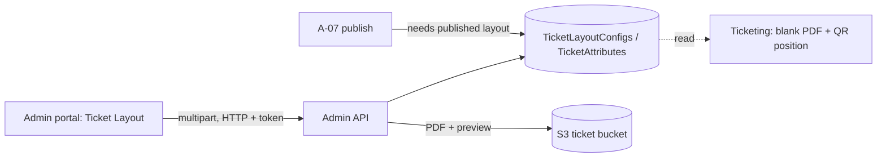

# A-13 · Ticket layouts and ticket attributes

> **Bangla name:** টিকিট লেআউট ও টিকিট অ্যাট্রিবিউট
>
> [← 10 · Admin portal](README.md) · [Contents](../README.md) · [Open queries](../99-open-queries.md)

## 1. Name and purpose

**Ticket layouts.** The printed ticket is a PDF template that the platform fills in: it draws text fields, the ticket number, seat data and a QR code on the template ([S-07](../50-system-initiated/S-07-initiate-user-ticket-generation.md), [S-08](../50-system-initiated/S-08-ticket-signing.md)). A **layout config** holds up to six templates for one program, venue and gallery (single or multiple segments × user, partner, complimentary) and an optional back page. **Ticket attributes** decide which information fields appear on the ticket and in which order. Publishing a layout is a precondition to publishing an event ([A-07](A-07-events.md)).

## 2. Trigger and actor

Staff with roles `admin`, `event_manager`, `ticket_manager`, `ticket_operator` (`BCBPersonnel`) (`TicketLayoutConfigsController`, `TicketAttributesController`). Entry: **Prog. Managem.** → a program → tab **Ticket Layout** (`/program-management/program-home/:id`; pages `layoutCreate`, `layoutDetails/:id`, `configuration`). A second module `/ticket-layout` (`ticket-layout-management`) has the same screens but is not in the menu.

## 3. Business flow

1. Create a layout for a program, venue and gallery: name, ticket type, ticket size (`Default`, `Vertical`, `A4`, `Horizontal`), default text and partner-sale default text.
2. Upload the PDF templates for the six types and a back-page PDF; the platform renders a **preview** of each upload.
3. Publish the layout (one published layout per gallery). Duplicate a layout to start a variant. **Do this before the first event of the program and venue is created**, because uploads, unpublish and delete are refused afterwards (§9).
4. Set the ticket attributes of the program (show/hide gallery, block, level/row, entry gate, mini gate, venue name, segment date and time, ticket type, entry and exit time, and their order).

## 4. Technical flow

1. **[HTTP + user token]** Create `POST /admin/api/v1/ticket-layout` (JSON `TicketLayoutConfig`); `CheckValidation` then insert. Update `PUT .../ticket-layout/{id}`; list `GET .../ticket-layout`, `.../venue/{programId}/{venueId}`, `.../configs/{programId}/{venueId}/{venueGalleryId}`, `.../published/...`, `.../back-page/...`; one `GET .../ticket-layout/{id}`.
2. Upload `POST /admin/api/v1/ticket-layout/upload/{id}` (multipart: file and `ticketLayoutType` 0 to 5: `SingleSegmentUser`, `MultipleSegmentUser`, `SingleSegmentPartner`, `MultipleSegmentPartner`, `SingleSegmentComplimentary`, `MultipleSegmentComplimentary`): refused when events already use the program and venue ("... not uploadable due to active events."); deletes the old file and preview, uploads to `ticekt-layout/{id}/{type}/...` in the **ticket bucket** and generates a **preview PDF** in Admin (`BlankPdf.GenerateTicketPdf` for the ticket size, one or several segments) to `ticekt-layout-preview/{id}/{type}/...`; stores both URLs ([X-20](../60-cross-cutting/X-20-file-storage.md)). Back page: `POST .../upload/back-page/{id}` to `back-page-ticekt-layout/{id}/`. Delete files: `DELETE .../delete-pdf/{id}`, `.../delete-pdf/back-page/{id}`.
3. Publish `PUT .../publish/{id}`: fails when already published or when **another layout of the same program, venue and gallery is published** ("Ticket Layout Config Already Published for same gallary"). Unpublish `PUT .../unpublish/{id}`: fails when the program and venue already have **any event** ("... not unpublishable due to active events.") or when already unpublished.
4. Duplicate `PUT .../duplicate/{id}`; delete `DELETE .../{id}`: refused when the program and venue have an event ("... cannot be deleted due to active events."), otherwise a soft delete of the row; the S3 files are not removed.
5. Attributes: `GET /admin/api/v1/ticket-attributes/program/{programId}`, `PUT /admin/api/v1/ticket-attributes/{id}` (flags and priorities). One row per program is created with the program ([A-02](A-02-programs.md)); the venue type (`Stadium`/`Exhibition Hall`) is part of it.
6. Use: when tickets are created, Ticketing and Admin render the blank PDF by the published layout and attributes (`GetBlankPdf`, `BuildTicketDynamicAttributesAsync`, [S-07](../50-system-initiated/S-07-initiate-user-ticket-generation.md)); `GET .../download-backpage/{eventId}` serves the back page for downloads.

## 5. Components

| Kind | Component |
|---|---|
| Client | `features/program-management/components/ticket-layout-*`, `ticket-configuration`; duplicate module `features/ticket-layout-management` |
| Services | Admin (`TicketLayoutConfigsController`, `TicketLayoutConfigsManager`, `TicketAttributesController`, `TicketAttributesManager`); Ticketing and Booking read the tables |
| Tables | `TicketLayoutConfigs`, `TicketAttributes` |
| Storage | S3 **ticket bucket**: `ticekt-layout`, `ticekt-layout-preview`, `back-page-ticekt-layout` |

## 6. API contracts

| Method | Path | Auth | Request | Response | Main errors |
|---|---|---|---|---|---|
| POST | `/admin/api/v1/ticket-layout` | roles Admin, EventManager, TicketManager, BCBPersonnel | `TicketLayoutConfig` | layout | 400 validation |
| PUT | `/admin/api/v1/ticket-layout/{id}` | same | `TicketLayoutConfig` | layout | |
| POST | `/admin/api/v1/ticket-layout/upload/{id}` | same | multipart `file`, `ticketLayoutType` | layout | 400 `not uploadable due to active events` |
| POST | `/admin/api/v1/ticket-layout/upload/back-page/{id}` | same | multipart `file` | layout | |
| PUT | `/admin/api/v1/ticket-layout/publish/{id}`, `unpublish/{id}`, `duplicate/{id}` | same | path | layout | messages in §4 |
| DELETE | `/admin/api/v1/ticket-layout/{id}`, `delete-pdf/{id}`, `delete-pdf/back-page/{id}` | same | path | layout | |
| GET | `/admin/api/v1/ticket-layout`, `/venue/...`, `/configs/...`, `/published/...`, `/back-page/...`, `/{id}`, `/{id}/{ticketLayoutType}`, `/download-backpage/{eventId}` | same | | | |
| GET | `/admin/api/v1/ticket-attributes/program/{programId}`, `/{id}` | same | | `TicketAttributes` | |
| POST, PUT | `/admin/api/v1/ticket-attributes`, `/{id}` | same | `TicketAttributes` | | |

Primary sample, `POST /admin/api/v1/ticket-layout` (property names from `TicketLayoutConfig`; values illustrative):

```json
{
  "ticketLayoutName": "Final - Stadium",
  "programId": 12, "venueId": 3, "venueGalleryId": 12,
  "ticketType": "Stadium", "ticketSize": "Default",
  "defaultText": "Please keep this ticket safe", "partnerSaleDefaultText": "Partner sale",
  "isPublished": false
}
```

`ticketAttributes` (selected properties): `venueType`, `showGallery`, `showBlock`, `showLevelRow`, `showEntryGate`, `showMiniGate`, `showVenueName`, `showSegmentDateTime`, `galleryPriority`, `blockPriority`, `levelRowPriority`, `entryGatePriority`, `miniGatePriority`, `showTicketType`, `showEntryTime`, `showExitTime` and their priorities.

## 7. Data and side effects

Layout rows with up to 12 file URLs (six templates and six previews) plus the back-page URL; S3 objects; activity log ([X-24](../60-cross-cutting/X-24-activity-logging.md)).

## 8. Code references

| What | Where |
|---|---|
| Controller | `rvl-gobcb-backend/Services/Admin/ETP.Admin.Service/Api/TicketLayoutConfigsController.cs:30-330` |
| Manager | `rvl-gobcb-backend/Services/Admin/ETP.Admin.Domain/Managers/TicketLayoutConfigsManager.cs:51-760` (create 51, publish 260, unpublish 288, upload 478, back page 558) |
| Attributes | `rvl-gobcb-backend/Services/Admin/ETP.Admin.Domain/Managers/TicketAttributesManager.cs`, `Models/TicketLayoutConfig/TicketAttributes.cs` |
| Portal | `rvl-gobcb-admin-portal/src/app/features/program-management/services/ticket-layout.service.ts:28-108`, `ticket-attributes.service.ts` |

## 9. Handover notes

1. **Layouts must come first.** A layout cannot get new files, be unpublished or be deleted once the program and venue have an event, even a draft; but an event cannot be published without a published layout for each active gallery. The working order is: venue, program-venue details, layouts (uploaded and published), then events. To change a template for a venue that already has events, there is no supported path except the database `[UNCONFIRMED: Q-23]`.
2. **The check is by program and venue, not by gallery**, so one event blocks changes for every gallery layout of that venue and program.
3. **Spelling `ticekt` is in the data** (S3 keys and URLs) ([X-20](../60-cross-cutting/X-20-file-storage.md)).
4. **Layout and ticket size drive the QR position** (`[900, 650, 650]` default and vertical, A4 and horizontal differ) in Ticketing ([S-08](../50-system-initiated/S-08-ticket-signing.md)); a template whose QR area does not match the size produces unreadable tickets.
5. **Event publish needs a *published* layout for every *active* gallery** of the event ([A-07](A-07-events.md)); a gallery added to the venue later without a layout blocks publishing.
6. **Two portals paths** (`/program-management` and the unlinked `/ticket-layout`) call the same endpoints; keep only one when refactoring.
7. A partial upload (file stored, preview generation failed) leaves the file URL set without a preview; the manager deletes the old preview first, then uploads.

## 10. Component relationships



**Depends on:** [A-02](A-02-programs.md), [A-05](A-05-venues.md), [A-06](A-06-program-venue-mapping.md). **Affects:** [A-07](A-07-events.md), [S-07](../50-system-initiated/S-07-initiate-user-ticket-generation.md), [S-08](../50-system-initiated/S-08-ticket-signing.md), [A-12](A-12-reserved-tickets.md).

## 11. Developer test guide

**Local testability: Full.**

| Item | Detail |
|---|---|
| Test data and accounts | `pwsh ./scripts/Seed-EtpData.ps1` (layouts exist so events can be published); admin `…01` |
| Browser | `http://localhost:4200/program-management` → program → **Ticket Layout**; Network: multipart `POST .../ticket-layout/upload/{id}` |
| Emulator | — |
| Postman | `postman/services/etp-admin.postman_collection.json`: "GET /api/v1/ticket-layout", "POST /api/v1/ticket-layout", "POST /api/v1/ticket-layout/upload/{id}" (form-data), "PUT /api/v1/ticket-layout/publish/{id}" |
| Visual Studio debug | `TicketLayoutConfigsManager.UploadTicketLayoutAsync`, `PublishTicketLayoutAsync` |
| Verify | SQL: `select "Id","IsPublished","VenueGalleryId" from etp."TicketLayoutConfigs"`; `aws --endpoint-url http://localhost:4566 s3 ls s3://etp-local/ticekt-layout/ --recursive` |
