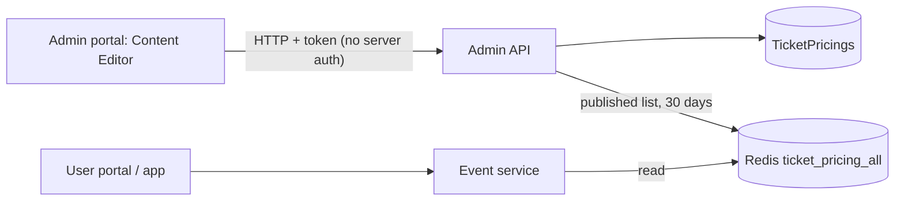

# A-14 · Ticket-pricing content page

> **Bangla name:** টিকিট-প্রাইসিং কনটেন্ট পেজ
>
> [← 10 · Admin portal](README.md) · [Contents](../README.md) · [Open queries](../99-open-queries.md)

## 1. Name and purpose

**Ticket-pricing page.** A public information page that tells customers the ticket prices of a program and venue as plain text lines (attribute name and price, for example "Gallery A: 500"). It is **content**, separate from the real prices of events ([A-09](A-09-event-level-pricing.md)); the admin keeps it in sync by hand. The portal and app display the published entries.

## 2. Trigger and actor

Staff who can open **Site Settings → Content Editor** (global menu, `/content-editor/ticket-pricing`). The **server** has no `[Authorize]` on `TicketPricingController` ([X-18](../60-cross-cutting/X-18-endpoints-without-auth.md)).

## 3. Business flow

List the entries, create one (program name, venue name, a list of attribute name and price pairs), edit it, **publish** or **unpublish**, delete. Only published entries are visible to customers.

## 4. Technical flow

1. **[HTTP + user token]** `GET /admin/api/v1/ticket-pricing?...` (paged), `GET .../ticket-pricing/list`, `GET .../{id}`.
2. Create `POST .../ticket-pricing` (JSON `CreateOrUpdateTicketPricing {programName, venueName, isPublished, attributes[{attributeName, attributePrice}]}`), update `PUT .../{id}` (the attribute list is cleared and rewritten), publish `PUT .../publish/{id}`, unpublish `PUT .../unpublish/{id}`, delete `DELETE .../{id}`, delete one attribute `DELETE .../attribute/{attributeId}`.
3. After every change `RefreshTicketPricingCacheAsync` reads all rows, keeps the **published** ones, and writes the list to the Redis key `ticket_pricing_all` for **30 days** ([X-25](../60-cross-cutting/X-25-redis.md)).
4. **Customer read:** the Event service answers **only from the Redis key `ticket_pricing_all`** (`EventTicketPriceManager.GetAllTicketPricingAsync`); if the key is missing it logs "Ticket pricing data not found in cache. Please ensure Admin service has populated the cache." and returns an **empty list** ([P-03](../20-user-portal/P-03-info-pages.md), [U-03](../30-user-app/U-03-info-pages.md)).

## 5. Components

| Kind | Component |
|---|---|
| Client | `features/content-editor` components `TicketPricingListComponent`, `CreateTicketPricingComponent`, `services/content-editor.service.ts:26-53` |
| Services | Admin (`TicketPricingController`, `TicketPricingManager`); Event (`TicketPricingController`, `EventTicketPriceManager`, read from Redis) |
| Tables | `TicketPricings`, `TicketPricingAttributes` |
| Redis | `ticket_pricing_all` (30 days) |

## 6. API contracts

| Method | Path | Auth | Request | Response |
|---|---|---|---|---|
| GET | `/admin/api/v1/ticket-pricing`, `/list`, `/{id}` | **none** | paging | `TicketPricingProgram` |
| POST | `/admin/api/v1/ticket-pricing` | **none** | `CreateOrUpdateTicketPricing` | `TicketPricingProgram` |
| PUT | `/admin/api/v1/ticket-pricing/{id}`, `publish/{id}`, `unpublish/{id}` | **none** | body / path | `TicketPricingProgram` |
| DELETE | `/admin/api/v1/ticket-pricing/{id}`, `attribute/{attributeId}` | **none** | path | result |

Primary sample, `POST /admin/api/v1/ticket-pricing` (property names from `CreateOrUpdateTicketPricing`; values illustrative; `attributePrice` is an integer):

```json
{
  "programName": "Premier League 2026",
  "venueName": "Sher-e-Bangla National Cricket Stadium",
  "isPublished": true,
  "attributes": [ { "attributeName": "Gallery A", "attributePrice": 500 }, { "attributeName": "VIP", "attributePrice": 3000 } ]
}
```

Errors: `Id must be greater than zero.`, `No ticket pricing found for id {id}.` (400).

## 7. Data and side effects

Rows, the 30-day Redis list; activity log ([X-24](../60-cross-cutting/X-24-activity-logging.md)).

## 8. Code references

| What | Where |
|---|---|
| Controller | `rvl-gobcb-backend/Services/Admin/ETP.Admin.Service/Api/TicketPricingController.cs:14-170` |
| Manager | `rvl-gobcb-backend/Services/Admin/ETP.Admin.Domain/Managers/TicketPricingManager.cs:97-330` |
| DTO | `rvl-gobcb-backend/Services/Admin/ETP.Admin.Domain/Models/TicketPricing/CreateOrUpdateTicketPricing.cs` |
| Portal | `rvl-gobcb-admin-portal/src/app/features/content-editor/services/content-editor.service.ts:26-53` |

## 9. Handover notes

1. **No authorization**: anyone who can reach the endpoint can publish, change or delete the public price page.
2. **Names, not ids.** The entry stores program and venue as free text; it is not linked to the program or the real prices, so it can disagree with them.
3. **The customer page depends on the cache alone.** After a Redis flush, a failover or the 30-day expiry, the page is empty until an admin saves any ticket-pricing entry again (that rewrites the whole list); nothing rebuilds it at start-up. A manual database edit is not visible either.
4. **`attributePrice` is a whole number** (`long`), so decimal prices cannot be shown.
5. **Stale unpublish.** Unpublish removes the entry from the cached list at once, but any customer page already loaded keeps showing it until it reloads.

## 10. Component relationships



**Depends on:** nothing. **Affects:** [P-03](../20-user-portal/P-03-info-pages.md), [U-03](../30-user-app/U-03-info-pages.md).

## 11. Developer test guide

**Local testability: Full.**

| Item | Detail |
|---|---|
| Test data and accounts | Admin `…01` (global menu) |
| Browser | `http://localhost:4200/content-editor/ticket-pricing` → create, publish; user portal pricing page |
| Emulator | — |
| Postman | `postman/services/etp-admin.postman_collection.json`: "GET /api/v1/ticket-pricing", "POST /api/v1/ticket-pricing" |
| Visual Studio debug | `TicketPricingManager.RefreshTicketPricingCacheAsync` |
| Verify | `redis-cli GET ticket_pricing_all`; SQL on `TicketPricings` |
