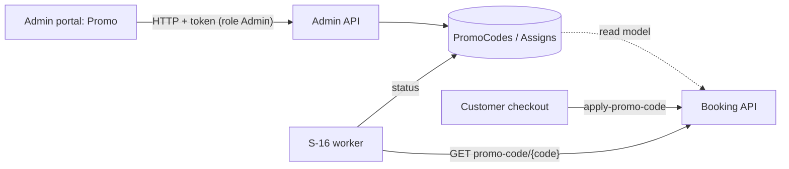

# A-15 · Promo codes

> **Bangla name:** প্রোমো কোড
>
> [← 10 · Admin portal](README.md) · [Contents](../README.md) · [Open queries](../99-open-queries.md)

## 1. Name and purpose

**Promo codes.** A promo code is a short text the customer enters at checkout to get a discount. The admin defines its value (percentage or fixed amount), validity period, total and per-customer usage limits, and which events or galleries of a program it applies to. The status (`Upcoming`, `Active`, `Expired`, `LimitReached`) is kept up to date by a worker ([S-16](../50-system-initiated/S-16-promo-code-status.md)); the customer side is [P-05](../20-user-portal/P-05-apply-promo-code.md).

## 2. Trigger and actor

Staff with role `admin` (`PromoCodeController` allows only `Admin`). Entry: program menu **Promo & Discount → Promo** (`/promo-management`, `/promo-management/create`, `/promo-management/edit-promo/:promoCodeId`).

## 3. Business flow

1. List promo codes of the program with status, dates and usage.
2. Create: code (≤ 12 characters, unique), name (≤ 26), discount type (`Percentage` or `FixedAmount`) and value, "applied to" (`BasePrice` or `DiscountedPrice`), start and end, total usage limit, limit per user, and one or more **assignments** to a program with either specific **events** or specific **galleries of events**.
3. Edit or delete (soft delete).
4. The form warns when a selected event already has another promo code (`exists` check).

## 4. Technical flow

1. **[HTTP + user token]** `GET /admin/api/v1/promo-codes?...` (paged), `/promo-codes/{id}`; `GET .../promo-codes/exists?eventIds=...&promoCodeId=` returns `{Success: false, Message: "A promo code is already assigned to the selected events: ..."}` when other codes already cover the events. The form loads programs, events and galleries from `GET /program`, `GET /events/list`, `GET /events/program/{id}/events`, `POST /eventsVenueDetails/galleries/by-event-ids` ([A-07](A-07-events.md), [A-09](A-09-event-level-pricing.md)).
2. Create `POST .../promo-codes` (JSON `CreateOrUpdatePromoCode`). `PromoCodeManager.CreateAsync`: `CheckValidityOfPromoCode` (code required, ≤ 12, unique among codes (`ExistsAsync(id, code)`), name required, ≤ 26, limit per user not above the total limit, whole number for percentage values, start and end set and end after start, at least one assignment, each program and event exists); computes the status (`GetPromoCodeStatusAsync`: `Upcoming` before start, `Expired` after end, `LimitReached` when paid orders with the code reach the total limit, else `Active`); inserts the code with `IsPublished = (status == Active)`; inserts the assignments (event assignments link events; gallery assignments link events, galleries and the venue-event-gallery names).
3. Update `PUT .../promo-codes/{id}`: same validation, replaces the assignment list, recomputes the status. Delete `DELETE .../promo-codes/{id}`: `IsDeleted = true`.
4. The status worker keeps `Status`, `IsActive`, `IsPublished` current ([S-16](../50-system-initiated/S-16-promo-code-status.md)). Booking reads the same tables as read models and validates a code at checkout itself ([P-05](../20-user-portal/P-05-apply-promo-code.md)).

## 5. Components

| Kind | Component |
|---|---|
| Client | `features/promo-management/pages/{promo-list,create-promo}`, `services/promo-management.service.ts:22-72` |
| Services | Admin (`PromoCodeController`, `PromoCodeManager`); Booking (read, usage count); the Admin worker |
| Tables | `PromoCodes`, `PromoCodeAssigns` (+ event, gallery and venue-event-gallery link tables) |

## 6. API contracts

| Method | Path | Auth | Request | Response | Main errors |
|---|---|---|---|---|---|
| GET | `/admin/api/v1/promo-codes`, `/list`, `/{id}`, `/code/{code}/{eventId}` | `Admin` | paging | `PromoCode` | |
| POST | `/admin/api/v1/promo-codes` | `Admin` | `CreateOrUpdatePromoCode` | `PromoCode` | 400 validation messages above |
| PUT | `/admin/api/v1/promo-codes/{id}` | `Admin` | same | `PromoCode` | 400 `PromoCode with ID {id} not found.` |
| DELETE | `/admin/api/v1/promo-codes/{id}` | `Admin` | path | `PromoCode` | 400 `Invalid promo code ID.` |
| GET | `/admin/api/v1/promo-codes/exists` | `Admin` | `eventIds[]`, `promoCodeId` | `{Success, Message}` | |

Enums: `discountType` `1` Percentage, `2` FixedAmount; `discountAppliedTo` `1` BasePrice, `2` DiscountedPrice; `assignType` `1` Event, `2` Gallery.

Primary sample, `POST /admin/api/v1/promo-codes` (property names from `CreateOrUpdatePromoCode`; values illustrative):

```json
{
  "code": "EARLY10", "name": "Early bird 10 percent", "programId": 12,
  "discountType": 1, "discountValue": 10, "discountAppliedTo": 1,
  "startDateTime": "2026-12-01T00:00:00Z", "endDateTime": "2026-12-31T23:59:59Z",
  "totalUsageLimit": 500, "limitPerUser": 2,
  "assignTo": [ { "assignType": 1, "programId": 12, "eventIds": [101] } ]
}
```

## 7. Data and side effects

Promo-code rows and assignments; activity log ([X-24](../60-cross-cutting/X-24-activity-logging.md)); no cache, no queue.

## 8. Code references

| What | Where |
|---|---|
| Controller | `rvl-gobcb-backend/Services/Admin/ETP.Admin.Service/Api/PromoCodeController.cs:26-150` |
| Manager | `rvl-gobcb-backend/Services/Admin/ETP.Admin.Domain/Managers/PromoCodeManager.cs:98-286, 320-457` |
| Customer-side check | `rvl-gobcb-backend/Services/Booking/ETP.Booking.Domain/Managers/UserBookingOrderManager.cs:1135-1193` |
| Portal | `rvl-gobcb-admin-portal/src/app/features/promo-management/services/promo-management.service.ts:22-72` |

## 9. Handover notes

1. **"Already assigned" is advisory.** The `exists` call only returns a message; `CreateAsync` does not reject overlapping event assignments, so two codes can cover one event.
2. **Status is computed at save time and then by the worker**, but the apply step recomputes dates and usage itself ([S-16](../50-system-initiated/S-16-promo-code-status.md) note 2), so the status field mainly serves the admin list.
3. **A code's text is unique only among non-deleted codes** (`ExistsAsync`); whether a soft-deleted code blocks its text is not checked here `[UNCONFIRMED: Q-25]`.
4. **Percentage values must be whole numbers.** A value above 100 is not rejected by the manager's checks listed here.
5. **Update replaces assignments** (`AssignTo.Clear()` then re-add), so assignment ids change on every edit.
6. **Discount stacking.** `discountAppliedTo` lets a code apply to the base price or to the price after the system discount ([A-16](A-16-discounts.md)); how Booking orders the two is described in [P-05](../20-user-portal/P-05-apply-promo-code.md) and [P-06](../20-user-portal/P-06-booking-payment.md).

## 10. Component relationships



**Depends on:** [A-02](A-02-programs.md), [A-07](A-07-events.md). **Affects:** [P-05](../20-user-portal/P-05-apply-promo-code.md), [P-06](../20-user-portal/P-06-booking-payment.md), reports ([A-22](A-22-reports.md)).

## 11. Developer test guide

**Local testability: Full.**

| Item | Detail |
|---|---|
| Test data and accounts | `pwsh ./scripts/Seed-EtpData.ps1`; admin `…01` (role `admin` is required) |
| Browser | `http://localhost:4200/promo-management` (select a program first) → create; Network: `POST .../admin/api/v1/promo-codes` |
| Emulator | — |
| Postman | `postman/services/etp-admin.postman_collection.json`: "GET /api/v1/promo-codes", "POST /api/v1/promo-codes", "GET /api/v1/promo-codes/exists" |
| Visual Studio debug | `PromoCodeManager.CreateAsync`, `CheckValidityOfPromoCode` |
| Verify | SQL: `select "Code","Status","IsPublished","TotalUsageLimit" from etp."PromoCodes"` |
