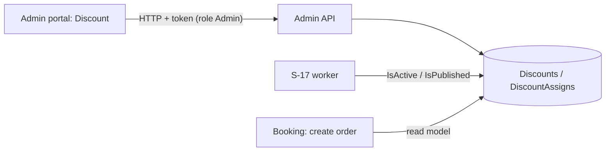

# A-16 · System discounts

> **Bangla name:** সিস্টেম ডিসকাউন্ট
>
> [← 10 · Admin portal](README.md) · [Contents](../README.md) · [Open queries](../99-open-queries.md)

## 1. Name and purpose

**System discounts.** A system discount reduces the ticket price automatically, without a code, for chosen events or galleries during a period (for example an early-bird price). The admin defines name, type (percentage or fixed amount), value, start and end, and the assignments. The status switch at the start and end is done by a worker ([S-17](../50-system-initiated/S-17-discount-status.md)); the customer sees the reduced price at seat selection and in the order ([P-04](../20-user-portal/P-04-seat-selection.md), [P-06](../20-user-portal/P-06-booking-payment.md)).

## 2. Trigger and actor

Staff with role `admin` (`DiscountController` allows `Admin`; one read endpoint is anonymous). Entry: program menu **Promo & Discount → Discount** (`/promo-management/discount`, `/promo-management/discount/create-discount`, `/discount/edit-discount/:discountId`).

## 3. Business flow

List discounts; create with name (≤ 26 characters), type `Percentage` (whole number) or `FixedAmount`, value, start and end, and one or more assignments (a program with events, or events with galleries); edit; delete (soft). The form checks first whether a selected event already has a discount.

## 4. Technical flow

1. **[HTTP + user token]** `GET /admin/api/v1/discount?...`, `/discount/list`, `/discount/{id}`; `GET .../discount/exists?eventIds&discountId` returns whether other discounts already cover the events.
2. Create `POST .../discount` (JSON `CreateOrUpdateDiscount {name, programId, discountType, discountValue, startDateTime, endDateTime, discountAssigns[]}`). `DiscountManager.CreateAsync`: validation (name required and ≤ 26, whole number for percentages, dates set and end after start, at least one assignment, program and events exist), then `GetDiscountStatus` (`Upcoming`, `Expired`, `Active` by the dates) and insert with `IsActive = IsPublished = (status == Active)`, plus the assignments.
3. Update `PUT .../discount/{id}`, delete `DELETE .../discount/{id}`.
4. **At checkout (in Booking, not through this API):** `UserBookingOrderManager.CreateAsync` calls `DiscountRepository.GetDiscountByIdsAsync(programId, eventId, galleryId)`: one discount that is not deleted, `IsActive` and `IsPublished`, assigned to the program and to the event (or to the event plus the gallery). A percentage discount reduces the **base price** (`basePrice × value / 100 × seats`), a fixed discount subtracts `value × seats` ([S-17](../50-system-initiated/S-17-discount-status.md)).
5. `GET /admin/api/v1/discount/program/{programId}/{eventId}/{galleryId}` is anonymous and returns the matching discount; Booking used to call it through `IAdminClient` (that call is commented out in `UserBookingOrderManager.CreateAsync`).

## 5. Components

| Kind | Component |
|---|---|
| Client | `features/promo-management/pages/{discount-list,create-discount}`, `services/promo-management.service.ts:76-98` |
| Services | Admin (`DiscountController`, `DiscountManager`, worker); Booking (read model and use) |
| Tables | `Discounts`, `DiscountAssigns` |

## 6. API contracts

| Method | Path | Auth | Request | Response | Main errors |
|---|---|---|---|---|---|
| GET | `/admin/api/v1/discount`, `/list`, `/{id}` | `Admin` | paging | `Discount` | |
| POST | `/admin/api/v1/discount` | `Admin` | `CreateOrUpdateDiscount` | `Discount` | 400 validation |
| PUT | `/admin/api/v1/discount/{id}` | `Admin` | same | `Discount` | 400 `Discount with ID {id} not found.` |
| DELETE | `/admin/api/v1/discount/{id}` | `Admin` | path | `Discount` | |
| GET | `/admin/api/v1/discount/exists` | `Admin` | `eventIds[]`, `discountId` | message | |
| GET | `/admin/api/v1/discount/program/{programId}/{eventId}/{galleryId}` | **anonymous** | path | `Discount` | |

Primary sample, `POST /admin/api/v1/discount` (names from `CreateOrUpdateDiscount`; `discountType` `1` Percentage, `2` FixedAmount; assignment fields as in [A-15](A-15-promo-codes.md); values illustrative):

```json
{
  "name": "Early bird", "programId": 12, "discountType": 1, "discountValue": 15,
  "startDateTime": "2026-12-01T00:00:00Z", "endDateTime": "2026-12-05T23:59:59Z",
  "discountAssigns": [ { "assignType": 1, "programId": 12, "eventIds": [101] } ]
}
```

## 7. Data and side effects

Discount rows and assignments; activity log ([X-24](../60-cross-cutting/X-24-activity-logging.md)). The worker changes the flags later ([S-17](../50-system-initiated/S-17-discount-status.md)).

## 8. Code references

| What | Where |
|---|---|
| Controller | `rvl-gobcb-backend/Services/Admin/ETP.Admin.Service/Api/DiscountController.cs:26-150` |
| Manager | `rvl-gobcb-backend/Services/Admin/ETP.Admin.Domain/Managers/DiscountManager.cs:60-350, 439-450` |
| Booking lookup and use | `rvl-gobcb-backend/Services/Booking/ETP.Booking.Storage/Repositories/DiscountRepository.cs:14-31`, `.../UserBookingOrderManager.cs:188-200` |
| Portal | `rvl-gobcb-admin-portal/src/app/features/promo-management/services/promo-management.service.ts:76-98` |

## 9. Handover notes

1. **Only one discount applies** and `FirstOrDefault` picks it; overlapping assignments are only warned about by `exists`, not rejected at save ([S-17](../50-system-initiated/S-17-discount-status.md) note 3).
2. **Pricing drift of up to two minutes** at the start and end, since Booking checks the flags, not the dates ([S-17](../50-system-initiated/S-17-discount-status.md) note 1).
3. **A new discount in the past is saved as `Expired`**, and a manual `IsActive` change by an admin edit is overwritten by the next status change.
4. **Fixed-amount discounts are per seat**, so a discount of 200 on four seats is 800; a fixed value above the price is not capped here.
5. The `discount/program/...` read is anonymous ([X-18](../60-cross-cutting/X-18-endpoints-without-auth.md)).

## 10. Component relationships



**Depends on:** [A-07](A-07-events.md). **Affects:** [P-04](../20-user-portal/P-04-seat-selection.md), [P-06](../20-user-portal/P-06-booking-payment.md), [S-10](../50-system-initiated/S-10-vat-challan.md), reports ([A-22](A-22-reports.md)).

## 11. Developer test guide

**Local testability: Full.**

| Item | Detail |
|---|---|
| Test data and accounts | `pwsh ./scripts/Seed-EtpData.ps1`; admin `…01` |
| Browser | `http://localhost:4200/promo-management/discount` → create; then user portal checkout |
| Emulator | — |
| Postman | `postman/services/etp-admin.postman_collection.json`: "GET /api/v1/discount", "POST /api/v1/discount", "GET /api/v1/discount/exists" |
| Visual Studio debug | `DiscountManager.CreateAsync`, `GetDiscountStatus`; Booking `DiscountRepository.GetDiscountByIdsAsync` |
| Verify | SQL: `select "Name","Status","IsActive","IsPublished" from etp."Discounts"` |
