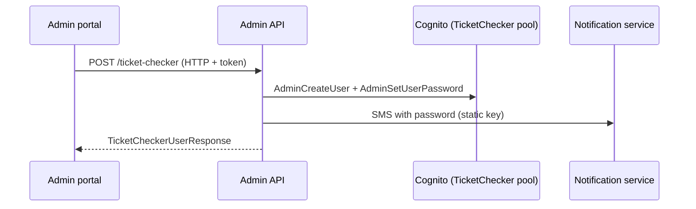

# A-17 · Ticket-checker (gate staff) accounts

> **Bangla name:** টিকিট-চেকার (গেট স্টাফ) অ্যাকাউন্ট
>
> [← 10 · Admin portal](README.md) · [Contents](../README.md) · [Open queries](../99-open-queries.md)

## 1. Name and purpose

**Ticket-checker accounts.** Gate staff sign in to the checker app with an account in the **TicketChecker Cognito pool**. Admins create and manage these accounts here: create, rename, disable, enable, reset password, delete, search. How the Cognito user, its attributes and the SMS with the password are produced is described once in [X-05](../60-cross-cutting/X-05-admin-provisioning.md); the checker's login is [X-12](../60-cross-cutting/X-12-checker-login.md); assigning checkers to gates is [A-18](A-18-gate-assignment.md).

## 2. Trigger and actor

Staff in the global menu (**Users → Ticket Checkers**, `/ticket-checker`, `LimitedMenuGuard`: program must be 0). `TicketCheckerController` allows roles `admin`, `event_manager`, `ticket_manager`, `ticket_operator` (`BCBPersonnel`); **search** is limited to `admin` and `event_manager`.

## 3. Business flow

1. List checkers (name, phone, status). 2. **Create** with name and phone: the account exists at once and the new checker receives an SMS with the user name and a generated password. 3. **Edit** the name. 4. **Disable** or **enable** the account (disabled staff cannot sign in). 5. **Set password** generates a new password and sends it by SMS. 6. **Delete** the account.

## 4. Technical flow

1. **[HTTP + user token]** List `GET /admin/api/v1/ticket-checker`; one `GET .../ticket-checker/{id}`; search `GET .../ticket-checker/search?name=` (used when assigning gates, [A-18](A-18-gate-assignment.md)) and `search-by-userid?sub=`.
2. Create `POST .../ticket-checker` with `{ "name", "phone" }` → `TicketCheckerManager.CreateUserAsync` → `TicketCheckerUserProvider.CreateUserAsync`: `AdminCreateUser` in the TicketChecker pool (username = phone, e-mail attribute built from the phone, `custom:role = TicketChecker`), a generated password, then the credentials SMS through the notification service (**[HTTP, static key]**, [X-22](../60-cross-cutting/X-22-sms-notification.md)). Details: [X-05](../60-cross-cutting/X-05-admin-provisioning.md).
3. Update `PUT .../ticket-checker/{id}` with `{ userId, name }`: **the body's `userId` is used, not the path `id`**; only the name is changed.
4. `POST .../ticket-checker/disable/{id}`, `enable/{id}`; `POST .../ticket-checker/set-password?userId=`; `DELETE .../ticket-checker/{id}`; `PUT .../ticket-checker/change-password` (checker changes their own password with an access token).
5. The gate list of one checker: `GET /admin/api/v1/ticket-checker-gate/user/{userId}` , and per gate `PUT .../ticket-checker-gate/update-download-status/{userId}/{gateId}/{status}`, `DELETE .../ticket-checker-gate/remove-user/{id}` ([A-18](A-18-gate-assignment.md)).

## 5. Components

| Kind | Component |
|---|---|
| Client | `features/ticket-checker/*`, `services/ticket-checker.service.ts` |
| Service | Admin (`TicketCheckerController`, `TicketCheckerManager`, `TicketCheckerUserProvider`) |
| AWS | Cognito TicketChecker pool; static AWS keys |
| External | Notification service (SMS) |
| Tables | none for the account (Cognito holds it); gate assignments in `TicketCheckerGateUsers` |

## 6. API contracts

| Method | Path | Auth | Request | Response |
|---|---|---|---|---|
| GET | `/admin/api/v1/ticket-checker` | roles Admin, EventManager, TicketManager, BCBPersonnel | paging | `TicketCheckerUserResponse[]` |
| GET | `/admin/api/v1/ticket-checker/{id}` | same | path | `TicketCheckerUserResponse` |
| POST | `/admin/api/v1/ticket-checker` | same | `TicketCheckerCreateUser {name, phone}` | `TicketCheckerUserResponse` |
| PUT | `/admin/api/v1/ticket-checker/{id}` | same | `TicketCheckerUpdateUser {userId, name}` | `TicketCheckerUserResponse` |
| POST | `/admin/api/v1/ticket-checker/disable/{id}`, `enable/{id}` | same | path | `bool` |
| POST | `/admin/api/v1/ticket-checker/set-password?userId=` | same | query | `bool` |
| DELETE | `/admin/api/v1/ticket-checker/{id}` | same | path | `bool` |
| PUT | `/admin/api/v1/ticket-checker/change-password` | same | `TicketCheckerChangePassword {accessToken, oldPassword, newPassword}` | `bool` |
| GET | `/admin/api/v1/ticket-checker/search`, `search-by-userid` | `Admin`, `EventManager` for search | `name` / `sub` | list |

Primary sample, `POST /admin/api/v1/ticket-checker`:

```json
{ "name": "Rahim Uddin", "phone": "+8801700000099" }
```

Response `TicketCheckerUserResponse`: `userId`, `name`, `email`, `phone`, `role`, `currentStatus`, `isActive`, `isPhoneNumberVerified`. Note the response field `isPhoneNumberVerified` is `false` because of a typo in the provider (see [X-05](../60-cross-cutting/X-05-admin-provisioning.md)).

## 7. Data and side effects

Cognito user in the TicketChecker pool; SMS with the password; activity log entries are written for database tables only, not for Cognito changes made here (unlike admin users, [A-25](A-25-admin-users.md)).

## 8. Code references

| What | Where |
|---|---|
| Controller | `rvl-gobcb-backend/Services/Admin/ETP.Admin.Service/Api/TicketCheckerController.cs:27-215` |
| Manager | `rvl-gobcb-backend/Services/Admin/ETP.Admin.Domain/Managers/TicketCheckerManager.cs:20-90` |
| Provider | `rvl-gobcb-backend/Services/Admin/ETP.Admin.Integration/Services/TicketCheckerUserProvider.cs:20-200` |
| Portal | `rvl-gobcb-admin-portal/src/app/features/ticket-checker/services/ticket-checker.service.ts:18-54` |

## 9. Handover notes

1. **Passwords travel by SMS in clear text** and are generated with `System.Random` ([X-05](../60-cross-cutting/X-05-admin-provisioning.md), [X-22](../60-cross-cutting/X-22-sms-notification.md)).
2. **Any of four staff roles can create and delete checker accounts**, including `ticket_operator` (`BCBPersonnel`), although the portal shows the Ticket Checkers menu in the global menu only to a subset ([X-17](../60-cross-cutting/X-17-authz-client-side.md)).
3. **`PUT .../{id}` ignores the path id** and trusts `userId` in the body, so a caller can rename a different account than the URL says.
4. **If the SMS fails, the account still exists** with a password nobody has (the call order is create user, set password, send SMS); use **Set password** to resend ([X-22](../60-cross-cutting/X-22-sms-notification.md) note 4).
5. **Deleting a checker does not remove gate assignments** in `TicketCheckerGateUsers` (the delete targets Cognito); remove the assignment first in [A-18](A-18-gate-assignment.md) `[UNCONFIRMED: Q-26]`.
6. The checker's own `change-password` takes the access token in the **request body**, not the Authorization header.

## 10. Component relationships



**Depends on:** [X-05](../60-cross-cutting/X-05-admin-provisioning.md), [X-15](../60-cross-cutting/X-15-authz-roles.md). **Affects:** [A-18](A-18-gate-assignment.md), [X-12](../60-cross-cutting/X-12-checker-login.md), [C-01](../40-checker-app/C-01-assigned-event-gate.md).

## 11. Developer test guide

**Local testability: Partial.** Cognito is Floci; the SMS call fails because the notification endpoint is dummy ([X-22](../60-cross-cutting/X-22-sms-notification.md)), so **creation returns an error after the Cognito user is created**.

| Item | Detail |
|---|---|
| Test data and accounts | Admin `…01`; seeded checker `…21` (`Passw0rd!23`) |
| Browser | `http://localhost:4200/ticket-checker` (program must be 0, [A-01](A-01-program-selection.md)) |
| Emulator | Checker app sign-in is a known local gap |
| Postman | `postman/services/etp-admin.postman_collection.json`: "GET /api/v1/ticket-checker", "POST /api/v1/ticket-checker/disable/{id}" |
| Visual Studio debug | `TicketCheckerUserProvider.CreateUserAsync` |
| Verify | `aws --endpoint-url http://localhost:4566 cognito-idp list-users --user-pool-id <TicketChecker pool>` |
