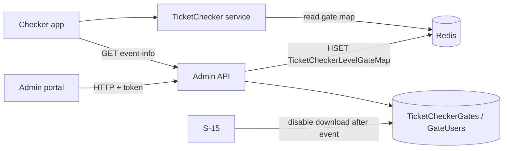

# A-18 · Gate assignment and download control

> **Bangla name:** গেট অ্যাসাইনমেন্ট ও ডাউনলোড নিয়ন্ত্রণ
>
> [← 10 · Admin portal](README.md) · [Contents](../README.md) · [Open queries](../99-open-queries.md)

## 1. Name and purpose

**Gate assignment.** For each event the admin decides which ticket checkers work at which **entry gate**, and whether each checker may **download** the event's ticket list to the phone. The checker app only shows the event and gate to which its user is assigned with download enabled ([C-01](../40-checker-app/C-01-assigned-event-gate.md), [C-02](../40-checker-app/C-02-offline-ticket-download.md)). Concepts: [Redis live capacity](../00-platform-primer.md#explainer-redis-live-capacity) (the gate map lives in Redis).

## 2. Trigger and actor

Staff on the event's **Ticket Checker Assign** tab (`/events/event-details/:id`, component `event-ticket-checker-gate`) and on the **Ticket Checkers** list (`/ticket-checker`, per checker). `TicketCheckerGateController` accepts the **admin and ticket-checker authentication schemes** with roles `Admin`, `EventManager`, `BCBPersonnel` and `TicketChecker` at class level; only `GET /{eventId}` and `POST /` (assign) add `Roles = Admin, EventManager`, and `event-info` needs the `ticket-checker` policy (see §9).

## 3. Business flow

1. Open the tab: the entry gates of the event's venue are listed, each with its assigned checkers.
2. Search checkers by name ([A-17](A-17-ticket-checker-users.md)), add them to a gate, tick **download enabled**, save.
3. **Force assign** or **force unassign** a batch of users when a checker must be moved even though they hold download access elsewhere.
4. From the checker's own row, switch download on or off per gate, or remove the checker from a gate.
5. After the event ends, the system switches download off for everyone ([S-15](../50-system-initiated/S-15-gate-download-status-cleanup.md)).

## 4. Technical flow

1. **[HTTP + user token]** `GET /admin/api/v1/ticket-checker-gate/{eventId}` → `GetAllByEventAsync`: the event's entry gates from the venue (grouped by gate **name**: several `BlockLevelEntryGates` with one name become one gate with comma-joined ids and gallery names), joined with the assignments stored for the event.
2. Save `POST .../ticket-checker-gate` with `AssignTicketCheckerGate { eventId, entryGateName, entryGateId, ticketCheckerUsers[{userId, name, isEnabled}] }`. `AssignTicketCheckerGate`:
   - the event must exist ("Invalid Event Id");
   - a user who is **download-enabled in another event** cannot be enabled here ("Please disable the ticket checker from other event");
   - if the gate row exists: a user already placed on a **different gate of the same event** is refused ("User duplicate found"); otherwise `AddOrRemoveAsync` makes the gate's user list equal to the posted list (new users added, **users not in the list removed**, `IsDownloadEnable` updated);
   - if it does not exist: any posted user already assigned elsewhere is refused; otherwise a `TicketCheckerGate` is created for the event, program and venue and the Redis hash `TicketCheckerLevelGateMap` gets one entry `{eventId}_{entryGateId}` → gate id per entry-gate id ([X-25](../60-cross-cutting/X-25-redis.md)).
3. `POST .../ticket-checker-gate/force-assign` and `.../force-unassign` with a list of `AssignTicketCheckerGate`: force-assign sets `IsDownloadEnable = true` for the posted users on existing gates after checking that none is download-enabled in **another event** ("The following user(s) are already download-enabled in another event: ..."); force-unassign sets it to false. A gate that does not exist is skipped silently.
4. `PUT .../ticket-checker-gate/update-download-status/{userId}/{gateId}/{status}` flips one checker's flag; `DELETE .../ticket-checker-gate/remove-user/{id}` removes a gate-user row; `GET .../ticket-checker-gate/user/{userId}` lists a checker's gates.
5. The checker app reads its assignment from `GET .../ticket-checker-gate/event-info` (policy `ticket-checker`, [C-01](../40-checker-app/C-01-assigned-event-gate.md)).

## 5. Components

| Kind | Component |
|---|---|
| Client | `features/events/components/event-ticket-checker-gate/*`, `services/ticket-checker-gate.service.ts`; `features/ticket-checker/*` |
| Service | Admin (`TicketCheckerGateController`, `TicketCheckerGateManager`, `TicketCheckerGateUserRepository`); TicketChecker (reads) |
| Tables | `TicketCheckerGates`, `TicketCheckerGateUsers` (`IsDownloadEnable`), `BlockLevelEntryGates` |
| Redis | `TicketCheckerLevelGateMap` hash |

## 6. API contracts

| Method | Path | Auth | Request | Response | Main errors |
|---|---|---|---|---|---|
| GET | `/admin/api/v1/ticket-checker-gate/{eventId}` | roles Admin, EventManager | path | gates with users | `Invalid Event Id` |
| POST | `/admin/api/v1/ticket-checker-gate` | roles Admin, EventManager | `AssignTicketCheckerGate` | `200` | `User duplicate found`, `Please disable the ticket checker from other event` |
| POST | `/admin/api/v1/ticket-checker-gate/force-assign`, `force-unassign` | class attribute: schemes admin and ticket-checker, roles Admin, EventManager, BCBPersonnel, TicketChecker | `AssignTicketCheckerGate[]` | `200` | `The following user(s) are already download-enabled in another event: ...` |
| GET | `/admin/api/v1/ticket-checker-gate/user/{userId}` | same | path | gates | |
| PUT | `/admin/api/v1/ticket-checker-gate/update-download-status/{userId}/{gateId}/{status}` | same | path | `200` | |
| DELETE | `/admin/api/v1/ticket-checker-gate/remove-user/{id}` | same | path | `200` | |
| GET | `/admin/api/v1/ticket-checker-gate/event-info` | `ticket-checker` policy | none | assigned event and gate | |

Primary sample, `POST /admin/api/v1/ticket-checker-gate` (names from `AssignTicketCheckerGate`; ids illustrative):

```json
{
  "eventId": 101, "entryGateName": "Gate 3", "entryGateId": "811,812",
  "ticketCheckerUsers": [ { "userId": "7d3c-example-sub", "name": "Rahim Uddin", "isEnabled": true } ]
}
```

## 7. Data and side effects

Gate and gate-user rows; Redis gate map; activity log ([X-24](../60-cross-cutting/X-24-activity-logging.md)). The ticket list of the gate (`ticket_checker_tickets:*`) is built later when the checker downloads ([C-02](../40-checker-app/C-02-offline-ticket-download.md)).

## 8. Code references

| What | Where |
|---|---|
| Controller | `rvl-gobcb-backend/Services/Admin/ETP.Admin.Service/Api/TicketCheckerGateController.cs:37-260` |
| Manager | `rvl-gobcb-backend/Services/Admin/ETP.Admin.Domain/Managers/TicketCheckerGateManager.cs:24-232` |
| Gate-user repository | `rvl-gobcb-backend/Services/Admin/ETP.Admin.Storage/Repositories/TicketCheckerGateUserRepository.cs:12-42` |
| Portal | `rvl-gobcb-admin-portal/src/app/features/events/services/ticket-checker-gate.service.ts:22-43`; `features/ticket-checker/services/ticket-checker.service.ts:18-25` |

## 9. Handover notes

1. **A partial list removes the others.** `AddOrRemoveAsync` makes the gate's user list equal to the posted list. `force-unassign` and `force-assign` post only the selected users, so any other checker on that gate is **removed** from it, not just unflagged. Send the full list of the gate.
2. **One event at a time per checker.** A checker can be download-enabled in only one event; the second event refuses until the first is switched off or ended ([S-15](../50-system-initiated/S-15-gate-download-status-cleanup.md)).
3. **The Redis gate map is written with un-awaited tasks.** The loop `Split(',').ToList().ForEach(async e => ...)` does not wait for the writes; a quick follow-up request (or an exception) can leave the map incomplete, and the checker-app sync then cannot resolve the gate (`TicketsManager` reads `TicketCheckerLevelGateMap`) `[UNCONFIRMED: Q-27]`.
4. **Class-level auth is broad.** The class attribute admits the ticket-checker scheme and the role `TicketChecker`, and only two actions add a stricter role list. A signed-in **checker** token therefore also reaches `report`, `export`, `force-assign`, `force-unassign`, `update-download-status`, `remove-user`, `duplicate-tickets` and `manual-entry-tickets`, so a checker could enable download for themselves or others ([X-15](../60-cross-cutting/X-15-authz-roles.md)).
5. **Gates are grouped by name**, so renaming an entry gate in the venue ([A-05](A-05-venues.md)) splits an existing assignment into a new, unassigned gate.
6. **Duplicated events copy assignments** ([A-07](A-07-events.md)).

## 10. Component relationships



**Depends on:** [A-05](A-05-venues.md), [A-07](A-07-events.md), [A-17](A-17-ticket-checker-users.md). **Affects:** [C-01](../40-checker-app/C-01-assigned-event-gate.md), [C-02](../40-checker-app/C-02-offline-ticket-download.md), [C-05](../40-checker-app/C-05-ticket-sync.md), [A-19](A-19-gate-reports.md), [S-14](../50-system-initiated/S-14-checked-ticket-sync.md).

## 11. Developer test guide

**Local testability: Full for the admin side.**

| Item | Detail |
|---|---|
| Test data and accounts | Seeded checker `…21`; admin `…01`; an event with entry gates (`scripts/seed/01-catalog.sql`) |
| Browser | `http://localhost:4200/events` → event → **Ticket Checker Assign**; Network: `POST .../ticket-checker-gate` |
| Emulator | Checker app sign-in is a known local gap (`docs/mobile-local.md` §8) |
| Postman | `postman/services/etp-admin.postman_collection.json`: "GET /api/v1/ticket-checker-gate/{eventId}", "POST /api/v1/ticket-checker-gate"; `etp-ticketchecker`: "GET /api/v1/ticket-checker-gate/event-info" with `{{access_token_ticket_operator}}` |
| Visual Studio debug | `TicketCheckerGateManager.AssignTicketCheckerGate`, `ForceAssignTicketCheckerGate` |
| Verify | SQL: `select "UserId","IsDownloadEnable" from etp."TicketCheckerGateUsers"`; `redis-cli HGETALL TicketCheckerLevelGateMap` |
