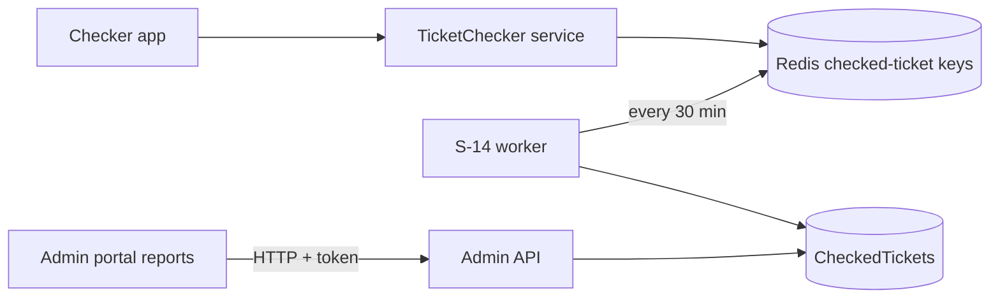

# A-19 · Gate (ticket-checker) reports

> **Bangla name:** গেট (টিকিট-চেকার) রিপোর্ট
>
> [← 10 · Admin portal](README.md) · [Contents](../README.md) · [Open queries](../99-open-queries.md)

## 1. Name and purpose

**Gate reports.** After and during an event the admin sees how many tickets were scanned at each gate, by which checker, how many entries were typed in manually, and which tickets were scanned more than once. The data comes from the `CheckedTickets` table, which is filled from the checker apps by [S-14](../50-system-initiated/S-14-checked-ticket-sync.md).

## 2. Trigger and actor

Staff under program menu **Reports → Ticket Checker** (`/report/checker` **Detailed Checker**, `/report/ticket-duplicate` **Duplicate Entry Count**). The controller `TicketCheckerGateController` is the same as in [A-18](A-18-gate-assignment.md) (admin and ticket-checker schemes, roles `Admin`, `EventManager`, `BCBPersonnel`, `TicketChecker`).

## 3. Business flow

1. **Detailed Checker:** choose an event; see a tree per gate with entry count and manual-entry count, per checker; export all scans.
2. **Duplicate Entry Count:** per gate, total scanned tickets, manual entries and tickets scanned more than once; open a gate for the details; select gates to list the duplicate and manual-entry ticket numbers.

## 4. Technical flow

All calls **[HTTP + user token]** to Admin, reading `etp."CheckedTickets"`:

1. `GET /admin/api/v1/ticket-checker-gate/report/{eventId}` → `GetCheckerGateReport`: groups the event's checked-ticket rows by gate name and checker name and sums `EntryCount` and `ManualEntryCount`; the manager builds a tree gate → checker (`BuildTicketCheckerGateNodeTree`).
2. `GET .../ticket-checker-gate/export/{eventId}` → `GetBulkTicketsAsync`: every checked ticket of the event (`CheckedTicketExportData`) for the portal's export.
3. `POST .../ticket-checker-gate/duplicate-tickets/{eventLongId}` and `.../manual-entry-tickets/{eventLongId}` with a JSON list of gate ids: ticket numbers that are duplicates or manual entries at those gates (a `400` "EventLongId must be greater than 0, and TicketCheckerGateIds are required." when empty).
4. `GET .../ticket-checker-gate/reports/duplicate-entries?eventId` → one row per gate with `ScannedTickets` (rows), `ManualEntry` (rows with `IsManualEntry`) and `DuplicateEntry`; `GET .../reports/duplicate-entries/details?eventId&ticketCheckerGateId` lists the duplicate tickets. These use a hand-written SQL statement against `etp."CheckedTickets"`.

## 5. Components

| Kind | Component |
|---|---|
| Client | `features/reports` components `TicketCheckerReportComponent`, `TicketDuplicationComponent`; `services/report.service.ts:24-36, 92-101` |
| Service | Admin (`TicketCheckerGateController`, `CheckedTicketManager`, `CheckedTicketRepository`, `TicketCheckerGateRepository`) |
| Tables | `CheckedTickets`, `TicketCheckerGates`, `Events` |

## 6. API contracts

| Method | Path | Auth | Request | Response |
|---|---|---|---|---|
| GET | `/admin/api/v1/ticket-checker-gate/report/{eventId}` | class attribute (see §2) | path | `TicketCheckerGateNode[]` |
| GET | `/admin/api/v1/ticket-checker-gate/export/{eventId}` | same | path | `CheckedTicketExportData[]` |
| POST | `/admin/api/v1/ticket-checker-gate/duplicate-tickets/{eventLongId}`, `manual-entry-tickets/{eventLongId}` | same | `["811","812"]` (gate ids as strings) | ticket numbers |
| GET | `/admin/api/v1/ticket-checker-gate/reports/duplicate-entries` | same | `eventId` | `DuplicateScannedReportData[]` |
| GET | `/admin/api/v1/ticket-checker-gate/reports/duplicate-entries/details` | same | `eventId`, `ticketCheckerGateId` | `DuplicateScannedDetailsReportData[]` |

`DuplicateScannedReportData` (from the SQL aliases): `GateId`, `TicketCheckerGateName`, `ScannedTickets`, `ManualEntry`, `DuplicateEntry`.

## 7. Data and side effects

None (read only).

## 8. Code references

| What | Where |
|---|---|
| Controller | `rvl-gobcb-backend/Services/Admin/ETP.Admin.Service/Api/TicketCheckerGateController.cs:37-262` |
| Manager | `rvl-gobcb-backend/Services/Admin/ETP.Admin.Domain/Managers/CheckedTicketManager.cs:40-80`, `TicketCheckerGateManager.cs:245-290` |
| Queries | `rvl-gobcb-backend/Services/Admin/ETP.Admin.Storage/Repositories/CheckedTicketRepository.cs:39-180`, `TicketCheckerGateRepository.cs:138-` |
| Portal | `rvl-gobcb-admin-portal/src/app/features/reports/services/report.service.ts:24-36, 92-101` |

## 9. Handover notes

1. **Reports lag by up to 30 minutes**, since the scans are copied to the table by the worker every 30 minutes ([S-14](../50-system-initiated/S-14-checked-ticket-sync.md)).
2. **"Duplicate" means a ticket number that appears in more than one row of one gate.** Each worker run writes a ticket once per period (with an `EntryCount`), so a ticket scanned twice **within the same period** is one row with `EntryCount` 2 and is **not** counted as a duplicate by the SQL (`count(...) > 1` over rows); a ticket scanned in two periods is. Check this definition with the business before relying on the number `[UNCONFIRMED: Q-28]`.
3. **Any checker token can call these endpoints** ([A-18](A-18-gate-assignment.md) note 4): the full list of scanned ticket numbers is readable by every gate user.
4. **The duplicate report is raw SQL** with a hard-coded table name `etp."CheckedTickets"` and an `Integer` parameter for the event id; a schema rename breaks it silently at run time.
5. The report counts the **gate name** (trimmed), so two physical gates with the same name are merged.
6. `export` returns all rows in one response; for very large events this is heavy (no paging).

## 10. Component relationships

**Depends on:** [S-14](../50-system-initiated/S-14-checked-ticket-sync.md), [C-05](../40-checker-app/C-05-ticket-sync.md), [A-18](A-18-gate-assignment.md). **Affects:** event reporting ([A-22](A-22-reports.md)).

## 11. Developer test guide

**Local testability: Partial** (the checker app cannot sign in locally, so scans must come from Postman or seed data).

| Item | Detail |
|---|---|
| Test data and accounts | Admin `…01`; scans through the TicketChecker sync (Postman, `{{access_token_ticket_operator}}`) then wait for [S-14](../50-system-initiated/S-14-checked-ticket-sync.md) |
| Browser | `http://localhost:4200/report/checker` and `/report/ticket-duplicate` (select a program) |
| Emulator | Checker app sign-in is a known local gap |
| Postman | `postman/services/etp-admin.postman_collection.json`: "GET /api/v1/ticket-checker-gate/report/{eventId}", "GET /api/v1/ticket-checker-gate/reports/duplicate-entries" |
| Visual Studio debug | `CheckedTicketRepository.GetDuplicateScannedTicketReportAsync` |
| Verify | SQL: `select "TicketCheckerGateName","TicketNumber","EntryCount","IsManualEntry" from etp."CheckedTickets" where "EventLongId" = <id>` |
