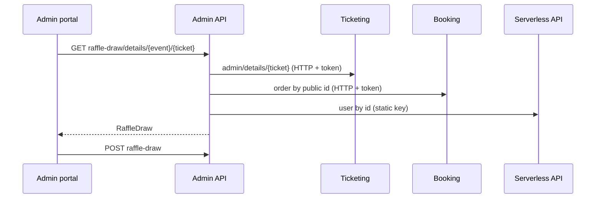

# A-20 · Raffle draw

> **Bangla name:** র‍্যাফেল ড্র
>
> [← 10 · Admin portal](README.md) · [Contents](../README.md) · [Open queries](../99-open-queries.md)

## 1. Name and purpose

**Raffle draw.** At the venue a raffle is drawn from ticket numbers. The admin types the winning ticket number; the platform checks that it is a valid ticket of this event, shows who holds it, and records the winner. It is a **record-keeping** feature: the platform does not draw the number itself.

## 2. Trigger and actor

Staff on the event's **Raffle Draw Winners** tab (`/events/event-details/:id`, component `raffle-draw`). `RaffleDrawController` allows roles `Admin` and `EventManager`.

## 3. Business flow

1. Enter the ticket number drawn.
2. The tab shows the ticket holder (name and phone), ticket type, order number and booking time, or an error.
3. **Add** the winner; the list of winners of the event is shown; a winner can be removed.

## 4. Technical flow

1. **[HTTP + user token]** Lookup: `GET /admin/api/v1/raffle-draw/details/{eventId}/{ticketNumber}` → `RaffleDrawManager.GetTicketDetailsForRaffleDrawAsync`:
   - refuses a ticket that is **already a winner** ("This ticket is already added");
   - **[HTTP + user token]** `ITicketingClient.GetTicketDetailsByTicketNumber` → `GET /ticketing/api/v1/booking-order-ticket/admin/details/{ticketNum}` (admin policy); no result: "This ticket is not system generated."; a ticket of another event: "This ticket ID is not valid for this event. Please enter a valid ticket ID for this event.";
   - for a **User** ticket: reads the order from Booking (**[HTTP + user token]**) and the customer's name and phone from the Serverless API (**[HTTP, static key]**, [X-22](../60-cross-cutting/X-22-sms-notification.md)); for other types (partner, complimentary) it uses the holder name and identification stored on the ticket.
2. Save: `POST .../raffle-draw` with the `RaffleDraw` object returned by the lookup; `CreateAsync` inserts it without further checks.
3. List: `GET .../raffle-draw?eventId=`; remove: `DELETE .../raffle-draw/{id}`.

## 5. Components

| Kind | Component |
|---|---|
| Client | `features/events/components/raffle-draw/*`, `services/raffle-draw-winner.service.ts:31-35` |
| Services | Admin (`RaffleDrawController`, `RaffleDrawManager`); Ticketing and Booking (lookups) |
| External | Serverless API (user name and phone) |
| Tables | `RaffleDraws` |

## 6. API contracts

| Method | Path | Auth | Request | Response | Main errors |
|---|---|---|---|---|---|
| GET | `/admin/api/v1/raffle-draw/details/{eventId}/{ticketNumber}` | roles Admin, EventManager | path | `RaffleDraw` (not saved) | 400 messages above |
| POST | `/admin/api/v1/raffle-draw` | same | `RaffleDraw` | `RaffleDraw` | |
| GET | `/admin/api/v1/raffle-draw` | same | `eventId` | `RaffleDraw[]` | |
| DELETE | `/admin/api/v1/raffle-draw/{id}` | same | path | `RaffleDraw` | |

`RaffleDraw` properties (from the manager): `ticketNumber`, `ticketType`, `ticketHolderName`, `ticketHolderIdentification`, `userId`, `eventLongId`, `eventPublicId`, `bookingOrderId`, `bookingOrderPublicId`, `bookingOrderDateTime`, `orderNumber`. Primary sample (response of the lookup; values illustrative):

```json
{
  "ticketNumber": "T20ABC123", "ticketType": "User",
  "ticketHolderName": "Karim Ahmed", "ticketHolderIdentification": "+8801700000011",
  "userId": "7d3c-example-sub", "eventLongId": 101,
  "orderNumber": "ORD-000123", "bookingOrderDateTime": "2026-12-02T09:30:00Z"
}
```

## 7. Data and side effects

`RaffleDraws` row holding **personal data** (name, phone, user id); activity log ([X-24](../60-cross-cutting/X-24-activity-logging.md)).

## 8. Code references

| What | Where |
|---|---|
| Controller | `rvl-gobcb-backend/Services/Admin/ETP.Admin.Service/Api/RaffleDrawController.cs:26-80` |
| Manager | `rvl-gobcb-backend/Services/Admin/ETP.Admin.Domain/Managers/RaffleDrawManager.cs:26-110` |
| Ticket lookup | `rvl-gobcb-backend/Core/ETP.Core/ServiceClient/TicketingClient/TicketingClient.cs:185-200` |
| Portal | `rvl-gobcb-admin-portal/src/app/features/events/services/raffle-draw-winner.service.ts:31-35` |

## 9. Handover notes

1. **The "already added" check is only in the lookup.** `POST` does not repeat it, so two admins can add the same ticket, or a client can post any `RaffleDraw` content (the server stores what it receives, including holder name and phone).
2. **Delete behaviour** is `DeleteByIdAsync` in the repository; this review did not check whether it is a soft or hard delete `[UNCONFIRMED: Q-29]`.
3. **Personal data is copied into the table** (name and phone), and a failed Serverless call fails the lookup for user tickets.
4. **The draw is manual.** Nothing in the platform selects the winner; the audit trail is the activity log.
5. The lookup treats any ticket type other than `User` as a partner or complimentary ticket and trusts the holder text stored on the ticket (empty for reserved tickets, [A-12](A-12-reserved-tickets.md) note 5).

## 10. Component relationships



**Depends on:** [S-08](../50-system-initiated/S-08-ticket-signing.md) (tickets exist), [A-07](A-07-events.md). **Affects:** nothing downstream.

## 11. Developer test guide

**Local testability: Partial.** The Serverless API is dummy, so the lookup of a **User** ticket fails locally; partner or complimentary tickets work.

| Item | Detail |
|---|---|
| Test data and accounts | Admin `…01`; a ticket number from seeded tickets (`scripts/seed/03-orders-tickets.sql`) |
| Browser | `http://localhost:4200/events` → event → **Raffle Draw Winners** |
| Emulator | — |
| Postman | `postman/services/etp-admin.postman_collection.json`: "GET /api/v1/raffle-draw/details/{eventId}/{ticketNumber}", "POST /api/v1/raffle-draw" |
| Visual Studio debug | `RaffleDrawManager.GetTicketDetailsForRaffleDrawAsync` |
| Verify | SQL: `select "TicketNumber","TicketHolderName","EventLongId" from etp."RaffleDraws"` |
