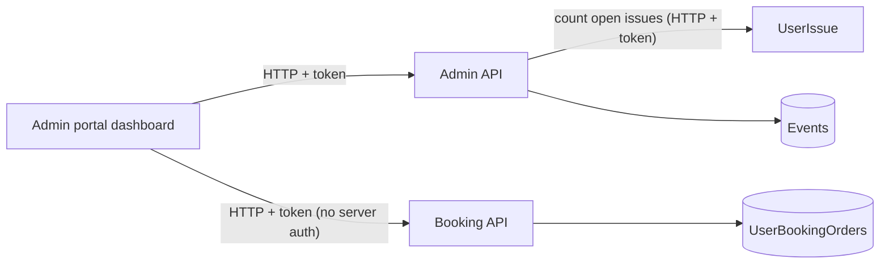

# A-21 · Dashboard

> **Bangla name:** ড্যাশবোর্ড
>
> [← 10 · Admin portal](README.md) · [Contents](../README.md) · [Open queries](../99-open-queries.md)

## 1. Name and purpose

**Dashboard.** The landing page of a program (`/`, route guard `ProgramMenuGuard`): tiles for published events, open issues and ticket sales, a chart of the next seven events, and sales charts for the last week and the last month. It reads from two services: Admin (events and issues) and Booking (sales).

## 2. Trigger and actor

Staff with roles `admin` or `ticket_operator` (`BCBPersonnel`) (the Admin dashboard controller requires them; other roles are sent to other landing pages, [A-01](A-01-program-selection.md)). A program must be selected.

## 3. Business flow

Open the portal with a program selected: the tiles and charts load automatically; nothing is edited.

## 4. Technical flow

All calls **[HTTP + user token]**, each with the header `X-Program-Id` and a `programId` query parameter:

1. Admin `GET /admin/api/v1/dashboard/get-tile-data?programId=` → `DashboardManager.GetTileDataAsync`: `TotalEvents` (published events of the program, `EventRepository.GetPublishedEventCountAsync`) and `UnResolveIssue` (count of `Open` issues from the **UserIssue** service through `IUserIssueClient.GetCountAsync`).
2. Admin `GET .../dashboard/get-event-by-category` → `GetEventsByCategoryAsync` (event counts by category; **no program parameter**).
3. Booking `GET /booking/api/v1/dashboard/get-ticket-sales-summary?programId=` (`TicketSalesSummary`: total tickets and amount; the repository uses the Asia/Dhaka time zone for "today").
4. Booking `GET .../dashboard/get-upcomming-seven-events?programId=`, `.../get-last-week-seats-sale-amount?programId=`, `.../get-last-Month-seats-sale-amount?programId=` (`DashboardChartData[]`).

`[AuthorizeProgram]` on the Admin controller: `admin` passes; a user with role `user` passes; others must send `X-Program-Id` equal to one of their `program_id` claims, else a 400 "Missing or invalid X-Program-Id header." or a 403 text ([X-16](../60-cross-cutting/X-16-authz-program-scope.md)).

## 5. Components

| Kind | Component |
|---|---|
| Client | `features/dashboard/*`, `services/dashboard.service.ts` |
| Services | Admin (`DashboardController`, `DashboardManager`); Booking (`BookingReportController` under route `dashboard`); UserIssue (count) |
| Tables | Admin `Events`; Booking `UserBookingOrders`; UserIssue issues |

## 6. API contracts

| Method | Path | Auth | Request | Response |
|---|---|---|---|---|
| GET | `/admin/api/v1/dashboard/get-tile-data` | roles Admin, BCBPersonnel + `[AuthorizeProgram]` | `programId` | `TileData {totalEvents, unResolveIssue}` |
| GET | `/admin/api/v1/dashboard/get-event-by-category` | same | none | `EventsByCategory` |
| GET | `/booking/api/v1/dashboard/get-ticket-sales-summary` | **none** | `programId` | `TicketSalesSummary` |
| GET | `/booking/api/v1/dashboard/get-upcomming-seven-events`, `get-last-week-seats-sale-amount`, `get-last-Month-seats-sale-amount` | **none** | `programId` | `DashboardChartData[]` |

Primary sample (response of `get-tile-data`; property names from `TileData`, value illustrative):

```json
{ "totalEvents": 7, "unResolveIssue": 3 }
```

## 7. Data and side effects

None (read only).

## 8. Code references

| What | Where |
|---|---|
| Admin controller | `rvl-gobcb-backend/Services/Admin/ETP.Admin.Service/Api/DashboardController.cs:14-48` |
| Admin manager | `rvl-gobcb-backend/Services/Admin/ETP.Admin.Domain/Managers/DashboardManager.cs:22-35` |
| Program filter attribute | `rvl-gobcb-backend/Services/Admin/ETP.Admin.Service/Attributes/AuthorizeProgramAttribute.cs` |
| Booking endpoints | `rvl-gobcb-backend/Services/Booking/ETP.Booking.Service/Api/BookingReportController.cs:13-76` |
| Portal | `rvl-gobcb-admin-portal/src/app/features/dashboard/services/dashboard.service.ts:14-60` |

## 9. Handover notes

1. **Sales figures are anonymous.** The Booking dashboard endpoints have no `[Authorize]` ([X-18](../60-cross-cutting/X-18-endpoints-without-auth.md)); anyone who reaches `/booking/api/v1/dashboard/...` can read sales totals for any `programId` (0 means all).
2. **`[AuthorizeProgram]` compares the header, but the action uses the query parameter.** A non-admin user with a permitted header can pass a different `programId` in the query and read another program's tiles. The attribute's 403 branch also writes the response without setting `context.Result`, so the action still runs afterwards.
3. **`get-event-by-category` ignores the program**, so its counts cover all programs.
4. **A hard-coded development URL** `https://download.admin.dev.ticket-bangla.com/BP23101EAF6C.pdf` is in `dashboard.service.ts` (`downloadPDF`) and in a comment of the top bar; the method has no caller found, but the URL names a dev host.
5. **"Today" in the sales summary uses the Dhaka time zone** (`TimeZoneInfo` id `Asia/Dhaka`, `UserBookingOrderRepository.GetTicketSalesSummaryAsync`), which must exist on the container image.
6. **The open-issue tile counts through the UserIssue service**; if that service is down, the whole tile call fails.
7. The route name `get-upcomming-seven-events` is misspelled (`upcomming`) and the month route uses a capital `M`; keep both spellings when calling.

## 10. Component relationships



**Depends on:** [A-01](A-01-program-selection.md), [A-07](A-07-events.md), [P-06](../20-user-portal/P-06-booking-payment.md) (orders), [A-24](A-24-user-issues-admin.md). **Affects:** nothing.

## 11. Developer test guide

**Local testability: Full** (`pwsh ./scripts/Seed-EtpData.ps1` gives orders to chart).

| Item | Detail |
|---|---|
| Test data and accounts | Admin `…01` (role `admin`) or `ticket_operator` (`BCBPersonnel`) (one of `…02` to `…05`); a program selected |
| Browser | `http://localhost:4200/` → Network: `GET .../admin/api/v1/dashboard/get-tile-data?programId=` and the four Booking calls |
| Emulator | — |
| Postman | `postman/services/etp-admin.postman_collection.json`: "GET /api/v1/dashboard/get-tile-data"; `etp-booking`: "GET /api/v1/dashboard/get-ticket-sales-summary" |
| Visual Studio debug | `DashboardManager.GetTileDataAsync`; `AuthorizeProgramAttribute.OnAuthorizationAsync` |
| Verify | SQL: published events count in `etp."Events"`; open issues in the UserIssue schema |
