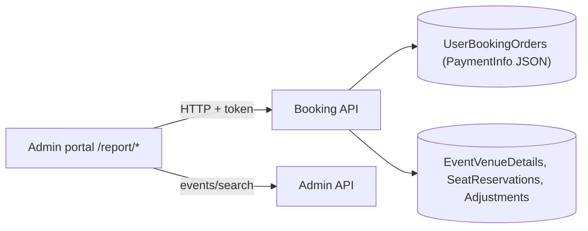

# A-22 · Booking, sales, revenue and payment-discrepancy reports

> **Bangla name:** বুকিং, সেলস, রেভিনিউ ও পেমেন্ট-ডিসক্রিপেন্সি রিপোর্ট
>
> [← 10 · Admin portal](README.md) · [Contents](../README.md) · [Open queries](../99-open-queries.md)

## 1. Name and purpose

**Reports.** The **Reports** menu of a program gives read-only views of orders and money: booking orders (with metrics and export), sales per event, revenue per day and per event, summaries, and a **payment discrepancy** report that compares what the gateway charged with what the order says. The gate reports are in [A-19](A-19-gate-reports.md).

## 2. Trigger and actor

Staff with a program selected (`/report/*`, routes guarded by `AuthGuard`). The menu shows it to the roles of [X-17](../60-cross-cutting/X-17-authz-client-side.md). The Booking `ReportController` (`/booking/api/v1/report/admin/...`) has **no `[Authorize]`**; the order list and detail endpoints require the admin policy.

## 3. Business flow

| Menu item | Route | What it shows |
|---|---|---|
| Booking Orders | `/report/booking-orders` | orders of an event with status filter, order number search, metrics and export |
| Payment Discrepancy | `/report/payment-discrepancy` | orders where the gateway amount differs from the order total |
| Event-Wise Sales | `/report/event-wise-sales` | seats and amounts per level of an event |
| Summary Sales | `/report/summary-sales` | sales summary per event |
| Day-wise Revenue | `/report/day-wise-revenue` | revenue between two dates |
| Event-wise Revenue | `/report/event-wise-revenue` | revenue detail of an event |
| Summary Revenue | `/report/summary-revenue` | revenue summary per event |

## 4. Technical flow

All calls **[HTTP + user token]** from the portal directly to Booking (and Admin for the event picker):

1. Event picker `GET /admin/api/v1/events/search?...` ([A-07](A-07-events.md)).
2. Booking orders: `GET /booking/api/v1/user-booking-order/admin/list/{eventId}?page&status&orderNumber&sortOrder&programId` (admin policy, 20 per page), `GET .../user-booking-order/admin/{bookingId}` (detail), `GET /booking/api/v1/report/admin/booking-metrics?eventId` → `GetBookingMetricstByEventId`: counts of reserved tickets, capacity adjustments, seating capacity, tickets sold, online tickets generated and orders by status (`Pending`, `Failed`, `Paid`, `Requested`, `Generated`); export `GET .../report/admin/export-booking-orders?eventId&programId`.
3. Sales and revenue: `GET .../report/admin/event-sales-summary?programId`, `event-sales-details?id&programId`, `event-revenue-summary?programId`, `event-revenue-sales-details?id&programId`, `revenue-report-list?startDate&endDate&eventId&programId`.
4. Payment discrepancy: `GET .../report/admin/payment-discrepancy?programId&eventId`: a hand-written SQL over `etp."UserBookingOrders"` that reads the amount the gateway reported from the stored `PaymentInfo` JSON (`data.amount` for DgePay, `amount` for SSLCommerz), and returns `OverBilling` (gateway amount above `TotalCharge`) and `UnderBilling` (below), with the gateway name, status text and payment method.
5. Each report endpoint takes `programId` as a **query parameter** chosen by the portal from the selected program ([A-01](A-01-program-selection.md)).

## 5. Components

| Kind | Component |
|---|---|
| Client | `features/reports/*`, `services/booking-orders.service.ts`, `services/report.service.ts:41-92` |
| Services | Booking (`ReportController`, `UserBookingOrderController`, `BookingReportManager`, repositories); Admin (events search) |
| Tables | `UserBookingOrders`, `EventVenueDetails`, `SeatReservations`, `EventCapacityAdjustments` |

## 6. API contracts

| Method | Path | Auth | Request | Response |
|---|---|---|---|---|
| GET | `/booking/api/v1/user-booking-order/admin/list/{eventId}` | admin policy | page, `status`, `orderNumber`, `sortOrder`, `programId` | paged orders |
| GET | `/booking/api/v1/user-booking-order/admin/{id}` | admin policy | path | order detail |
| GET | `/booking/api/v1/report/admin/booking-metrics` | **none** | `eventId` | `BookingMetrics` |
| GET | `/booking/api/v1/report/admin/export-booking-orders` | **none** | `eventId`, `programId` | `ExportOrderDetails[]` |
| GET | `/booking/api/v1/report/admin/event-sales-summary`, `event-revenue-summary` | **none** | `programId` | summaries |
| GET | `/booking/api/v1/report/admin/event-sales-details`, `event-revenue-sales-details` | **none** | `id`, `programId` | detail rows |
| GET | `/booking/api/v1/report/admin/revenue-report-list` | **none** | `startDate`, `endDate`, `eventId`, `programId` | rows |
| GET | `/booking/api/v1/report/admin/payment-discrepancy` | **none** | `programId`, `eventId` | `PaymentDiscrepancyData[]` |

`PaymentDiscrepancyData` fields (SQL aliases): `EventName`, `EventStartDateTime`, `UserId`, `OrderNumber`, `NumberOfSeats`, `OrderTime`, `ETPTxnId`, `Status`, `ETPChargeAmount`, `PaymentGateway`, `GatewayChargedAmount`, `OverBilling`, `UnderBilling`, `PaymentMethod`.

## 7. Data and side effects

Read only.

## 8. Code references

| What | Where |
|---|---|
| Report controller | `rvl-gobcb-backend/Services/Booking/ETP.Booking.Service/Api/ReportController.cs:14-160` |
| Orders list and detail | `rvl-gobcb-backend/Services/Booking/ETP.Booking.Service/Api/UserBookingOrderController.cs:325, 378` |
| Manager | `rvl-gobcb-backend/Services/Booking/ETP.Booking.Domain/Managers/BookingReportManager.cs:22-105` |
| Discrepancy SQL | `rvl-gobcb-backend/Services/Booking/ETP.Booking.Storage/Repositories/UserBookingOrderRepository.cs:1446-1560` |
| Portal | `rvl-gobcb-admin-portal/src/app/features/reports/services/booking-orders.service.ts:25-57`, `report.service.ts:41-92` |

## 9. Handover notes

1. **Financial data is readable without a token.** All eight `report/admin/*` endpoints are anonymous ([X-18](../60-cross-cutting/X-18-endpoints-without-auth.md)): customer user ids, order numbers, amounts and payment details are returned to any caller who can reach the Booking path.
2. **The program scope is a parameter.** `programId` is chosen by the client; a request with `programId=0` or another program returns everything (no server-side check, [X-16](../60-cross-cutting/X-16-authz-program-scope.md)).
3. **The discrepancy report depends on the shape of the stored gateway JSON**; the keys (`data.amount`, `data.payment_method`, `card_type`) are hard-coded for two gateways. An order marked Paid by the anonymous bypass endpoint stores a fixed payment-info text with amount `1.0` and gateway DgePay ([S-01](../50-system-initiated/S-01-level-capacity-update.md), `UserBookingOrderManager.cs:495-545`), so this report would list it as under-billed; that is where misuse of the endpoint would be visible.
4. **The comparison rule changed.** An earlier version of the SQL (commented out in the repository) excluded orders where the gateway amount equalled `TotalCharge × 1.03`; the active query reports every non-zero difference between the gateway amount and `TotalCharge`.
5. **Capacity in the sales charts is the venue seating capacity**, not the online capacity after allocations and reservations ([A-10](A-10-capacity-adjustment.md), [A-11](A-11-seat-reservation.md)); sold plus available therefore does not equal what customers can buy.
6. **Dates in revenue reports are strings** (`startDate`, `endDate` in `GetUserBookingOrdersByEvent`); the time zone used for day boundaries should be checked before month-end reconciliation `[UNCONFIRMED: Q-30]`.
7. **Export loads all rows** into memory and into one response.

## 10. Component relationships

**Depends on:** [P-06](../20-user-portal/P-06-booking-payment.md) (orders), [S-05](../50-system-initiated/S-05-pending-failed-revalidation.md) (status), [A-09](A-09-event-level-pricing.md). **Affects:** reconciliation ([A-23](A-23-reconciliation.md)), VAT checks ([S-10](../50-system-initiated/S-10-vat-challan.md)).

## 11. Developer test guide

**Local testability: Full** with seeded orders (`scripts/seed/03-orders-tickets.sql`).

| Item | Detail |
|---|---|
| Test data and accounts | `pwsh ./scripts/Seed-EtpData.ps1`; admin `…01`; select a program |
| Browser | `http://localhost:4200/report/booking-orders` and the other routes in §3; Network: `GET .../booking/api/v1/report/admin/...` |
| Emulator | — |
| Postman | `postman/services/etp-booking.postman_collection.json`: "GET /api/v1/report/admin/booking-metrics", "GET /api/v1/report/admin/payment-discrepancy", "GET /api/v1/user-booking-order/admin/list/{eventId}" (admin token) |
| Visual Studio debug | `BookingReportManager.GetBookingMetricstByEventId`, `UserBookingOrderRepository.GetPaymentDiscrepancyDataAsync` |
| Verify | SQL: `select "OrderNumber","TotalCharge","Status" from etp."UserBookingOrders" where "EventLongId" = <id>` |
