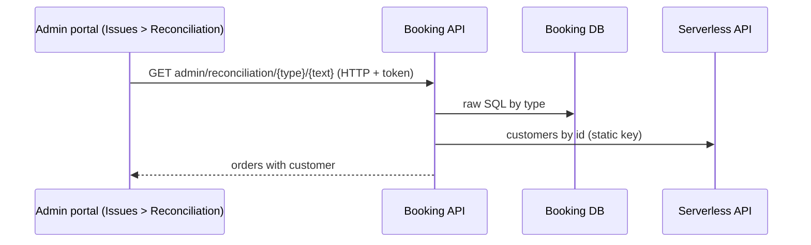

# A-23 · Reconciliation lookup

> **Bangla name:** রিকনসিলিয়েশন লুকআপ
>
> [← 10 · Admin portal](README.md) · [Contents](../README.md) · [Open queries](../99-open-queries.md)

## 1. Name and purpose

**Reconciliation.** Support staff resolve customer complaints ("I paid but have no ticket") by finding the order from whatever the customer can give: the order number, the payment transaction id, a ticket number or the phone number. The result shows the order with its status, payment information and the customer. It sits next to the issue list under **Issues → Reconciliation**.

## 2. Trigger and actor

Staff with the admin policy (`admin`, `customer_support` and others who see the **Issues** menu, [X-17](../60-cross-cutting/X-17-authz-client-side.md)); a program must be selected (`/issues/reconciliation`). The Booking endpoint requires `[Authorize(Policy = Admin)]`.

## 3. Business flow

Choose the search type (**Order number**, **Transaction id**, **Ticket number**, **Phone number**), type the value, press search, and read the matching orders (several are possible for a phone number). The support person then compares with the gateway and, if needed, raises the case with the technical team.

## 4. Technical flow

1. **[HTTP + user token]** `GET /booking/api/v1/user-booking-order/admin/reconciliation/{searchType}/{searchText}?programId=` (portal `getReconciliationDetails`, called from the portal directly to Booking).
2. `UserBookingOrderManager.GetAllBySearchType`: for `PhoneNo` it first looks up the customer by phone (`"+88" + searchText`, a fixed Bangladesh prefix) through `IPortalUserManager` and replaces the search text with the user id ("User not found with this phone number." otherwise).
3. `UserBookingOrderRepository.FindListBySearchType` runs a **parameterised** raw SQL over `etp."UserBookingOrders"` joined to events and program settings: `OrderNumber = @data`, `PaymentTransactionId = @data`, the order of a ticket number (`Tickets.BookingOrderId`), or `CreatedBy = @data` (the user id found from the phone); filtered by `ProgramId` when `programId > 0`.
4. The customers' names and phones are filled in with one bulk call to the **Serverless API** (**[HTTP, static key]** `GetAllUserByIdAsync`, [X-22](../60-cross-cutting/X-22-sms-notification.md)); if it returns null the rows have no user data.

## 5. Components

| Kind | Component |
|---|---|
| Client | `features/issues/pages/reconciliation`, `services/reconciliation.service.ts:30-42` |
| Services | Booking (`UserBookingOrderController`, `UserBookingOrderManager`, `PortalUserManager`); Serverless API (external) |
| Tables | `UserBookingOrders` |

## 6. API contracts

| Method | Path | Auth | Request | Response | Main errors |
|---|---|---|---|---|---|
| GET | `/booking/api/v1/user-booking-order/admin/reconciliation/{searchType}/{searchText}` | `admin` policy | `searchType` `OrderNumber`, `TransactionId`, `TicketNumber`, `PhoneNo`; `programId` | `UserBooking[]` with `user` | 400 `User not found with this phone number.` |

`searchType` is an enum bound from the path, so the name or its number (`0`..`3`) is accepted. The response carries the order fields (order number, status, amounts, `paymentInfo` JSON, program, event, level, seats) and the customer record; property names are those of `UserBooking`.

Primary sample: `GET /booking/api/v1/user-booking-order/admin/reconciliation/PhoneNo/01700000011?programId=12` (phone illustrative; the leading `+88` is added by the server).

## 7. Data and side effects

Read only; the `paymentInfo` of an order may contain the gateway's raw response.

## 8. Code references

| What | Where |
|---|---|
| Endpoint | `rvl-gobcb-backend/Services/Booking/ETP.Booking.Service/Api/UserBookingOrderController.cs:338-344` |
| Manager | `rvl-gobcb-backend/Services/Booking/ETP.Booking.Domain/Managers/UserBookingOrderManager.cs:811-835` |
| Query | `rvl-gobcb-backend/Services/Booking/ETP.Booking.Storage/Repositories/UserBookingOrderRepository.cs:1268-` |
| Enum | `rvl-gobcb-backend/Services/Booking/ETP.Booking.Domain/Models/Enum.cs:49-55` |
| Portal | `rvl-gobcb-admin-portal/src/app/features/issues/services/reconciliation.service.ts:30-42` |

## 9. Handover notes

1. **The search text is part of the URL path**, so phone numbers and transaction ids appear in access logs; it is also bound as a path segment, so characters such as `/` break the lookup.
2. **The phone prefix `+88` is hard-coded**; a number typed with `+88` or `88` in front fails to match.
3. **`programId` is optional and client-supplied**: with `0` (or omitted) the search spans every program, so a support person sees orders of programs they are not assigned to ([X-16](../60-cross-cutting/X-16-authz-program-scope.md)).
4. **The ticket-number search can return a wrong order for reserved tickets.** The SQL finds `UBO."Id" = (select T."BookingOrderId" from "Tickets" T where T."TicketNumber" = @data)`, but reserved tickets store a **reservation id** in `BookingOrderId` ([A-12](A-12-reserved-tickets.md)); the match is then an unrelated customer order with the same numeric id `[UNCONFIRMED: Q-31]`.
5. **If the Serverless API is down**, the lookup by order number still returns the orders but without customer details.
6. The reconciliation helps with **cancelled but paid** cases that [S-05](../50-system-initiated/S-05-pending-failed-revalidation.md) can create (note 1 there): look at `status` and `paymentInfo` together.

## 10. Component relationships

**Depends on:** [P-06](../20-user-portal/P-06-booking-payment.md), [A-22](A-22-reports.md). **Affects:** support decisions; no data change.

## 11. Developer test guide

**Local testability: Partial.** The Serverless API is dummy, so customer details are empty locally; the order search itself works (`PhoneNo` search needs the portal-user lookup, which uses Cognito/Floci).

| Item | Detail |
|---|---|
| Test data and accounts | Admin `…01`; seeded orders (`scripts/seed/03-orders-tickets.sql`) for user `…11` |
| Browser | `http://localhost:4200/issues/reconciliation` (program selected) |
| Emulator | — |
| Postman | `postman/services/etp-booking.postman_collection.json`: "GET /api/v1/user-booking-order/admin/reconciliation/{searchType}/{searchText}" with `{{access_token_admin}}` |
| Visual Studio debug | `UserBookingOrderManager.GetAllBySearchType` |
| Verify | SQL: `select "OrderNumber","PaymentTransactionId","Status" from etp."UserBookingOrders"` |
