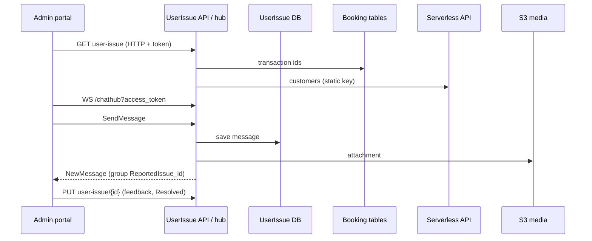

# A-24 · User issues and support chat (admin side)

> **Bangla name:** ইউজার ইস্যু ও সাপোর্ট চ্যাট (অ্যাডমিন দিক)
>
> [← 10 · Admin portal](README.md) · [Contents](../README.md) · [Open queries](../99-open-queries.md)

## 1. Name and purpose

**Support issues and chat.** A customer reports a problem with an order (the customer side is [P-12](../20-user-portal/P-12-issues-chat.md) and [U-08](../30-user-app/U-08-issues-chat.md)). The support team lists the issues, opens one, answers in a real-time chat, adds feedback and marks it **Resolved**. The feature runs in the **UserIssue** service (port 5110 locally), with a SignalR hub for the chat. Concepts: [path-prefix routing](../00-platform-primer.md#explainer-path-prefix-routing), [token forwarding](../00-platform-primer.md#explainer-token-forwarding).

## 2. Trigger and actor

Staff with role `customer_support` or `admin` (`Issues` menu with a program selected, `/issues/list`, `/issues/:id/details`; the **server** admin policy admits any admin-pool user). The hub accepts the **user** and **admin** schemes.

## 3. Business flow

1. **Issue list:** filter by status (`Open`, `Resolved`), search by issue number, order number or transaction id, sort; the list shows the customer name and phone.
2. **Issue details:** the order summary, the customer, the chat thread with unread counts, and attachments.
3. **Chat:** type a message or attach a file; the customer sees it at once if connected; typing indicators and join/leave events appear.
4. **Resolve:** write feedback and set the status to `Resolved`.

## 4. Technical flow

1. **[HTTP + user token]** List `GET /userissue/api/v1/user-issue?search=&searchType=&sortBy=&sortOrder=&pageOffset=&pageSize=10&status=&programId=` (admin policy): `ReportIssueManager.GetAllAsync` (a `searchType=txnid` search first finds order ids by payment transaction id in the shared orders table), then reads the customers from the **Serverless API** (**[HTTP, static key]**) and the transaction ids of the orders. Detail `GET .../user-issue/{id}`; count `GET .../user-issue/count?status&programId` (used by the dashboard, [A-21](A-21-dashboard.md)); delete `DELETE .../{id}`.
2. Update `PUT .../user-issue/{id}` with `{feedback, status}` → `UpdateFeedbackAsync` sets the feedback and status. **No notification is sent to the customer** (see §9).
3. **Chat, REST:** `GET .../user-issue-chat/{id}/messages` (paged), `.../unread`, `.../unread-count?receiverType`, `POST .../{id}/mark-read`, `.../last`, `.../recent?count`, `POST .../user-issue-chat/send` (multipart with file), `GET .../message/{messageId}/attachment/download`.
4. **Chat, SignalR** `/userissue/chathub?access_token=<admin token>` **[SignalR]**: client methods `SendMessage(CreateChatMessage)` (saves through `ReportIssueChatManager.SendMessageAsync` and broadcasts `NewMessage` to the group `ReportedIssue_{id}`), `JoinUserIssueChat(id)`, `LeaveUserIssueChat(id)`, `SendTypingIndicator(id)`, `StopTyping(id)`; events received by the portal: `NewMessage`, `ReceiveMessage`, `MessageError`, `UserJoined`, `UserLeft`, `UserTyping`, `UserStoppedTyping`. On connect, a user joins the group `User_{nameIdentifier}` and, if the role claim contains "Admin", `AdminGroup`.
5. `SendMessageAsync` requires text or a file, stores the message (`SenderType`, `SenderId`, `SenderName` **as sent by the caller**), uploads an attachment through `HandleFileUploadAsync` to S3 `chat-attachments/{issueId}/...` ([X-20](../60-cross-cutting/X-20-file-storage.md)), then `IChatNotificationService.NotifyNewMessageAsync`.

## 5. Components

| Kind | Component |
|---|---|
| Client | `features/issues/pages/{issue-list,issue-details,reconciliation}`, `services/{issue,chat}.service.ts` (SignalR client) |
| Services | UserIssue (`ReportIssueController`, `ReportIssueChatController`, `UserIssueChatHub`, managers); Booking (order lookups through `IBookingClient`/read model); Serverless API |
| Tables | UserIssue `ReportedIssues`, `ReportedIssueChatMessages` |
| Storage | S3 media `chat-attachments/{issueId}` |
| Real time | SignalR hub `/userissue/chathub` |

## 6. API contracts

| Method | Path | Auth | Request | Response |
|---|---|---|---|---|
| GET | `/userissue/api/v1/user-issue` | admin policy | filters above | paged `ReportedUserIssue` with `user` and `transactionId` |
| GET | `/userissue/api/v1/user-issue/{id}` | admin policy | path | `ReportedUserIssueDetails` |
| PUT | `/userissue/api/v1/user-issue/{id}` | admin policy | `UpdateUserIssue {feedback, status}` | `ReportedUserIssue` |
| DELETE | `/userissue/api/v1/user-issue/{id}` | admin policy | path | result |
| GET | `/userissue/api/v1/user-issue/count` | admin policy | `status`, `programId` | `int` |
| GET/POST | `/userissue/api/v1/user-issue-chat/...` (8 routes) | **none** | see §4 | messages |
| WS | `/userissue/chathub` | user or admin scheme | hub methods | events |

Statuses: `Open`, `Resolved`. Primary sample, `PUT /userissue/api/v1/user-issue/45`:

```json
{ "feedback": "Refunded by the payment gateway on 12 Dec.", "status": "Resolved" }
```

## 7. Data and side effects

Issue and chat rows, S3 attachments, SignalR broadcasts; the activity log covers the UserIssue database ([X-24](../60-cross-cutting/X-24-activity-logging.md)).

## 8. Code references

| What | Where |
|---|---|
| Issue controller | `rvl-gobcb-backend/Services/UserIssue/ETP.UserIssue.Service/Api/ReportIssueController.cs:14-170` |
| Chat controller | `.../Api/ReportIssueChatController.cs:12-160` |
| Hub | `rvl-gobcb-backend/Services/UserIssue/ETP.UserIssue.Service/Hubs/UserIssueChatHub.cs` |
| Managers | `rvl-gobcb-backend/Services/UserIssue/ETP.UserIssue.Domain/Managers/ReportIssueManager.cs:54-312`, `ReportIssueChatManager.cs:37-140` |
| Portal | `rvl-gobcb-admin-portal/src/app/features/issues/services/chat.service.ts:60-240`, `issue.service.ts:50-74` |

## 9. Handover notes

1. **The chat REST endpoints have no authorization** (`ReportIssueChatController`); any caller can read the messages or download attachments of any issue id, and post as any sender ([X-18](../60-cross-cutting/X-18-endpoints-without-auth.md)).
2. **The hub has no ownership check.** Any authenticated customer or admin can call `JoinUserIssueChat` with any issue id and then receive every message of that issue; `SendMessage` trusts `SenderType`, `SenderId` and `SenderName` from the payload.
3. **Resolving an issue sends nothing to the customer.** The `issue_resolved` notification exists only in the **legacy copy** in the Admin service (`UserIssueManager.UpdateFeedbackAsync`), which the portal no longer calls ([X-22](../60-cross-cutting/X-22-sms-notification.md) note 2, [Appendix A](../90-appendix-a-legacy.md)). `UpdateFeedbackAsync` in the live service only saves.
4. **One issue per order.** Creating a second issue for an order is refused ("You cannot create multiple issues per order") and the description is limited to 600 characters; the first message of the thread is that description.
5. **The hub needs the token in the query string** (`?access_token=`), which is logged by proxies; the admin portal uses it ([X-04](../60-cross-cutting/X-04-admin-session.md)).
6. **Admin service has a second, older copy** of issues, chat and `/admin/chathub`; the portal's `issue.service.ts` and `chat.service.ts` call the `/userissue/...` paths ([Appendix A](../90-appendix-a-legacy.md)).
7. The issue list reads customer data and transaction ids for the whole page on each request (one Serverless call and one orders query per page).

## 10. Component relationships



**Depends on:** customer issue creation ([P-12](../20-user-portal/P-12-issues-chat.md), [U-08](../30-user-app/U-08-issues-chat.md)), [P-06](../20-user-portal/P-06-booking-payment.md) (orders). **Affects:** the dashboard tile ([A-21](A-21-dashboard.md)), [A-23](A-23-reconciliation.md).

## 11. Developer test guide

**Local testability: Partial.** The service, hub and REST API run (UserIssue on port 5110); customer data and notifications come from the dummy Serverless API.

| Item | Detail |
|---|---|
| Test data and accounts | Admin `…01` (or `customer_support`); a customer issue created by the user portal (`…11`, [P-12](../20-user-portal/P-12-issues-chat.md)) |
| Browser | `http://localhost:4200/issues/list` → open an issue; DevTools → Network → WS → `.../userissue/chathub?access_token=...` frames |
| Emulator | — |
| Postman | `postman/services/etp-userissue.postman_collection.json`: "GET /api/v1/user-issue", "PUT /api/v1/user-issue/{id}" with `{{access_token_admin}}` (the collection's `base_url` has no `/userissue` prefix, see Appendix D) |
| Visual Studio debug | `ReportIssueManager.UpdateFeedbackAsync`, `UserIssueChatHub.SendMessage` |
| Verify | SQL on the UserIssue tables; `aws --endpoint-url http://localhost:4566 s3 ls s3://etp-local/chat-attachments/ --recursive` |
