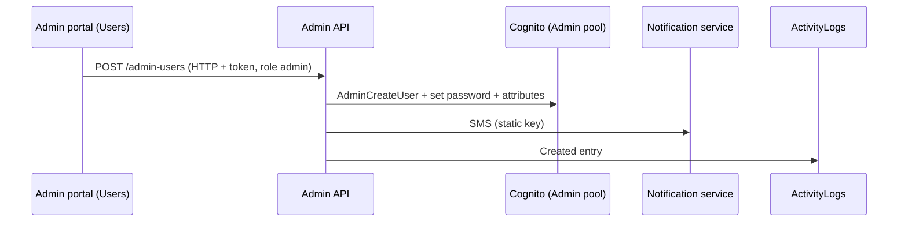

# A-25 · Admin users

> **Bangla name:** অ্যাডমিন ইউজার
>
> [← 10 · Admin portal](README.md) · [Contents](../README.md) · [Open queries](../99-open-queries.md)

## 1. Name and purpose

**Admin users.** The staff accounts of the admin portal ("Regular Admins"): create, edit name, **role** and **programs**, disable, enable, reset password and delete. A staff account is a user of the **Admin Cognito pool**; its role and programs are stored as the attributes `custom:role` and `custom:program_ids`, which drive the menu and the server checks ([X-15](../60-cross-cutting/X-15-authz-roles.md), [X-16](../60-cross-cutting/X-16-authz-program-scope.md), [X-17](../60-cross-cutting/X-17-authz-client-side.md)). The Cognito mechanics and the SMS with the password are in [X-05](../60-cross-cutting/X-05-admin-provisioning.md).

## 2. Trigger and actor

Staff with role `admin` only (`AdminUsersController` has `[Authorize(Roles = Admin)]`; the two password-reset endpoints are anonymous, [X-02](../60-cross-cutting/X-02-admin-forgot-password.md)). Entry: global menu **Users → Regular Admins** (`/users`, program 0).

## 3. Business flow

List the admins (name, phone, e-mail, role, programs, status); **Create** with name, phone, e-mail, role and programs; **Edit** name, role, programs; **Disable** or **Enable**; **Set password** (a new password is generated and sent by SMS); **Delete**. An admin cannot disable or delete their own account.

## 4. Technical flow

1. **[HTTP + user token]** `GET /admin/api/v1/admin-users` (list), `GET .../admin-users/{id}`.
2. Create `POST .../admin-users` `{name, phone, email, role, programIds}` → `AdminUserManager.CreateUserAsync` → `AdminUserProvider.CreateUserAsync` (Cognito `AdminCreateUser` with phone as user name, `custom:role`, `custom:program_ids`; generated password; SMS through the notification service, [X-22](../60-cross-cutting/X-22-sms-notification.md)); then `IActivityLogger.LogActivityAsync("AdminUser", id, "Created", null, {name, email, phone, role, programIds})` ([X-24](../60-cross-cutting/X-24-activity-logging.md)).
3. Update `PUT .../admin-users/{id}` `{userId, name, role, programIds}` (the body's `userId` is used); logged with old and new values.
4. `DELETE .../admin-users/{id}` and `POST .../disable/{id}` refuse the caller's own id ("Invalid permission"); `POST .../enable/{id}`; `POST .../set-password?userId=`.
5. Effect on the target user: role and program changes take effect when `CognitoUserAttributesMiddleware` reloads the attributes (the cache `User`/`user_{sub}` lives about 2 minutes, [X-15](../60-cross-cutting/X-15-authz-roles.md)); the portal detects a role change and signs the user out of the program context ([X-17](../60-cross-cutting/X-17-authz-client-side.md)).

## 5. Components

| Kind | Component |
|---|---|
| Client | `features/users/*` (`UserListComponent`), `services/user.service.ts:19-47` |
| Service | Admin (`AdminUsersController`, `AdminUserManager`, `AdminUserProvider`, `ActivityLogger`) |
| AWS | Cognito Admin pool; static AWS keys |
| External | Notification service (SMS) |
| Tables | `ActivityLogs` only (the account is in Cognito) |

## 6. API contracts

| Method | Path | Auth | Request | Response |
|---|---|---|---|---|
| GET | `/admin/api/v1/admin-users`, `/{id}` | role `Admin` | | `AdminUserResponse[]` / one |
| POST | `/admin/api/v1/admin-users` | `Admin` | `AdminCreateUser` | `AdminUserResponse` |
| PUT | `/admin/api/v1/admin-users/{id}` | `Admin` | `AdminUpdateUser` | `AdminUserResponse` |
| DELETE | `/admin/api/v1/admin-users/{id}` | `Admin` | path | `bool` |
| POST | `/admin/api/v1/admin-users/disable/{id}`, `enable/{id}`, `set-password?userId=` | `Admin` | path / query | `bool` |
| GET, POST | `/admin/api/v1/admin-users/forget-password`, `set-forget-password` | **anonymous** | see [X-02](../60-cross-cutting/X-02-admin-forgot-password.md) | |

`role` values: `admin`, `event_manager`, `ticket_manager`, `ticket_operator`, `customer_support` (several can be given, comma separated, [X-15](../60-cross-cutting/X-15-authz-roles.md)); `programIds`: comma-separated program ids, empty for none.

Primary sample, `POST /admin/api/v1/admin-users` (names from `AdminCreateUser`; values illustrative):

```json
{ "name": "Nadia Rahman", "phone": "+8801700000055", "email": "nadia@example.com",
  "role": "event_manager,ticket_manager", "programIds": "12,13" }
```

Response `AdminUserResponse`: `userId`, `name`, `email`, `phone`, `role`, `programIds`, `currentStatus`, `isActive`, `isPhoneNumberVerified` (see the typo note in [X-05](../60-cross-cutting/X-05-admin-provisioning.md)).

## 7. Data and side effects

A Cognito user; an SMS; activity log rows named `AdminUser` with old and new values (no password).

## 8. Code references

| What | Where |
|---|---|
| Controller | `rvl-gobcb-backend/Services/Admin/ETP.Admin.Service/Api/AdminUsersController.cs:28-200` |
| Manager | `rvl-gobcb-backend/Services/Admin/ETP.Admin.Domain/Managers/AdminUserManager.cs:26-200` |
| Provider | `rvl-gobcb-backend/Services/Admin/ETP.Admin.Integration/Services/AdminUserProvider.cs:29-580` |
| Portal | `rvl-gobcb-admin-portal/src/app/features/users/services/user.service.ts:19-47` |

## 9. Handover notes

1. **Role names are free text.** `role` is a string the server writes to `custom:role` without checking it against the known roles; a typo creates an account with no access, and any string is accepted ([X-15](../60-cross-cutting/X-15-authz-roles.md)).
2. **Program restriction is not enforced for most data** ([X-16](../60-cross-cutting/X-16-authz-program-scope.md)); assigning `programIds` limits the portal's program dropdown and the dashboard, not the API.
3. **Passwords are generated with `System.Random` and sent by SMS in clear text** ([X-05](../60-cross-cutting/X-05-admin-provisioning.md)).
4. **If the SMS fails the account exists but nobody knows the password** ([X-22](../60-cross-cutting/X-22-sms-notification.md) note 4).
5. **Role changes are not immediate**: up to the cache lifetime (about 2 minutes) the old roles remain in force on the server; a disabled account's **existing token stays valid until it expires**, because the server only validates the token and does not check Cognito status per request ([X-14](../60-cross-cutting/X-14-authz-pool-policies.md)) `[UNCONFIRMED: Q-32]`.
6. **Only admin changes are logged by name here**; changes to ticket checkers and agents are not ([A-17](A-17-ticket-checker-users.md), [A-26](A-26-agent-users.md)).
7. `PUT .../{id}` trusts the body's `userId` and ignores the path id.

## 10. Component relationships



**Depends on:** [X-01](../60-cross-cutting/X-01-admin-login.md), [X-05](../60-cross-cutting/X-05-admin-provisioning.md). **Affects:** every admin feature's access ([X-15](../60-cross-cutting/X-15-authz-roles.md)), [A-01](A-01-program-selection.md), [A-27](A-27-activity-log.md).

## 11. Developer test guide

**Local testability: Partial.** Cognito is Floci; the SMS fails (dummy endpoint), so **creation errors after the user exists** ([X-22](../60-cross-cutting/X-22-sms-notification.md)).

| Item | Detail |
|---|---|
| Test data and accounts | Admin `…01` (role `admin`) |
| Browser | `http://localhost:4200/users` (program 0, [A-01](A-01-program-selection.md)) |
| Emulator | — |
| Postman | `postman/services/etp-admin.postman_collection.json`: "GET /api/v1/admin-users", "POST /api/v1/admin-users/disable/{id}" with `{{access_token_admin}}` |
| Visual Studio debug | `AdminUserManager.CreateUserAsync`, `AdminUserProvider.CreateUserAsync` |
| Verify | `aws --endpoint-url http://localhost:4566 cognito-idp admin-get-user --user-pool-id <Admin pool> --username <phone>` shows `custom:role`; SQL: `select "EntityName","Action","Timestamp" from etp."ActivityLogs" where "EntityName" = 'AdminUser'` |
