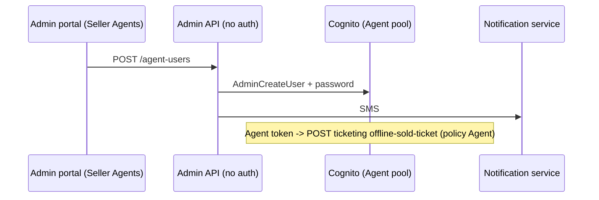

# A-26 · Agent (seller) users

> **Bangla name:** এজেন্ট (সেলার) ইউজার
>
> [← 10 · Admin portal](README.md) · [Contents](../README.md) · [Open queries](../99-open-queries.md)

## 1. Name and purpose

**Agent users.** Agents are offline sellers (companies and branches) who sell tickets outside the website. Their accounts live in the **Agent Cognito pool**. Admins create and manage them here ("Seller Agents"). The pool and the only agent API are described in [X-13](../60-cross-cutting/X-13-agent-pool.md): `POST /ticketing/api/v1/offline-sold-ticket` (policy `Agent`). The client that would use this account is **not in the repositories** (`[UNCONFIRMED: Q-07]`).

## 2. Trigger and actor

Staff in the global menu (**Users → Seller Agents**, `/agent-user`, program 0). The **server** controller `AgentController` has **no `[Authorize]`** at all ([X-18](../60-cross-cutting/X-18-endpoints-without-auth.md)).

## 3. Business flow

List agents (name, phone, e-mail, company, branch, branch location, status); create an agent with name, phone, optional e-mail, company name, company branch and branch location (all required but e-mail); enable, disable, set a new password; the list screen offers no edit and no delete in the portal service.

## 4. Technical flow

1. **[HTTP + user token]** `GET /admin/api/v1/agent-users`, `POST .../agent-users`, `POST .../agent-users/enable/{userId}`, `.../disable/{userId}`, `POST .../agent-users/set-password?userId=` (portal `agent-user.service.ts`). The backend also exposes `GET .../{id}`, `PUT .../{id}` (name only) and `DELETE .../{id}`.
2. `AgentUserManager.CreateUserAsync` validates: request present; `Name`, `Phone`, `CompanyBranch`, `BranchLocation`, `CompanyName` not empty ("Name should not be empty", "Phone should not be empty", "Agent branch should not be empty", "Branch location should not be empty", "Agent name should not be empty"); then `AgentUserProvider.CreateUserAsync`: `AdminCreateUser` in the Agent pool (phone as user name, company attributes), a generated password and the SMS ([X-05](../60-cross-cutting/X-05-admin-provisioning.md), [X-22](../60-cross-cutting/X-22-sms-notification.md)).
3. Disable, enable, set password, delete call the provider (Cognito `AdminDisableUser`, `AdminEnableUser`, `AdminSetUserPassword`, `AdminDeleteUser`).

## 5. Components

| Kind | Component |
|---|---|
| Client | `features/agent-user/*`, `services/agent-user.service.ts:19-35` |
| Service | Admin (`AgentController`, `AgentUserManager`, `AgentUserProvider`) |
| AWS | Cognito Agent pool; static AWS keys |
| External | Notification service (SMS) |

## 6. API contracts

| Method | Path | Auth | Request | Response | Main errors |
|---|---|---|---|---|---|
| GET | `/admin/api/v1/agent-users`, `/{id}` | **none** | | `AgentUserResponse` | |
| POST | `/admin/api/v1/agent-users` | **none** | `AgentCreateUser` | `AgentUserResponse` | 400 messages above |
| PUT | `/admin/api/v1/agent-users/{id}` | **none** | `AgentUpdateUser {userId, name}` | `AgentUserResponse` | |
| DELETE | `/admin/api/v1/agent-users/{id}` | **none** | path | `bool` | |
| POST | `/admin/api/v1/agent-users/disable/{id}`, `enable/{id}`, `set-password?userId=` | **none** | path / query | `bool` | |

Primary sample, `POST /admin/api/v1/agent-users` (names from `AgentCreateUser`; values illustrative):

```json
{ "name": "Sabbir Hossain", "phone": "+8801700000066", "email": null,
  "companyName": "Ticket Express", "companyBranch": "Dhanmondi", "branchLocation": "Road 8, Dhanmondi, Dhaka" }
```

Response `AgentUserResponse`: `userId`, `name`, `email`, `phone`, `companyName`, `companyBranch`, `branchLocation`, `currentStatus`, `isActive`.

## 7. Data and side effects

A Cognito user in the Agent pool and an SMS; no database row, no activity-log entry.

## 8. Code references

| What | Where |
|---|---|
| Controller | `rvl-gobcb-backend/Services/Admin/ETP.Admin.Service/Api/AgentUserController.cs:23-146 (class `AgentController`)` |
| Manager | `rvl-gobcb-backend/Services/Admin/ETP.Admin.Domain/Managers/AgentUserManager.cs` |
| Provider | `rvl-gobcb-backend/Services/Admin/ETP.Admin.Integration/Services/AgentUserProvider.cs:20-200` |
| Portal | `rvl-gobcb-admin-portal/src/app/features/agent-user/services/agent-user.service.ts:19-35` |

## 9. Handover notes

1. **Anyone who can reach the endpoint can create, enable, disable, reset the password of or delete an agent account**, and receive no token check. Because the new password is sent by SMS to the phone given in the request, an attacker who creates an account with their own phone obtains working Agent credentials ([X-13](../60-cross-cutting/X-13-agent-pool.md), [X-18](../60-cross-cutting/X-18-endpoints-without-auth.md)).
2. **Agent credentials can then call `offline-sold-ticket`**, which creates tickets without payment.
3. **No audit trail**: agent changes are not logged by `IActivityLogger` (only admin users are, [A-25](A-25-admin-users.md)).
4. **No consumer was found for these accounts** in the repositories: no agent app, no web client; the `OfflineSoldTickets` data has no reader either ([X-13](../60-cross-cutting/X-13-agent-pool.md) `[UNCONFIRMED: Q-07]`).
5. `set-password` takes the user id as a query string.

## 10. Component relationships



**Depends on:** [X-05](../60-cross-cutting/X-05-admin-provisioning.md). **Affects:** [X-13](../60-cross-cutting/X-13-agent-pool.md).

## 11. Developer test guide

**Local testability: Partial.** Cognito is Floci; the SMS call fails (dummy endpoint) after the account exists.

| Item | Detail |
|---|---|
| Test data and accounts | Admin `…01`; seeded agent `…31` (`Passw0rd!23`) |
| Browser | `http://localhost:4200/agent-user` (program 0) |
| Emulator | — |
| Postman | `postman/services/etp-admin.postman_collection.json`: "GET /api/v1/agent-users", "POST /api/v1/agent-users"; agent token from `etp-login-all-pools` |
| Visual Studio debug | `AgentUserManager.CreateUserAsync`, `AgentUserProvider.CreateUserAsync` |
| Verify | `aws --endpoint-url http://localhost:4566 cognito-idp list-users --user-pool-id <Agent pool>` |
