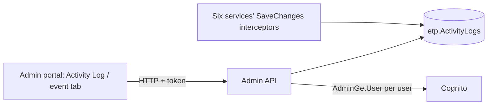

# A-27 · Activity log viewer

> **Bangla name:** অ্যাক্টিভিটি লগ ভিউয়ার
>
> [← 10 · Admin portal](README.md) · [Contents](../README.md) · [Open queries](../99-open-queries.md)

## 1. Name and purpose

**Activity log viewer.** Two screens read the audit trail that the services write automatically ([X-24](../60-cross-cutting/X-24-activity-logging.md)): the **global Activity Log** in the global menu, and the **Activity Log tab** of one event. The recording mechanism and the table are in X-24; this entry covers the screens and their API.

## 2. Trigger and actor

- **Global log:** `/activity-log` (global menu, `AuthGuard`; the menu shows it in the admin's global menu). 
- **Event trail:** `/events/event-details/:id` → tab **Activity Log** (`event-activity-log`).
- Server: `ActivityLogController` allows roles `Admin` and `EventManager`.

## 3. Business flow

1. **Global log:** a paged list (newest first) of changes: when, who (name), operation (for example "AdminUser Created", "Event Updated"), entity and a readable description of old and new values; search box.
2. **Event trail:** all changes made to one event and its parts (event, segments, venue details, settings, gates...), so the team can see who changed what before the match (Admin entities and the Booking capacity, adjustment and reservation rows).

## 4. Technical flow

1. **[HTTP + user token]** Global log: `GET /admin/api/v1/activity-log?serviceName=Admin&entityNamesToExclude=Event&entityNamesToExclude=EventSegment&entityNamesToExclude=EventVenueDetails&entityNamesToExclude=EventSettings&pageOffset=&pageSize=&search=` (`activity-log.service.ts`). The screen has **`serviceName` fixed to `Admin`** (`activity-log.component.ts:21`): it shows only changes recorded by the Admin service, without the event entities listed.
2. Event trail: `GET /admin/api/v1/activity-log/event/{eventId}?pageOffset&pageSize` → `ActivityLogManager.GetActivityLogEventAsync`: it collects the ids of the event, its settings, venue details and ticket-checker gates (Admin) and, through **[HTTP + user token]** Booking calls, its capacities, capacity adjustments and seat reservations, then reads the log rows for those entities and merges them.
3. `ActivityLogManager` then maps `UserId` to a **name** with one Cognito lookup per distinct user (`AdminUserManager.GetUserDetails`); unknown users (for example `System`) show the lookup's error text.
4. In the browser, `formatOperationType` and `generateDescription` turn the JSON strings `oldValues` and `newValues` into text (special cases for `AdminUser`, `TicketCheckerGateUser`, `LandingPageImage`; S3 paths become links).
5. A batch endpoint `POST /admin/api/v1/activity-log/batch` returns entries for a list of `{serviceName, entityName, entityId}` (no portal caller found).

## 5. Components

| Kind | Component |
|---|---|
| Client | `features/global-activity-log/*`, `features/events/components/event-activity-log/*`, `services/activity-log.service.ts`, `event.service.ts:256` |
| Service | Admin (`ActivityLogController`, `ActivityLogManager`, `ActivityLogRepository`) |
| AWS | Cognito (names) |
| Tables | `etp."ActivityLogs"` |

## 6. API contracts

See [X-24](../60-cross-cutting/X-24-activity-logging.md) §6 for the three endpoints and `ActivityLogsResponse`. Primary sample (one row of the response; values illustrative; `oldValues` and `newValues` are JSON **strings**):

```json
{
  "serviceName": "Admin", "entityName": "ProgramTeam", "entityId": "21", "action": "Modified",
  "oldValues": "{\"Name\":\"Dhaka D\"}", "newValues": "{\"Name\":\"Dhaka Dynamites\"}",
  "entityContext": null, "transactionId": "5b1f...", "timestamp": "2026-12-02T09:31:12Z",
  "userId": "7d3c-example-sub", "userName": "Nadia Rahman", "ipAddress": "203.0.113.10"
}
```

## 7. Data and side effects

Read only; the lookup of names calls Cognito once per distinct user per page.

## 8. Code references

| What | Where |
|---|---|
| Screens | `rvl-gobcb-admin-portal/src/app/features/global-activity-log/pages/activity-log/activity-log.component.ts:21-170`, `.../events/components/event-activity-log/*` |
| Services | `rvl-gobcb-admin-portal/src/app/features/global-activity-log/services/activity-log.service.ts:22`, `.../events/services/event.service.ts:256` |
| API | `rvl-gobcb-backend/Services/Admin/ETP.Admin.Service/Api/ActivityLogController.cs:14-66` |
| Manager | `rvl-gobcb-backend/Services/Admin/ETP.Admin.Domain/Managers/ActivityLogManager.cs:44-245` |

## 9. Handover notes

1. **The global screen shows only the Admin service**, since `serviceName = 'Admin'` is hard-coded. Changes in Booking, Ticketing, TicketChecker, Event and UserIssue exist in the table but have no screen; to see them, call the endpoint with another `serviceName` or query the table ([X-24](../60-cross-cutting/X-24-activity-logging.md) note 7 lists services that do not write at all).
2. **Event entities are excluded on purpose** from the global list and appear only in the event tab, which uses a different endpoint.
3. **Names come from Cognito on every request**, so deleted or other-pool users show an error text or `System` instead of a name.
4. **Default page size is 100 on the API** (10 in the screen); a very old log is not archived or purged ([X-24](../60-cross-cutting/X-24-activity-logging.md) note 6).
5. **Anyone with role `EventManager` can read the whole Admin trail**, including admin-user changes with names, phones and e-mails of staff.

## 10. Component relationships



**Depends on:** [X-24](../60-cross-cutting/X-24-activity-logging.md). **Affects:** nothing.

## 11. Developer test guide

**Local testability: Full.**

| Item | Detail |
|---|---|
| Test data and accounts | Admin `…01`; make a change first (for example rename a team, [A-04](A-04-teams.md)) |
| Browser | `http://localhost:4200/activity-log` (program 0) and an event's **Activity Log** tab |
| Emulator | — |
| Postman | `postman/services/etp-admin.postman_collection.json`: "GET /api/v1/activity-log" with `serviceName=Admin` |
| Visual Studio debug | `ActivityLogManager.GetAllAsync`, `MapUserNamesToActivityLogs` |
| Verify | SQL: `select "ServiceName","EntityName","Action","UserId","Timestamp" from etp."ActivityLogs" order by "Timestamp" desc limit 20` |
