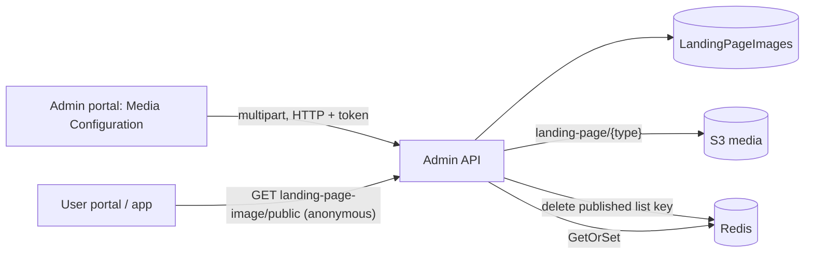

# A-28 · Media configuration (banners, gallery, contact, registration)

> **Bangla name:** মিডিয়া কনফিগারেশন (ব্যানার, গ্যালারি, কন্টাক্ট, রেজিস্ট্রেশন)
>
> [← 10 · Admin portal](README.md) · [Contents](../README.md) · [Open queries](../99-open-queries.md)

## 1. Name and purpose

**Media configuration.** The images and blocks of the public pages are managed as **landing-page items**: hero banners, sponsor logos, graffiti banners, an advertisement, the gallery page (two titled segments), the contact-us block and the registration banners. One table (`LandingPageImages`) holds them all, distinguished by `Type`. The user portal and app read the **published** ones ([P-01](../20-user-portal/P-01-home-content.md), [U-02](../30-user-app/U-02-home-browse-events.md)). The text pages (terms, privacy, FAQ, notice) use the same table and are described in [A-29](A-29-content-editor.md).

## 2. Trigger and actor

Staff who can open **Site Settings → Media Configuration** (global menu, `/media-configuration`; no route guard beyond sign-in). `LandingPageImageController` allows roles `Admin` and `EventManager`; one read endpoint is public.

## 3. Business flow

1. The page lists items grouped by type (Hero, Sponsors, Graffiti, Advertisement, Gallery page, Contact us, Registration).
2. **Create** an item of a type with image (and a thumbnail for sponsors), title, description, action URL, optional start and end time and display order; **edit**; **delete**; **duplicate**; **publish/unpublish**; **reorder** by moving one item to another position; for the gallery page, add several images to its two segments at once.
3. Only published items appear for customers; the number of published items per type is limited.

## 4. Technical flow

1. **[HTTP + user token]** `GET /admin/api/v1/landing-page-image` (all), `GET .../{id}`; public `GET .../landing-page-image/public` (**anonymous**, answered from the Redis key `landing_page_image_published:list` and rebuilt from the database when missing).
2. Create `POST .../landing-page-image` (`multipart/form-data`, `CreateOrUpdateLandingPageImage {title, question, description, actionUrl, type, displayOrder, isPublished, startDateTime, endDateTime, imageFile, thumbnailFile}`). `CreateAsync`: validation (image required; a thumbnail for `Sponsors`; **only one** `Advertisement`, one `Terms_Condition`, one `Privacy_Policy` may exist); `Terms_Condition` and `Privacy_Policy` are always saved published; `CreatedBy` = the admin's name (Cognito lookup); the image goes to S3 `landing-page/{type}/...` and its URL is stored; text types (`Notice`, `Terms_Condition`, `Privacy_Policy`, `FAQ`) have no image; then the cache key is deleted ([X-20](../60-cross-cutting/X-20-file-storage.md), [X-25](../60-cross-cutting/X-25-redis.md)).
3. Update `PUT .../{id}`; delete `DELETE .../{id}`; duplicate `PUT .../duplicate/{id}`; gallery `POST .../add-gallery-image` (two segments, each with title and several image files, types `Gallery_Page_Segment_1` and `_2`).
4. Publish `PUT .../publish/{id}` and unpublish `PUT .../unpublish/{id}`: toggles `IsPublished`; publishing is refused when the number of **already published** items of the type reaches the limit: **6** for `Hero` and `Sponsors`, **4** for `Graffiti`, **3** for `Registration` (no limit for others): "A maximum of {n} {type} can be published at a time."; the count is taken from the cached published list.
5. Reorder `PUT .../display-order/{type}/{displayOrder1}/{displayOrder2}`: moves the item at position 1 to position 2 and shifts the items in between by one; both positions must be greater than 0.
6. Every change deletes `landing_page_image_published:list`.

## 5. Components

| Kind | Component |
|---|---|
| Client | `features/media-configuration/*` (pages `hero-banner`, `sponsors-banner`, `graffiti-banner`, `advertisement-banner`, `gallery-page`, `contact-us`, `register-page`), `services/media-configuration.service.ts:19-59`; an older copy in the unlinked `features/program-settings/pages/landing-page-*` |
| Service | Admin (`LandingPageImageController`, `LandingPageImageManager`); Event service reads the published list |
| Tables | `LandingPageImages` |
| Redis | `landing_page_image_published:list` |
| Storage | S3 media `landing-page/{type}` |

## 6. API contracts

| Method | Path | Auth | Request | Response |
|---|---|---|---|---|
| GET | `/admin/api/v1/landing-page-image`, `/{id}` | `Admin`, `EventManager` | | items |
| GET | `/admin/api/v1/landing-page-image/public` | **anonymous** | | `LandingPageImagePublic[]` |
| POST | `/admin/api/v1/landing-page-image` | same | multipart | item |
| POST | `/admin/api/v1/landing-page-image/add-gallery-image` | same | multipart `GalleryPageSegmentImages` | items |
| PUT | `/admin/api/v1/landing-page-image/{id}`, `publish/{id}`, `unpublish/{id}`, `duplicate/{id}`, `display-order/{type}/{o1}/{o2}` | same | | item(s) |
| DELETE | `/admin/api/v1/landing-page-image/{id}` | same | path | item |

`type` values: `Hero`, `Sponsors`, `Graffiti`, `Advertisement`, `Gallery_Page_Segment_1`, `Gallery_Page_Segment_2`, `Contact_Us`, `Registration`, `Notice`, `Terms_Condition`, `Privacy_Policy`, `FAQ` (strings). Primary sample, `POST /admin/api/v1/landing-page-image` multipart (names from `CreateOrUpdateLandingPageImage`):

```
type=Hero
title=Premier League 2026
description=Book now
actionUrl=https://example.com/events
displayOrder=1
isPublished=true
imageFile=<file>
```

## 7. Data and side effects

Rows, S3 files, cache delete; activity log ([X-24](../60-cross-cutting/X-24-activity-logging.md)) records entity `LandingPageImage`.

## 8. Code references

| What | Where |
|---|---|
| Controller | `rvl-gobcb-backend/Services/Admin/ETP.Admin.Service/Api/LandingPageImageController.cs:27-190` |
| Manager | `rvl-gobcb-backend/Services/Admin/ETP.Admin.Domain/Managers/LandingPageImageManager.cs:47-340` |
| Enum | `rvl-gobcb-backend/Services/Admin/ETP.Admin.Domain/Enums/Enums.cs:20-34` |
| Portal | `rvl-gobcb-admin-portal/src/app/features/media-configuration/services/media-configuration.service.ts:19-59` |

## 9. Handover notes

1. **The publish limits read a cached list.** `PublishLandingPageImageAsync` counts published items through `GetAllPublishedAsync`, which is served from Redis; if the cache is stale, the limit check can be wrong in either direction.
2. **Publish toggles.** `publish/{id}` flips the flag; a repeated call unpublishes. The portal calls publish and unpublish separately, but a double click can undo the change.
3. **Sponsors need a thumbnail; ads, terms and privacy allow one item each**, enforced only at creation; edits do not re-check the singleton rule.
4. **`GetOrSetAsync` has no expiry set by the manager**, so the published list stays in Redis until a change deletes it; manual database edits are invisible to customers until the next change.
5. **A public, unauthenticated read** of this table is intended (`public` route) and is called by the user portal and app.
6. **Two portal copies**: the unlinked `/settings/landing-page` pages call the same endpoints.

## 10. Component relationships



**Depends on:** admin login ([X-01](../60-cross-cutting/X-01-admin-login.md)). **Affects:** [P-01](../20-user-portal/P-01-home-content.md), [U-02](../30-user-app/U-02-home-browse-events.md), [P-03](../20-user-portal/P-03-info-pages.md).

## 11. Developer test guide

**Local testability: Full.**

| Item | Detail |
|---|---|
| Test data and accounts | Admin `…01`; seeded banners (`scripts/seed/01-catalog.sql`) |
| Browser | `http://localhost:4200/media-configuration` → add a hero banner → check `http://localhost:4201` home |
| Emulator | — |
| Postman | `postman/services/etp-admin.postman_collection.json`: "GET /api/v1/landing-page-image", "GET /api/v1/landing-page-image/public", "PUT /api/v1/landing-page-image/publish/{id}" |
| Visual Studio debug | `LandingPageImageManager.CreateAsync`, `PublishLandingPageImageAsync` |
| Verify | `redis-cli GET landing_page_image_published:list`; `aws --endpoint-url http://localhost:4566 s3 ls s3://etp-local/landing-page/ --recursive`; SQL on `LandingPageImages` |
