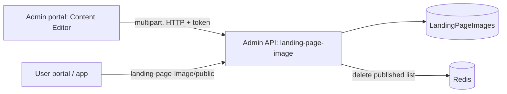

# A-29 · Content editor (T&C, FAQ, privacy, notice)

> **Bangla name:** কনটেন্ট এডিটর (T&C, FAQ, প্রাইভেসি, নোটিশ)
>
> [← 10 · Admin portal](README.md) · [Contents](../README.md) · [Open queries](../99-open-queries.md)

## 1. Name and purpose

**Content editor.** The static text pages of the public site and app are edited here: **Terms & Conditions**, **Privacy Policy**, **FAQ** (question and answer entries), **Notice** (announcement entries) and the **ticket-pricing** page ([A-14](A-14-ticket-pricing-content.md)). Except for ticket pricing, all of them are stored in the **same table and with the same endpoints as the banners** ([A-28](A-28-media-configuration.md)): rows of `LandingPageImages` whose `Type` is `Terms_Condition`, `Privacy_Policy`, `FAQ` or `Notice`, with the text in the `Description` (and `Title`, `Question`) fields and no image.

## 2. Trigger and actor

Staff who can open **Site Settings → Content Editor** (global menu, `/content-editor`, tabs `terms-conditions` (default), `faq`, `privacy-policy`, `ticket-pricing`, `notice`). Server roles: `Admin`, `EventManager` (`LandingPageImageController`).

## 3. Business flow

- **Terms and Privacy:** one document each. Edit the text and save; the item is always published.
- **FAQ:** a list of entries (title and answer), add, edit, delete, publish/unpublish, reorder.
- **Notice:** a list of notices with title and text, create, edit, delete, publish/unpublish, reorder (the create form warns about unsaved changes).
- Customers read the published content in the user portal and app ([P-03](../20-user-portal/P-03-info-pages.md), [U-03](../30-user-app/U-03-info-pages.md)).

## 4. Technical flow

All **[HTTP + user token]** with the calls of [A-28](A-28-media-configuration.md) §4, using `type`:

1. Load: `MediaDataManagerService.getDataByType(type)` reads `GET /admin/api/v1/landing-page-image` and filters by type in the browser.
2. Save: `POST /admin/api/v1/landing-page-image` or `PUT .../{id}` as `multipart/form-data` with `type` (`Terms_Condition`, `Privacy_Policy`, `FAQ`, `Notice`), `title`, `description`, `displayOrder`, `isPublished`. `CheckValidationLandingPageImage`: type valid; **no image is required** for these four types; **only one** Terms and one Privacy Policy item may exist ("Terms & Condition should not be multiple", "Privacy Policy should not be multiple"); display-order rules ("Invalid display order. It should be 0", "Invalid display order.", "Display order duplicate"). Terms and Privacy are saved with `IsPublished = true` and cannot be saved unpublished (`UpdateAsync` rejects it).
3. FAQ and Notice: publish `PUT .../publish/{id}`, unpublish `.../unpublish/{id}`, delete `DELETE .../{id}`, reorder `PUT .../display-order/{type}/{o1}/{o2}`.
4. Each change deletes the Redis key `landing_page_image_published:list`; customers read `GET .../landing-page-image/public` ([P-03](../20-user-portal/P-03-info-pages.md)).

## 5. Components

| Kind | Component |
|---|---|
| Client | `features/content-editor/components/{terms-conditions,privacy-policy,faq,notice/*,ticket-pricing}`; they reuse `features/media-configuration/services/{media-configuration,media-data-manager}.service.ts` |
| Service | Admin: `LandingPageImageController`, `LandingPageImageManager` (and `TicketPricingController` for pricing) |
| Tables | `LandingPageImages` |
| Redis | `landing_page_image_published:list` |

## 6. API contracts

Same as [A-28](A-28-media-configuration.md) §6. Primary sample, save the FAQ entry (`multipart/form-data`; names from `CreateOrUpdateLandingPageImage`; values illustrative):

```
type=FAQ
title=How do I get my ticket?
description=Open My Bookings and press Generate Ticket after payment.
displayOrder=1
isPublished=true
```

## 7. Data and side effects

`LandingPageImages` rows (no S3 file), cache delete, activity log entity `LandingPageImage` ([X-24](../60-cross-cutting/X-24-activity-logging.md)).

## 8. Code references

| What | Where |
|---|---|
| Manager | `rvl-gobcb-backend/Services/Admin/ETP.Admin.Domain/Managers/LandingPageImageManager.cs:61-110, 340-400` |
| Portal tabs | `rvl-gobcb-admin-portal/src/app/features/content-editor/content-editor-routing.module.ts:23-34` |
| Components | `.../content-editor/components/faq/faq.component.ts:100-350`, `notice/*`, `terms-conditions/*`, `privacy-policy/*` |

## 9. Handover notes

1. **Content is plain text in a column named for images**: no versioning, no preview, no approval; an edit is live at once for Terms and Privacy (always published).
2. **Two "notice" features exist.** This tab's **Notice** uses `LandingPageImages` type `Notice`; the separate **General notices** use their own table and API and live in the unlinked `/settings` module ([A-31](A-31-general-notices.md)). Customers may see either depending on the client.
3. **HTML or markdown is not sanitised here**; the description is stored as sent, so how it is rendered (escaped or as HTML) is decided by the customer clients `[UNCONFIRMED: Q-33]`.
4. **The single-item rule is only checked on create**; an edit that changes the type is not re-checked.
5. **Cached public list** has no expiry; manual database edits are invisible until the next change ([A-28](A-28-media-configuration.md) note 4).

## 10. Component relationships



**Depends on:** [A-28](A-28-media-configuration.md) (same API). **Affects:** [P-03](../20-user-portal/P-03-info-pages.md), [U-03](../30-user-app/U-03-info-pages.md).

## 11. Developer test guide

**Local testability: Full.**

| Item | Detail |
|---|---|
| Test data and accounts | Admin `…01` |
| Browser | `http://localhost:4200/content-editor/faq`; Network: multipart `POST .../landing-page-image` with `type=FAQ`; user portal info page |
| Emulator | — |
| Postman | `postman/services/etp-admin.postman_collection.json`: "POST /api/v1/landing-page-image" (form-data with `type`), "GET /api/v1/landing-page-image/public" |
| Visual Studio debug | `LandingPageImageManager.CheckValidationLandingPageImage` |
| Verify | SQL: `select "Type","Title","IsPublished","DisplayOrder" from etp."LandingPageImages" where "Type" in ('FAQ','Notice','Terms_Condition','Privacy_Policy')` |
