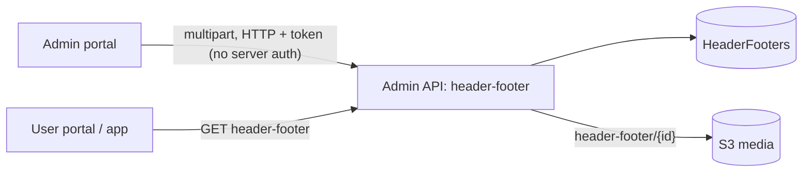

# A-30 · Header/footer and social-media settings

> **Bangla name:** হেডার/ফুটার ও সোশ্যাল মিডিয়া সেটিংস
>
> [← 10 · Admin portal](README.md) · [Contents](../README.md) · [Open queries](../99-open-queries.md)

## 1. Name and purpose

**Header/footer and social media.** One record controls the public site's header and footer: the title, a brand image, a "powered by" image, the social-media links (Facebook, Instagram, Twitter/X, LinkedIn) and the **contact block — `phoneNumber`, `email` and `officeAddress`**. A second, older record (`SocialMediaSettings`) holds only the four links and has its own screen in the unlinked `/settings` module.

The contact block is the site's public phone number, email address and postal address. It is stored on `HeaderFooters`, returned by the Event service and shown in the customer footer ([P-01](../20-user-portal/P-01-home-content.md)).

## 2. Trigger and actor

- **Header/footer:** staff in **Site Settings → Media Configuration** (page section `HeaderFooterComponent`). The **server** `HeaderFooterController` has **no `[Authorize]`**: both the read and the update are open ([X-18](../60-cross-cutting/X-18-endpoints-without-auth.md)).
- **Social media settings:** screen `/settings/footer-settings` (reachable only by URL); server role `Admin` (`SocialMediaSettingsController`).

## 3. Business flow

Open the section, change the title, replace the images, edit the four links, fill in the **phone number, email and office address**, then **Update**. Customers see the result in the portal header and footer ([P-01](../20-user-portal/P-01-home-content.md), [U-02](../30-user-app/U-02-home-browse-events.md)).

## 4. Technical flow

1. **[HTTP + user token]** `GET /admin/api/v1/header-footer` (list, normally one record); `PUT /admin/api/v1/header-footer` (`multipart/form-data`, `UpdateHeaderFooter {title, facebookUrl, instagramUrl, twitterUrl, linkedInUrl, brandImageUrl (file), poweredByImageUrl (file), phoneNumber, email, officeAddress}`).
2. `HeaderFooterManager.UpdateHeaderFooterAsync`: title required ("Title is required and cannot be empty."); each non-empty social link must be an `http(s)` URL on `facebook.com`, `instagram.com`, `x.com`, `twitter.com` or `linkedin.com` (a subdomain allowed), else "Invalid {Platform} URL format."; update the row; upload the brand and powered-by images to S3 `header-footer/{id}/...` and store their URLs ([X-20](../60-cross-cutting/X-20-file-storage.md)). Note the field names `brandImageUrl` and `poweredByImageUrl` carry **files** in the request. The DTO is mapped to the entity with Mapster (`updateHeaderFooter.Adapt<Storage.Models.Settings.HeaderFooter>()`), so `phoneNumber`, `email` and `officeAddress` are persisted by name — **none of the three is validated**, unlike the title and the social URLs.
3. **Social media settings:** `GET /admin/api/v1/social-media-settings`, `PUT /admin/api/v1/social-media-settings` (JSON `{facebookUrl, instagramUrl, linkedInUrl, twitterUrl}`), same URL validation; no cache.
4. **Customer reads:** the user portal reads the header and footer data (`HeaderFooterData`) and social settings through its `common` store ([P-01](../20-user-portal/P-01-home-content.md)).

## 5. Components

| Kind | Component |
|---|---|
| Client | `features/media-configuration/pages/header-footer/*`; `features/program-settings/pages/footer-settings/*` with `services/footer-settings.service.ts:19-23` |
| Service | Admin (`HeaderFooterController`, `HeaderFooterManager`, `SocialMediaSettingsController`, `SocialMediaSettingsManager`) |
| Tables | `HeaderFooters`, `SocialMediaSettings` |
| Storage | S3 media `header-footer/{id}` |

## 6. API contracts

| Method | Path | Auth | Request | Response |
|---|---|---|---|---|
| GET | `/admin/api/v1/header-footer` | **none** | | `HeaderFooter[]` |
| PUT | `/admin/api/v1/header-footer` | **none** | `UpdateHeaderFooter` (multipart) | `HeaderFooter` |
| GET | `/admin/api/v1/social-media-settings` | `Admin` | | `SocialMediaSettings[]` |
| PUT | `/admin/api/v1/social-media-settings` | `Admin` | `SocialMediaSettings` | `SocialMediaSettings` |

Primary sample, `PUT /admin/api/v1/header-footer` multipart (names from `UpdateHeaderFooter`):

```
title=GoBCB
facebookUrl=https://facebook.com/gobcb
instagramUrl=https://instagram.com/gobcb
phoneNumber=+8801700000000
email=info@gobcb.com
officeAddress=Bangabandhu National Stadium, Dhaka
brandImageUrl=<file>
poweredByImageUrl=<file>
```

## 7. Data and side effects

One header/footer row (including `PhoneNumber`, `Email`, `OfficeAddress`), S3 images, activity log entries ([X-24](../60-cross-cutting/X-24-activity-logging.md)).

## 8. Code references

| What | Where |
|---|---|
| Header/footer controller | `rvl-gobcb-backend/Services/Admin/ETP.Admin.Service/Api/HeaderFooterController.cs:14-45` |
| Manager | `rvl-gobcb-backend/Services/Admin/ETP.Admin.Domain/Managers/HeaderFooterManager.cs:20-150` |
| Social manager | `rvl-gobcb-backend/Services/Admin/ETP.Admin.Domain/Managers/SocialMediaSettingsManager.cs:25-60` |
| Portal | `rvl-gobcb-admin-portal/src/app/features/media-configuration/services/media-configuration.service.ts:51-55`; `features/program-settings/services/footer-settings.service.ts:19-23` |

## 9. Handover notes

1. **Anyone can change the site header, footer and links.** `PUT /header-footer` needs no token, and the URL validation accepts any `facebook.com` or `x.com` path, so a hostile link on a real social domain is accepted.
2. **Two sources for the same links.** Header/footer carries the four URLs and `SocialMediaSettings` carries the same four; which one each customer client reads should be checked before relying on either `[UNCONFIRMED: Q-34]`.
3. **Replacing an image deletes using the *new* file name.** In `UploadBrandImageAsync`, when a brand image already exists the code calls `DeleteContentAsync("header-footer", id, storageFilename)` with the newly generated name, not the old file's name, so the old object stays in S3 and orphan files accumulate.
4. **No cache** here, unlike banners ([A-28](A-28-media-configuration.md)); every customer page load reads the table.
5. **The contact fields are unvalidated.** `CheckValidation` (`:65-75`) requires the title and validates the four social URLs, but **nothing checks `phoneNumber`, `email` or `officeAddress`** — a malformed address or an unparseable string is stored and published to every customer. They are mapped by name through Mapster, so they do persist; they simply have no rules.
6. The `/settings` module is not in any menu ([A-02](A-02-programs.md) note 3).

## 10. Component relationships



**Depends on:** nothing. **Affects:** [P-01](../20-user-portal/P-01-home-content.md), [U-02](../30-user-app/U-02-home-browse-events.md).

## 11. Developer test guide

**Local testability: Full.**

| Item | Detail |
|---|---|
| Test data and accounts | Admin `…01` |
| Browser | `http://localhost:4200/media-configuration` (header/footer section); social: `http://localhost:4200/settings/footer-settings` |
| Emulator | — |
| Postman | `postman/services/etp-admin.postman_collection.json`: "GET /api/v1/header-footer", "PUT /api/v1/header-footer" (form-data), "GET /api/v1/social-media-settings" |
| Visual Studio debug | `HeaderFooterManager.UpdateHeaderFooterAsync`, `ValidateSocialMediaUrl` |
| Verify | SQL on `HeaderFooters`; `aws --endpoint-url http://localhost:4566 s3 ls s3://etp-local/header-footer/ --recursive` |
