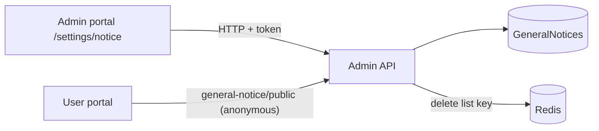

# A-31 · General notices

> **Bangla name:** জেনারেল নোটিশ
>
> [← 10 · Admin portal](README.md) · [Contents](../README.md) · [Open queries](../99-open-queries.md)

## 1. Name and purpose

**General notices.** Short announcements (for example "gates open at 2 pm") that the public portal shows as a banner between a start and an end time. Each notice has a program, a text of up to 260 characters (simple HTML), a period and a publish flag. Do not confuse them with the **Notice** entries of the content editor ([A-29](A-29-content-editor.md)), which are a different table.

## 2. Trigger and actor

Staff on `/settings/notice` (the `program-settings` module; **not linked from any menu**, reachable only by URL). Server roles `Admin`, `EventManager` (`GeneralNoticeController`); the public read is anonymous.

## 3. Business flow

List notices, create one (program, text, start, end, publish), edit, delete. Customers see published notices whose end time has not passed, ordered by start time.

## 4. Technical flow

1. **[HTTP + user token]** `GET /admin/api/v1/general-notice` (all), `GET .../{id}`, `POST .../general-notice` (JSON `CreateOrUpdateGeneralNotice {programId, description, startDateTime, endDateTime, isPublished}`), `PUT .../{id}`, `DELETE .../{id}`. The form also loads programs and program settings (`GET /program`, `GET /program-settings/{programId}`).
2. Validation: description required and at most 260 characters ("Description should not be more than 260"). Every create, update and delete deletes the Redis key `general_notice_published:list`.
3. Public read `GET /admin/api/v1/general-notice/public` (**anonymous**, `[AllowAnonymous]`): `GetAllPublishedAsync` takes the published list from Redis (`GetOrSetAsync`, rebuilt from the database when absent), **drops notices whose `EndDateTime` is before now**, orders by `StartDateTime`, and replaces `<p>` and `</p>` with `<span>` and `</span>` in the text. The user portal calls this URL through the Event service base URL (`event-api.service.ts`, [P-03](../20-user-portal/P-03-info-pages.md)).

## 5. Components

| Kind | Component |
|---|---|
| Client | `features/program-settings/pages/notice/*`, `services/notice.service.ts:19-43` |
| Service | Admin (`GeneralNoticeController`, `GeneralNoticeManager`) |
| Tables | `GeneralNotices` |
| Redis | `general_notice_published:list` |

## 6. API contracts

| Method | Path | Auth | Request | Response | Main errors |
|---|---|---|---|---|---|
| GET | `/admin/api/v1/general-notice`, `/{id}` | `Admin`, `EventManager` | | `GeneralNotice` | |
| POST | `/admin/api/v1/general-notice` | same | `CreateOrUpdateGeneralNotice` | `GeneralNotice` | 400 `Description is missing.`, `Description should not be more than 260` |
| PUT | `/admin/api/v1/general-notice/{id}` | same | same | `GeneralNotice` | |
| DELETE | `/admin/api/v1/general-notice/{id}` | same | path | `GeneralNotice` | |
| GET | `/admin/api/v1/general-notice/public` | **anonymous** | | `GeneralNoticePublic[]` | |

Primary sample, `POST /admin/api/v1/general-notice` (names from `CreateOrUpdateGeneralNotice`; values illustrative):

```json
{ "programId": 12, "description": "<p>Gates open at 2:00 pm.</p>",
  "startDateTime": "2026-12-10T00:00:00Z", "endDateTime": "2026-12-10T23:59:59Z", "isPublished": true }
```

## 7. Data and side effects

`GeneralNotices` row, cache delete, activity log ([X-24](../60-cross-cutting/X-24-activity-logging.md)).

## 8. Code references

| What | Where |
|---|---|
| Controller | `rvl-gobcb-backend/Services/Admin/ETP.Admin.Service/Api/GeneralNoticeController.cs:26-110` |
| Manager | `rvl-gobcb-backend/Services/Admin/ETP.Admin.Domain/Managers/GeneralNoticeManager.cs:26-110` |
| Portal | `rvl-gobcb-admin-portal/src/app/features/program-settings/services/notice.service.ts:19-43` |
| Customer read | `rvl-gobcb-user-portal/ETP-Web/src/app/modules/core/services/api/event-api.service.ts:20, 56` |

## 9. Handover notes

1. **The management screen is not in the menu**, so staff may not know it exists.
2. **The user portal fetches these notices but never renders them.** `EventApiService.getAllGeneralNotices` **is** called from `home-events-page.component.ts:43`, the rows **are** date-filtered in memory and assigned to the component's `notices` array — but **`notices` is never bound in `home-events-page.component.html`**, and the code comment at `:40` says so outright: `// Fetch notices but do not start the marquee`. So each home-page load issues a request whose result is discarded, and the scrolling line customers actually see is the content editor's `Notice` type ([A-29](A-29-content-editor.md)). Whether the user app renders them is not visible. **This is the single most likely reason staff would report "I published a notice and nothing happened."** `[UNCONFIRMED: Q-35]`
3. **Public list is cached without a program filter**; the response contains notices of every program, and the customer client filters — here it filters by `startDateTime`/`endDateTime` only, never by program.
4. **The text is HTML** and is not sanitised on save; only `<p>` is rewritten on read, so scripts or other tags in the text depend on the client's rendering `[UNCONFIRMED: Q-33]`.
5. **Ended notices stay in the cached list** until the next change but are filtered out on every read, so they disappear on time without a cache refresh. Not-yet-started notices are returned too; the client decides whether to show them.
6. **Delete is `DeleteByIdAsync`** of the repository; soft or hard is not checked here.

## 10. Component relationships



**Depends on:** [A-02](A-02-programs.md). **Affects:** [P-03](../20-user-portal/P-03-info-pages.md).

## 11. Developer test guide

**Local testability: Full.**

| Item | Detail |
|---|---|
| Test data and accounts | Admin `…01` |
| Browser | `http://localhost:4200/settings/notice` (type the URL; program 0) |
| Emulator | — |
| Postman | `postman/services/etp-admin.postman_collection.json`: "GET /api/v1/general-notice/public", "POST /api/v1/general-notice" |
| Visual Studio debug | `GeneralNoticeManager.GetAllPublishedAsync` |
| Verify | `redis-cli GET general_notice_published:list`; SQL on `GeneralNotices` |
