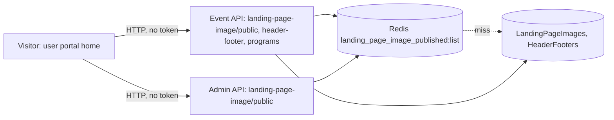

# P-01 · Home page content (banners, sponsors, notices, header and footer)

> **Bangla name:** হোম পেজের কনটেন্ট (ব্যানার, স্পনসর, নোটিশ, হেডার ও ফুটার)
>
> [← 20 · User portal](README.md) · [Contents](../README.md) · [Open queries](../99-open-queries.md)

## 1. Name and purpose

**Home page content.** What a visitor sees on the first page of the customer web portal before choosing an event: the hero banner carousel, the sponsor strip, the advertisement banner, the graffiti banners, a scrolling notice line, the upcoming-events list ([P-02](P-02-browse-events.md)), and the shared header (brand logo, program menu) and footer (social links, contact details). All of it is configured by staff in the admin portal ([A-28](../10-admin-portal/A-28-media-configuration.md), [A-29](../10-admin-portal/A-29-content-editor.md), [A-30](../10-admin-portal/A-30-header-footer-social.md)).

## 2. Trigger and actor

Any visitor, **no sign-in** (the home route has no guard). The loading starts when the Angular app starts: `AppComponent` calls `commonStoreService.loadCommon()` (`app.component.ts:23`).

## 3. Business flow

1. The visitor opens `/{lang}` (`en` or `bn`; the root redirects to `/en`, see [P-13](P-13-language-switch.md)).
2. The hero carousel, sponsors, advertisement and graffiti banners appear, each taken from the published items of one type.
3. A one-line scrolling **notice** shows the published `Notice` items whose start/end window contains the current time.
4. The header shows the brand logo and the list of programs; the footer shows the social links and the contact block.

## 4. Technical flow

1. **[HTTP, no token]** Application start: `GET {services.events}/event/api/v1/landing-page-image/public` (`CommonApiService.fetchCommon`, Event service, `[AllowAnonymous]`). The answer fills the NgRx `common` store; the reducer splits it into Terms, Privacy, FAQ list and Notice list by `type` (`common.reducer.ts:35-38`); the graffiti banners and the gallery ([P-03](P-03-info-pages.md)) are selected from the same list.
2. **[HTTP, no token]** `GET {services.events}/admin/api/v1/landing-page-image/public` (`ImageApiService.getAllBannerImages`, the **Admin** copy of the same read). It is cached in the browser with `shareReplay(1)`, sorted by `displayOrder`, and used for the `Hero` carousel (`PrimaryBannerSectionComponent`), the sponsors strip (`HomepageSponsorsComponent`) and the `Advertisement` banner (`HomeEventsPageComponent`). An error returns an empty list, so a failure is silent.
3. **[HTTP, no token]** Header and footer: `GET {services.events}/event/api/v1/header-footer` (`FooterApiService.getSocialMediaUrls`, Event service). The first element of the returned list becomes `HeaderFooterData` in the store: brand image, "powered by" image, title, four social links, phone number, e-mail and office address.
4. **[HTTP, no token]** Programs for the header menu: `GET .../event/api/v1/events/programs` (`ToolbarComponent` → `EventApiService.getAllPrograms`).
5. Notice line: `HomeEventsPageComponent.fetchAllGeneralNotices` reads `selectNotices` (the `Notice` landing-page items), keeps those whose `startDateTime`..`endDateTime` contains now (items without both dates are always kept) and scrolls them with a timer; the text is bound with `[innerHTML]` (Angular's default sanitiser applies).
6. On the server both `landing-page-image/public` endpoints read the Redis list `landing_page_image_published:list` (`GetOrSetAsync`), which the Admin service deletes after every change ([A-28](../10-admin-portal/A-28-media-configuration.md)).

## 5. Components

| Kind | Component |
|---|---|
| Client | `home-events-page`, `primary-banner-section`, `homepage-sponsors`, `layout/components/{toolbar,footer}`; stores `core/modules/common/store/*` |
| Services | Event (`LandingPageImageController`, `SiteSettingsManager`, `HeaderFooterController`, `ProgramController`); Admin (`LandingPageImageController`) |
| Tables | `LandingPageImages`, `HeaderFooters`, `Programs` |
| Redis | `landing_page_image_published:list` ([X-25](../60-cross-cutting/X-25-redis.md)) |
| Storage | images are full URLs on the media bucket ([X-20](../60-cross-cutting/X-20-file-storage.md)) |

## 6. API contracts

| Method | Path (as called by the portal) | Auth | Response |
|---|---|---|---|
| GET | `/event/api/v1/landing-page-image/public` | anonymous | `LandingPageImagePublic[]` |
| GET | `/admin/api/v1/landing-page-image/public` | anonymous | same list (without `question`) |
| GET | `/event/api/v1/header-footer` | none | `HeaderFooter[]` |
| GET | `/event/api/v1/events/programs` | none | `Program[]` |

Primary sample, one element of `GET /event/api/v1/landing-page-image/public` (property names from `LandingPageImagePublic`, camelCase on the wire; values illustrative):

```json
{ "title": "Premier League 2026", "question": null, "description": "Book now",
  "actionUrl": "https://example.com/events", "imageUrl": "https://media.example.com/landing-page/Hero/7.jpg",
  "thumbnailUrl": null, "type": "Hero", "displayOrder": 1, "startDateTime": null, "endDateTime": null }
```

## 7. Data and side effects

Read only; nothing is written. Besides the Redis list, the browser caches the Admin copy for the page session.

## 8. Code references

| What | Where |
|---|---|
| Startup load | `rvl-gobcb-user-portal/ETP-Web/src/app/app.component.ts:23` |
| API services | `rvl-gobcb-user-portal/ETP-Web/src/app/modules/core/services/api/{common-api,image-api,footer-api,event-api}.service.ts` |
| Store | `rvl-gobcb-user-portal/ETP-Web/src/app/modules/core/modules/common/store/{common.effects,common.reducer,common.selectors}.ts` |
| Pages | `rvl-gobcb-user-portal/ETP-Web/src/app/modules/featured/events/pages/home-events-page/home-events-page.component.ts:36-70`; `.../components/primary-banner-section/primary-banner-section.component.ts` |
| Event service | `rvl-gobcb-backend/Services/Event/ETP.Event.Service/Api/LandingPageImageController.cs:22`; `.../HeaderFooterController.cs:21` |

## 9. Handover notes

1. **Two endpoints, two services, one list.** The portal reads the same published list once through the Event service (store: graffiti, FAQ, terms, notices, gallery) and once through the Admin service (hero, sponsors, advertisement). Both read the same Redis key. The Admin route must therefore be reachable from the public internet `[UNCONFIRMED: Q-04]`.
2. **General notices ([A-31](../10-admin-portal/A-31-general-notices.md)) are not used by this portal.** `EventApiService.getAllGeneralNotices` exists but has no caller; the scrolling line shows `Notice` items of the content editor ([A-29](../10-admin-portal/A-29-content-editor.md)). Whether the user app or any other client reads the `GeneralNotices` table is not visible `[UNCONFIRMED: Q-35]`.
3. **Header/footer, not social-media settings.** The portal reads social links and contact data only from the `HeaderFooters` record ([A-30](../10-admin-portal/A-30-header-footer-social.md)); the older `SocialMediaSettings` record has no reader here (the user app may differ `[UNCONFIRMED: Q-34]`).
4. **Silent failures.** A failed banner call returns an empty list and the page shows no banner; a failed header/footer call fills an error flag in the store but shows no message.
5. **Cache has no expiry.** Admin changes delete the list key; manual database edits stay invisible until the next change.

## 10. Component relationships



**Depends on:** [A-28](../10-admin-portal/A-28-media-configuration.md), [A-29](../10-admin-portal/A-29-content-editor.md), [A-30](../10-admin-portal/A-30-header-footer-social.md). **Affects:** [P-02](P-02-browse-events.md), [P-03](P-03-info-pages.md).

## 11. Developer test guide

**Local testability: Full** (seeded hero, sponsors, notice and FAQ rows exist, one unpublished; `docs/local-dev.md` seed list).

| Item | Detail |
|---|---|
| Test data and accounts | No account needed; seed `scripts/seed/01-catalog.sql` |
| Browser | `http://localhost:4201/en`; DevTools → Network → filter `landing-page-image`: expect two calls (one through the Event proxy, one through the Admin proxy) and one `header-footer` |
| Emulator | — (the app is in [U-02](../30-user-app/U-02-home-browse-events.md)) |
| Postman | `postman/services/etp-event.postman_collection.json`: "GET /api/v1/landing-page-image/public", "GET /api/v1/header-footer", "GET /api/v1/events/programs" |
| Visual Studio debug | `ETP.Event.Domain/Managers/SiteSettingsManager.cs` (`GetAllPublishedAsync`) |
| Verify | `redis-cli GET landing_page_image_published:list`; change a banner in the admin portal ([A-28](../10-admin-portal/A-28-media-configuration.md)) and reload |
