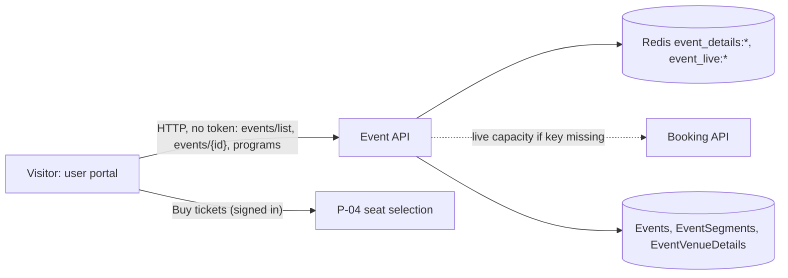

# P-02 · Browse events and event details

> **Bangla name:** ইভেন্ট ব্রাউজ ও ইভেন্টের বিস্তারিত
>
> [← 20 · User portal](README.md) · [Contents](../README.md) · [Open queries](../99-open-queries.md)

## 1. Name and purpose

**Browse events.** The customer sees the upcoming matches on the home page and on the **Events** page (filter by program, team, venue and date; sort), opens one event to see its segments (for example a day of a Test match), venue, ticket-selling window and a status badge (`Available`, `LimitedAvailability`, `SoldOut`, `ComingSoon`, `BookingClosed`), and presses **Buy tickets**, which leads to seat selection ([P-04](P-04-seat-selection.md)). The data is what staff published in the admin portal ([A-07](../10-admin-portal/A-07-events.md), [A-09](../10-admin-portal/A-09-event-level-pricing.md)).

## 2. Trigger and actor

Any visitor for browsing (no sign-in). Pressing **Buy tickets** needs a signed-in customer with a completed profile.

## 3. Business flow

1. Home page: the first *n* events (`environment.homePageSettings.homeTotalEvents`) as cards.
2. `/{lang}/events`: all upcoming events; the program chosen in the header menu narrows the list (the choice lives only in memory, `ProgramSelectionService`); further filters (team, venue, date) and sorting run in the browser.
3. `/{lang}/events/{eventId}`: event banner, dates, venue, segments, minimum price and the **Buy tickets** button. A pricing pop-up shows the ticket prices of the program (see [P-03](P-03-info-pages.md) for the pricing page).
4. **Buy tickets:** nothing happens for `ComingSoon` and `SoldOut` (and the server refuses outside the selling window, [P-06](P-06-booking-payment.md)). A signed-in customer with a completed profile goes to `/{lang}/tickets/{eventId}/seats`. An anonymous customer, or one whose profile is not complete, gets the **Secure ticket** pop-up with buttons to log in ([X-07](../60-cross-cutting/X-07-user-password-login.md)), register ([X-06](../60-cross-cutting/X-06-user-registration.md)) or complete the profile ([P-11](P-11-profile.md)).

## 4. Technical flow

1. **[HTTP, no token]** Home: `GET {services.events}/event/api/v1/events/list?numberOfEvents={n}`; events page: `GET .../event/api/v1/events/list` (with `programId` when a program is chosen). Both go through the NgRx event store (`event.effects.ts`).
2. **[HTTP, no token]** Detail: `GET .../event/api/v1/events/{eventId}` where `eventId` is the public GUID (`EventApiService.getEventById`).
3. Server, list: `EventManager.GetEventsAsync` reads the cached list `event_details:list` (or builds it from published, active events that have not ended), drops events that already ended and, **for every event on every request**, recomputes `AvailabilityStatus` (`DetermineAvailabilityStatus`): `ComingSoon` before selling start, `BookingClosed` after selling stop, otherwise from the live event capacity in Redis (`event_live:{id}`, filled through Booking when missing) compared with a threshold: the program's *limited-availability percentage* when set (`GetLimitedAvailabilityThreshold`) or 9 % of the online tickets by default, giving `LimitedAvailability`, `SoldOut` or `Available`.
4. Server, detail: `GetEventByEventIdAsync` reads `event_details:{eventId}` (or builds it; an unpublished or inactive event answers with an error) and recomputes the status the same way. The `minimumPrice` is the lowest `PricePerSeat` among the event's venue-detail rows.
5. Program menu and filters: `GET .../event/api/v1/events/programs` ([P-01](P-01-home-content.md)).
6. **Buy tickets** is a pure client decision: `buyTicketPage` checks `availabilityStatus`, the Cognito session (`isAuthenticated$`) and the profile flag `isProfileCompleted` (loaded from the identity API, [P-11](P-11-profile.md)), then navigates; the route `tickets/*` has `AuthGuard` (local flag `rvl_cognito_auth`, [X-10](../60-cross-cutting/X-10-user-session.md)).

## 5. Components

| Kind | Component |
|---|---|
| Client | `events/pages/{home-events-page,all-event-list-page,event-detail-page,filter-events}`, `events/components/{home-event-list,event-card,event-card-homepage,event-overview,event-segments,event-segment-card,secure-ticket-modal}`; `core/modules/events/store/*` |
| Service | Event (`EventsController`, `ProgramController`, `EventManager`); Booking is called for the live capacity (`GetEventLiveCapacity`) |
| Tables | `Events`, `EventSegments`, `EventVenueDetails`, `Programs`, `EventSettings` (read model of Admin tables, see [00 primer](../00-platform-primer.md)) |
| Redis | `event_details:list`, `event_details:{id}`, `event_live:{id}` ([X-25](../60-cross-cutting/X-25-redis.md)) |

## 6. API contracts

| Method | Path | Auth | Request | Response |
|---|---|---|---|---|
| GET | `/event/api/v1/events/list` | none | `numberOfEvents?`, `programId?` | `Event[]` (`eventId`, `eventName`, `programId`, `bannerImage`, dates, `minimumPrice`, `availabilityStatus`, `segments[]`, `venue`) |
| GET | `/event/api/v1/events/{eventId}` | none | public GUID | `Event` (adds `vat`, `isVatInclusive`, `isVatPercentage`, `ticketAvailabilityStartDateTime`) |
| GET | `/event/api/v1/events/programs` | none | | `Program[]` |

Primary sample, `GET /event/api/v1/events/list?numberOfEvents=2` (shortened; property names follow `HomeEvent` in the portal model; values illustrative):

```json
[{ "id": 2, "eventId": "9f0b2c1e-3b0e-4a43-9d5e-6f5f3d0c1a11", "eventName": "1st ODI, Mirpur",
   "programId": 1, "bannerImage": "https://media.example.com/eventcover/2.jpg",
   "eventStartDateTime": "2026-12-10T08:00:00Z", "eventEndDateTime": "2026-12-10T16:00:00Z",
   "ticketSellingStartDateTime": "2026-11-20T04:00:00Z", "ticketSellingStopDateTime": "2026-12-10T08:00:00Z",
   "minimumPrice": 300, "availabilityStatus": "Available",
   "segments": [{ "id": 3, "name": "BAN vs IND", "segmentType": "Sport", "team1": "Bangladesh", "team2": "India" }],
   "venue": { "id": 1, "name": "Sher-e-Bangla National Cricket Stadium", "location": "Mirpur" } }]
```

## 7. Data and side effects

Read only. The list request may fill `event_live:{id}` in Redis when the key is missing (a call to Booking). No other state changes.

## 8. Code references

| What | Where |
|---|---|
| Portal API | `rvl-gobcb-user-portal/ETP-Web/src/app/modules/core/services/api/event-api.service.ts:20-75` |
| Pages | `rvl-gobcb-user-portal/ETP-Web/src/app/modules/featured/events/pages/all-event-list-page/all-event-list-page.component.ts:68-100`; `.../event-detail-page/event-detail-page.component.ts:21-27` |
| Buy button | `rvl-gobcb-user-portal/ETP-Web/src/app/modules/featured/events/components/event-overview/event-overview.component.ts:90-112` |
| Controller | `rvl-gobcb-backend/Services/Event/ETP.Event.Service/Api/EventsController.cs:21, 83-100` |
| Manager | `rvl-gobcb-backend/Services/Event/ETP.Event.Domain/Managers/EventManager.cs:41-80, 267-330` |

## 9. Handover notes

1. **The status badge is recomputed on every request** from Redis counters, so it is live, but each call to `list` performs several Redis and lookup calls per event; with many events this is the busiest anonymous read of the system.
2. **`numberOfEvents` is applied after `programId`** and takes the first *n* of the cached order, not "the next *n* by date"; the order is the order of the cached list.
3. **The list is cached until staff change an event.** The cached read drops events that have ended, but changes made directly in the database are invisible until an Admin change deletes `event_details:*` ([A-07](../10-admin-portal/A-07-events.md) lists the caches it deletes).
4. **The "Buy tickets" rules are client-side only.** Hidden or sold-out events can still be ordered by calling the Booking API directly; the server enforces event published/active, the selling window, seat limits and capacity ([P-06](P-06-booking-payment.md)), not the badge.
5. **If the profile flag is neither complete nor incomplete (for example while the profile call is still loading), the button does nothing** and shows no message.
6. **Event-list filtering by team and venue assumes every event has segments and a venue** (`event.segments.filter(...)`, `event.venue.name`); an event without a venue object would break the page `[UNCONFIRMED: Q-36]`.

## 10. Component relationships



**Depends on:** [A-07](../10-admin-portal/A-07-events.md), [A-09](../10-admin-portal/A-09-event-level-pricing.md), [S-02](../50-system-initiated/S-02-event-live-capacity.md). **Affects:** [P-04](P-04-seat-selection.md).

## 11. Developer test guide

**Local testability: Full** (seven seeded matches in two programs; the 1st ODI at Mirpur is "live today").

| Item | Detail |
|---|---|
| Test data and accounts | Anonymous for browsing; user `+8801700000011` / `Passw0rd!23` for the Buy button |
| Browser | `http://localhost:4201/en/events`, open a match, press **Buy tickets** signed out (pop-up) and signed in (goes to seats); Network: `events/list`, `events/{id}` |
| Emulator | — (see [U-02](../30-user-app/U-02-home-browse-events.md)) |
| Postman | `postman/services/etp-event.postman_collection.json`: "GET /api/v1/events/list", "GET /api/v1/events/{eventId}", "GET /api/v1/events/programs" |
| Visual Studio debug | `EventManager.GetEventsAsync`, `DetermineAvailabilityStatus` (start the Event service from the Aspire AppHost) |
| Verify | `redis-cli KEYS 'event_details:*'`; `redis-cli GET event_live:2` |
