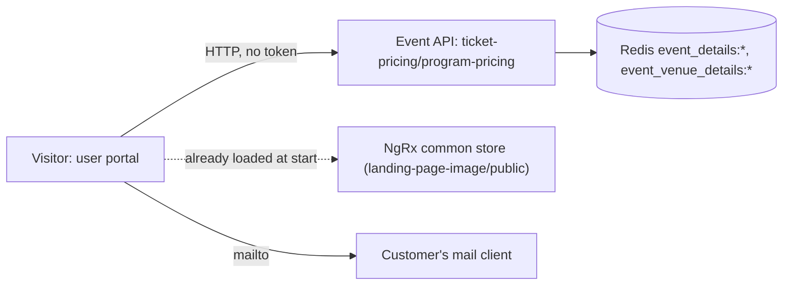

# P-03 · Information pages (pricing, gallery, FAQ, terms, privacy, contact and policies)

> **Bangla name:** তথ্য পাতা (মূল্য তালিকা, গ্যালারি, FAQ, শর্তাবলি, প্রাইভেসি, যোগাযোগ ও নীতিমালা)
>
> [← 20 · User portal](README.md) · [Contents](../README.md) · [Open queries](../99-open-queries.md)

## 1. Name and purpose

**Information pages.** The static-looking pages in the portal footer and menu: **Ticket pricing**, **Gallery**, **FAQ**, **Terms & Conditions**, **Privacy Policy**, **Contact**, **ICC Anti-Racism Code** and **ICC Anti-Discrimination Policy**. Most of them show text or images that staff edit in the admin portal ([A-28](../10-admin-portal/A-28-media-configuration.md), [A-29](../10-admin-portal/A-29-content-editor.md)); the pricing page is computed from the events themselves.

## 2. Trigger and actor

Any visitor, no sign-in. Routes (all under `/{lang}/`): `ticket-pricing`, `gallery`, `faq`, `terms`, `policy`, `contact`, `message-sent`, `icc-anti-racism-code`, `icc-anti-discrimination-code` (`event-routing.module.ts:17-28`).

## 3. Business flow

- **Ticket pricing:** one tab per program; per event, the price of each venue gallery/block/level (the same prices the customer pays, [A-09](../10-admin-portal/A-09-event-level-pricing.md)). A pricing pop-up on the event page ([P-02](P-02-browse-events.md)) shows the same data.
- **Gallery:** image groups in two titled segments.
- **FAQ / Terms / Privacy:** the published entries; Terms and Privacy as formatted text.
- **Contact:** the contact block from the footer record ([A-30](../10-admin-portal/A-30-header-footer-social.md)), an embedded map, and a form that opens the customer's e-mail program.
- **Anti-racism and anti-discrimination:** fixed text inside the portal build.

## 4. Technical flow

1. **Pricing, [HTTP, no token]:** `GET {services.events}/event/api/v1/ticket-pricing/program-pricing` (`EventApiService.getProgramPricing` through the NgRx event store, `loadProgramPricing`). The server (`ProgramPricingManager.GetProgramPricingAsync`) takes all active programs that have not ended, reads each program's cached events (`EventManager.GetEventsAsync(programId)`), reads each event's venue galleries (`GetEventVenueDetailsByEventIdAsync(.., includeZeroCapacity: true)`) and returns one row per level with event, venue, gallery, `ticketType` (`"N/A"`) and `price`. The `?programId=` query parameter of the page URL only selects the tab in the browser.
2. **Gallery, FAQ, Terms, Privacy:** no extra call. They read the published landing-page list that was loaded at start ([P-01](P-01-home-content.md)): gallery images have types `Gallery_Page_Segment_1/_2` (grouped by type, title = type with underscores replaced, two images per row); FAQ = type `FAQ`, question = `title`, answer = `description`, sorted by `displayOrder`; Terms = the single `Terms_Condition` item, Privacy = the single `Privacy_Policy` item (`common.reducer.ts:35-38`).
3. **Terms and Privacy rendering:** the `description` is bound with `[innerHTML]` after `DomSanitizer.bypassSecurityTrustHtml` ("to allow inline styles from the rich text editor"), so the stored HTML is rendered **without** Angular's sanitising (`terms-conditions.component.ts:30-33`, `privacy-policy.component.ts:30-33`). The FAQ and the notice line use Angular's normal binding.
4. **Contact map:** the `Contact_Us` landing-page item's `imageUrl` is used as the `src` of an iframe through `bypassSecurityTrustResourceUrl` (`contact-map.component.ts:43-70`), so staff are expected to paste a map embed URL there. The contact details (phone, e-mail, address) come from the header/footer record (`selectContactInfo`).
5. **Contact form:** `ContactFormComponent.onSubmit` builds a `mailto:contact@reliefvalidation.com.bd?...` link and opens it (`window.open(.., '_self')`). **No request is sent to any server**; the route `message-sent` is a static thank-you page.
6. The two ICC policy pages are static HTML in the portal source.

## 5. Components

| Kind | Component |
|---|---|
| Client | `events/pages/{ticket-pricing,gallery,faq,terms-conditions,privacy-policy,contact,message-sent,anti-racism-code,anti-discrimination-policy}`, `events/components/{contact-form,contact-map}` |
| Service | Event (`TicketPricingController`, `ProgramPricingManager`, `EventManager`, `LandingPageImageController`) |
| Tables | `Programs`, `Events`, `EventVenueDetails`, `LandingPageImages`, `HeaderFooters` |
| Redis | `event_details:*`, `event_venue_details:*`, `landing_page_image_published:list` |

## 6. API contracts

| Method | Path | Auth | Response |
|---|---|---|---|
| GET | `/event/api/v1/ticket-pricing/program-pricing` | none | `ProgramPricingResponse[]` (per program: events with gallery, block, level, `ticketType`, `price`) |
| GET | `/event/api/v1/landing-page-image/public` | anonymous | see [P-01](P-01-home-content.md) |

Query parameters `programId` and `eventId` exist on `program-pricing` but the portal sends none. Primary sample, one level row inside a program of `GET /event/api/v1/ticket-pricing/program-pricing` (names from `EventPricingData`; values illustrative):

```json
{ "eventId": 2, "eventName": "1st ODI, Mirpur", "venueId": 1, "venueName": "Sher-e-Bangla National Cricket Stadium",
  "galleryName": "Pavilion", "ticketType": "N/A", "price": 1500 }
```

## 7. Data and side effects

Read only. The mail form leaves the system (the customer's mail client).

## 8. Code references

| What | Where |
|---|---|
| Routes | `rvl-gobcb-user-portal/ETP-Web/src/app/modules/featured/events/event-routing.module.ts:17-28` |
| Pricing page | `.../events/pages/ticket-pricing/ticket-pricing.component.ts:36-85`; store `core/modules/events/store/event.effects.ts:36-45` |
| Terms / Privacy | `.../events/pages/terms-conditions/terms-conditions.component.ts:20-36`; `.../privacy-policy/privacy-policy.component.ts` |
| Contact | `.../events/components/contact-form/contact-form.component.ts:30-37`; `.../contact-map/contact-map.component.ts:36-75` |
| Server | `rvl-gobcb-backend/Services/Event/ETP.Event.Service/Api/TicketPricingController.cs:27-52`; `.../ETP.Event.Domain/Managers/ProgramPricingManager.cs:25-120` |

## 9. Handover notes

1. **The pricing page does not use the "ticket pricing content" that staff edit in [A-14](../10-admin-portal/A-14-ticket-pricing-content.md).** The portal calls `program-pricing` (live prices from the events). `EventApiService.getTicketPricingList` (the `ticket-pricing/list` call that reads the A-14 Redis list) has no caller in the portal. Whether the user app reads A-14 content is checked in [U-03](../30-user-app/U-03-info-pages.md) `[UNCONFIRMED: Q-35]`.
2. **Stored HTML is trusted.** Terms and Privacy are rendered with `bypassSecurityTrustHtml`; the Admin service does not sanitise the text on save ([A-29](../10-admin-portal/A-29-content-editor.md) note 3). Anyone who can write a `LandingPageImages` row (admin and event-manager roles) can therefore run script in every visitor's browser `[UNCONFIRMED: Q-33]`.
3. **The map URL is also trusted.** `Contact_Us.imageUrl` becomes an iframe `src` through `bypassSecurityTrustResourceUrl`, so it can point to any site.
4. **The contact form depends on the visitor having a mail program** (`mailto:`); there is no server-side contact message and no "message-sent" confirmation from a real submission (the page is only a static route).
5. **`program-pricing` does heavy work per request:** for every program, event and level it calls cached managers; there is no response cache of its own. It also says `ticketType: "N/A"` for every level.
6. **Level prices shown here are venue-detail prices**, i.e. before system discount, promo code and VAT/service charge, which are added in [P-04](P-04-seat-selection.md) and [P-06](P-06-booking-payment.md).
7. **Translation:** page chrome is translated with `ngx-translate`, but the staff-edited text (FAQ, Terms, Privacy, notices) exists once and is shown in every language ([P-13](P-13-language-switch.md)).

## 10. Component relationships



**Depends on:** [P-01](P-01-home-content.md), [A-09](../10-admin-portal/A-09-event-level-pricing.md), [A-28](../10-admin-portal/A-28-media-configuration.md), [A-29](../10-admin-portal/A-29-content-editor.md), [A-30](../10-admin-portal/A-30-header-footer-social.md). **Affects:** nothing downstream.

## 11. Developer test guide

**Local testability: Full.**

| Item | Detail |
|---|---|
| Test data and accounts | Anonymous; seeded FAQ, notice, hero and sponsors rows (no Terms/Privacy row is mentioned in the seed list, create one in [A-29](../10-admin-portal/A-29-content-editor.md)) |
| Browser | `http://localhost:4201/en/ticket-pricing`, `/en/faq`, `/en/terms`, `/en/policy`, `/en/gallery`, `/en/contact` |
| Emulator | — (see [U-03](../30-user-app/U-03-info-pages.md)) |
| Postman | `postman/services/etp-event.postman_collection.json`: "GET /api/v1/ticket-pricing/program-pricing", "GET /api/v1/ticket-pricing/list", "GET /api/v1/landing-page-image/public" |
| Visual Studio debug | `ProgramPricingManager.GetProgramPricingAsync` |
| Verify | Edit a FAQ entry in [A-29](../10-admin-portal/A-29-content-editor.md) and reload `/en/faq`; compare the pricing page with `EventVenueDetails` prices |
