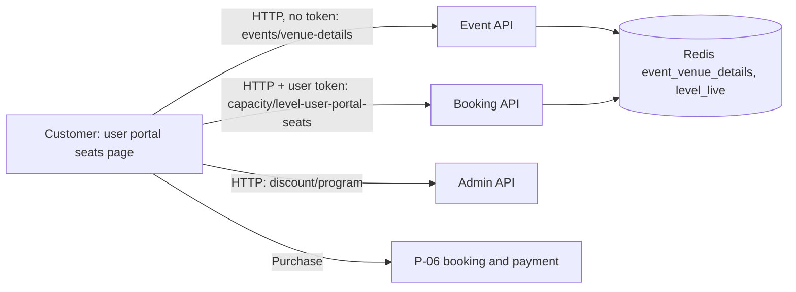

# P-04 · Seat and ticket selection

> **Bangla name:** আসন ও টিকিট নির্বাচন
>
> [← 20 · User portal](README.md) · [Contents](../README.md) · [Open queries](../99-open-queries.md)

## 1. Name and purpose

**Seat selection.** After pressing **Buy tickets** ([P-02](P-02-browse-events.md)) the signed-in customer chooses *where* to sit and *how many* tickets to buy: gallery → block → level (or row), on a stadium SVG map; the number of tickets; the exact seats when the level has numbered seats; optionally the name and phone of each ticket holder; and sees a live price preview with VAT, service charge, system discount and promo code ([P-05](P-05-apply-promo-code.md)). The page ends with the **Purchase** button, which is the start of [P-06](P-06-booking-payment.md).

## 2. Trigger and actor

Signed-in customer (User pool). Route `/{lang}/tickets/{eventId}/seats`, protected by `AuthGuard` (local flag only, [X-10](../60-cross-cutting/X-10-user-session.md)) and by a route resolver (`VenueDetailsResolverService`).

## 3. Business flow

1. The page opens with the venue map. Only events whose status is `Available` or `LimitedAvailability` open; any other status sends the customer back to the home page.
2. The customer picks a gallery, then a block, then a level (a row for seated levels). The map highlights the choice; the first seat-mapped block and level are preselected.
3. The customer picks the number of tickets (1 up to the live capacity of the level). For a seated level the portal proposes the first *n* free seats in seat order and lets the customer change them in a seat dialog (cannot pick more or fewer than *n*).
4. Optional holder names (letters and spaces, at most 17 characters) and 11-digit phone numbers for each ticket.
5. The price box shows subtotal, VAT, service charge, system discount, promo discount and total. Changing gallery, block or level resets the promo code and discount.
6. **Purchase** opens the confirmation pop-up of [P-06](P-06-booking-payment.md).

## 4. Technical flow

1. **[HTTP, no token]** Route resolver: `GET {services.events}/event/api/v1/events/venue-details/{eventId}` (`EventApiService.getVenueDetailsByEventId`, Event service). The answer is the event with its venue, SVG file, galleries → blocks → levels (each with `pricePerSeat`, `svgKey`, `isSeatMapped`, `hasSeats`, live `availableCapacity`) and `eventSettings` (VAT, service charge, VAT-inclusive flag, limits). If `availabilityStatus` is not `Available`/`LimitedAvailability` the resolver navigates home; if the session is gone (`No current user`) it signs out and goes to login. The server builds this from the cached `event_venue_details:{id}` and replaces each level's capacity with the live Redis value (`GetLevelLiveCapacity`).
2. The venue SVG is loaded and drawn by `SvgRenderService`; `updateView(key)` colours the map by splitting the selected key on `_` (1 to 3 parts).
3. **[HTTP + user token]** For a seated level: `GET {services.bookings}/booking/api/v1/capacity/level-user-portal-seats?eventId={Events.Id}&galleryId=&blockId=&levelId=` (`BookingApiService.getAvailableSeats`). The server (`CapacityManager.GetLevelUserPortalSeats`) returns two comma-separated strings: `total` (all seat names of the level) and `available` (the live free seats, Redis hash `level_live:*`/seat sets, [X-25](../60-cross-cutting/X-25-redis.md)). The portal sorts by letter then number and marks unavailable seats.
4. **[HTTP, no token]** System discount: `GET {services.tickets}/admin/api/v1/discount/program/{programId}/{eventId}/{galleryId}` (`BookingApiService.getDiscount`, Admin service, `[AllowAnonymous]`); a result with `discountValue` and `discountType` (`Percentage` or fixed) is applied to the preview. The server applies its own discount again when the order is created ([P-06](P-06-booking-payment.md)).
5. Preview price (browser only): `calculateTotal = subtotal + previewVat + serviceCharge − systemDiscount − promoDiscount` (`stadium-seat-page.component.ts`); VAT and service charge follow the event settings (percentage or fixed per ticket).
6. **Purchase** builds `TicketPurchase { eventId, galleryId, blockId, levelId, numberOfSeats, pricePerSeat, hasSeats, seats ("A1,A2"), promoCode, totalCharge, vat, bookedUserDetails[] }` and opens `CompletePaymentModalComponent`.

## 5. Components

| Kind | Component |
|---|---|
| Client | `tickets/pages/stadium-seat-page`, `tickets/resolvers/venue-details.resolver.service.ts`, `shared` `SvgRenderService`, seat dialog template |
| Services | Event (`EventsController.GetEventVenueDetailsAsync`); Booking (`CapacityController`); Admin (`DiscountController`) |
| Tables | `EventVenueDetails`, `Capacities`, `Discounts` |
| Redis | `event_venue_details:{id}`; hash `capacity` fields `level_live:*`, `level_live_seats:*`, key `level_database_seats:*` ([X-25](../60-cross-cutting/X-25-redis.md)) |

## 6. API contracts

| Method | Path | Auth | Request | Response |
|---|---|---|---|---|
| GET | `/event/api/v1/events/venue-details/{eventId}` | none | public GUID | `Event` with `venue.venueGalleries[].galleryBlocks[].blockLevels[]`, `eventSettings` |
| GET | `/booking/api/v1/capacity/level-user-portal-seats` | none on the server (portal sends the token) | `eventId` (long), `galleryId`, `blockId`, `levelId` | `{ total, available }` |
| GET | `/admin/api/v1/discount/program/{programId}/{eventId}/{galleryId}` | anonymous | path | discount or empty |

Primary sample, `GET /booking/api/v1/capacity/level-user-portal-seats?eventId=2&galleryId=5&blockId=11&levelId=31` (values illustrative):

```json
{ "total": "A1,A2,A3,A4,B1,B2", "available": "A1,A3,A4,B2" }
```

## 7. Data and side effects

Read only. **Nothing is reserved** while the customer chooses; the seats are checked and locked only when the order is created ([P-06](P-06-booking-payment.md)).

## 8. Code references

| What | Where |
|---|---|
| Page | `rvl-gobcb-user-portal/ETP-Web/src/app/modules/featured/tickets/pages/stadium-seat-page/stadium-seat-page.component.ts:78-135, 300-395, 470-545` |
| Resolver | `rvl-gobcb-user-portal/ETP-Web/src/app/modules/featured/tickets/resolvers/venue-details.resolver.service.ts:18-48` |
| API | `rvl-gobcb-user-portal/ETP-Web/src/app/modules/core/services/api/booking-api.service.ts:63-80, 137-140, 176-185` |
| Server | `rvl-gobcb-backend/Services/Booking/ETP.Booking.Service/Api/CapacityController.cs:54-66`; `.../ETP.Booking.Domain/Managers/CapacityManager.cs:352-362`; `rvl-gobcb-backend/Services/Event/ETP.Event.Domain/Managers/EventManager.cs:391-470` |

## 9. Handover notes

1. **Prices in the page are a preview.** The server ignores the `pricePerSeat`, `totalCharge` and `vat` sent by the portal (it only requires them to be positive) and recomputes everything from the event settings, the level price, the system discount and the promo code ([P-06](P-06-booking-payment.md)). If the portal formula and the server formula differ, the customer sees one amount and is charged another; compare both when changing VAT or discount rules.
2. **No reservation during selection.** Two customers can choose the same seat; the later order fails with `Unavailable seats: ...` ([P-06](P-06-booking-payment.md) note 4).
3. **The ticket-count list can be very long.** `seatOptions` offers 1 to the level's live capacity; the limit `AllowableMaximumSeatPerOrder` is enforced only by the server, so a customer can pick a number that is refused at purchase.
4. **Seat proposal is simply the first free seats**, not the best or consecutive ones.
5. **The seat list and the discount lookup are anonymous endpoints.** The seat call goes through the token interceptor (the URL is under `booking`), the discount call may not carry a token depending on the host settings; both work without one ([X-18](../60-cross-cutting/X-18-endpoints-without-auth.md)).
6. **Holder names and phones are validated only in the browser** (letters/spaces ≤ 17, 11 digits); the server stores whatever it receives in `BookedUserRecords`. These values are later written on tickets, and the holder can still edit them before generation ([P-09](P-09-ticket-details-downloads.md)).
7. **`eventsVenueDetails/get-level` is unused:** `BookingApiService.getGalleryInformation` calls an Admin endpoint that needs staff roles, but nothing calls the method.

## 10. Component relationships



**Depends on:** [P-02](P-02-browse-events.md), [A-09](../10-admin-portal/A-09-event-level-pricing.md), [A-10](../10-admin-portal/A-10-capacity-adjustment.md), [A-11](../10-admin-portal/A-11-seat-reservation.md), [A-16](../10-admin-portal/A-16-discounts.md), [S-01](../50-system-initiated/S-01-level-capacity-update.md). **Affects:** [P-05](P-05-apply-promo-code.md), [P-06](P-06-booking-payment.md).

## 11. Developer test guide

**Local testability: Full** for browsing and the preview; the final payment is not possible locally ([P-06](P-06-booking-payment.md)).

| Item | Detail |
|---|---|
| Test data and accounts | User `+8801700000011` / `Passw0rd!23` (profile complete); the **1st ODI at Mirpur** is on sale; the Pavilion has an active early-bird discount (10 %) |
| Browser | `http://localhost:4201/en/events` → 1st ODI → **Buy tickets**; Network: `venue-details`, `level-user-portal-seats`, `discount/program` |
| Emulator | — (the app does the same in [U-04](../30-user-app/U-04-seat-selection-promo.md); mobile apps cannot sign in locally) |
| Postman | `postman/services/etp-event.postman_collection.json`: "GET /api/v1/events/venue-details/{eventId}"; `etp-booking`: "GET /api/v1/capacity/level-user-portal-seats"; `etp-admin`: "GET /api/v1/discount/program/{programId}/{eventId}/{galleryId}" |
| Visual Studio debug | `CapacityManager.GetLevelUserPortalSeats`, `EventManager.GetEventVenueDetailsByEventIdAsync` |
| Verify | `redis-cli HGETALL capacity` (fields `level_live:{e}_{g}_{b}_{l}` and `level_live_seats:{e}_{g}_{b}_{l}`); compare the page's seat list with the `total`/`available` response |
