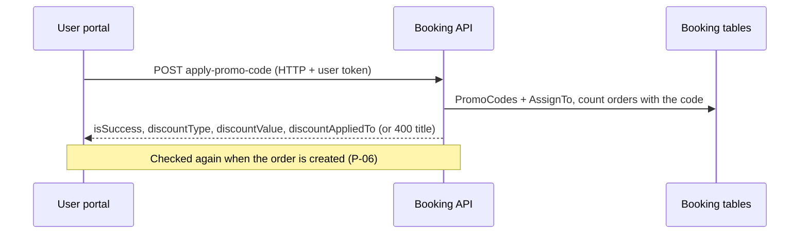

# P-05 · Apply promo code

> **Bangla name:** প্রোমো কোড প্রয়োগ
>
> [← 20 · User portal](README.md) · [Contents](../README.md) · [Open queries](../99-open-queries.md)

## 1. Name and purpose

**Apply promo code.** On the seat-selection page ([P-04](P-04-seat-selection.md)) the customer types a promo code and presses **Apply**. The server checks that the code is valid for this customer, program, event and gallery, and the page shows the discount in the price preview. The codes themselves are created by staff ([A-15](../10-admin-portal/A-15-promo-codes.md)).

## 2. Trigger and actor

Signed-in customer on `/{lang}/tickets/{eventId}/seats`.

## 3. Business flow

1. Type the code (spaces cannot be typed, `preventSpace`) and press **Apply**.
2. Success: the discount (percentage or fixed amount) is subtracted in the price box and the code is shown as applied; **Remove** clears it.
3. Failure: one message under the box: "invalid", or "expired" when the server says the code has expired. Every other reason (not started, usage limit, per-user limit, wrong program/event/gallery) shows the same "invalid" message.
4. Changing the gallery, block or level clears the code.
5. The code is only *checked* here. It is counted as used when the order is paid ([P-06](P-06-booking-payment.md)).

## 4. Technical flow

1. **[HTTP + user token]** `POST {services.bookings}/booking/api/v1/user-booking-order/apply-promo-code` with `{promoCode, programId, eventId (public GUID), galleryId}` (`BookingApiService.applyPromoCode`; server `[Authorize(Policy = User)]`).
2. `UserBookingOrderManager.ValidateApplyPromoCodeAsync`:
   1. an empty code → `Invalid promo code. Please enter a valid code.`;
   2. `promoCodeRepository.GetByCodeAsync(code.Trim(), eventId)` (exact, case-sensitive code match on non-deleted rows that are assigned to the event); none → the same message;
   3. now before `StartDateTime` → `This promo code is not active yet.`; after `EndDateTime` → `This promo code has expired. Please use a valid code.`;
   4. usage: orders that carry the code and have status `Paid`, `Requested` or `Generated` are counted; total ≥ `TotalUsageLimit` → `This code has reached its usage limit and is no longer valid.`; this user's count ≥ `LimitPerUser` → `You have already used this promo code the maximum allowed times.`;
   5. eligibility through `AssignTo` rows: the program must be assigned, then the event (an empty event list means all events), then the gallery (an empty gallery list means all galleries) → `This promo code is not applicable to the selected program/event/gallery.`;
   6. success returns `{ isSuccess: true, discountType, discountValue, discountAppliedTo }`.
3. Every failure is an `ArgumentException`; the exception filter turns it into HTTP 400 with a problem-details body whose `title` is the message. The portal reads `error.error.title` and maps text containing "not active" or "expired" to translation keys (`stadium-seat-page.component.ts:545-565`).
4. The preview discount uses `discountAppliedTo`: `BasePrice` (percentage of the base price) or `DiscountedPrice` (percentage of the price after the system discount); `discountType` is `Percentage` or `FixedAmount`.
5. **Purchase repeats the whole check.** `CreateAsync` calls `ValidateApplyPromoCodeAsync` again and computes the promo discount itself ([P-06](P-06-booking-payment.md)); if the code is no longer valid the exception is not caught and the order is refused with the same message (see note 3).

## 5. Components

| Kind | Component |
|---|---|
| Client | `tickets/pages/stadium-seat-page` (`applyPromoCode`, `removePromoCode`), `booking-api.service.ts:63-73` |
| Service | Booking (`UserBookingOrderController.ApplyPromoCode`, `UserBookingOrderManager`, `PromoCodeRepository`) |
| Tables | `PromoCodes`, `PromoCodeAssignments` (events, galleries), `UserBookingOrders` (usage count) |
| Cache | none |

## 6. API contracts

| Method | Path | Auth | Request | Response | Main errors |
|---|---|---|---|---|---|
| POST | `/booking/api/v1/user-booking-order/apply-promo-code` | User | `ApplyPromoCodeRequest` | `ApplyPromoCodeResponse` | 400 with the messages above |

Primary sample, request and success response (names from `ApplyPromoCodeRequest` / `ApplyPromoCodeResponse`; values from the local seed code `BCBWELCOME10` for the 2nd ODI Pavilion):

```json
{ "promoCode": "BCBWELCOME10", "programId": 1, "eventId": "9f0b2c1e-3b0e-4a43-9d5e-6f5f3d0c1a11", "galleryId": 5 }
```

```json
{ "isSuccess": true, "discountType": "Percentage", "discountValue": 10, "discountAppliedTo": "BasePrice" }
```

Failure example (HTTP 400): `{ "title": "This promo code has expired. Please use a valid code.", "status": 400 }`.

## 7. Data and side effects

None; a check only. The usage counters are derived by counting orders, not stored on the code ([S-16](../50-system-initiated/S-16-promo-code-status.md) note on counting).

## 8. Code references

| What | Where |
|---|---|
| Portal call | `rvl-gobcb-user-portal/ETP-Web/src/app/modules/core/services/api/booking-api.service.ts:63-73` |
| Portal page | `rvl-gobcb-user-portal/ETP-Web/src/app/modules/featured/tickets/pages/stadium-seat-page/stadium-seat-page.component.ts:519-566` |
| Controller | `rvl-gobcb-backend/Services/Booking/ETP.Booking.Service/Api/UserBookingOrderController.cs:443-453` |
| Manager | `rvl-gobcb-backend/Services/Booking/ETP.Booking.Domain/Managers/UserBookingOrderManager.cs:1135-1193` |
| Repository | `rvl-gobcb-backend/Services/Booking/ETP.Booking.Storage/Repositories/PromoCodeRepository.cs:13-35` |

## 9. Handover notes

1. **The code is not "used" at apply time.** Two customers can apply the last remaining use at the same time; whoever is counted as `Paid`/`Requested`/`Generated` first wins, and the other's purchase is refused at the second check.
2. **Pending orders do not count.** Orders still `Pending` (not yet paid) are not counted against the limits, so the limits can be exceeded while payments are in flight.
3. **A refused purchase still holds the seats for a while.** In `CreateAsync` the seats are locked in Redis (`BookLevelCapacity`, 12-minute lock) *before* the promo code is validated; if the code is rejected at that moment the order is not created but the lock stays until it expires after 12 minutes, so those seats look unavailable to others for that time `[UNCONFIRMED: Q-37]`. The recomputed discount can also differ from the preview ([P-04](P-04-seat-selection.md) note 1).
4. **Case-sensitive, exact match.** `bcbwelcome10` does not match `BCBWELCOME10`.
5. **The "active" flag of a code is not part of the check;** only the start and end dates are used ([S-16](../50-system-initiated/S-16-promo-code-status.md)); a promo code that staff unpublish in the admin portal still works until it is deleted or expires `[UNCONFIRMED: Q-18]`.
6. **The portal hides the reason** for usage-limit and per-user-limit refusals (it shows "invalid" for them), although the server returns precise messages.

## 10. Component relationships



**Depends on:** [A-15](../10-admin-portal/A-15-promo-codes.md), [P-04](P-04-seat-selection.md). **Affects:** [P-06](P-06-booking-payment.md), [A-22](../10-admin-portal/A-22-reports.md) (promo usage in reports).

## 11. Developer test guide

**Local testability: Full.**

| Item | Detail |
|---|---|
| Test data and accounts | User `+8801700000011` / `Passw0rd!23`; seeded codes `BCBWELCOME10` (2nd ODI Pavilion), `BPLFLAT100`, `OLDCODE` (expired) |
| Browser | `http://localhost:4201/en/events` → 2nd ODI → seats → Pavilion → code `BCBWELCOME10` → **Apply**; Network: `apply-promo-code` (200 or 400) |
| Emulator | — (see [U-04](../30-user-app/U-04-seat-selection-promo.md)) |
| Postman | `postman/services/etp-booking.postman_collection.json`: "POST /api/v1/user-booking-order/apply-promo-code" (token `{{access_token_user}}` from `etp-login-all-pools`) |
| Visual Studio debug | `UserBookingOrderManager.ValidateApplyPromoCodeAsync` (Booking service from the Aspire AppHost) |
| Verify | SQL: `select "Code","StartDateTime","EndDateTime","TotalUsageLimit","LimitPerUser" from etp."PromoCodes"`; count: `select count(*) from etp."UserBookingOrders" where "PromoCode"='BCBWELCOME10' and "Status" in (...)` |
