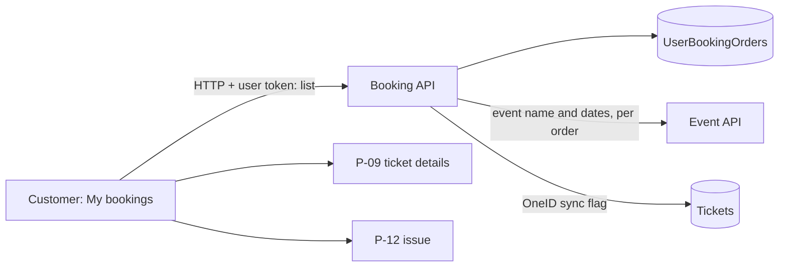

# P-07 · My bookings

> **Bangla name:** আমার বুকিং
>
> [← 20 · User portal](README.md) · [Contents](../README.md) · [Open queries](../99-open-queries.md)

## 1. Name and purpose

**My bookings.** The signed-in customer's list of orders: event, event date, order number, booking date, status (`Pending`, `Paid`, `Requested`, `Generated`, `Cancelled`), seat count and, for OneID customers, the OneID sync state ([P-10](P-10-oneid-ticket-sync.md)). From a row the customer opens the ticket page ([P-09](P-09-ticket-details-downloads.md)), the payment invoice, or the issue screen ([P-12](P-12-issues-chat.md)). This is also the landing page after payment ([P-06](P-06-booking-payment.md)).

## 2. Trigger and actor

Signed-in customer. Route `/{lang}/tickets` (`AllBookingsPageComponent`, `AuthGuard`). Reached from the header menu and after the DgePay redirect.

## 3. Business flow

1. Two tables (mobile: cards): **Upcoming** (events that have not ended) and **All**, both sorted by booking date, newest first, with paging and column sorting in the browser.
2. A `Paid`, `Requested` or `Generated` order shows an active **View details** button and an **Invoice** button; a `Cancelled` or `Pending` order shows a disabled button.
3. **Report an issue** goes to the issue screen of the order: the existing issue if there is one, otherwise the form ([P-12](P-12-issues-chat.md)).

## 4. Technical flow

1. **[HTTP + user token]** `GET {services.bookings}/booking/api/v1/user-booking-order/list?page=0&pageSize=50&sortOrder=Descending` (`BookingApiService.getAllbookings`; the portal always asks for the first 50). The server (`UserBookingOrderManager.GetAllByUser`) reads the caller's orders (`FindByUserId(User.GetId(), page, pageSize, sortOrder)`), then, **one by one**, asks the Event service for the event name and dates, and adds the OneID sync flag from the tickets (`GetOneIdSyncStatusAsync`).
2. The browser maps each item to a table row (`id` = order public id, `eventName`, `eventDate`, `bookingId` = order number, `status`, `quantity`, `eventEndDate`, `oneIdSync`, `oneIdUserId`); the **Upcoming** table is the rows whose `eventEndDate` is in the future; a **sync status** column appears when any row has a `oneIdUserId`.
3. View details → `/{lang}/tickets/ticket-details/{publicId}`; Invoice → `/{lang}/tickets/payment-invoice/{publicId}` (both use `BookingDetailsComponent`, which loads `GET /ticketing/api/v1/booking-order-ticket/details?publicId=`, [P-09](P-09-ticket-details-downloads.md)).
4. Report an issue → `GET /userissue/api/v1/user-issue/user-detail/{orderId}`; a 400 with title `User issue not found` means "no issue yet" and opens the form ([P-12](P-12-issues-chat.md)).

## 5. Components

| Kind | Component |
|---|---|
| Client | `tickets/pages/all-bookings-page`, `tickets/pages/booking-details`, `booking-api.service.ts:44-48` |
| Services | Booking (`UserBookingOrderController.GetAllOrders`, `UserBookingOrderManager.GetAllByUser`); Event (event name and dates) |
| Tables | `UserBookingOrders`, Ticketing `Tickets` (OneID flag) |

## 6. API contracts

| Method | Path | Auth | Request | Response |
|---|---|---|---|---|
| GET | `/booking/api/v1/user-booking-order/list` | User | `page`, `pageSize`, `sortOrder` (`Ascending`/`Descending`) | paged `UserBooking` (`items[]`, paging fields) |

Primary sample (one item of `items`; property names from the portal's `Booking` model; values illustrative):

```json
{ "publicId": "5b1f7a64-6c1e-4c0a-8f6e-0f3d2f9a7b10", "orderNumber": "BDI7K2M9Q", "eventName": "1st ODI, Mirpur",
  "eventStartDateTime": "2026-12-10T08:00:00Z", "eventEndDateTime": "2026-12-10T16:00:00Z",
  "createdAt": "2026-12-01T09:30:00Z", "status": "Paid", "numberOfSeats": 2,
  "oneIdUserId": null, "oneIdSync": false }
```

## 7. Data and side effects

Read only.

## 8. Code references

| What | Where |
|---|---|
| Page | `rvl-gobcb-user-portal/ETP-Web/src/app/modules/featured/tickets/pages/all-bookings-page/all-bookings-page.component.ts:97-140, 200-235` |
| Template | `.../all-bookings-page/all-bookings-page.component.html:61-130` |
| API | `rvl-gobcb-user-portal/ETP-Web/src/app/modules/core/services/api/booking-api.service.ts:44-48` |
| Controller / manager | `rvl-gobcb-backend/Services/Booking/ETP.Booking.Service/Api/UserBookingOrderController.cs:298-306`; `.../UserBookingOrderManager.cs:764-809` |

## 9. Handover notes

1. **Only the newest 50 orders are shown**, whatever the paging controls say: the portal requests `page=0&pageSize=50` once and pages in the browser.
2. **One event lookup per order (up to 50 calls)** run one after another (the parallel version was commented out because of `DbContext` threading problems). The list gets slower as customers accumulate orders.
3. **Order-status display is a raw string.** The status text comes from the server enum; `Failed` is a server status but the portal model (`BookingStatus`) has no `Failed`, so such a row shows the default grey badge and no action buttons.
4. **A `Pending` order has no "Pay now"**: the regenerate-payment endpoint is commented out ([P-06](P-06-booking-payment.md) note 7).
5. **The "Upcoming" filter uses the browser clock** and the event end time.
6. **OneID flag is computed twice** in `GetAllByUser` (two identical calls to `GetOneIdSyncStatusAsync`); harmless but wasteful.

## 10. Component relationships



**Depends on:** [P-06](P-06-booking-payment.md). **Affects:** [P-09](P-09-ticket-details-downloads.md), [P-10](P-10-oneid-ticket-sync.md), [P-12](P-12-issues-chat.md).

## 11. Developer test guide

**Local testability: Full** (nine seeded orders for `+8801700000011`).

| Item | Detail |
|---|---|
| Test data and accounts | User `+8801700000011` / `Passw0rd!23`; statuses Paid ×6, Pending, Failed, Cancelled |
| Browser | `http://localhost:4201/en/tickets`; Network: `user-booking-order/list` |
| Emulator | — (see [U-06](../30-user-app/U-06-my-bookings-tickets.md)) |
| Postman | `postman/services/etp-booking.postman_collection.json`: "GET /api/v1/user-booking-order/list" (token `{{access_token_user}}`) |
| Visual Studio debug | `UserBookingOrderManager.GetAllByUser` |
| Verify | SQL: `select "OrderNumber","Status","NumberOfSeats","CreatedAt" from etp."UserBookingOrders" where "UserId"=...` |
