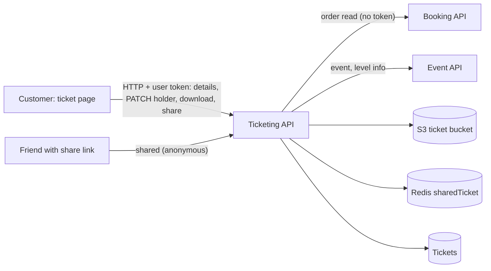

# P-09 · Ticket details, holder information, download, share and invoice

> **Bangla name:** টিকিটের বিস্তারিত, ধারকের তথ্য, ডাউনলোড, শেয়ার ও ইনভয়েস
>
> [← 20 · User portal](README.md) · [Contents](../README.md) · [Open queries](../99-open-queries.md)

## 1. Name and purpose

**Ticket page.** For a paid order the customer sees the event, venue and seat details, one card per ticket and the payment summary; fills in each ticket holder's name and phone; and, once the tickets are generated ([P-08](P-08-ticket-generation-request.md)), **downloads** a ticket PDF (or all as a ZIP), **shares** a ticket link, or downloads the **payment invoice**.

## 2. Trigger and actor

Signed-in customer who owns the order. Routes `/{lang}/tickets/ticket-details/{publicId}` and `/{lang}/tickets/payment-invoice/{publicId}` (both `BookingDetailsComponent`; the invoice route only switches the view mode).

## 3. Business flow

1. Open an order from [P-07](P-07-my-bookings.md): event name and times, venue, gallery/block/level, entry gate, ticket cards with the ticket number, seat and the holder form.
2. Before generation: enter the holder name and phone for each ticket and press save (allowed while the order is `Paid` and the ticket is `Active`).
3. After generation: **Download** (single PDF, with the program's back page appended when the layout has one), **Download all** (ZIP, shown for more than one ticket), **Share** (a link, sent through the phone's share sheet or WhatsApp), **Sync with OneID** for OneID customers ([P-10](P-10-oneid-ticket-sync.md)).
4. **Invoice:** a PDF "Ticket Invoice" for the order.

## 4. Technical flow

1. **[HTTP + user token]** Details: `GET {services.tickets}/ticketing/api/v1/booking-order-ticket/details?publicId={id}` (`BookingApiService.getBookedTicketsById`, `[Authorize(User)]`). `TicketManager.GetTicketsInfo`: reads the order from Booking (**[HTTP, no token]**), requires `userOrder.UserId == caller` (`unauthorized_access` otherwise) and status `Paid`, `Requested` or `Generated`; when the order is `Paid` and has **no ticket rows**, creates them now under the lock `create_user_ticket_{id}` (see [P-08](P-08-ticket-generation-request.md) step 1); blanks the ticket URLs in the answer; adds event (`GetEventByIdForTicketing`, so ended or deactivated events still show), level/venue info, payment method and transaction id from the stored payment text, sub-total, discounts, and the *ticket attributes* chosen for the program ([A-03](../10-admin-portal/A-03-program-settings.md)).
2. **Holder information:** `PATCH /ticketing/api/v1/booking-order-ticket` with `{id, ticketHolderName, ticketHolderIdentification}` (`updateTicketHoldersInfo`, `[Authorize(User)]`). `TicketManager.UpdateTicket` loads the ticket and `ValidaUpdateTicket` requires the caller to own the order, the order to be `Paid`, the ticket `Active` (`not_eligible_to_update_ticket`); then stores the trimmed values.
3. **Download one:** `GET .../booking-order-ticket/download?ticketNumber=` (blob). `GetUserTicketStreamAsync` finds the ticket **created by the caller** (`CreatedBy == userId`), requires a `SignedTicketUrl`, reads the signed PDF from the ticket bucket and, if the ticket has a back-page URL, appends the back-page PDF (`MergePdfs`).
4. **Download all:** `GET .../booking-order-ticket/download-all/{orderPublicId}` (blob ZIP named after the event). The manager takes every ticket of the order, adds each (with back page) to a ZIP in memory; if any ticket is not generated it fails with `Ticket is not generated yet.`.
5. **Share:** `GET .../booking-order-ticket/share?ticketNumber=` (text). `ShareTicketAsync` (own tickets only) makes a pre-signed S3 URL valid for `ShareExpiryMinutes`, keeps it in Redis `sharedTicket:{ticketNumber}_{signature}` for the same time and returns `{ShareBase}?ticketNumber=...&signature=...`. The recipient opens that link, which calls the **anonymous** `GET .../booking-order-ticket/shared?ticketNumber&signature`: the manager looks up the Redis key, fetches the PDF through the pre-signed URL, appends the back page and returns it. The portal hands the link to `navigator.share`, or opens `https://api.whatsapp.com/send?text=...` when the browser has no share sheet.
6. **Invoice:** `GET .../booking-order-ticket/download-invoice/{publicId}` (blob). `DownloadInvoiceByPublicId` calls `GetTicketsInfo` (so the same owner check applies), loads the profile (identity API) and the program, and draws the PDF with PdfSharp.
7. **Refresh while waiting:** the page re-reads the details every 30 s while the order is `Requested` ([P-08](P-08-ticket-generation-request.md)).

## 5. Components

| Kind | Component |
|---|---|
| Client | `tickets/pages/booking-details`, `components/{ticket-preview,tickekt-preview-details,ticket-event-details,payment-invoice}`; `booking-api.service.ts:56-135, 168-176` |
| Services | Ticketing (`BookingOrderTicketController`, `TicketManager`, `TicketMediaManager`); Booking (order read); Event (event for ticketing, level info); identity API (invoice) |
| Tables | `Tickets`, Booking `UserBookingOrders`, `BookedUserRecords` |
| Storage | ticket bucket `{SignedBase}` PDFs; layout back page `back-page-ticekt-layout` ([X-20](../60-cross-cutting/X-20-file-storage.md)) |
| Redis | `sharedTicket:{ticketNumber}_{signature}` |

## 6. API contracts

| Method | Path | Auth | Request | Response | Main errors |
|---|---|---|---|---|---|
| GET | `/ticketing/api/v1/booking-order-ticket/details` | User | `publicId` | `UserBookingResponse` | `unauthorized_access` |
| PATCH | `/ticketing/api/v1/booking-order-ticket` | User | `TicketUpdateRequest {id, ticketHolderName, ticketHolderIdentification}` | same | `not_eligible_to_update_ticket`, `unauthorized_access` |
| GET | `/ticketing/api/v1/booking-order-ticket/download` | User | `ticketNumber` | PDF | `Ticket is not generated yet.`, unauthorized |
| GET | `/ticketing/api/v1/booking-order-ticket/download-all/{orderPublicId}` | User | path | ZIP | `Ticket is not generated yet.` |
| GET | `/ticketing/api/v1/booking-order-ticket/share` | User | `ticketNumber` | link text | `Ticket is not genetared yet.` |
| GET | `/ticketing/api/v1/booking-order-ticket/shared` | **anonymous** | `ticketNumber`, `signature` | PDF | `Unauthorized access` (expired or unknown) |
| GET | `/ticketing/api/v1/booking-order-ticket/download-invoice/{publicId}` | User | path | PDF | unauthorized |

Primary sample, `PATCH /ticketing/api/v1/booking-order-ticket` (names from `TicketUpdateRequest`; values illustrative):

```json
{ "id": 301, "ticketHolderName": "Nadia Rahman", "ticketHolderIdentification": "1711111111" }
```

## 7. Data and side effects

Holder fields on `Tickets`; draft ticket rows created on first view of a paid order; Redis share keys; no other writes. The activity log records ticket updates ([X-24](../60-cross-cutting/X-24-activity-logging.md)).

## 8. Code references

| What | Where |
|---|---|
| Portal | `rvl-gobcb-user-portal/ETP-Web/src/app/modules/featured/tickets/components/tickekt-preview-details/ticket-preview-details.component.ts:90-180`; `.../ticket-preview/ticket-preview.component.ts:140-200`; `.../pages/booking-details/booking-details.component.ts:25-42` |
| Controller | `rvl-gobcb-backend/Services/Ticketing/ETP.Ticketing.Service/Api/BookingOrderTicketController.cs:71-108, 346-362, 380-425, 505-519` |
| Manager | `rvl-gobcb-backend/Services/Ticketing/ETP.Ticketing.Domain/Managers/TicketManager.cs:146-257, 1890-1960, 2008-2200` and the stream methods (`GetUserTicketStreamAsync`, `GetUserAllTicketStreamAsync`) |
| Repository | `rvl-gobcb-backend/Services/Ticketing/ETP.Ticketing.Storage/Repositories/TicketRepository.cs:41-55` |

## 9. Handover notes

1. **Download-all has no owner check.** `GetUserAllTicketStreamAsync` reads the tickets by order id only; the controller needs a user token but not the owner. Any signed-in customer who learns another order's public id can download that order's signed tickets (compare `download`, which filters by `CreatedBy`). Add the owner check ([X-18](../60-cross-cutting/X-18-endpoints-without-auth.md)) `[UNCONFIRMED: Q-41]`.
2. **Server-side validation of the holder fields is weak.** `ValidaUpdateTicket` tests the *stored* ticket values (name and phone up to 20 characters), not the values being saved; the request values are only trimmed. The limits are in the browser (name letters/spaces ≤ 17; the details form takes **10 digits** without a leading 0 while the seat page asks for 11 digits, [P-04](P-04-seat-selection.md) note 6).
3. **Viewing creates data.** The first details call of a paid order creates the ticket rows if none exist, so a read path writes to the database (guarded by a Redis lock).
4. **Shared links work for anyone** until they expire; they carry no login, and the pre-signed URL is held in Redis keyed by the signature. If Redis is flushed, all shared links die.
5. **Share text bug.** The portal puts an HTML `<a href>` string into the share text; native share sheets and WhatsApp show it as literal text around the URL.
6. **Misspelling in an error text:** `Ticket is not genetared yet.` (share) is what clients receive.
7. **The ZIP is built in memory** for the whole order; very large orders can use a lot of memory in the Ticketing service.
8. **The back page is merged on every download** (no caching), which costs a layout-bucket read and a PDF merge per request ([A-13](../10-admin-portal/A-13-ticket-layouts.md)).
9. **Ticket bucket naming and the signed cookie** (`ticekt` spelling, CloudFront) apply to the staff screens, not to these customer downloads, which stream through the Ticketing service ([X-20](../60-cross-cutting/X-20-file-storage.md)).

## 10. Component relationships



**Depends on:** [P-06](P-06-booking-payment.md), [P-08](P-08-ticket-generation-request.md), [S-08](../50-system-initiated/S-08-ticket-signing.md). **Affects:** [P-10](P-10-oneid-ticket-sync.md), [C-02](../40-checker-app/C-02-offline-ticket-download.md) (the checker verifies these tickets).

## 11. Developer test guide

**Local testability: Partial.** Seeded orders have ticket rows, but TSP signing is a dummy, so signed-PDF downloads depend on the seed (`docs/local-dev.md`: "the seed supplies the *results*"); holder edit, details and invoice work.

| Item | Detail |
|---|---|
| Test data and accounts | User `+8801700000011` / `Passw0rd!23`; a seeded `Paid` order |
| Browser | `http://localhost:4201/en/tickets` → **View details**; edit a holder; Network: `details`, `booking-order-ticket` PATCH, `download`, `share`, `download-invoice` |
| Emulator | — ([U-06](../30-user-app/U-06-my-bookings-tickets.md)) |
| Postman | `postman/services/etp-ticketing.postman_collection.json`: "GET /api/v1/booking-order-ticket/details", "PATCH /api/v1/booking-order-ticket", "GET /api/v1/booking-order-ticket/download", "GET /api/v1/booking-order-ticket/download-all/{orderPublicId}", "GET /api/v1/booking-order-ticket/share", "GET /api/v1/booking-order-ticket/shared", "GET /api/v1/booking-order-ticket/download-invoice/{publicId}" |
| Visual Studio debug | `TicketManager.GetTicketsInfo`, `UpdateTicket`, `ShareTicketAsync`, `DownloadSharedTicketAsync` |
| Verify | SQL: `select "TicketNumber","Status","TicketHolderName","TicketHolderIdentification","SignedTicketUrl" from etp."Tickets" where "BookingOrderPublicId"=...`; `redis-cli KEYS 'sharedTicket:*'` |
